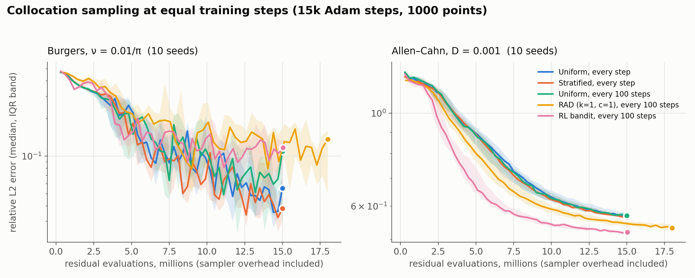
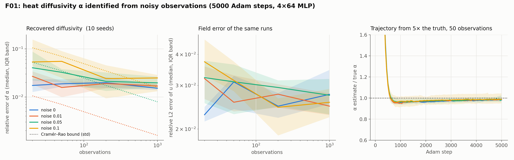

# Benchmarks

`pinnrl-benchmark` has two parts: classical baselines, so PINN accuracy has a reference point, and a multi-seed study that compares collocation samplers fairly. Every number below can be reproduced with the commands shown.

## Classical baselines

```bash
pinnrl-benchmark fdm --pde heat     # explicit finite differences, periodic 1-D heat
pinnrl-benchmark fdm --pde wave     # leap-frog, periodic 1-D travelling wave
```

Both report the relative L2 error at the final time against the analytical solution, plus the maximum error and the wall time. On the default heat problem ($\alpha = 0.1$, $u_0 = \sin 2\pi x$, 101 points), the explicit scheme reaches a relative L2 error of about $7 \times 10^{-4}$ in about 30 ms. The convergence is second order: doubling the points at a fixed diffusion number cuts the error about four-fold. That's the bar a PINN is measured against on forward problems.

## Reference solutions

When there is no closed form, PINNs are scored against high-accuracy numerical references (`pinnrl.benchmarks.reference`):

| Reference | Method | Verification |
|---|---|---|
| `burgers_reference` | Cole–Hopf integral evaluated by a log-sum-exp trapezoid rule | Reproduces Basdevant et al. (1986): $u_x(0, 1.6037/\pi) = -152.00516$ for $\nu = 0.01/\pi$; agrees with a fine finite-difference solve to $7 \times 10^{-5}$ |
| `allen_cahn_reference` | Second-order finite differences plus adaptive Runge–Kutta (method of lines) on a grid 8× finer than the output | Grid-converged: doubling the solver grid changes the field by less than $10^{-5}$ (relative) |

## Sampling study (experiments B01 and B06)

```bash
pinnrl-benchmark sampling --seeds 10 --steps 15000 --checkpoints 50 --workers 4
```

**Setup:**
- The Burgers ($\nu = 0.01/\pi$) and Allen–Cahn ($u_t = 0.001\,u_{xx} + 5(u - u^3)$, $u_0 = x^2\cos\pi x$) benchmarks.
- A tanh MLP (4 × 64) trained for 15,000 Adam steps on 1,000 points, with 10 paired seeds (identical initial weights across samplers).
- Five samplers:
  - uniform and stratified, with fresh points every step;
  - uniform refreshed every 100 steps, a control for how often points change;
  - RAD (k = 1, c = 1) and the RL bandit, also every 100 steps.
- Each run records the relative L2 error and the residual evaluations spent, including the sampler's own (RAD +20 %, bandit +0.3 %). Samplers are compared at equal steps (B01) and at equal total evaluations (B06).



| PDE | Sampler | Rel. L2, equal steps | vs uniform (paired) | Rel. L2, equal evaluations | vs uniform |
|---|---|---|---|---|---|
| Burgers | uniform | 0.055 | – | 0.055 | – |
| | stratified | 0.038 | 6/10, p = 0.63 | 0.038 | 6/10, p = 0.63 |
| | RAD | 0.136 | 3/10, p = 0.11 | 0.090 | 2/10, p = 0.06 |
| | RL bandit | 0.117 | 1/10, p = 0.06 | 0.105 | 2/10, **p = 0.01 (worse)** |
| Allen–Cahn | uniform | 0.568 | – | 0.568 | – |
| | RAD | 0.533 | **10/10, p = 0.002** | 0.547 | **10/10, p = 0.002** |
| | RL bandit | 0.520 | **10/10, p = 0.002** | 0.518 | **10/10, p = 0.002** |

Errors are medians over 10 seeds; "6/10" counts the seeds on which the sampler beat uniform; p is from a Wilcoxon signed-rank test.

**What this says:**

- **Burgers.** No sampler is significantly better than uniform. Seed-to-seed variation (6×) and optimizer noise (the error moves 1.7× between checkpoints at a constant learning rate) swamp any sampling effect. Charged its probe cost, the bandit is significantly worse.
- **Allen–Cahn.** Adaptive samplers win on every seed and the bandit gets there with about 40 % fewer evaluations early on. But every method stays stuck near the wrong solution (relative error above 0.5).
- **Recommendation:** use `uniform` (or `stratified`) by default. Use `residual_based` (RAD) when the solution has sharp features, and measure it against uniform at equal budget. Treat `--rl` as experimental.

The full write-up, with IQRs, the same-cadence control and the follow-ups it motivates (optimizer settling, resampling frequency, Allen–Cahn failure modes), is in [`experiments/B01_sampling_equal_compute`](https://github.com/josegarciav/PINNs-RL-PDE/tree/main/experiments/B01_sampling_equal_compute).

## Identification baseline (experiment F01)

```bash
python experiments/F01_heat_alpha_recovery/run.py --seeds 10 --steps 5000 --workers 4
```

The diffusivity of the 1-D heat equation ($\alpha = 0.1$, started at 0.5) is identified from 20 to 1,000 noisy observations of the exact solution, for noise standard deviations from 0 to 0.1, on 10 seeds. The `heat` entry of the [catalogue](custom_equations.md#the-catalogue) is used with `alpha` trainable; a 4 × 64 MLP trains for 5,000 Adam steps with loss weights residual / BC / IC / data = 1 / 10 / 10 / 10.



| Noise σ | $N_{\text{obs}}$ = 20 | 50 | 200 | 1000 |
|---|---|---|---|---|
| 0 | 0.017 | 0.019 | 0.020 | 0.015 |
| 0.01 | 0.027 | 0.016 | 0.019 | 0.017 |
| 0.05 | 0.041 | 0.033 | 0.021 | 0.020 |
| 0.1 | 0.054 | 0.055 | 0.024 | 0.025 |

Median relative error of $\hat\alpha$ over 10 seeds.

**What this says:**

- **A 2 % floor that data cannot lower.** With clean or lightly noisy data every seed lands at $\hat\alpha \approx 0.098$ whatever the number of observations. The Cramér–Rao bound for 1,000 points is 0.2 %, so the floor is the surrogate's own forward error (2–3 % in $u$), absorbed by the parameter.
- **Above the floor, near-efficient.** For σ ≥ 0.05 the spread of $\hat\alpha$ across seeds matches the Cramér–Rao bound from the same points to within about 20 %, so the Fisher information predicts how many sensors a target accuracy needs.
- **Few noisy points bias low.** At 20 points the bias grows with noise (−3 %, −5 %, −9 %): the physics loss prefers a smoother, slower-diffusing field when the fixed data weight ignores the noise level.
- **Field error does not predict parameter error.** The relative L2 error of $u$ is 2–4 % in every cell while the median error of α spans 1.5–5.5 % and single seeds reach 22 %.

The full write-up, with IQRs, the spread against the bound per cell, and the follow-ups (the floor after optimizer settling, K01 Fisher information, K39 likelihood weighting), is in [`experiments/F01_heat_alpha_recovery`](https://github.com/josegarciav/PINNs-RL-PDE/tree/main/experiments/F01_heat_alpha_recovery).

**Initial guess (experiment F04).** Ten starting values from 0.1× to 10× the truth, on one data set per seed (200 observations, noise 0.05). For a fixed data set the ten starts land within 0.3 % of each other, six times less than the spread across seeds; the two seeds that end 5–7 % low do so for every start. Starts far above the truth settle in 700–900 steps, sooner than starts near it. The estimate is a function of the data, not of the guess. Write-up: [`experiments/F04_initial_guess`](https://github.com/josegarciav/PINNs-RL-PDE/tree/main/experiments/F04_initial_guess).

**Fixed sensors (experiment F05).** Plant-like data: 1, 2, 4 or 8 probes at fixed positions read at regular times, against random scatter, all with 200 observations. One probe at mid-domain has the lowest Cramér–Rao bound (1.2 % at noise 0.05 against 1.7 % for scatter) and the PINN delivers it (median error 1.1 % against 1.9 %), because the information about α sits at mid-domain and late times. Spreading the same readings over 8 positions raises the bound and the measured spread alike. Dense time series also halve the low-noise bias. Write-up: [`experiments/F05_fixed_sensors`](https://github.com/josegarciav/PINNs-RL-PDE/tree/main/experiments/F05_fixed_sensors).

## Conditioning diagnostics (experiment K01)

```bash
python experiments/K01_fisher_information/run.py --seeds 3
```

`pinnrl.analysis.surrogate_sensitivities` computes $\partial u / \partial\theta$ from a trained network by the implicit-function theorem (matrix-free Hessian blocks, a MINRES solve), and `fisher_information` turns it into the Cramér–Rao bound. K01 checks this against the exact layer: on heat and the two-parameter KdV soliton the bounds, the α–β correlation and the condition number agree to 1–4 % (Jacobians to 2–6 %). On Burgers at $\nu = 0.01/\pi$ the network smooths the shock and its bound is 2–25× too optimistic. The surrogate's Fisher information is trusted only where its forward error is small compared with the feature the parameter acts on, and the field error is reported next to it. Write-up: [`experiments/K01_fisher_information`](https://github.com/josegarciav/PINNs-RL-PDE/tree/main/experiments/K01_fisher_information); the live demo is in `notebooks/07_conditioning.ipynb`.

**Two parameters, and a shock (experiments F02, F03).** For the KdV soliton with two coefficients the bound says 200 clean points determine (α, β) to 0.6 % and 1.4 %; the PINN returns them 18 % and 25 % low on every seed, and a run started at the truth drifts to the same point: the minimum of the PINN loss is not at the truth, because the network cannot zero the third-derivative residual of the true soliton. A tenfold data weight halves the bias. For the Burgers viscosity at ν = 0.01/π the network resolves a shock several times wider than the real one and reports a viscosity 2.5–5× too large, still falling at 10,000 steps. The surrogate floor therefore orders as heat 2 %, KdV soliton 20 %, Burgers shock 150 %, and above it the spread across seeds still follows the bound. Write-ups: [`experiments/F02_kdv_joint`](https://github.com/josegarciav/PINNs-RL-PDE/tree/main/experiments/F02_kdv_joint), [`experiments/F03_burgers_nu`](https://github.com/josegarciav/PINNs-RL-PDE/tree/main/experiments/F03_burgers_nu).

**Profile likelihood (experiment F07).** With α fixed on a grid and the network retrained, the misfit of the exact solution reproduces the Fisher parabola to 2 %, while the PINN's data misfit is 2.5–12× flatter: the network deviates from the PDE instead of reproducing the wrong solution. Profile likelihood with a PINN needs hard physics or the full weighted loss. Write-up: [`experiments/F07_profile_likelihood`](https://github.com/josegarciav/PINNs-RL-PDE/tree/main/experiments/F07_profile_likelihood).

## Training conditioning (experiment K03)

Across eight operators and two architectures after 3,000 steps, the architecture sets the conditioning, not the operator order: a tanh MLP's residual tangent kernel has a condition number near $10^8$ for every problem, Fourier features bring it down by three to five orders but make the residual kernel's trace $10^3$–$4 \times 10^3$ times the boundary kernel's on wave-type and fourth-order problems (the gradient pathology), and no run is at a minimum (every Hessian has a negative Ritz value whose size tracks the final loss). Write-up: [`experiments/K03_training_conditioning`](https://github.com/josegarciav/PINNs-RL-PDE/tree/main/experiments/K03_training_conditioning); the tools are `pinnrl.analysis.loss_hessian_spectrum` and `tangent_kernel_spectrum`.

## Disturbance and stability (experiments K05–K07)

**Data disturbances (K05).** For the identified heat diffusivity, a sensor bias or a timestamp delay shifts the estimate by the linear prediction $F^{-1}J^\top\delta y$ to within 20 %, with negligible scatter across seeds; a bias of the noise level moves α by 18 % and nothing in the residual flags it. Dropout of 75 % of the points or of a whole probe costs information, not accuracy. Outliers break the squared-error data term and raise the residual 10–25×, which makes the residual a detector for them. **Problem perturbations (K06).** A trained field responds to a change of initial data, boundary data or a coefficient as the exact solution does (amplification 0.7–1.2) when the change exceeds the surrogate's own field error, and not at all below it: the field error is the resolution of a trained surrogate. **Stability constants (K07).** On an independent sample the error falls in proportion to the residual with a constant near 1 for heat, convection, wave, Klein–Gordon and heat in 2-D, and an equation-dependent constant otherwise; for the beam the error stalls while the residual falls, because the boundary and initial mismatches are the binding terms. Write-ups: [`K05_data_disturbance`](https://github.com/josegarciav/PINNs-RL-PDE/tree/main/experiments/K05_data_disturbance), [`K06_problem_disturbance`](https://github.com/josegarciav/PINNs-RL-PDE/tree/main/experiments/K06_problem_disturbance), [`K07_stability_constants`](https://github.com/josegarciav/PINNs-RL-PDE/tree/main/experiments/K07_stability_constants); the tools are `pinnrl.analysis.perturb_observations`, `linear_response` and `stability_ratio`.
