# Benchmarks

This page holds every measured result of `pinnrl`, one section per experiment, each with the command that reproduces it. Read it to check a claim made elsewhere in the docs, or to see where a PINN wins and where a classical method wins.

`pinnrl-benchmark` has two parts:

- **Classical baselines** (`fdm`): a reference point for PINN accuracy.
- **Sampling study** (`sampling`): a multi-seed, fair comparison of collocation samplers.

Every section has the same shape: question, setup, result, what it shows, reproduce, source.

## Index of experiments

| Experiment | Question | Headline result |
|---|---|---|
| [FDM](#classical-baselines) | The bar on forward problems | Heat: about $7 \times 10^{-4}$ in about 30 ms |
| [References](#reference-solutions) | Truth without a closed form | Verified to $7 \times 10^{-5}$ and $10^{-5}$ |
| [B01, B06](#sampling-study-experiments-b01-and-b06) | Adaptive samplers against uniform | No gain on Burgers; Allen–Cahn fails for all |
| [F01, F04, F05](#identification-baseline-experiment-f01) | Heat diffusivity from noisy data | 0.1–0.2 % on clean data |
| [K01, F02, F03, F07](#conditioning-diagnostics-experiment-k01) | Fisher information from a network | Right to 1–4 %, except on a shock |
| [K03](#training-conditioning-experiment-k03) | What sets training conditioning | The architecture, not the operator |
| [K05–K07](#disturbance-and-stability-experiments-k05k07) | Bad data, perturbed problems | A sensor bias moves $\alpha$ by 18 %, unflagged |
| [F06, K10, K39, K46](#calibrated-uncertainty-experiments-f06-k10-k39-k46) | Are 90 % intervals calibrated | Laplace 77 %, ensemble 13 %, swarm 90 % |
| [B02, B03, B04, B08](#sampling-follow-ups-experiments-b02-b03-b04-b08) | Sampler, cadence, point count | Cadence matters more than the sampler |
| [F09](#field-valued-unknowns-experiment-f09) | Unknown functions $\alpha(t)$, $\alpha(x)$ | Drift recovered; the bump collapses |
| [K02](#sensor-layout-vs-conditioning-experiment-k02) | Where to put sensors | Placement beats count |
| [K08](#dimension-scaling-experiment-k08) | Error against dimension | Heat: 2 % → 44 % for $d = 1 \ldots 5$ |
| [K48](#reduced-bases-for-field-unknowns-experiment-k48) | Is F09's collapse a data limit | No, the surrogate's |
| [D01, D02](#optimizers-and-the-floor-experiments-d01-d02) | Adam, L-BFGS, the 2 % floor | The floor was the regularization |
| [K47](#the-swarm-as-a-posterior-sample-experiment-k47) | Is the weighted swarm a posterior | Centred, but 0.5–0.7 as wide |
| [K45](#parametric-surrogate-as-the-forward-emulator-experiment-k45) | One network over a parameter range | 0.2–0.3 % on heat and Burgers |
| [I11](#the-cost-of-a-training-step-pytorch-c-and-rust-experiment-i11) | Cost of a training step | Kernel: 10.6 → 5.4 ms |
| [I13, I14, I15](#the-kernel-on-third-fourth-and-mixed-derivatives-experiment-i13) | The kernel at higher order | 1.9× to 7.2× over autograd |
| [I17](#the-step-against-the-alternatives-experiment-i17) | The step against other frameworks | First on nine of nine on an Apple M4 (1.1–1.8× JAX); on Linux x86 JAX leads by 1–11 % on seven plain-network problems |
| [I16](#the-evaporators-reference-solve-in-c-experiment-i16) | The evaporator solve in C++ | Batch fit: 106 s → 0.68 s |
| [J01, J02](#the-evaporator-reference-and-its-pinn-experiments-j01-j02) | Evaporator reference and its PINN | PINN to 0.4–0.6 % |
| [F11](#change-point-identification-experiment-f11) | Identify a change point | To the Cramér–Rao bound |
| [J04](#fouling-from-outlet-sensors-identifiability-experiment-j04) | Does the outlet fix the fouling | Yes, if the steam is known to 0.1 K |
| [J03](#fouling-estimation-experiment-j03) | PINN twin on a fouling drift | 9–16 % in L2 |
| [K09](#linearized-stability-experiment-k09) | Does stiffness explain failures | No: trivial solutions do |
| [J05](#a-kalman-filter-baseline-experiment-j05) | Kalman filter against the twin | 3.5 % in 0.2 s against 9–16 % |
| [J05b](#moving-horizon-estimation-experiment-j05b) | Moving horizon against the filter | Equal, at 10–35 times the cost |
| [J06](#calibrated-fouling-intervals-experiment-j06) | Are fouling intervals calibrated | Batch fits yes; PINN twin fails 22 of 36 |
| [J09](#measurement-design-for-the-fouling-estimate-experiment-j09) | Which measurement to buy | Condensate meter: 10.6 → 4.9 % |
| [J07, J07b–e](#a-drying-droplet-and-its-closure-experiment-j07) | An unknown drying closure | PINN collapses; shooting 1.5–1.6 % |
| [J11](#the-closure-at-dryer-scale-experiment-j11) | The closure from tower records | Form known: ±0.03 |
| [J08](#a-soft-sensor-for-the-stickiness-margin-experiment-j08) | A soft sensor for stickiness | 1.0–1.5 K against the lab's 1.6–3.2 K |
| [J12](#measurement-and-campaign-design-for-the-dryer-experiment-j12) | Measurement design, dryer | Better thermocouples: ±0.085 → ±0.052 |
| [J13](#the-counter-current-tower-experiment-j13) | A unit without a cheap solve | Classical fit wins; PINN twin rejected |
| [J10](#the-line-level-twin-experiment-j10) | A twin of the whole line | Moisture std 0.16 → 0.0011 |
| [H04](#time-marching-windows-experiment-h04) | Do time windows rescue failures | SIR yes, Lorenz no |

## Terms used on this page

- **PINN**: a physics-informed neural network, trained to make the equation's residual small.
- **Residual**: what is left when the network is put into the equation.
- **Collocation point**: a point where the residual is evaluated. A **sampler** places them.
- **Relative L2 error**: $\lVert u_w - u \rVert_2 / \lVert u \rVert_2$, with $u_w$ the network and $u$ the reference.
- **Forward problem**: solve with known coefficients. **Inverse problem**: find a coefficient from observations.
- **Surrogate**: the trained network, used in place of the solution.
- **Surrogate floor**: the parameter error that remains with perfect data.
- **MLP 4 × 64**: a network with 4 hidden layers of 64 units.
- **Adam**, **L-BFGS**: a first-order and a quasi-Newton optimizer.
- **Seed**: one random initialization. **Paired seeds** give every arm the same one.
- **Fisher information** $F = J^\top J / \sigma^2$: what the records say about the parameters, with $J = \partial u / \partial\theta$ and $\sigma$ the noise.
- **Cramér–Rao bound**: the smallest standard deviation of an unbiased estimate, $\sqrt{(F^{-1})_{ii}}$.
- **$\kappa(F)$**: the condition number of $F$; large when parameters cannot be told apart.
- **Coverage**: the fraction of data sets whose interval contains the truth.
- **Reference solver**: a classical numerical solver used as the truth.
- **Method of lines**: discretize space, then integrate the ODEs in time.
- **Twin**: a model of a plant unit kept in step with its records.
- **Swarm**: a particle swarm that samples the parameters fitting the data (`pinnrl.uq`).

## Classical baselines

**Question.** How accurate and fast is a classical scheme on forward problems?

**Setup**

- **Heat**: $u_t = \alpha\,u_{xx}$, periodic, $\alpha = 0.1$, $u_0 = \sin 2\pi x$, 101 points, explicit finite differences.
- **Wave**: periodic 1-D travelling wave, leap-frog.
- **Score**: relative L2 error at the final time against the analytical solution, plus the maximum error and the wall time.

**Result**

| Problem | Rel. L2 error | Wall time | Convergence |
|---|---|---|---|
| heat, default | about $7 \times 10^{-4}$ | about 30 ms | second order |

- **Second order**: doubling the points at a fixed diffusion number ($\alpha\,\Delta t / \Delta x^2$) cuts the error about four-fold.

**What it shows**

- That's the bar a PINN is measured against on forward problems.

**Reproduce**

```bash
pinnrl-benchmark fdm --pde heat     # explicit finite differences, periodic 1-D heat
pinnrl-benchmark fdm --pde wave     # leap-frog, periodic 1-D travelling wave
```

**Source:** `pinnrl/benchmarks/fdm.py`.

## Reference solutions

**Question.** What is a PINN scored against when there is no closed form?

**Setup**

- **Burgers**: $u_t + u\,u_x = \nu\,u_{xx}$.
- **Allen–Cahn**: $u_t = 0.001\,u_{xx} + 5(u - u^3)$.

**Result**

| Reference | Method | Verification |
|---|---|---|
| `burgers_reference` | Cole–Hopf integral evaluated by a log-sum-exp trapezoid rule | Reproduces Basdevant et al. (1986): $u_x(0, 1.6037/\pi) = -152.00516$ for $\nu = 0.01/\pi$; agrees with a fine finite-difference solve to $7 \times 10^{-5}$ |
| `allen_cahn_reference` | Second-order finite differences plus adaptive Runge–Kutta (method of lines) on a grid 8× finer than the output | Grid-converged: doubling the solver grid changes the field by less than $10^{-5}$ (relative) |

**What it shows**

- PINNs are scored against these high-accuracy numerical references.

**Reproduce:** call the two functions of `pinnrl.benchmarks.reference`.

**Source:** `pinnrl/benchmarks/reference.py`.

## Sampling study (experiments B01 and B06)

**Question.** Do adaptive samplers beat uniform, at equal steps (B01) and at equal total evaluations (B06)?

**Setup**

- **Problems**: Burgers ($\nu = 0.01/\pi$) and Allen–Cahn ($u_t = 0.001\,u_{xx} + 5(u - u^3)$, $u_0 = x^2\cos\pi x$).
- **Network and budget**: tanh MLP (4 × 64), 15,000 Adam steps on 1,000 points, 10 paired seeds (identical initial weights across samplers).
- **Five samplers**: uniform and stratified, fresh points every step; uniform refreshed every 100 steps (a control for how often points change); RAD (k = 1, c = 1) and the RL bandit, also every 100 steps.
- **Accounting**: each run records the relative L2 error and the residual evaluations spent, including the sampler's own (RAD +20 %, bandit +0.3 %).

Terms:

- **RAD** (`residual_based`): points drawn with density $p(x) \propto |r(x)|^k / \overline{|r|^k} + c$, with $r$ the residual, $k$ the exponent, $c$ the uniform floor.
- **RL bandit** (`--rl`): a sampler that probes the residual and learns where to place points.
- **Stratified**: each coordinate cut into equal bins, one random point per bin.

**Result**

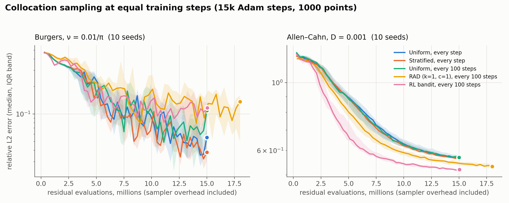

| PDE | Sampler | Rel. L2, equal steps | vs uniform (paired) | Rel. L2, equal evaluations | vs uniform |
|---|---|---|---|---|---|
| Burgers | uniform | 0.055 | – | 0.055 | – |
| | stratified | 0.038 | 6/10, p = 0.63 | 0.038 | 6/10, p = 0.63 |
| | RAD | 0.136 | 3/10, p = 0.11 | 0.090 | 2/10, p = 0.06 |
| | RL bandit | 0.117 | 1/10, p = 0.06 | 0.105 | 2/10, **p = 0.01 (worse)** |
| Allen–Cahn | uniform | 0.568 | – | 0.568 | – |
| | RAD | 0.533 | **10/10, p = 0.002** | 0.547 | **10/10, p = 0.002** |
| | RL bandit | 0.520 | **10/10, p = 0.002** | 0.518 | **10/10, p = 0.002** |

- Errors are medians over 10 seeds.
- "6/10" counts the seeds on which the sampler beat uniform.
- p is from a Wilcoxon signed-rank test (a paired test).

**What it shows**

- **Burgers.** No sampler is significantly better than uniform. Seed-to-seed variation (6×) and optimizer noise (the error moves 1.7× between checkpoints at a constant learning rate) swamp any sampling effect. Charged its probe cost, the bandit is significantly worse.
- **Allen–Cahn.** Adaptive samplers win on every seed, and the bandit gets there with about 40 % fewer evaluations early on. But every method stays stuck near the wrong solution (relative error above 0.5).
- **Recommendation:** use `uniform` (or `stratified`) by default. Use `residual_based` (RAD) when the solution has sharp features, and measure it against uniform at equal budget. Treat `--rl` as experimental.

**Reproduce**

```bash
pinnrl-benchmark sampling --seeds 10 --steps 15000 --checkpoints 50 --workers 4
```

**Source:** [`experiments/B01_sampling_equal_compute`](https://github.com/josegarciav/PINNs-RL-PDE/tree/main/experiments/B01_sampling_equal_compute), with the IQRs, the same-cadence control and the follow-ups it motivates (optimizer settling, resampling frequency, Allen–Cahn failure modes).

## Identification baseline (experiment F01)

**Question.** How well does a PINN recover the heat diffusivity from noisy observations?

**Setup**

- **Problem**: 1-D heat, $u_t = \alpha\,u_{xx}$, truth $\alpha = 0.1$, started at 0.5; the `heat` entry of the [catalogue](custom_equations.md#the-catalogue) with `alpha` trainable.
- **Data**: 20 to 1,000 noisy observations of the exact solution, noise standard deviation σ from 0 to 0.1.
- **Network and budget**: 4 × 64 MLP, 5,000 Adam steps, loss weights residual / BC / IC / data = 1 / 10 / 10 / 10.
- **Seeds**: 10.

**Result**

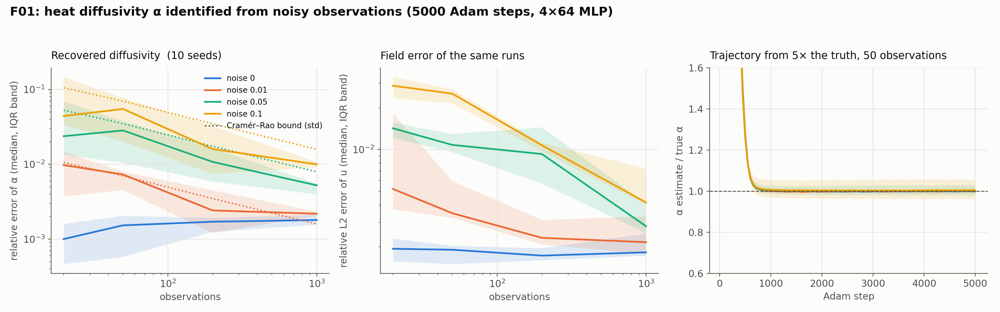

| Noise σ | $N_{\text{obs}}$ = 20 | 50 | 200 | 1000 |
|---|---|---|---|---|
| 0 | 0.0010 | 0.0015 | 0.0017 | 0.0018 |
| 0.01 | 0.0098 | 0.0073 | 0.0024 | 0.0022 |
| 0.05 | 0.024 | 0.028 | 0.011 | 0.0052 |
| 0.1 | 0.044 | 0.055 | 0.016 | 0.010 |

- Median relative error of $\hat\alpha$ over 10 seeds, with the network's weight decay and gradient clipping off (`--clean`, 2026-11-04).
- The first run, with the packaged regularization, gave 0.015–0.027 in the first two rows and 0.020–0.055 in the last two ([the table is in the experiment folder](https://github.com/josegarciav/PINNs-RL-PDE/tree/main/experiments/F01_heat_alpha_recovery)).

| Follow-up | Setup | Result |
|---|---|---|
| **Initial guess (experiment F04)** | Ten starts from 0.1× to 10× the truth, one data set per seed (200 observations, noise 0.05) | For a fixed data set the ten starts land within 0.3 % of each other, six times less than the spread across seeds. The two seeds that end 5–7 % low do so for every start. Starts far above the truth settle in 700–900 steps, sooner than starts near it. |
| **Fixed sensors (experiment F05)** | Plant-like data: 1, 2, 4 or 8 probes at fixed positions read at regular times, against random scatter, all with 200 observations | One mid-domain probe has the lowest Cramér–Rao bound (1.2 % at noise 0.05 against 1.7 % for scatter) and the PINN delivers it (median error 1.1 % against 1.9 %). Eight positions raise the bound and the measured spread alike. Dense time series also halve the low-noise bias. |

**What it shows**

- **The 2 % floor was the regularization.** With the packaged weight decay and gradient clipping, clean data gave 1.5–2 % whatever the number of observations, every seed at $\hat\alpha \approx 0.098$. With both off the same Adam run lands at 0.1–0.2 % with a field error of 0.2 %, and the median error over the grid falls from 2.2 % to 0.6 %. Those defaults are priors on the surrogate that the parameter absorbs: inverse runs start from `weight_decay=0`, `gradient_clipping=0`.
- **Near-efficient from the floor up.** For σ ≥ 0.01 the spread of $\hat\alpha$ across seeds matches the Cramér–Rao bound to within about 20 % in most cells. The error falls with $N$ along the bound (σ = 0.01: 1.0 %, 0.7 %, 0.24 %, 0.22 % against 1.1 %, 0.7 %, 0.35 %, 0.16 %), so the Fisher information predicts how many sensors a target accuracy needs.
- **Few noisy points bias low, regularized or not.** At 20 points the bias is −3.5 % and −8 % at σ = 0.05 and 0.1 in the clean run. The physics loss prefers a smoother, slower-diffusing field when the fixed data weight ignores the noise level (K39).
- **Field error does not predict parameter error.** The field error spans 0.2–3 % and the parameter error 0.1–5.5 %, with one seed at 22 % for a field error of 3 %. The estimate is a function of the data, not of the guess (F04); the information about α sits at mid-domain and late times (F05).

**Reproduce**

```bash
python experiments/F01_heat_alpha_recovery/run.py --seeds 10 --steps 5000 --workers 4
```

**Source:** [`experiments/F01_heat_alpha_recovery`](https://github.com/josegarciav/PINNs-RL-PDE/tree/main/experiments/F01_heat_alpha_recovery) (IQRs, the spread against the bound per cell, and the follow-ups: the floor after optimizer settling, K01 Fisher information, K39 likelihood weighting), [`experiments/F04_initial_guess`](https://github.com/josegarciav/PINNs-RL-PDE/tree/main/experiments/F04_initial_guess), [`experiments/F05_fixed_sensors`](https://github.com/josegarciav/PINNs-RL-PDE/tree/main/experiments/F05_fixed_sensors).

## Conditioning diagnostics (experiment K01)

**Question.** Can the Fisher information be read from a trained network, and when is it right?

**Setup**

- **Sensitivities**: `pinnrl.analysis.surrogate_sensitivities` computes $\partial u / \partial\theta$ from a trained network by the implicit-function theorem (matrix-free Hessian blocks, a MINRES solve).
- **Bound**: `fisher_information` turns it into the Cramér–Rao bound.
- **Check**: against the exact layer, on heat, the two-parameter KdV soliton ($u_t + \alpha\,u\,u_x + \beta\,u_{xxx} = 0$) and Burgers; 3 seeds.

**Result**

| Problem | Surrogate against exact |
|---|---|
| heat and KdV | Bounds, α–β correlation and condition number agree to 1–4 % (Jacobians to 2–6 %) |
| Burgers at $\nu = 0.01/\pi$ | The network smooths the shock; its bound is 2–25× too optimistic |

| Follow-up | Result |
|---|---|
| **Two parameters (experiment F02)**, KdV soliton | The bound says 200 clean points determine (α, β) to 0.6 % and 1.4 %. The PINN returns them 18 % and 25 % low on every seed, and a run started at the truth drifts to the same point. A tenfold data weight halves the bias. |
| **A shock (experiment F03)**, Burgers viscosity at ν = 0.01/π | The network resolves a shock several times wider than the real one and reports a viscosity 2.5–5× too large, still falling at 10,000 steps. |
| **Profile likelihood (experiment F07)**: α fixed on a grid, the network retrained | The misfit of the exact solution reproduces the Fisher parabola to 2 %. The PINN's data misfit is 2.5–12× flatter. |

**What it shows**

- **Trust rule.** The surrogate's Fisher information is trusted only where its forward error is small compared with the feature the parameter acts on. The field error is reported next to it.
- **F02.** The minimum of the PINN loss is not at the truth: the network cannot zero the third-derivative residual of the true soliton.
- **Floors.** The surrogate floor orders as heat 2 %, KdV soliton 20 %, Burgers shock 150 %. Above it the spread across seeds still follows the bound.
- **F07.** The network deviates from the PDE instead of reproducing the wrong solution. Profile likelihood with a PINN needs hard physics or the full weighted loss.

**Reproduce**

```bash
python experiments/K01_fisher_information/run.py --seeds 3
```

**Source:** [`experiments/K01_fisher_information`](https://github.com/josegarciav/PINNs-RL-PDE/tree/main/experiments/K01_fisher_information) (live demo: `notebooks/07_conditioning.ipynb`), [`experiments/F02_kdv_joint`](https://github.com/josegarciav/PINNs-RL-PDE/tree/main/experiments/F02_kdv_joint), [`experiments/F03_burgers_nu`](https://github.com/josegarciav/PINNs-RL-PDE/tree/main/experiments/F03_burgers_nu), [`experiments/F07_profile_likelihood`](https://github.com/josegarciav/PINNs-RL-PDE/tree/main/experiments/F07_profile_likelihood).

## Training conditioning (experiment K03)

**Question.** Does the equation or the network set the conditioning of training?

**Setup**

- **Runs**: eight operators, two architectures, after 3,000 steps.
- **Tangent kernel**: $K = J_w J_w^\top$, the sensitivities of a loss term to the weights; its condition number says how unevenly the term trains.
- **Ritz value**: an estimate of an extreme Hessian eigenvalue.
- **Tools**: `pinnrl.analysis.loss_hessian_spectrum` and `tangent_kernel_spectrum`.

**Result**

| Case | Measured |
|---|---|
| tanh MLP | Residual tangent kernel's condition number near $10^8$ for every problem |
| Fourier features | Three to five orders lower |
| Fourier features, wave-type and fourth-order problems | Residual kernel's trace $10^3$–$4 \times 10^3$ times the boundary kernel's (the gradient pathology) |
| every run | Every Hessian has a negative Ritz value whose size tracks the final loss |

**What it shows**

- The architecture sets the conditioning, not the operator order.
- No run is at a minimum.

**Reproduce:** `python experiments/K03_training_conditioning/run.py --seeds 2 --steps 3000`

**Source:** [`experiments/K03_training_conditioning`](https://github.com/josegarciav/PINNs-RL-PDE/tree/main/experiments/K03_training_conditioning).

## Disturbance and stability (experiments K05–K07)

**Question.** How do an estimate and a trained field respond to bad data and to a perturbed problem?

**Setup**

- **Data disturbances (K05)**: the identified heat diffusivity under disturbed records $\delta y$. Linear prediction of the shift: $F^{-1}J^\top\delta y$.
- **Problem perturbations (K06)**: a change of initial data, boundary data or a coefficient. **Amplification** is the trained field's response over the exact solution's.
- **Stability constants (K07)**: error over residual, on an independent sample.
- **Tools**: `pinnrl.analysis.perturb_observations`, `linear_response` and `stability_ratio`.

**Result**

| Experiment | Case | Measured |
|---|---|---|
| K05 | sensor bias or timestamp delay | Shift within 20 % of the linear prediction, negligible scatter across seeds |
| K05 | a bias of the noise level | Moves α by 18 %; nothing in the residual flags it |
| K05 | dropout of 75 % of the points or of a whole probe | Costs information, not accuracy |
| K05 | outliers | Break the squared-error data term and raise the residual 10–25× |
| K06 | a change above the surrogate's own field error | The field responds as the exact solution does (amplification 0.7–1.2) |
| K06 | a change below it | No response at all |
| K07 | heat, convection, wave, Klein–Gordon, heat in 2-D | Error falls in proportion to the residual, constant near 1 |
| K07 | other equations | An equation-dependent constant |
| K07 | the beam | Error stalls while the residual falls |

**What it shows**

- The residual is a detector for outliers, not for a bias.
- The field error is the resolution of a trained surrogate.
- For the beam the boundary and initial mismatches are the binding terms.

**Reproduce**

- `python experiments/K05_data_disturbance/run.py --seeds 5 --steps 5000 --workers 4`
- `python experiments/K06_problem_disturbance/run.py --seeds 3 --steps 3000 --workers 4`
- `python experiments/K07_stability_constants/run.py --seeds 2 --workers 4`

**Source:** [`K05_data_disturbance`](https://github.com/josegarciav/PINNs-RL-PDE/tree/main/experiments/K05_data_disturbance), [`K06_problem_disturbance`](https://github.com/josegarciav/PINNs-RL-PDE/tree/main/experiments/K06_problem_disturbance), [`K07_stability_constants`](https://github.com/josegarciav/PINNs-RL-PDE/tree/main/experiments/K07_stability_constants).

## Calibrated uncertainty (experiments F06, K10, K39, K46)

**Question.** Does a 90 % interval for the identified heat diffusivity cover the truth 90 % of the time?

**Setup**

- **Data**: 30 synthetic data sets.
- **Laplace posterior** (`pinnrl.uq.laplace_posterior`): a Gaussian from the surrogate's Fisher information.
- **Ensemble**: networks trained from different initializations.
- **Likelihood-ratio region**: the parameters whose exact misfit is close enough to the best, sampled by the swarm.

**Result**

| Interval | Coverage (target 90 %) | Note |
|---|---|---|
| Laplace posterior | 77 % | Its standard deviation equals the spread of the estimate across data sets to three digits |
| ensemble over initializations | 13 % | It measures the initialization noise, a quarter of the data noise |
| likelihood-ratio region, swarm | 90 % | |

| Experiment | Measured |
|---|---|
| K39, data weight set from the Gaussian noise model | The estimate gets worse (bias up to −21 % at low weights) |
| K46, the swarm on closed-form misfits | Its region coincides with the Fisher ellipse at these noise levels and under-samples its edges, which K47 addresses |

**What it shows**

- The Laplace interval misses only because every estimate is 2 % low (the surrogate floor).
- The residual of a trained PINN is a systematic approximation error, not noise (K39).
- The balance weight is set by the surrogate's floor relative to the noise.

**Reproduce**

- `python experiments/F06_coverage/run.py --datasets 30 --members 8 --steps 5000 --workers 4`
- `python experiments/K39_likelihood_weighting/run.py --seeds 10 --steps 5000 --workers 4`
- `python experiments/K46_swarm_equivalence/run.py --datasets 10`

**Source:** [`F06_coverage`](https://github.com/josegarciav/PINNs-RL-PDE/tree/main/experiments/F06_coverage) (F06 and K10), [`K39_likelihood_weighting`](https://github.com/josegarciav/PINNs-RL-PDE/tree/main/experiments/K39_likelihood_weighting), [`K46_swarm_equivalence`](https://github.com/josegarciav/PINNs-RL-PDE/tree/main/experiments/K46_swarm_equivalence).

## Sampling follow-ups (experiments B02, B03, B04, B08)

**Question.** Does the sampling result hold elsewhere, and what matters besides the sampler?

**Setup**

- **B02**: heat, convection, wave and the KdV soliton, 5 paired seeds.
- **B03**: RAD's exponent $k$ and floor $c$ on a grid.
- **B04**: the resampling cadence (steps between new point sets).
- **B08**: the number $N$ of collocation points.

**Result**

| Experiment | Measured |
|---|---|
| B02 | No sampler differs significantly from fresh uniform points (errors 0.2–2.5 %). RAD has the best median on three of the four and narrows the spread. |
| B04, Burgers | The cadence changes the error threefold, more than any choice of sampler at a fixed cadence. RAD's best cadence is every 10 steps, now the study's default. |
| B03, Burgers | Good RAD settings lie on $c \approx k/2$. A zero uniform floor with a sharp exponent is three times worse than uniform. |
| B03, Allen–Cahn | Every setting is equally and modestly better than uniform. |
| B08 | The error falls as about $N^{-1/3}$ on Burgers, for uniform and RAD alike, and not at all on Allen–Cahn. Cost is linear in $N$. |

**What it shows**

- The cadence matters more than the sampler.
- More points cost linearly and buy little.

**Reproduce**

- `python experiments/B02_more_pdes/run.py --seeds 5 --steps 10000 --workers 4`
- `python experiments/B03_rad_grid/run.py --seeds 3 --steps 10000 --workers 4`
- `python experiments/B04_resampling_frequency/run.py --seeds 5 --steps 10000 --workers 4`
- `python experiments/B08_point_count/run.py --seeds 3 --steps 5000 --workers 4`

**Source:** [`B02_more_pdes`](https://github.com/josegarciav/PINNs-RL-PDE/tree/main/experiments/B02_more_pdes), [`B03_rad_grid`](https://github.com/josegarciav/PINNs-RL-PDE/tree/main/experiments/B03_rad_grid), [`B04_resampling_frequency`](https://github.com/josegarciav/PINNs-RL-PDE/tree/main/experiments/B04_resampling_frequency), [`B08_point_count`](https://github.com/josegarciav/PINNs-RL-PDE/tree/main/experiments/B08_point_count).

## Field-valued unknowns (experiment F09)

**Question.** Can a PINN identify a coefficient that is a function?

**Setup**

- **Problem**: heat with a drifting diffusivity, $u_t = \alpha(t)\,u_{xx}$, or a coefficient field, $u_t = (\alpha(x)\,u_x)_x$.
- **Unknown**: an `UnknownFunction` (a 2 × 32 network through a softplus, which keeps it positive).
- **Data and budget**: 200 noisy observations, 10,000 Adam steps, 5 seeds.
- **Control**: the best constant for each truth.

**Result**

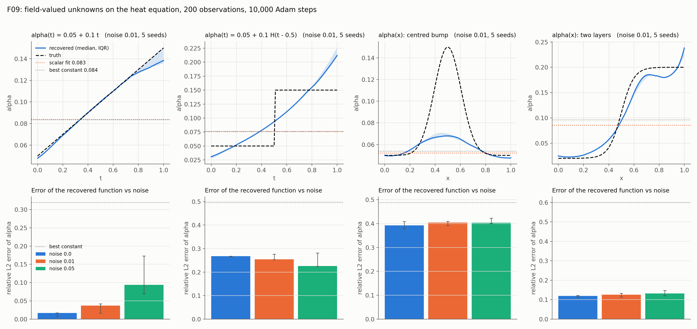

| Truth | Rel. L2 of $\hat\alpha$ at noise 0.01 | Scalar model instead | Best constant's distance in $u$ |
|---|---|---|---|
| $\alpha(t) = 0.05 + 0.1 t$ | 0.037 | 0.32 | 0.048 |
| $\alpha(t)$ with a step at $t = 0.5$ | 0.254 (a ramp with the right mean) | 0.50 | 0.080 |
| $\alpha(x)$, centred bump | 0.405 (collapses to the constant) | 0.50 | 0.038 |
| $\alpha(x)$, two layers | 0.125 (shape and plateaus recovered) | 0.62 | 0.198 |

**What it shows**

- A linear drift is recovered to a few percent; a scalar model absorbs it as the best constant with a field error 2.7 times larger.
- A jump comes back as a smooth ramp: the data see $\int \alpha$ through the solution's amplitude, and a smooth surrogate rounds the kink.
- A field is identified only where the solution feels it (through the flux $\alpha u_x$) and only to the surrogate's accuracy. The two-layer medium, whose solution no constant reproduces within 20 %, is recovered. The centred bump, which a constant reproduces to 4 % (twice the surrogate's field error), is not, although the data alone would determine its modes (K48). The check is one call to `heat_variable_reference`.
- The optimizer's weight decay had been acting on the unknowns; PDE unknowns now train without it.

**Reproduce:** `python experiments/F09_field_unknowns/run.py --seeds 5 --steps 10000 --workers 5`

**Source:** `experiments/F09_field_unknowns/README.md`.

## Sensor layout vs conditioning (experiment K02)

**Question.** Where should the probes go, and does the trained estimate follow the layout's bound?

**Setup**

- **Layout's Fisher information**: from `sensor_jacobian` on closed forms (heat $\alpha$; KdV $\alpha, \beta$).
- **Training**: $\alpha$ identified from 1–8 probes, against the bound of each layout.
- **Probe**: a sensor at a fixed position $x_0$.

**Result**

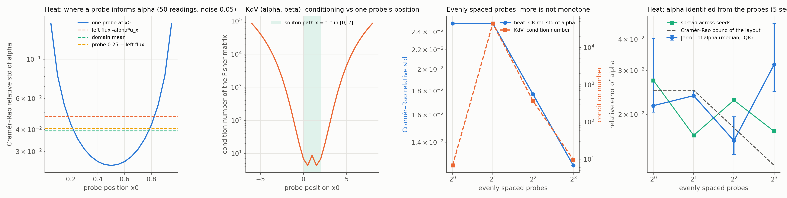

| Case | Measured |
|---|---|
| heat, one probe at $x_0$ | Information scales with $\sin^2 \pi x_0$: a probe at 5 % of the length is 6.4 times worse (in standard deviation) than one at the centre |
| heat, two probes at the quarter points | Equal one at the centre |
| heat: the domain mean, a quarter-point probe, the wall flux | Within a factor of two of the best probe |
| KdV, a probe on the soliton's path | Sees height (fixes $\alpha$) and width (fixes $\beta$): $\kappa(F) \approx 7$ |
| KdV, a probe four lengths away | Sees only the tail, where both coefficients scale the same number: $\kappa(F) > 10^4$, correlation 0.996 |
| KdV, two evenly spaced probes at $\pm 7.5$ | Worse than one at the origin |
| trained on the records | Spread of $\hat\alpha$ across seeds matches each layout's bound (1.6–2.7 % against 1.3–2.5 %); the error stops at the 2 % surrogate floor |

**What it shows**

- Placement beats count.
- Sensor design pays until the bound reaches the forward model's accuracy.

**Reproduce:** `python experiments/K02_sensor_layout/run.py --seeds 5 --steps 5000 --workers 5`

**Source:** `experiments/K02_sensor_layout/README.md`.

## Dimension scaling (experiment K08)

**Question.** How does the error grow with the dimension at a fixed budget?

**Setup**

- **Problems**: heat and convection in $d = 1 \ldots 5$.
- **Budget**: 4,096 points, 4,000 Adam steps.
- **Measured on fresh points**: the error, the residual and their ratio (the empirical stability constant).
- **Quadrature gap**: the mean-squared residual on a batch against a dense sample (relative difference).

**Result**

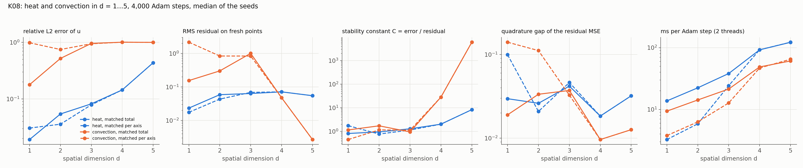

| Case | Measured |
|---|---|
| heat, interior residual | 2–7 % whatever $d$ |
| heat, error | From 2 % to 44 % |
| heat, empirical stability constant | From 0.8 to 8.4 |
| convection | Fails from $d = 2$; at $d \ge 4$ converges to $u \approx 0$ |
| Monte Carlo quadrature gap | 1–4 % at 4,096 points for every $d$; 10–14 % at 36–216 points |
| cost per step | 14 → 122 ms |

**What it shows**

- **Heat.** A factor 4 of the constant's growth is the shrinking norm of the product solution. The rest is the initial and boundary errors, which 512 fixed points cover more thinly in high dimension.
- **Convection.** A small residual with a large initial error, which the residual-based estimate does not see. The bound holds only with the condition terms.
- **Cost.** A dimension costs per point, not in the quadrature.

**Reproduce:** `python experiments/K08_dimension_scaling/run.py --seeds 2 --steps 4000 --workers 3`

**Source:** `experiments/K08_dimension_scaling/README.md`.

## Reduced bases for field unknowns (experiment K48)

**Question.** Is F09's collapse of the bump a limit of the data or of the surrogate?

**Setup**

- **Fields**: the F09 fields in a cosine basis (one coefficient per **mode**).
- **Data limit**: the Fisher spectrum of the modes from the reference solver, and the swarm over the coefficients.
- **Trained unknown**: a 6-mode basis against a network.

**Result**

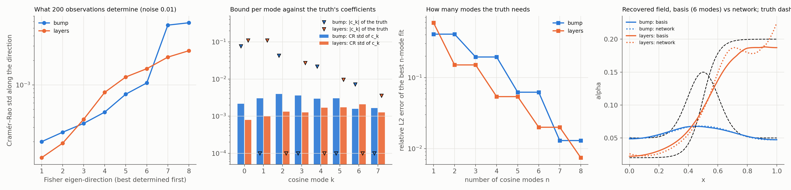

| Case | Measured |
|---|---|
| exact forward model, 200 observations at noise 0.01 | All eight modes of either field determined to 0.001–0.006, no null space |
| 6-mode basis as the trained unknown | The same (biased) field as the network; coefficients reproducible across seeds to three digits |
| the PINN's optimum in the field | 10–50 Fisher standard deviations from the truth |
| reference solver as the swarm's forward model | 1,440 solves a minute |
| the swarm | Under-samples the region at 0.2–0.7 of the Fisher half-widths |
| a 4-mode truncation | Model-form error that the fit absorbs |

**What it shows**

- F09's collapse of the bump is the surrogate's limit, not the data's.
- Forward accuracy, not the representation, is the bottleneck of field identification.

**Reproduce:** `python experiments/K48_reduced_bases/run.py --seeds 3 --steps 10000 --workers 3`

**Source:** `experiments/K48_reduced_bases/README.md`.

## Optimizers and the floor (experiments D01, D02)

**Question.** Which optimizer wins at equal time, when to switch (D02), and is F01's 2 % floor an optimization effect?

**Setup**

- **Forward arms**: Adam, L-BFGS and Adam→L-BFGS at matched wall-clock time on heat, Burgers and Allen–Cahn.
- **Floor arm**: the heat-diffusivity floor cell of F01 without the packaged regularization.

**Result**

| Case | Measured |
|---|---|
| floor cell, weight decay and clipping off, Adam | $\alpha$ to 0.4 %, field error 0.23 % |
| floor cell, with an L-BFGS finish | Halved again (0.2 %, 0.1 %) |
| heat, 120 s | L-BFGS reaches $2 \times 10^{-4}$ against Adam's $10^{-3}$ |
| Burgers | L-BFGS 2–3 times better |
| Allen–Cahn | L-BFGS halves the error where Adam makes no progress |
| an early switch on Burgers | Diverged in 3 of 6 runs |

**What it shows**

- **The 2 % floor of F01–F09 was the packaged weight decay and gradient clipping of the network**, not the surrogate. F01 has been rerun on its whole grid with the clean configuration (its floor is 0.1–0.2 %); F02, F03 and F09 are still to be reread.
- The switch point hardly matters when both phases work.
- The trainer needs a step safeguard before `adam_lbfgs` becomes a default.

**Reproduce:** `python experiments/D01_optimizer_baseline/run.py --seeds 3 --floor-seeds 5 --budget 120 --workers 4`

**Source:** `experiments/D01_optimizer_baseline/README.md`.

## The swarm as a posterior sample (experiment K47)

**Question.** Is the likelihood-weighted swarm a sample of the posterior?

**Setup**

- **Sample**: every position a cloud swarm evaluates, weighted by its likelihood.
- **Truth**: the exact posterior on heat $\alpha$ and the damped pendulum.

**Result**

| Quantity | Weighted swarm | Accepted (likelihood-ratio) set |
|---|---|---|
| centre | Within 0.05 standard deviations of the posterior mean | |
| width | 0.5–0.7 of the exact one | Wider |
| coverage at the 90 % level | 80–87 % | 90–100 % |

**What it shows**

- Importance weights cannot recover tails the swarm never visits.
- The accepted set, widened by K46's factor, is the usable interval.
- For a density, use a sampler, with the parametric surrogate (K45) as its cheap forward model.

**Reproduce:** `python experiments/K47_swarm_posterior/run.py`

**Source:** `experiments/K47_swarm_posterior/README.md`.

## Parametric surrogate as the forward emulator (experiment K45)

**Question.** Can one network over a parameter range replace a network per value, and serve the swarm?

**Setup**

- **Surrogate**: one network $u_w(x, t; \theta)$ with the parameters as inputs (`CustomPDE(parametric=...)`), trained once over the prior range.
- **Network and budget**: 4 × 64, Adam 4,000 steps then L-BFGS 100. Control: a dedicated network per parameter value at the same budget.
- **Problems**: heat ($\alpha \in [0.02, 0.5]$), the KdV soliton ($(\alpha, \beta) \in [2, 12] \times [0.3, 3]$), the Burgers travelling wave ($\nu \in [0.05, 0.5]$).
- **Inverse test**: the swarm of K46 on the surrogate's misfit (`pde.surrogate_misfit`) against the closed-form misfit, 10 noisy data sets.

**Result**

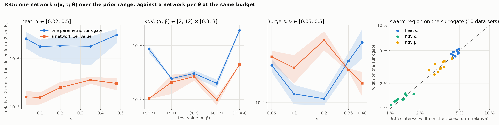

| Quantity | Measured |
|---|---|
| accuracy over the range | 0.2–0.3 % on heat and Burgers, 0.2–2 % on KdV |
| training cost | A quarter to a half of five dedicated networks (9–19 minutes against 23–56) |
| a forward evaluation of 10,000 points | 15–40 ms |
| against a network per value | Heat: 5–10 times less accurate. Burgers: as accurate. KdV: equal in the middle of the box, 4–8 times worse at the corners |
| swarm on the surrogate against the closed form | Best fits agree to 0.04–0.3 % of the truth, 90 % widths to 1–3 % |
| coverage, data set by data set | 8/10 heat, 7/10 KdV (the swarm's own under-coverage from K46) |
| sampling a region on the PINN's own misfit | 0.1–0.2 s per data set |
| the KdV corner at (11, 0.4), surrogate error 2 % | The region is biased by about that error |

**What it shows**

- One surrogate covers the range.
- The swarm on the surrogate is the swarm on the closed form: the surrogate's forward error is well below the scatter the data impose.
- Where the surrogate's error exceeds the data scatter, the region is biased. The check is one dedicated network at the best fit.

**Reproduce**

```bash
python experiments/K45_parametric_surrogate/run.py --seeds 2 --datasets 10 --workers 4
```

**Source:** `experiments/K45_parametric_surrogate/README.md`.

## The cost of a training step: PyTorch, C++ and Rust (experiment I11)

**Question.** Where does the time of a training step go, and what does compiled code save?

**Setup**

- **Step**: the heat PINN ($u_t = \alpha\,u_{xx}$), a 4 × 64 `tanh` network, 5,120 points, Adam.
- **Arms**: the same step written ten ways, on an Apple M4.
- **Taylor mode**: carry $u_x, u_{xx}, \ldots$ forward through the network next to $u$, instead of differentiating the graph twice (double backward).
- **Kernel**: the package's compiled code that does this ([the native engine](engine.md)).

**Result**

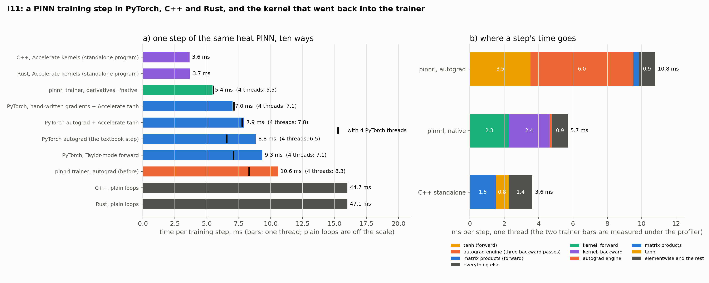

| Implementation | ms per step (1 thread / 4 threads) |
|---|---|
| C++ and Rust with no framework, Accelerate for the matrix products and `tanh` | 3.6 / 3.7 |
| `pinnrl` trainer, `derivatives="native"` | 5.4 / 5.5 |
| PyTorch autograd, a minimal loop | 8.8 / 6.6 |
| `pinnrl` trainer, autograd | 10.6 / 8.3 |
| C++ and Rust with plain loops | 45 / 47 |

| Also measured | |
|---|---|
| sampling, the optimizer and bookkeeping | A tenth of a step |
| `tanh` in PyTorch | 2.6 ns an element, twenty times the matrix product next to it, a third of the trainer's step |
| Taylor mode in tensor operations | 9.3–12.4 ms against 8.8 for double backward |
| C++ and Rust against the PyTorch step | 2.4 times faster on the same BLAS, five times slower without one |
| the kernel in the trainer | 10.6 → 5.4 ms; with the packaged network's layer normalization 32 → 10.4 ms |
| `torch.nn.LayerNorm` weight gradient | 2–3 % off in norm on this problem, 1–9 % in single directions against finite differences |

**What it shows**

- **The network's arithmetic is the cost**, and `tanh` is the most expensive single operation in PyTorch here. C++ and Rust are indistinguishable.
- **Taylor-mode derivatives do not pay in tensor operations**; they pay with fused loops in compiled code.
- **The kernel is in the package**, with the same loss and gradients to rounding. It is now the default: [`build_trainer(derivatives="auto")`](custom_equations.md#a-faster-step-the-compiled-kernel), with `"autograd"` to switch it off and `"native"` (the table's name) as an old alias. The default is unreleased (v0.9 in progress) and covers `tanh` feed-forward networks on macOS (Accelerate) and Linux (OpenBLAS, I14).
- **A PyTorch defect found on the way:** `torch.nn.LayerNorm` returns a wrong weight gradient for any loss with second derivatives of the network (exact for first-order residuals). The package's networks now use [`ExactLayerNorm`](api/neural_networks.md#neural_networks.base_network.ExactLayerNorm), the same function written in elementary operations, at the same cost.

**Reproduce**

1. `python experiments/I11_native_pinn/bench_python.py`
2. `python experiments/I11_native_pinn/run.py` (builds the C++ and Rust programs; needs `clang++` and `rustc`)
3. `python experiments/I11_native_pinn/bench_trainer.py`

**Source:** `experiments/I11_native_pinn/`.

## The kernel on third, fourth and mixed derivatives (experiment I13)

**Question.** Does the kernel's gain hold at third and fourth order and for mixed derivatives?

**Setup**

- **Step**: I11's step on five equations, with autograd and with the kernel.
- **Stream**: one derivative (such as $u_{xx}$) carried through the network. The kernel now carries general Taylor coefficients, one stream per multi-index the residual needs.
- **Timing**: one thread, medians of three seeds.

**Result**

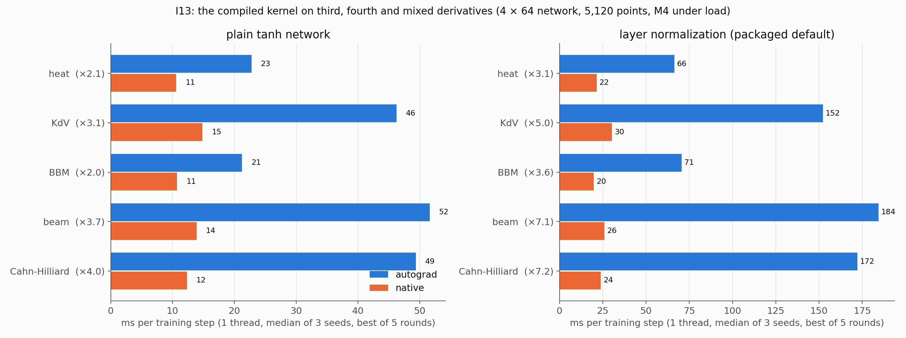

| Equation | plain `tanh` network | with layer normalization |
|---|---|---|
| heat, $u_{xx}$ | 1.9× (11.1 → 5.7 ms) | 3.0× (33.8 → 11.1 ms) |
| KdV, $u_{xxx}$ | 2.6× | 4.7× |
| BBM, $u_{xxt}$ | 2.0× | 3.6× |
| Euler–Bernoulli beam, $w_{xxxx}$ | 3.8× | 7.1× |
| Cahn–Hilliard, $u_{xxxx}$ | 4.0× | 7.2× |

| Follow-up | Measured |
|---|---|
| **On Linux with OpenBLAS (experiment I14)** | The same source builds with `g++` and the tests pass. In Docker's VM on the same M4 the step gains 1.4× (heat, plain) to 3.0× (KdV, layer normalization), against 1.9–4.7× under Accelerate. |
| I14, the cause | OpenBLAS's `sgemm` is as fast as `torch.mm` there. Taylor mode does about as many matrix-product flops as double backward and saves the elementwise work; without Apple's AMX units the twelve matrix products of a step are two thirds of it. |
| **The registry's classes (experiment I15)** | `PDEBase.compute_derivatives` goes through the kernel: `heat`, `kdv`, `burgers` and `pendulum` gain 1.7×, 2.7×, 2.0× and 1.7× on a plain network and 2.5×, 4.7×, 3.1× and 2.3× with layer normalization (idle M4, residuals to 1e-6). |
| **One value pass (I15)** | Every boundary face and the initial points in one kernel call: worth 2 % of the heat step. |
| I15, what is left | 5.7 ms with the kernel against the 3.6 ms of the framework-free program: the trainer's bookkeeping and the loss arithmetic in PyTorch. |

- I15 set `pde.derivatives = "native"`; the attribute now defaults to `"auto"`, which does the same.

**What it shows**

- **Residual, loss and weight gradient agree with autograd** to $10^{-7}$–$10^{-5}$ relative on every equation, through fourth order and the mixed $u_{xxt}$.
- **The gain grows with the order:** autograd nests a graph per derivative, the kernel adds a stream per multi-index.
- **A mixed derivative costs its closure:** $u_{xxt}$ brings $u_{xt}$ and $u_{xx}$ with it, five streams, as many as KdV.
- The general loops cost under 5 % against the special-cased kernel of I11/I12 on the heat streams, after the passes over the chunk arrays were pared (the first version was 45 % slower).

**Reproduce**

- `python experiments/I13_native_higher_order/run.py`
- `python experiments/I15_native_value_pass/run.py`
- I14: the Docker command in `experiments/I14_native_linux/README.md`.

**Source:** `experiments/I13_native_higher_order/`, `experiments/I14_native_linux/`, `experiments/I15_native_value_pass/`.

## The step against the alternatives (experiment I17)

**Question.** Is `pinnrl` the fastest way to take a PINN step on a CPU?

**Setup**

- **Step**: a 4 × 64 `tanh` network, 4,096 collocation + 512 initial + 512 boundary points, Adam, float32, one thread.
- **Problems**: nine, from second to fourth order, with a mixed derivative (BBM), two fields (Schrödinger) and two space dimensions.
- **Arms**: `pinnrl` (compiled step, general kernel, autograd), PyTorch (eager, `torch.func`, `torch.compile`), JAX under `jit` (reverse, forward, Taylor mode), DeepXDE, NVIDIA PhysicsNeMo.
- **Protocol**: each arm in its own process, residual checked against a reverse-mode reference, best of three rounds of 100 steps over two passes.

**Result on an Apple M4**, milliseconds per step, best of each column in bold.

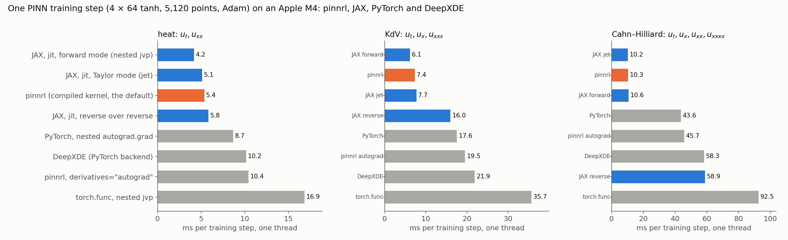

| Implementation | heat | Burgers | Allen–Cahn | KdV | BBM | Cahn–Hilliard | K–S | Schrödinger | heat 2-D |
|---|---|---|---|---|---|---|---|---|---|
| **`pinnrl`, the default (step compiled per equation)** | **3.7** | **3.7** | **3.7** | **4.4** | **5.5** | **5.7** | **5.7** | **3.8** | **5.1** |
| JAX, `jit`, forward mode (nested `jvp`) | 4.3 | 4.2 | 4.2 | 6.1 | 6.6 | 10.4 | 10.4 | 4.4 | 6.6 |
| `pinnrl`, general kernel (`PINNRL_NATIVE_SPECIALIZE=off`) | 4.8 | 4.8 | 4.8 | 6.8 | 8.9 | 9.6 | 9.6 | 5.1 | 7.3 |
| JAX, `jit`, Taylor mode (`jax.experimental.jet`) | 5.2 | 5.1 | 5.1 | 7.2 | 8.4 | 10.0 | 10.1 | 5.5 | 7.7 |
| JAX, `jit`, reverse over reverse | 6.0 | 7.7 | 6.5 | 15.7 | 15.6 | 56.8 | 56.5 | 11.4 | 9.6 |
| PyTorch, nested `autograd.grad` | 8.7 | 8.8 | 8.8 | 17.7 | 17.7 | 43.6 | 43.6 | 17.7 | 12.0 |
| `pinnrl`, `derivatives="autograd"` | 10.0 | 10.2 | 10.1 | 19.1 | 19.1 | 45.0 | 45.1 | 15.6 | 14.5 |
| DeepXDE (PyTorch backend) | 10.1 | 10.0 | 10.0 | 21.5 | 21.9 | 56.0 | 55.7 | 18.8 | 14.5 |
| NVIDIA PhysicsNeMo, `PhysicsInformer` (autodiff) ¹ | 10.9 | 10.7 | 10.7 | n/s | n/s | n/s | n/s | 17.7 | 14.3 |
| `torch.func`, nested `jvp` | 16.8 | 17.1 | 16.9 | 35.7 | 30.9 | 92.1 | 92.3 | 17.1 | 27.3 |
| `torch.compile` | fails | fails | fails | fails | fails | fails | fails | fails | fails |

¹ PhysicsNeMo 2.2.2, timed in its own environment (PyTorch 2.15; the eager loop there is within 4 % of the row above). `PhysicsInformer` takes derivatives up to second order, so the four higher-order problems are not supported (n/s). The separate `nvidia-physicsnemo-sym` package does not install without CUDA.

**With layer normalization** (the packaged default network's kind), same machine:

| Implementation | heat | Burgers | Allen–Cahn | KdV | BBM | Cahn–Hilliard | K–S | Schrödinger | heat 2-D |
|---|---|---|---|---|---|---|---|---|---|
| **`pinnrl`, the default (step compiled per equation)** | **7.7** | **7.5** | **7.5** | **9.6** | **12.6** | **12.7** | **12.7** | **7.6** | **11.4** |
| JAX, `jit`, forward mode (nested `jvp`) | 9.7 | 9.2 | 9.2 | 14.0 | 15.4 | 24.5 | 24.2 | 9.2 | 14.3 |
| `pinnrl`, general kernel (`PINNRL_NATIVE_SPECIALIZE=off`) | 10.3 | 10.1 | 9.8 | 13.7 | 17.6 | 18.4 | 18.2 | 10.0 | 14.6 |
| JAX, `jit`, Taylor mode (`jax.experimental.jet`) | 10.5 | 10.7 | 10.8 | 13.9 | 17.3 | 18.9 | 19.0 | 10.9 | 15.4 |
| PyTorch, nested `autograd.grad` | 26.3 | 26.2 | 26.1 | 59.8 | 59.6 | 152.3 | 152.1 | 60.6 | 38.9 |
| `pinnrl`, `derivatives="autograd"` | 31.9 | 31.6 | 31.1 | 65.2 | 65.3 | 157.8 | 157.5 | 53.8 | 49.2 |

**On Linux x86** (a GitHub Actions runner, AMD EPYC 7763, OpenBLAS; one pass on a shared machine, so read ratios, not times):

| Implementation | heat | Burgers | Allen–Cahn | KdV | BBM | Cahn–Hilliard | K–S | Schrödinger | heat 2-D |
|---|---|---|---|---|---|---|---|---|---|
| **`pinnrl`, the default (step compiled per equation)** | 24.2 | 24.0 | 23.9 | 30.7 | 38.1 | **38.4** | **38.6** | 24.2 | 37.3 |
| JAX, `jit`, forward mode (nested `jvp`) | **22.3** | **22.9** | **22.7** | **30.4** | **34.1** | 47.4 | 46.5 | **23.5** | **33.9** |
| `pinnrl`, general kernel (`PINNRL_NATIVE_SPECIALIZE=off`) | 27.4 | 27.4 | 27.5 | 35.0 | 41.9 | 43.1 | 43.0 | 27.9 | 40.7 |
| JAX, `jit`, Taylor mode (`jax.experimental.jet`) | 30.2 | 30.8 | 30.7 | 39.0 | 45.1 | 51.5 | 50.6 | 31.2 | 43.5 |
| PyTorch, nested `autograd.grad` | 55.1 | 61.2 | 58.9 | 135.2 | 128.5 | 349.2 | 343.9 | 99.4 | 79.5 |
| `pinnrl`, `derivatives="autograd"` | 45.9 | 46.8 | 45.7 | 84.4 | 81.4 | 185.3 | 183.8 | 74.5 | 66.2 |
| DeepXDE (PyTorch backend) | 71.3 | 70.3 | 64.6 | 188.5 | 182.9 | 466.4 | 492.6 | 141.8 | 95.2 |

**What it shows**

- **M4**: `pinnrl` is first on every equation, 1.1–1.8× JAX's best mode, 2.4–7.7× eager PyTorch, 2.7–9.9× DeepXDE; with layer normalization 1.2–1.5× JAX.
- **Linux x86**: on the plain network JAX's forward mode is 1–11 % ahead on seven problems and `pinnrl` leads by 1.2× at fourth order; with layer normalization `pinnrl` leads by 1.3–1.7× on the five problems measured. The matrix products dominate there, so the fused loops gain only 1.1× over the general kernel.
- **PyTorch ecosystem**: the margin holds on both machines. PhysicsNeMo's `PhysicsInformer` runs near the textbook loop and supports second order at most. `torch.compile` cannot run the step.
- **Where the first gap came from**: when the experiment started JAX led by 1.3× on heat, by fusing each layer's derivative arithmetic per equation and by a rational `tanh`. Both are now in the package ([engine](engine.md)).

**Reproduce**: `uv run --with jax --with deepxde python experiments/I17_step_head_to_head/run.py` (add `--layer-norm` for the second table); the Linux run is the manual workflow `benchmark.yml`.

**Source**: `experiments/I17_step_head_to_head/`. It measures the cost of a step, not the error reached in a given time.

## The evaporator's reference solve in C++ (experiment I16)

**Question.** Why was the evaporator's reference solve slow, and what does compiled code save?

**Setup**

- **Model**: the falling-film evaporator's method-of-lines model, one hour at 11, 51 and 201 cells.
- **BDF**: SciPy's implicit, variable-order integrator for stiff ODEs.
- **SDIRK4**: a fourth-order implicit Runge–Kutta integrator, compiled in `pinnrl.native.evaporator`; its implicit stages are solved exactly by one sweep downstream.

**Result**

| Inputs | SciPy BDF (dense), 1e-8 | compiled, 1e-8 | compiled, 1e-6 |
|---|---|---|---|
| smooth steam, 11 / 51 / 201 cells | 10 / 16 / 78 ms | 1.8 / 5.0 / 16 ms | 1.3 / 2.3 / 5.7 ms |
| a steam record with 10 s knots | 0.7 / 1.5 / 6.5 s | 6.7 / 30 / 108 ms | 3.5 / 10 / 39 ms |
| a batch fit of the fouling (4 modes + offset, 51 cells) | 106 s | | 0.68 s, the same estimate |
| the fouling monitor (360 records, 51 cells) | 1.9 s | 1.2 s | |

**What it shows**

- **The right-hand side was never the cost** (7 µs a call). The cost was SciPy's dense factorisations of a Jacobian that is block lower-bidiagonal, and above all the steps that the kinks of a linearly interpolated record force on a variable-order method. That is where J06's 4–14 s fits came from.
- **The batch estimator through the reference solver is now as cheap as the filter.** The filter's remaining time is its own finite-difference Jacobian and matrix exponential.
- **The compiled path splines the sampled inputs.** Against SciPy's linear interpolation of a noisy record that is a modelling difference of 2 × 10⁻⁵ in the outlet solids, a hundredth of the record's noise.

**Reproduce:** `python experiments/I16_native_evaporator/run.py` (about 4 min).

**Source:** `experiments/I16_native_evaporator/`.

## The evaporator reference and its PINN (experiments J01, J02)

**Question.** Is there a trusted forward model of the evaporator (J01), and can a PINN match it (J02)?

**Setup**

- **Model**: `pinnrl.process.FallingFilmEvaporator`. Liquid flow $W$ and solids fraction $X$ transported along a heated tube, with boiling-point elevation, fouling and measured feed and steam signals.
- **Fouling** $R_f$: the thermal resistance of the deposit on the tube; the total is $1/U + R_f$, with $U$ the clean coefficient.
- **Solvers**: a steady-state ODE solver, a first-order method-of-lines dynamic solver, and the same model as a `CustomPDE`.
- **PINN (J02)**: the normalised model on a steam-step scenario, 3 seeds.

**Result**

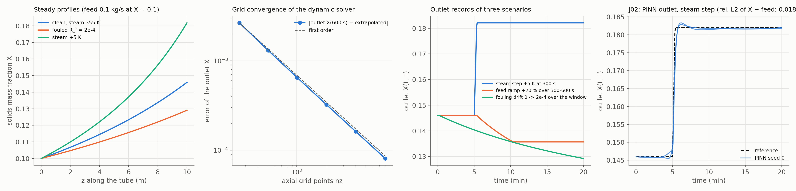

| Quantity | Measured |
|---|---|
| water evaporated in one pass | 31 % of the feed's water |
| a fouling of $10^{-4}$ m²K/W | Moves the outlet solids as much as 1.7 K of steam or 18 % of feed |
| reference solver | Converges at first order; 0.2 s per 10-minute simulation on the working grid |
| normalised PINN, steam-step scenario | 0.4–0.6 % on both fields in under six minutes, in physical units |
| PINN seeds | One of three diverged in the L-BFGS finish |

**What it shows**

- The outlet alone cannot tell fouling from a steam or feed change.
- The L-BFGS safeguard is the next engineering item.

**Reproduce:** `python experiments/J01_evaporator_reference/run.py --seeds 3 --workers 3`

**Source:** `experiments/J01_evaporator_reference/README.md`.

## Change-point identification (experiment F11)

**Question.** Can the time of a sudden change of a coefficient be identified to the bound?

**Setup**

- **Problem**: heat with $\alpha(t) = a + b\,\sigma((t - t_0)/0.02)$, with $\sigma$ the logistic step, $t_0$ the change point and $b$ the jump.
- **Unknowns**: the three numbers, trainable from either side of the truth.
- **Data**: 200 observations at noise 0, 0.01 and 0.05, 5 seeds.
- **Controls**: the Cramér–Rao bound and F09's network unknown.

**Result**

| Case | Error of $t_0$ | Bound |
|---|---|---|
| clean configuration, noise 0.01, from either start | 0.0075 (median) | 0.0062 |
| clean configuration, noise 0.05, from either start | 0.032 (median) | 0.031 |
| default weight decay and gradient clipping | 0.16 early, 25 times the bound, with half the jump | |

**What it shows**

- **A change point is identifiable to the bound** with the clean configuration; $b$ is at the truth within its bound.
- The parametrised step beats the network's ramp at every noise level.
- Under the defaults the failure is the regularization, not the estimator.

**Reproduce**

```bash
python experiments/F11_change_point/run.py --seeds 5 --steps 10000 --workers 5 --clean --lbfgs --out experiments/F11_change_point/results/clean
```

**Source:** `experiments/F11_change_point/README.md`.

## Fouling from outlet sensors: identifiability (experiment J04)

**Question.** Do the evaporator's outlet sensors determine the fouling's time course?

**Setup**

- **Records**: J03's outlet records, solids and flow every 5 s over 20 minutes.
- **Unknowns**: six Legendre modes of the fouling resistance $R_f(t)$.
- **Nuisances** (unknowns of no interest that must be admitted): the clean coefficient $U$, a steam bias, feed-flow and feed-solids biases.
- **Method**: the Fisher information from finite differences on the reference solver, and F07's profile likelihood of the drift's end value on the reference.

**Result**

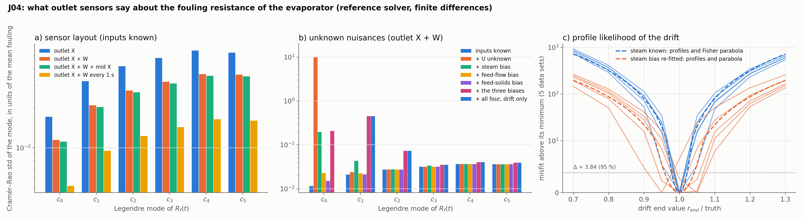

| Case | Measured |
|---|---|
| inputs known | Six modes to 1–4 % of the mean fouling, $\kappa(F) = 25$, the end value to 5 % |
| adding the flow meter to the solids sensor | Halves the bound |
| 1 s sampling | Halves it again |
| a mid-tube probe | Adds nothing |
| 0.5 K of steam bias | Reproduces the records of a 30 % fouling error (correlation 0.85 with the drift) |
| the three input biases free together | The drift's bound goes from 2 % to 45 % |
| profile likelihood on the reference | The Fisher parabola at $\pm 10$ %; a 95 % interval of $\pm 2$ % on the drift's end value (steam known) and $\pm 4$ % (steam bias re-fitted) |

**What it shows**

- **With the inputs known, the outlet determines the whole time course.**
- **$U$ and the constant fouling are one unknown** ($1/U + R_f$): a monitor estimates the change of resistance since a reference state, never its absolute value.
- **The steam temperature is the nuisance that matters.** With the three input biases free together, the leftover direction masquerades as a drift.
- The twin needs the steam temperature to 0.1 K, or a heat-duty signal.

**Reproduce**

```bash
python experiments/J04_plant_sensors/run.py --datasets 5 --modes 6
```

**Source:** `experiments/J04_plant_sensors/README.md`.

## Fouling estimation (experiment J03)

**Question.** Can a PINN twin recover a drifting fouling resistance from two outlet sensors?

**Setup**

- **Twin**: the evaporator model with the steam and feed records as inputs.
- **Sensors**: outlet $X$ and $W$ every 5 s for 20 minutes.
- **Unknown**: the fouling $R_f(t)$, an `UnknownFunction` of time bounded to $[0, 5 \times 10^{-4}]$; the control is a scalar $R_f$.
- **Budget**: the J02 recipe, 3 seeds.

**Result**

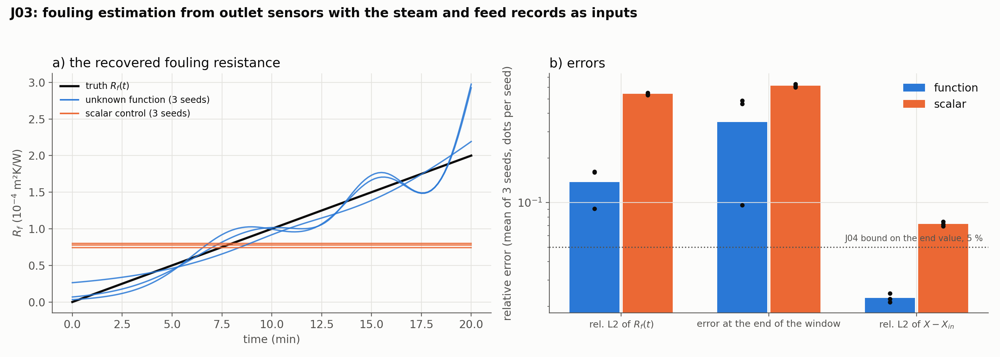

| Quantity | Twin with $R_f(t)$ | Best constant |
|---|---|---|
| drift, L2 error | 9–16 % | 53–55 % |
| field error | 2 % | 7 % |
| end of the window | 10–49 % (J04's bound is 5 %) | |
| a few residence times before the end | 5–10 % | |

**What it shows**

- **A drifting coefficient is a function to identify.**
- **It lands at the surrogate's limit, not the data's.** Its excursions follow the steam signal: the surrogate's imperfect response to the recorded input is absorbed by the unknown.
- **Sensor misfits are now taken in units of the field's scale.** The first pass ignored the records because the flow sensor's units (kg/s, scale 0.02) made its misfit 2,500 times too weak in the normalized loss.

**Reproduce**

```bash
python experiments/J03_fouling_estimation/run.py --seeds 3 --steps 4000 --workers 3
```

**Source:** `experiments/J03_fouling_estimation/README.md`.

## Linearized stability (experiment K09)

**Question.** Does stiffness explain where a PINN fails?

**Setup**

- **ODEs**: the Jacobian spectrum along the reference trajectory of eight catalogue ODE systems, next to the PINN's error on each.
- **Measures**: fastest rate, stiffness ratio (fastest rate over slowest), fast units in the window (window length $T$ times the fastest rate), oscillations, perturbation growth.
- **Evaporator**: the method-of-lines spectrum (`FallingFilmEvaporator.mol_rhs`) against its grid, and with the source terms alone.
- **Non-normal operator**: one whose eigenvectors are far from orthogonal; its eigenvalues do not describe it.

**Result**

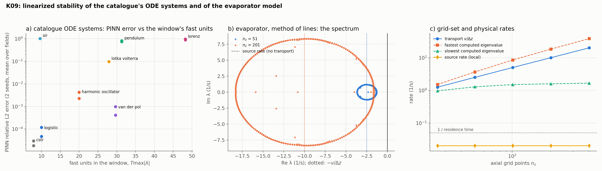

| Case | Measured |
|---|---|
| evaporator, upwind transport | One defective eigenvalue $-v/\Delta z$; the computed spectrum is a circle of rounding around it, so its "stiffness ratio" means nothing |
| evaporator, physical rates | The source terms grow locally at 0.02 s⁻¹, the transport removes them at 0.05 s⁻¹, the physical rates span a factor 6 |
| evaporator, grid-set rate | 10 s⁻¹ at $n_z = 201$; it forces BDF, and a PINN never sees it |
| pendulum, Lorenz, SIR | Collapse to an exact trivial solution close to the initial condition (errors 0.7–1.0) |
| Van der Pol, the same fast-unit count, stiffness 2,500 | Trains to $10^{-3}$ |
| every success | At most 30 fast units in the window |

**What it shows**

- **The evaporator's discretised operator is non-normal.** The physics is convectively stabilised and not stiff.
- **On ODEs the PINN fails by the trivial solution, not by stiffness.**
- **Time-marching (H04) and causal weighting are the remedies.**

**Reproduce**

```bash
python experiments/K09_linearized_stability/run.py --seeds 2 --steps 2000 --workers 3
```

**Source:** `experiments/K09_linearized_stability/README.md`.

## A Kalman-filter baseline (experiment J05)

**Question.** With the model known, does a classical filter beat the PINN twin on the fouling drift?

**Setup**

- **Filter**: `pinnrl.process.ExtendedKalmanFilter`, which corrects a model's state with each new record. A Rauch–Tung–Striebel **smoother** then revises past states with later records.
- **Model**: a lumped method-of-lines model of the evaporator with 6–51 cells, the fouling as a random-walk state.
- **Data**: J03's records and seeds.
- **Arms**: against the PINN twin, and with the steam and feed biases of J04.

**Result**

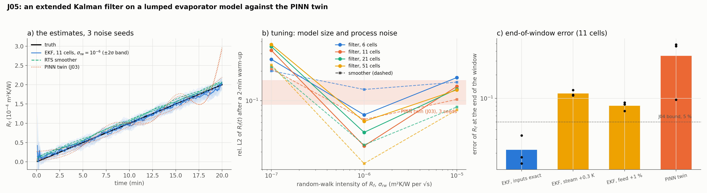

| Estimator | Drift, L2 | At the end | Time |
|---|---|---|---|
| filter, 11 cells | 3.5 % | 2 % | 0.2 s |
| smoother, 51 cells | 2.3 % | 0.7 % (J04's data limit is 5 %) | |
| filter, 6 cells | 7 % | | |
| PINN twin (J03) | 9–16 % | 10–49 % | five minutes |

| Disturbance | Cost to the filter |
|---|---|
| random-walk intensity a decade too small | Lags the ramp by four minutes |
| random-walk intensity a decade too large | Follows the noise |
| a 0.3 K steam bias | 12 % at the end |
| a 1 % feed bias | 8 % (the J04 numbers) |

**What it shows**

- **With the model known, the filter beats the PINN twin by a wide margin at a thousandth of the cost.**
- **The tuning is one number**, the random-walk intensity.
- **The inputs bound both estimators alike.**
- The PINN's case is the partly unknown model (a closure, a field), not this one. The EKF stays as the control on every later comparison.

**Reproduce**

```bash
python experiments/J05_ekf_baseline/run.py --seeds 3
```

**Source:** `experiments/J05_ekf_baseline/README.md`.

## Moving-horizon estimation (experiment J05b)

**Question.** Does re-optimizing over a sliding window improve on the Kalman filter?

**Setup**

- **Estimator**: `pinnrl.process.MovingHorizonEstimator` fits the states over the last records (the horizon) by optimization, which allows constraints.
- **Control**: the extended Kalman filter on J05's records; the same 11-cell model, $Q$ (process noise), $R$ (measurement noise) and prior.
- **Arms**: horizons of 6 to 24 records, with and without the constraint that the fouling only grows.
- **Stress tests**: a random walk ten times too loose, and a confident wrong prior.

**Result**

| Case | Moving horizon | Kalman filter |
|---|---|---|
| drift, L2, every horizon | 3.4 % | 3.5 % |
| at the end, every horizon | 2.1 % | 2.2 % |
| cost | 10–35 times the filter's | |
| growth constraint, random walk ten times too loose | Removes two thirds of the noise-following and a tenth of the L2 error; the end error stays where it was | |
| a confident wrong prior | Costs about half a minute, twice the residence time | The same |

**What it shows**

- **On this model the moving horizon is the Kalman filter at 10–35 times the cost**, because the response to the fouling is nearly linear over a window. For a linear model the two coincide exactly, which the tests check.
- **The growth constraint smooths, it does not correct.** A one-sided constraint on noisy increments ratchets upward.
- **The moving horizon's place** is a model that is nonlinear within a window, or constraints that bind in normal operation.

**Reproduce**

```bash
python experiments/J05_ekf_baseline/run_mhe.py --seeds 3 --workers 3
```

**Source:** `experiments/J05_ekf_baseline/README.md`.

## Calibrated fouling intervals (experiment J06)

**Question.** F06's question on the evaporator: over 100 noise draws of J03's records, does each estimator's 90 % interval contain the fouling at the end of the record, and the time to the next cleaning, 90 % of the time?

**Setup**

- **Batch fit**: Gauss–Newton through the reference solver, with 2 or 6 Legendre modes (2 modes assume a ramp).
- **Filters**: the Kalman filters of J05 on 11 and 51 cells, with the fouling as a random walk or as a level and a rate (the **trend filter**).
- **PINN twin**: the twin of J03.
- **Scenarios**: the inputs exact, a steam record uncertain by 0.3 K, and a fouling curve that saturates.

**Result**

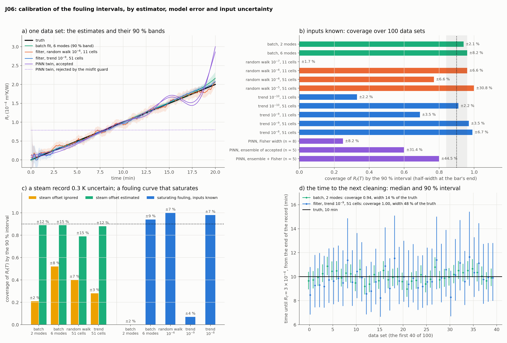

| Case | Coverage (target 0.90) | Width or error |
|---|---|---|
| batch fits, model and form right | 0.92–0.96 | ±2 % (a ramp assumed) to ±8 % (six modes) |
| trend filter, 51 cells | 0.91–0.99 | |
| trend filter's tight intervals, 11 cells | 33–69 % (91–97 % on 51 cells) | The 11-cell filter of J05 is biased by 2.7 % of the fouling |
| ramp fit on a saturating curve | | 25 % off with a ±2.5 % interval; misfit 776 against 474 |
| trend filter, rate frozen, saturating curve | 0 % | It is the ramp fit |
| trend filter, rate free to change over five minutes | Covers both curves | ±7 %; the time to clean has an open upper end in half the data sets |
| steam uncertain by 0.3 K, taken at face value | 21–52 % for every interval | |
| steam offset estimated under its prior, batch fits | 0.89 | ±12–15 % |
| fouling clipped at zero inside the filter | Costs five points of coverage once the offset is a state | |
| time to clean, ramp fit | 0.94 | ±7 % |
| time to clean, steam offset admitted | 0.92–0.93 | ±28–37 % |
| PINN twin, accepted runs, Fisher width | 0.25 | 26 % off at the end of the record against the 5 % the data allow |
| PINN twin, accepted runs, ensembles | 0.60–0.80 | ±31–45 % |

**What it shows**

- **With the model right and the fouling's form containing the truth, the Fisher interval is calibrated.** The form is an assumption the interval inherits, and the misfit is what reveals a wrong one. The trend filter's rate noise is the same assumption in filter form.
- **A model good enough for the estimate is not good enough for the interval.** The tuned random walk covers on 11 cells only because its lag and the grid's bias cancel by half.
- **The honest width for this plant is set by the steam measurement, not by the estimator.** The time to clean is calibrated where the level and rate are.
- **The PINN twin fails to train on 22 of 36 runs** (a constant fouling, or the unknown's bound), which its own sensor misfit detects. No internal width covers the error of the accepted runs. J03's three good seeds were a lucky draw.

**Reproduce**

```bash
python experiments/J06_fouling_intervals/run.py --datasets 100 --workers 6
python experiments/J06_fouling_intervals/run.py --part pinn --pinn-datasets 12 --members 3 --workers 4
```

**Source:** `experiments/J06_fouling_intervals/README.md`.

## Measurement design for the fouling estimate (experiment J09)

**Question.** J06 ends with an interval of ±12–15 % once the steam record's offset is admitted. Which remedy narrows it most?

**Setup**

- **Errors admitted**: every instrument error (the steam offset, the feed solids, both flow meters' gains, the outlet density meter's offset), each with the accuracy it is trusted to as a prior.
- **Posterior covariance**: $(P_0^{-1} + J^\top R^{-1} J)^{-1}$, with $P_0$ the prior covariance, $R$ the noise covariance and $J$ the sensitivities from the reference solver. It does not depend on the records, so remedies are priced before any is bought.
- **Tools**: [`pinnrl.analysis.posterior_covariance`](api/analysis.md#analysis.design.posterior_covariance) and [`greedy_design`](api/analysis.md#analysis.design.greedy_design).
- **Check**: 200 nonlinear simulated fits per design.

**Result**

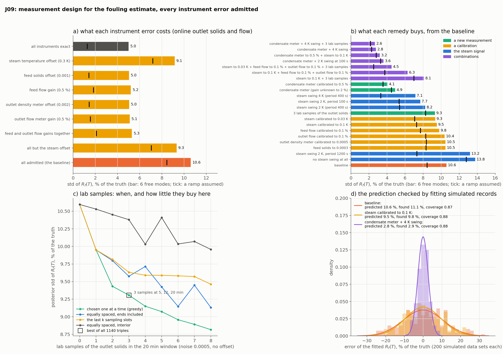

| Design (std of $R_f(T)$, % of the truth; six free modes) | |
|---|---|
| exact instruments | 5.0 |
| the steam offset admitted alone / the four mass-balance instruments alone | 9.1 / 9.3 |
| everything admitted (the baseline) | 10.6 |
| the steam probe calibrated to 0.03 K | 9.3 |
| three lab samples of the outlet solids, at the best times | 9.3 |
| a 4 K steam swing instead of 1 K | 7.1 |
| a condensate meter, gain unknown to 2 % | 4.9 |
| the condensate meter and the 4 K swing | 2.8 |

| Further numbers | |
|---|---|
| any single loose mass-balance instrument | 5.0–5.2 % (the other balance stays closed) |
| no steam swing | 13.8 % |
| lab samples | Buy 1.3 points; best taken at the end, a quarter and past the middle of the window (the greedy triple is the best of all 1140) |
| predicted against simulated std | 10.6 → 11.1, 9.5 → 9.8, 2.8 → 2.9 % (within 5 %), with coverages of 0.87–0.88 |

**What it shows**

- **Two sources limit the estimate, and one is invisible one instrument at a time.** The evaporation rate carries the fouling and the records give it twice, by the flow balance and by the solids balance. All four instruments together cost as much as the steam offset, so no single calibration pays.
- **A condensate meter is the measurement to buy.** It reports the evaporation directly, not as the difference of two flows eight times larger, and with its gain unknown to 2 % it beats exact instruments without it.
- **The steam swing is the free remedy.** A change of the steam temperature changes the flux by $\Delta T_s/(1/U + R_f)$ whatever the offset. A swing as slow as the window is worth almost nothing, since that is what a change of fouling looks like.
- **The prediction holds** over the simulated fits.

**Reproduce:** `python experiments/J09_measurement_design/run.py` (about 1.5 min on 6 workers).

**Source:** `experiments/J09_measurement_design/`.

## A drying droplet and its closure (experiment J07)

**Question.** Can a PINN solve a drying droplet, and identify its unknown rate law from a record?

**Setup**

- **Model**: `pinnrl.process.DryingDroplet`, a 1.5 mm droplet drying in 90 °C air.
- **Closure** $f(X)$: the characteristic drying curve, the drying rate over that of a fully wet surface at moisture $X$. It is 1 above the critical moisture $X_{cr}$ and 0 at the equilibrium moisture $X_{eq}$; $n$ is its exponent.
- **Tasks**: the PINN forward solve, and $f(X)$ identified as an unknown function from a mass-and-temperature record.
- **Controls**: least squares with the right and with a wrong parametric form; 3 seeds.

**Result**

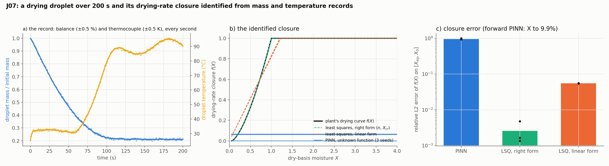

| Pass | Method | Measured |
|---|---|---|
| J07 | PINN forward solve, 12,000 + 500 steps | 8–14 % on the moisture |
| J07 | PINN, unknown closure | Collapses to a constant on every seed: $f \equiv 0$ (records fitted, physics ignored) or $f \equiv 0.06$ (data ignored). One recovery to 15 % did not reproduce |
| J07 | least squares, the right form | $n$, $X_{cr}$ to 1 % in 0.2 s (the noise floor) |
| J07 | least squares, the wrong form | 5.5 % off, with a misfit 16 times larger |
| J07b | pointwise closure from the record, $f_i = -\dot X_i m_s / (h_m A \Delta\rho)$ from the smoothed readings | 2–3 % |
| J07b | PINN started there | Refines to 1.7–2.1 % on two seeds, destroys it on the third |
| J07b | the function frozen first | The collapse is certain |
| J07b | a Legendre basis | Removes the sticky collapse (7 %, 20 %, 66 %) but not the multimodality |
| J07c | guard, reduced $\chi^2$ of the record | 0.9 for the plant's curve, 1.5–1.7 for the two good refinements, 60–90 for the pointwise start, 390–765 for the two failed runs, infinite for the collapsed constants |
| J07c | a failure the network's own fields hide | Fields within 0.8 %, closure 20 % off, record missed 43-fold |
| J07d | shooting, 24 knots, cold start | 1.5–1.6 % on every seed, record at the noise level, in 8–10 s (PINN: six to eight minutes and one lost seed in three) |
| J07e | anchored closure, the same pointwise estimate | Misses the record by 1.6–2.3 times its noise instead of 60–92 times, in one second |
| J07e | anchored closure refined with the PINN | Improves one seed and worsens two (the misfit guard rejects both); shooting stays ahead (1.5–1.6 % against 2–3 %) |

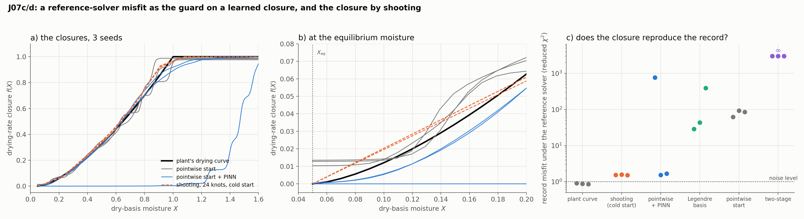

The J07b figure is `assets/benchmarks/j07b_closure.png`.

The passes:

- **Second pass (J07b)**: the PINN started from the pointwise closure; a misfit check against the start catches the seed it destroys.
- **The guard (J07c)**: `DryingDroplet.record_misfit` solves the droplet with a closure by the reference solver and returns the reduced $\chi^2$ of the record (about 1 when the closure explains the record to its noise).
- **Shooting (J07d), the classical control**: a monotone piecewise-linear closure on 24 knots, fitted through the reference solver by bounded least squares.
- **The anchored closure (J07e)**: `UnknownFunction(anchor={"at": X_eq, "value": 0.0})` with `monotone` holds $f(X_{eq}) = 0$ by construction.

**What it shows**

- **Forward solve.** The 50 K temperature rise over 40 s at the critical moisture is the feature a smooth network spreads (time-marching is the next lever).
- **Collapse.** It is K09's trivial attractor in the inverse setting, sticky because softplus-constrained weights that go small cannot grow back.
- **The guard catches every failure of J07b.** The start's misfit is all at the equilibrium moisture, where its closure is 0.01 instead of 0. What the PINN refinement buys is that consistency: a fifty-fold drop in misfit at an unchanged L2 error.
- **Shooting wins.** With an ODE model and a reference solver that takes a closure, an unknown function is a few dozen bounded parameters. The PINN's case starts where the forward solve is missing or too expensive to iterate.

**Reproduce**

```bash
python experiments/J07_droplet_drying/run.py --seeds 3 --steps 12000 --lbfgs-steps 500 --data-weight 300 --workers 3
```

**Source:** `experiments/J07_droplet_drying/README.md`.

## The closure at dryer scale (experiment J11)

**Question.** Can the drying curve be identified from the records of a spray-dryer tower?

**Setup**

- **Model**: [`SprayDryer`](api/process.md#process.dryer.SprayDryer) couples J07's droplet to the air it dries in: a co-current plug-flow tower at steady state, four ODEs along the residence time.
- **Instruments**: those a plant has (six air thermocouples, the outlet humidity, the powder's moisture).
- **Estimator**: one solve takes 5 ms, so a least-squares fit through it; no network was trained.

**Result**

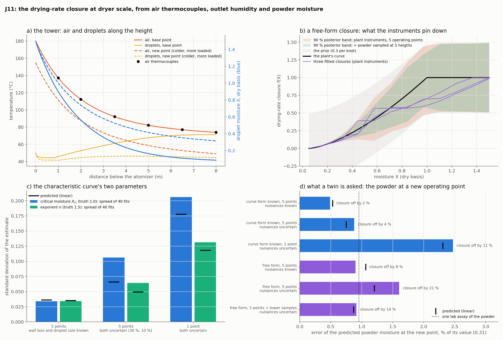

| Case | Measured |
|---|---|
| the curve's form known, five operating points | Critical moisture and exponent to ±0.03 each (2 % in L2), in under a second |
| the same, wall loss (30 %) and droplet size (10 %) uncertain | ±0.11 and ±0.06, more than the linear analysis predicts |
| a free-form closure | 4 to 6 of its 11 directions are determined; the band closes only below a moisture of 0.5; the fits are 8–21 % off |
| powder moisture at an operating point outside the campaign (four times wetter) | Predicted to 0.9–1.6 % by the free-form fits and 0.5–0.9 % with the form known; one lab assay resolves 1 % |
| the same prediction from a single operating point | 2.5 % |

**What it shows**

- **A free-form closure is not identifiable from the tower:** the droplets cross the high-moisture range above the first thermocouple.
- **The prediction does not need it.**
- **For the twin:** identify the closure on a droplet rig, carry it to the tower, and estimate at dryer scale the few numbers its records determine, with the droplet size as the nuisance to design for.

**Reproduce:** `python experiments/J11_dryer_closure/run.py` (about 6 min on 6 workers).

**Source:** `experiments/J11_dryer_closure/`.

## A soft sensor for the stickiness margin (experiment J08)

**Question.** Can the twin estimate the powder's distance from sticking, which cannot be measured online?

**Setup**

- **Stickiness margin**: [`SprayDryer.stickiness_margin`](api/process.md#process.dryer.SprayDryer) is $T_p - T_g(X)$ along the tower, with $T_p$ the particle temperature. Powder sticks when it passes a material limit.
- **Glass transition** $T_g$: the temperature above which an amorphous solid softens, from Gordon–Taylor. It falls by 9 K per 0.01 of moisture, so the margin cannot be measured online.
- **Soft sensor**: an estimate computed from a model and other measurements.

**Result**

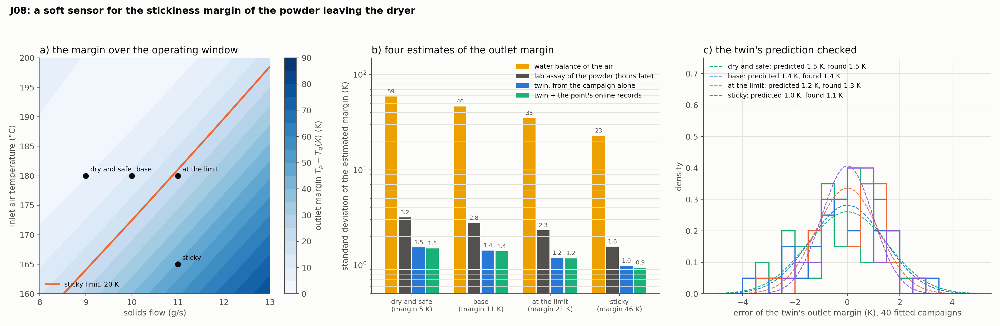

| Estimate of the outlet margin (std, four operating points) | |
|---|---|
| moisture from the water balance of the air | 23–59 K |
| lab assay of the powder, hours late | 1.6–3.2 K |
| the twin, identified on J11's five-point campaign and run forward | 1.0–1.5 K |
| the twin updated with the point's online records | 0.9–1.5 K |

| Further numbers | |
|---|---|
| air against solids | The air carries 36 times the solids' mass, so a humidity error of 0.001 is half the outlet moisture |
| errors of 40 fitted campaigns | Match the prediction (1.1–1.5 K) |
| guard band below the sticky limit | Halves, from 4.6 to 2.3 K |
| margin inside the tower | To about 1 K |

**What it shows**

- **The water balance cannot see the powder.**
- **The twin beats the assay it replaces and is not late.**
- **The caveat:** these are estimation errors of a model whose structure is the plant's. Against a real dryer the first comparison is the twin's moisture against the lab's over a campaign.

**Reproduce**

1. `python experiments/J11_dryer_closure/run.py` (the campaign fits this experiment reuses).
2. `python experiments/J08_stickiness/run.py` (about 10 s).

**Source:** `experiments/J08_stickiness/`.

## Measurement and campaign design for the dryer (experiment J12)

**Question.** Which instrument or campaign narrows the dryer's estimates most?

**Setup**

- **Method**: J09's calculation on the tower.
- **Errors admitted**: eight inputs at their accuracies.
- **Check**: 60 fitted campaigns per design.

**Result**

| Remedy | Effect |
|---|---|
| measuring the droplet size alone | Buys nothing |
| thermocouples good to 0.2 K | Critical moisture ±0.085 → ±0.052 |
| nine operating points | ±0.065 |
| replicate lab assays, for the stickiness margin | 1.2 → 0.6 K |
| 60 fitted campaigns per design | Confirm the parameters' predicted spreads; the margin's is 20 % optimistic |

**What it shows**

- **The droplet's diameter and velocity are one unknown** (the drying time against the residence time).
- **Behind them the six balance inputs limit jointly, none alone.**
- **The best five points depend on the target:** next to the operating limit for the margin, the corners of the window at high load for the curve.

**Reproduce:** `python experiments/J12_dryer_design/run.py` (about 2.5 min on 6 workers).

**Source:** `experiments/J12_dryer_design/`.

## The counter-current tower (experiment J13)

**Question.** Does the PINN twin win on a unit without a cheap initial-value solve? It is the test the roadmap set for the PINN twin's case.

**Setup**

- **Model**: [`CounterCurrentDryer`](api/process.md#process.counter_dryer.CounterCurrentDryer) is J11's tower with the air entering at the bottom against the falling droplets.
- **Steady state**: the droplets' state is given at the top and the air's at the bottom, so it is a two-point boundary-value problem.
- **Transient**: a hyperbolic system whose characteristics run both ways.
- **Shooting**: guess the missing values at one end, integrate, correct until the other end matches.

**Result**

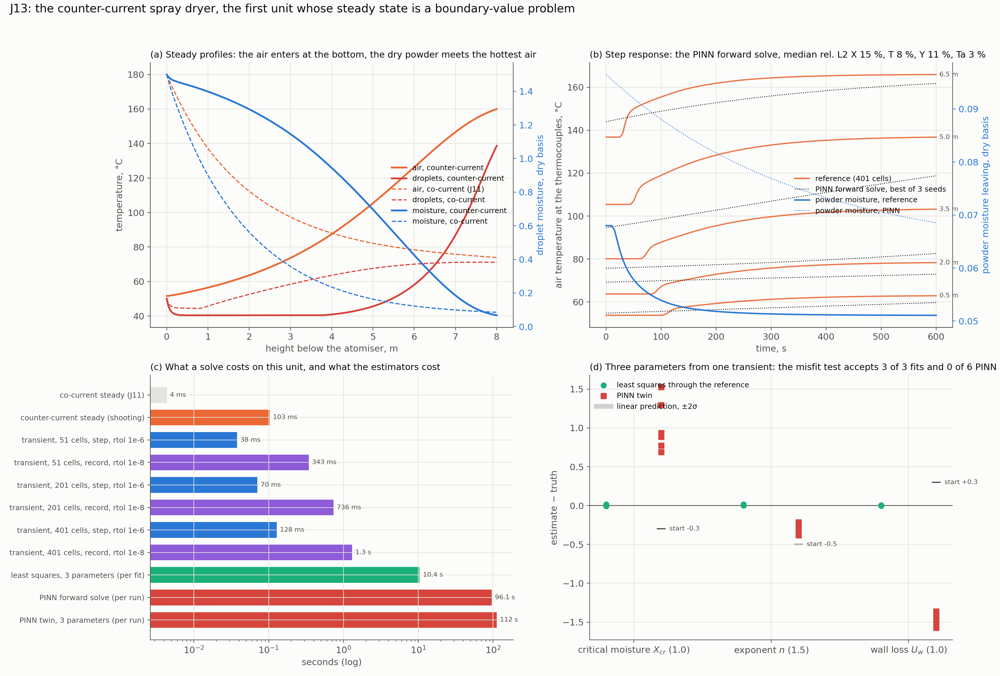

| Solve (M4, one thread) | Time |
|---|---|
| co-current steady state (J11) | 4 ms |
| counter-current steady state, shooting | 103 ms |
| transient, 600 s, 51 / 201 / 401 cells, smooth step at rtol 1e-6 | 0.04 / 0.07 / 0.13 s |
| transient, a 10 s-knot record of the inlet air at rtol 1e-8 | 0.34 / 0.74 / 1.3 s |
| least squares, three parameters from one transient record | 10 s |
| PINN forward solve / PINN twin (2,000 Adam + 200 L-BFGS, the compiled kernel) | 96 s / 110–140 s |

| Accuracy | Measured |
|---|---|
| PINN forward solve, problem scaled, two seeds of three | 12–15 % off on the moisture, 7–8 % on the droplet temperature, 3 % on the air's |
| the four equations' residuals | Differ by five orders of magnitude; the unit's time scales are 5 and 100 s; the residual weight had to drop to 1e-3 |
| bounded least squares through the transient | Within the linear prediction (±0.011, ±0.015, ±0.003) on all three data sets |
| PINN twin, six runs | All rejected by the misfit test (reduced χ² 5–9); critical moisture 0.7–1.5 too high and the wall loss negative |

**What it shows**

- **The boundary-value problem is the expensive part, and it is not expensive enough.** Shooting costs twenty-five integrations down the tower. The transient, where a twin estimates anything, integrates in a tenth of a second once the Jacobian's sparsity is declared. The PINN's case would need a model with no method-of-lines form at all.
- **The PINN forward solve needs the problem scaled.** The package's residual normalization assumes the fields change over the whole window; `custom_pde` now divides each equation by its own scale. L-BFGS does all the learning, and the kink of the drying curve at the critical moisture is what the network does not resolve.
- **The twin cannot identify the curve from a transient; the classical fit can.** The unknowns are the critical moisture, the exponent and the wall loss, from five thermocouples, the outlet humidity and hourly powder samples over ten minutes. The PINN twin's parameters absorb the physics the network does not resolve.

**Reproduce**

1. `python experiments/J13_counter_current_dryer/run.py --arms cost` (1 min).
2. `python experiments/J13_counter_current_dryer/run.py --arms forward,identify` (about 15 min on 3 workers).

**Source:** `experiments/J13_counter_current_dryer/`.

## The line-level twin (experiment J10)

**Question.** What does a twin of the whole line know about the powder, and from which records?

**Setup**

- **Model**: [`ProcessLine`](api/process.md#process.line.ProcessLine) chains three evaporator passes into the spray dryer. The concentrate sets the droplets' solids and the solids flow.
- **Time scales**: the dryer is quasi-steady against the evaporator's hours of fouling.
- **Scenario**: over a four-hour shift the passes foul to 2, 4 and 6e-5 m²K/W, the concentrate thins from 41 to 34 % and the powder's moisture rises from 0.077 to 0.21.
- **Propagation**: push upstream estimates and priors through the model, without the dryer's own records.

**Result**

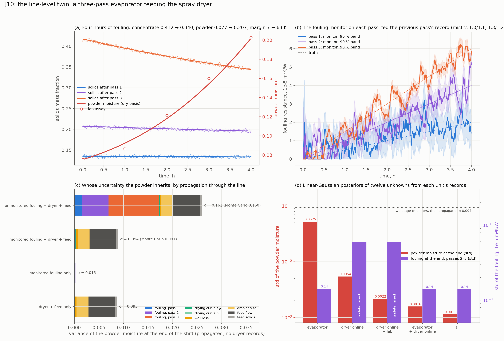

| Estimate of the powder moisture at the end of the shift (std) | |
|---|---|
| propagation: fouling unmonitored, dryer and feed at their priors | 0.16 |
| propagation: fouling as the monitors have it, dryer and feed at their priors | 0.094 (feed flow 61 %, droplet size 27 %) |
| linear-Gaussian posterior from the dryer's online records alone | 0.0054 |
| from the dryer's records and the lab's four assays | 0.0022 |
| from every record of the line | 0.0011 |

| Further numbers | |
|---|---|
| fouling of the three passes, monitored | Pinned to a few 1e-6; the fouling then owns 1 % of the powder's variance |
| Monte Carlo stds against the linear budget | Agree within 10 % |
| dryer records against the propagated band | 17 times narrower; the lab halves it and the evaporator's records halve it again |
| ten simulated shifts, joint fit of twelve unknowns | Powder to 0.0008 (claimed 0.0011) in four minutes |
| ten simulated shifts, two-stage estimate | 0.075 (claimed 0.10) in ten seconds |
| pass 1 fouling, feed admitted at its accuracy | Joint posterior 3.8e-5, larger than the fouling itself (0.99 collinear with the feed flow) |
| pass 1 fouling, the monitor that trusts the feed | Claims ±6e-6; its error on the simulated shifts is 4.7e-5, and its prediction misfit of 5 flags it |
| passes 2 and 3 | Measured on both sides and determined to 1–2e-6 |

**What it shows**

- **Once the fouling is monitored, the powder inherits the dryer's inputs, not the evaporator.** What remains is the feed flow and the droplet size, J12's nuisances.
- **Propagation is the wrong estimator for the powder.** The dryer's thermocouples and hygrometer see the drying itself. The simulated shifts, with the nuisances drawn from their priors, confirm it.
- **Information flows downstream only.** The dryer's records leave the fouling at its prior. A line twin estimates each unit's unknowns on that unit's instruments and uses the downstream unit's instruments for its product.
- **The first pass's fouling is one unknown with the feed.**

**Reproduce:** `python experiments/J10_line_twin/run.py` (monitors and joint fit in 2 min; validation about 20 min on 3 workers).

**Source:** `experiments/J10_line_twin/`.

## Time-marching windows (experiment H04)

**Question.** Does training window by window in time rescue the runs that fail in one shot?

**Setup**

- **Method**: `PDETrainer.train_windows` trains time windows in order, the network carried over.
- **Budget**: the same Adam budget split over 1, 2, 4 or 8 time windows, then an L-BFGS finish on the whole span; 2 seeds.
- **Problems**: the K09 failures, Van der Pol and the drying droplet.

**Result**

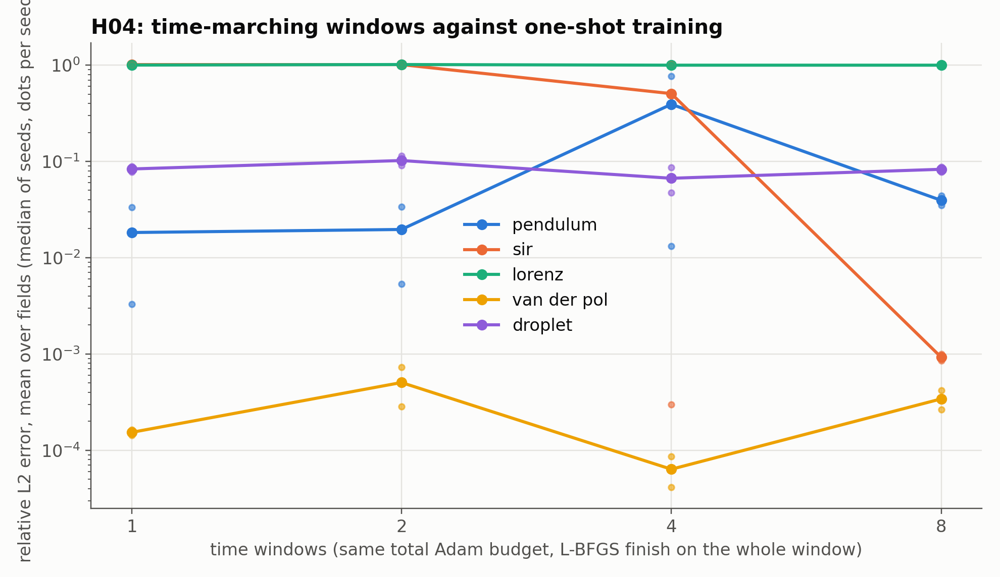

| Problem | One shot | With windows |
|---|---|---|
| SIR | The disease-free state (error 1.0) | Eight windows find the epidemic wave to 0.1 % |
| pendulum | 0.3–3 % at 12,000 + 500 steps (K09's 2,000 + 100 gave 74 %) | No help |
| Lorenz | A K09 failure | Rescued by nothing (growth of $e^{23}$) |
| drying droplet | 2–5 % on the moisture | Unchanged by the schedule |

**What it shows**

- **Time marching rescues SIR**: a window short against the feature keeps the network off the trivial branch.
- **The pendulum was a budget problem.**
- **Lorenz**: a chaotic trajectory with a growth of $e^{23}$ is not one network's job.
- **The droplet's sharp transition is a resolution problem.**

**Reproduce**

```bash
python experiments/H04_time_marching/run.py --seeds 2 --steps 12000 --workers 4
```

**Source:** `experiments/H04_time_marching/README.md`.
