# Benchmarks

`pinnrl-benchmark` has two parts: classical baselines, so PINN accuracy has a reference point, and a multi-seed study that compares collocation samplers fairly. Every number below can be reproduced with the commands shown.

## Classical baselines

```bash
pinnrl-benchmark fdm --pde heat     # explicit finite differences, periodic 1-D heat
pinnrl-benchmark fdm --pde wave     # leap-frog, periodic 1-D travelling wave
```

Both report the relative L2 error at the final time against the analytical solution, plus the maximum error and the wall time. On the default heat problem ($\alpha = 0.1$, $u_0 = \sin 2\pi x$, 101 points), the explicit scheme reaches a relative L2 error of about $7 \times 10^{-4}$ in about 30 ms. The convergence is second order: doubling the points at a fixed diffusion number cuts the error about four-fold. That's the bar a PINN is measured against on forward problems.

## Reference solutions

When there is no closed form, PINNs are scored against high-accuracy numerical references (`pinnrl.benchmarks.reference`):

| Reference | Method | Verification |
|---|---|---|
| `burgers_reference` | Cole–Hopf integral evaluated by a log-sum-exp trapezoid rule | Reproduces Basdevant et al. (1986): $u_x(0, 1.6037/\pi) = -152.00516$ for $\nu = 0.01/\pi$; agrees with a fine finite-difference solve to $7 \times 10^{-5}$ |
| `allen_cahn_reference` | Second-order finite differences plus adaptive Runge–Kutta (method of lines) on a grid 8× finer than the output | Grid-converged: doubling the solver grid changes the field by less than $10^{-5}$ (relative) |

## Sampling study (experiments B01 and B06)

```bash
pinnrl-benchmark sampling --seeds 10 --steps 15000 --checkpoints 50 --workers 4
```

**Setup:**
- The Burgers ($\nu = 0.01/\pi$) and Allen–Cahn ($u_t = 0.001\,u_{xx} + 5(u - u^3)$, $u_0 = x^2\cos\pi x$) benchmarks.
- A tanh MLP (4 × 64) trained for 15,000 Adam steps on 1,000 points, with 10 paired seeds (identical initial weights across samplers).
- Five samplers:
  - uniform and stratified, with fresh points every step;
  - uniform refreshed every 100 steps, a control for how often points change;
  - RAD (k = 1, c = 1) and the RL bandit, also every 100 steps.
- Each run records the relative L2 error and the residual evaluations spent, including the sampler's own (RAD +20 %, bandit +0.3 %). Samplers are compared at equal steps (B01) and at equal total evaluations (B06).

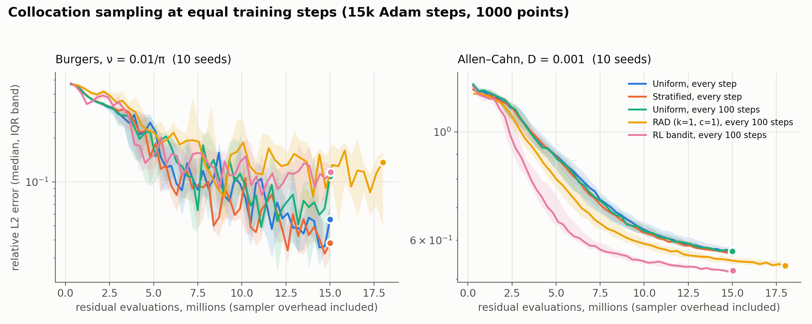

| PDE | Sampler | Rel. L2, equal steps | vs uniform (paired) | Rel. L2, equal evaluations | vs uniform |
|---|---|---|---|---|---|
| Burgers | uniform | 0.055 | – | 0.055 | – |
| | stratified | 0.038 | 6/10, p = 0.63 | 0.038 | 6/10, p = 0.63 |
| | RAD | 0.136 | 3/10, p = 0.11 | 0.090 | 2/10, p = 0.06 |
| | RL bandit | 0.117 | 1/10, p = 0.06 | 0.105 | 2/10, **p = 0.01 (worse)** |
| Allen–Cahn | uniform | 0.568 | – | 0.568 | – |
| | RAD | 0.533 | **10/10, p = 0.002** | 0.547 | **10/10, p = 0.002** |
| | RL bandit | 0.520 | **10/10, p = 0.002** | 0.518 | **10/10, p = 0.002** |

Errors are medians over 10 seeds; "6/10" counts the seeds on which the sampler beat uniform; p is from a Wilcoxon signed-rank test.

**What this says:**

- **Burgers.** No sampler is significantly better than uniform. Seed-to-seed variation (6×) and optimizer noise (the error moves 1.7× between checkpoints at a constant learning rate) swamp any sampling effect. Charged its probe cost, the bandit is significantly worse.
- **Allen–Cahn.** Adaptive samplers win on every seed and the bandit gets there with about 40 % fewer evaluations early on. But every method stays stuck near the wrong solution (relative error above 0.5).
- **Recommendation:** use `uniform` (or `stratified`) by default. Use `residual_based` (RAD) when the solution has sharp features, and measure it against uniform at equal budget. Treat `--rl` as experimental.

The full write-up, with IQRs, the same-cadence control and the follow-ups it motivates (optimizer settling, resampling frequency, Allen–Cahn failure modes), is in [`experiments/B01_sampling_equal_compute`](https://github.com/josegarciav/PINNs-RL-PDE/tree/main/experiments/B01_sampling_equal_compute).

## Identification baseline (experiment F01)

```bash
python experiments/F01_heat_alpha_recovery/run.py --seeds 10 --steps 5000 --workers 4
```

The diffusivity of the 1-D heat equation ($\alpha = 0.1$, started at 0.5) is identified from 20 to 1,000 noisy observations of the exact solution, for noise standard deviations from 0 to 0.1, on 10 seeds. The `heat` entry of the [catalogue](custom_equations.md#the-catalogue) is used with `alpha` trainable; a 4 × 64 MLP trains for 5,000 Adam steps with loss weights residual / BC / IC / data = 1 / 10 / 10 / 10.

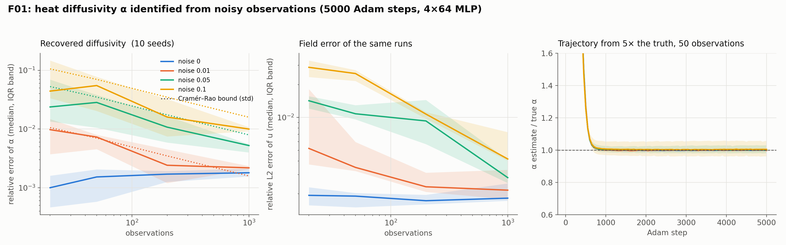

| Noise σ | $N_{\text{obs}}$ = 20 | 50 | 200 | 1000 |
|---|---|---|---|---|
| 0 | 0.0010 | 0.0015 | 0.0017 | 0.0018 |
| 0.01 | 0.0098 | 0.0073 | 0.0024 | 0.0022 |
| 0.05 | 0.024 | 0.028 | 0.011 | 0.0052 |
| 0.1 | 0.044 | 0.055 | 0.016 | 0.010 |

Median relative error of $\hat\alpha$ over 10 seeds, with the network's weight decay and gradient clipping off (`--clean`, 2026-11-04). The first run, with the packaged regularization, gave 0.015–0.027 in the first two rows and 0.020–0.055 in the last two ([the table is in the experiment folder](https://github.com/josegarciav/PINNs-RL-PDE/tree/main/experiments/F01_heat_alpha_recovery)).

**What this says:**

- **The 2 % floor was the regularization.** With the packaged weight decay and gradient clipping, clean data gave 1.5–2 % whatever the number of observations, every seed at $\hat\alpha \approx 0.098$. With both off the same Adam run lands at 0.1–0.2 % with a field error of 0.2 %, and the median error over the grid falls from 2.2 % to 0.6 %. The defaults that help a forward fit are priors on the surrogate that the parameter absorbs; inverse runs start from `weight_decay=0`, `gradient_clipping=0`.
- **Near-efficient from the floor up.** For σ ≥ 0.01 the spread of $\hat\alpha$ across seeds matches the Cramér–Rao bound from the same points to within about 20 % in most cells, and the error now falls with $N$ along the bound (σ = 0.01: 1.0 %, 0.7 %, 0.24 %, 0.22 % against 1.1 %, 0.7 %, 0.35 %, 0.16 %), so the Fisher information predicts how many sensors a target accuracy needs.
- **Few noisy points bias low, regularized or not.** At 20 points the bias is −3.5 % and −8 % at σ = 0.05 and 0.1 in the clean run: the physics loss prefers a smoother, slower-diffusing field when the fixed data weight ignores the noise level (K39).
- **Field error does not predict parameter error.** The field error spans 0.2–3 % and the parameter error 0.1–5.5 %, with one seed at 22 % for a field error of 3 %.

The full write-up, with IQRs, the spread against the bound per cell, and the follow-ups (the floor after optimizer settling, K01 Fisher information, K39 likelihood weighting), is in [`experiments/F01_heat_alpha_recovery`](https://github.com/josegarciav/PINNs-RL-PDE/tree/main/experiments/F01_heat_alpha_recovery).

**Initial guess (experiment F04).** Ten starting values from 0.1× to 10× the truth, on one data set per seed (200 observations, noise 0.05). For a fixed data set the ten starts land within 0.3 % of each other, six times less than the spread across seeds; the two seeds that end 5–7 % low do so for every start. Starts far above the truth settle in 700–900 steps, sooner than starts near it. The estimate is a function of the data, not of the guess. Write-up: [`experiments/F04_initial_guess`](https://github.com/josegarciav/PINNs-RL-PDE/tree/main/experiments/F04_initial_guess).

**Fixed sensors (experiment F05).** Plant-like data: 1, 2, 4 or 8 probes at fixed positions read at regular times, against random scatter, all with 200 observations. One probe at mid-domain has the lowest Cramér–Rao bound (1.2 % at noise 0.05 against 1.7 % for scatter) and the PINN delivers it (median error 1.1 % against 1.9 %), because the information about α sits at mid-domain and late times. Spreading the same readings over 8 positions raises the bound and the measured spread alike. Dense time series also halve the low-noise bias. Write-up: [`experiments/F05_fixed_sensors`](https://github.com/josegarciav/PINNs-RL-PDE/tree/main/experiments/F05_fixed_sensors).

## Conditioning diagnostics (experiment K01)

```bash
python experiments/K01_fisher_information/run.py --seeds 3
```

`pinnrl.analysis.surrogate_sensitivities` computes $\partial u / \partial\theta$ from a trained network by the implicit-function theorem (matrix-free Hessian blocks, a MINRES solve), and `fisher_information` turns it into the Cramér–Rao bound. K01 checks this against the exact layer: on heat and the two-parameter KdV soliton the bounds, the α–β correlation and the condition number agree to 1–4 % (Jacobians to 2–6 %). On Burgers at $\nu = 0.01/\pi$ the network smooths the shock and its bound is 2–25× too optimistic. The surrogate's Fisher information is trusted only where its forward error is small compared with the feature the parameter acts on, and the field error is reported next to it. Write-up: [`experiments/K01_fisher_information`](https://github.com/josegarciav/PINNs-RL-PDE/tree/main/experiments/K01_fisher_information); the live demo is in `notebooks/07_conditioning.ipynb`.

**Two parameters, and a shock (experiments F02, F03).** For the KdV soliton with two coefficients the bound says 200 clean points determine (α, β) to 0.6 % and 1.4 %; the PINN returns them 18 % and 25 % low on every seed, and a run started at the truth drifts to the same point: the minimum of the PINN loss is not at the truth, because the network cannot zero the third-derivative residual of the true soliton. A tenfold data weight halves the bias. For the Burgers viscosity at ν = 0.01/π the network resolves a shock several times wider than the real one and reports a viscosity 2.5–5× too large, still falling at 10,000 steps. The surrogate floor therefore orders as heat 2 %, KdV soliton 20 %, Burgers shock 150 %, and above it the spread across seeds still follows the bound. Write-ups: [`experiments/F02_kdv_joint`](https://github.com/josegarciav/PINNs-RL-PDE/tree/main/experiments/F02_kdv_joint), [`experiments/F03_burgers_nu`](https://github.com/josegarciav/PINNs-RL-PDE/tree/main/experiments/F03_burgers_nu).

**Profile likelihood (experiment F07).** With α fixed on a grid and the network retrained, the misfit of the exact solution reproduces the Fisher parabola to 2 %, while the PINN's data misfit is 2.5–12× flatter: the network deviates from the PDE instead of reproducing the wrong solution. Profile likelihood with a PINN needs hard physics or the full weighted loss. Write-up: [`experiments/F07_profile_likelihood`](https://github.com/josegarciav/PINNs-RL-PDE/tree/main/experiments/F07_profile_likelihood).

## Training conditioning (experiment K03)

Across eight operators and two architectures after 3,000 steps, the architecture sets the conditioning, not the operator order: a tanh MLP's residual tangent kernel has a condition number near $10^8$ for every problem, Fourier features bring it down by three to five orders but make the residual kernel's trace $10^3$–$4 \times 10^3$ times the boundary kernel's on wave-type and fourth-order problems (the gradient pathology), and no run is at a minimum (every Hessian has a negative Ritz value whose size tracks the final loss). Write-up: [`experiments/K03_training_conditioning`](https://github.com/josegarciav/PINNs-RL-PDE/tree/main/experiments/K03_training_conditioning); the tools are `pinnrl.analysis.loss_hessian_spectrum` and `tangent_kernel_spectrum`.

## Disturbance and stability (experiments K05–K07)

**Data disturbances (K05).** For the identified heat diffusivity, a sensor bias or a timestamp delay shifts the estimate by the linear prediction $F^{-1}J^\top\delta y$ to within 20 %, with negligible scatter across seeds; a bias of the noise level moves α by 18 % and nothing in the residual flags it. Dropout of 75 % of the points or of a whole probe costs information, not accuracy. Outliers break the squared-error data term and raise the residual 10–25×, which makes the residual a detector for them. **Problem perturbations (K06).** A trained field responds to a change of initial data, boundary data or a coefficient as the exact solution does (amplification 0.7–1.2) when the change exceeds the surrogate's own field error, and not at all below it: the field error is the resolution of a trained surrogate. **Stability constants (K07).** On an independent sample the error falls in proportion to the residual with a constant near 1 for heat, convection, wave, Klein–Gordon and heat in 2-D, and an equation-dependent constant otherwise; for the beam the error stalls while the residual falls, because the boundary and initial mismatches are the binding terms. Write-ups: [`K05_data_disturbance`](https://github.com/josegarciav/PINNs-RL-PDE/tree/main/experiments/K05_data_disturbance), [`K06_problem_disturbance`](https://github.com/josegarciav/PINNs-RL-PDE/tree/main/experiments/K06_problem_disturbance), [`K07_stability_constants`](https://github.com/josegarciav/PINNs-RL-PDE/tree/main/experiments/K07_stability_constants); the tools are `pinnrl.analysis.perturb_observations`, `linear_response` and `stability_ratio`.

## Calibrated uncertainty (experiments F06, K10, K39, K46)

Over 30 synthetic data sets, the interval the Laplace posterior gives for the identified heat diffusivity (the surrogate's Fisher information, `pinnrl.uq.laplace_posterior`) has a standard deviation equal to the spread of the estimate across data sets to three digits, and covers the truth 77 % of the time instead of 90 % only because every estimate is 2 % low (the surrogate floor). An ensemble over initializations covers 13 %: it measures the initialization noise, a quarter of the data noise. The likelihood-ratio region of the exact misfit sampled by the swarm covers 90 %. Setting the data weight from the Gaussian noise model makes the estimate worse (bias up to −21 % at low weights), because the residual of a trained PINN is a systematic approximation error, not noise; the balance weight is set by the surrogate's floor relative to the noise. On closed-form misfits the swarm's region coincides with the Fisher ellipse at these noise levels and under-samples its edges, which K47 addresses. Write-ups: [`F06_coverage`](https://github.com/josegarciav/PINNs-RL-PDE/tree/main/experiments/F06_coverage), [`K39_likelihood_weighting`](https://github.com/josegarciav/PINNs-RL-PDE/tree/main/experiments/K39_likelihood_weighting), [`K46_swarm_equivalence`](https://github.com/josegarciav/PINNs-RL-PDE/tree/main/experiments/K46_swarm_equivalence).

## Sampling follow-ups (experiments B02, B03, B04, B08)

On heat, convection, wave and the KdV soliton no sampler differs significantly from fresh uniform points (errors 0.2–2.5 %, 5 paired seeds); RAD has the best median on three of the four and narrows the spread (B02). On Burgers the resampling cadence changes the error threefold, more than any choice of sampler at a fixed cadence, and RAD's best cadence is every 10 steps, which is now the study's default (B04). Good RAD settings on Burgers lie on $c \approx k/2$, and a zero uniform floor with a sharp exponent is three times worse than uniform; on Allen–Cahn every setting is equally and modestly better than uniform (B03). The error falls as about $N^{-1/3}$ in the number of collocation points on Burgers, for uniform and RAD alike, and not at all on Allen–Cahn, while cost is linear in $N$ (B08). Write-ups: [`B02_more_pdes`](https://github.com/josegarciav/PINNs-RL-PDE/tree/main/experiments/B02_more_pdes), [`B03_rad_grid`](https://github.com/josegarciav/PINNs-RL-PDE/tree/main/experiments/B03_rad_grid), [`B04_resampling_frequency`](https://github.com/josegarciav/PINNs-RL-PDE/tree/main/experiments/B04_resampling_frequency), [`B08_point_count`](https://github.com/josegarciav/PINNs-RL-PDE/tree/main/experiments/B08_point_count).

## Field-valued unknowns (experiment F09)

A drifting diffusivity $\alpha(t)$ and a coefficient field $\alpha(x)$ identified on the heat equation with `UnknownFunction` (a 2 × 32 network through a softplus), 200 noisy observations, 10,000 Adam steps, 5 seeds, against the best constant for each truth. Details in `experiments/F09_field_unknowns/README.md`.

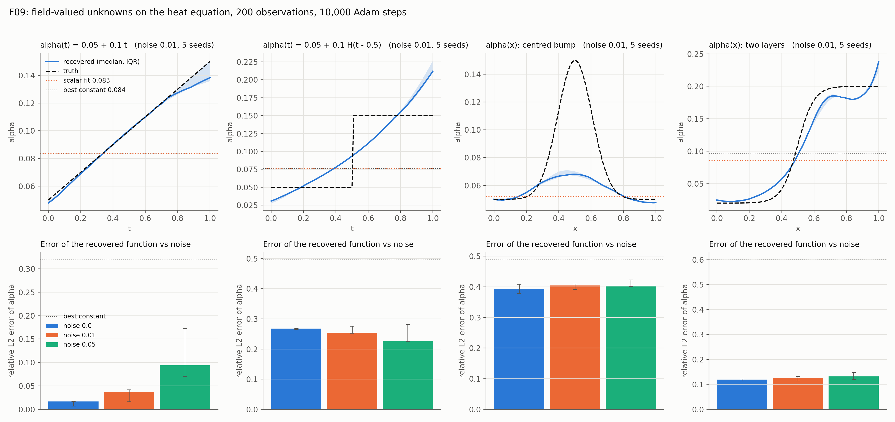

| Truth | Rel. L2 of $\hat\alpha$ at noise 0.01 | Scalar model instead | Best constant's distance in $u$ |
|---|---|---|---|
| $\alpha(t) = 0.05 + 0.1 t$ | 0.037 | 0.32 | 0.048 |
| $\alpha(t)$ with a step at $t = 0.5$ | 0.254 (a ramp with the right mean) | 0.50 | 0.080 |
| $\alpha(x)$, centred bump | 0.405 (collapses to the constant) | 0.50 | 0.038 |
| $\alpha(x)$, two layers | 0.125 (shape and plateaus recovered) | 0.62 | 0.198 |

- A linear drift is recovered to a few percent; a scalar model absorbs it as the best constant with a field error 2.7 times larger.
- A jump comes back as a smooth ramp: the data see $\int \alpha$ through the solution's amplitude, and a smooth surrogate rounds the kink.
- A field is identified only where the solution feels it (through the flux $\alpha u_x$) and only to the surrogate's accuracy: the two-layer medium, whose solution no constant reproduces within 20 %, is recovered; the centred bump, which a constant reproduces to 4 %, twice the surrogate's field error, is not, although the data alone would determine its modes (K48). The check is one call to `heat_variable_reference`.
- The optimizer's weight decay had been acting on the unknowns; PDE unknowns now train without it.

## Sensor layout vs conditioning (experiment K02)

The Fisher information of a sensor layout from `sensor_jacobian` on closed forms (heat $\alpha$; KdV $\alpha, \beta$), and $\alpha$ identified from 1–8 probes against the bound of each layout. Details in `experiments/K02_sensor_layout/README.md`.

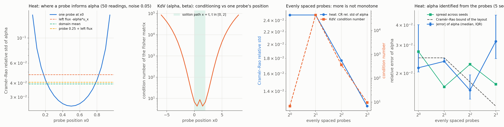

- On heat a probe's information scales with $\sin^2 \pi x_0$: a probe at 5 % of the length is 6.4 times worse (in standard deviation) than one at the centre, and two probes at the quarter points equal one at the centre. The domain mean, a quarter-point probe and the wall flux lie within a factor of two of the best probe.
- On KdV a probe on the soliton's path sees height (fixes $\alpha$) and width (fixes $\beta$) with $\kappa(F) \approx 7$; four lengths away it sees only the tail, where both coefficients scale the same number: $\kappa(F) > 10^4$, correlation 0.996. Two evenly spaced probes at $\pm 7.5$ are worse than one at the origin; placement beats count.
- Trained on the records, the spread of $\hat\alpha$ across seeds matches each layout's bound (1.6–2.7 % against 1.3–2.5 %), and the error stops at the 2 % surrogate floor: sensor design pays until the bound reaches the forward model's accuracy.

## Dimension scaling (experiment K08)

Heat and convection in $d = 1 \ldots 5$ at a fixed budget (4,096 points, 4,000 Adam steps), with the error, the residual and their ratio measured on fresh points. Details in `experiments/K08_dimension_scaling/README.md`.

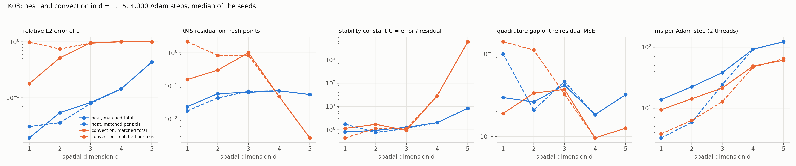

- For heat the interior residual stays at 2–7 % whatever $d$ while the error grows from 2 % to 44 %: the empirical stability constant goes from 0.8 to 8.4, a factor 4 of it the shrinking norm of the product solution and the rest the initial and boundary errors, which 512 fixed points cover more thinly in high dimension.
- Convection fails from $d = 2$ and at $d \ge 4$ converges to $u \approx 0$: a small residual with a large initial error, which the residual-based estimate does not see. The bound holds only with the condition terms.
- The Monte Carlo quadrature gap is 1–4 % at 4,096 points for every $d$, and 10–14 % at 36–216 points: the cost of a dimension is per point (14 → 122 ms per step), not in the quadrature.

## Reduced bases for field unknowns (experiment K48)

The F09 fields in a cosine basis: the Fisher spectrum of the modes from the reference solver, the swarm over the coefficients, and a 6-mode basis against a network as the trained unknown. Details in `experiments/K48_reduced_bases/README.md`.

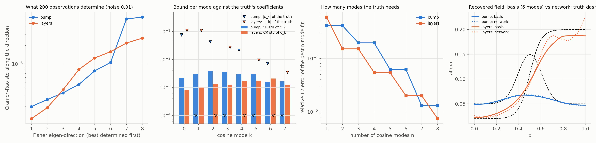

- With an exact forward model, 200 observations at noise 0.01 determine all eight modes of either field to 0.001–0.006, with no null space: F09's collapse of the bump is the surrogate's limit, not the data's.
- A 6-mode basis recovers the same (biased) field as the network, with coefficients reproducible across seeds to three digits: the PINN's optimum in the field sits 10–50 Fisher standard deviations from the truth. Forward accuracy, not the representation, is the bottleneck of field identification.
- The reference solver serves the swarm as a forward model (1,440 solves a minute); the swarm under-samples the region at 0.2–0.7 of the Fisher half-widths, and a 4-mode truncation is model-form error that the fit absorbs.

## Optimizers and the floor (experiments D01, D02)

Adam, L-BFGS and Adam→L-BFGS at matched wall-clock time on heat, Burgers and Allen–Cahn, and the heat-diffusivity floor cell of F01 without the packaged regularization. Details in `experiments/D01_optimizer_baseline/README.md`.

- **The 2 % floor of F01–F09 was the packaged weight decay and gradient clipping of the network**, not the surrogate: with both off, Adam identifies $\alpha$ to 0.4 % with a 0.23 % field error, and an L-BFGS finish halves that again (0.2 %, 0.1 %). F01 has been rerun on its whole grid with the clean configuration (its floor is 0.1–0.2 %); F02, F03 and F09 are still to be reread.
- L-BFGS reaches $2 \times 10^{-4}$ on heat in 120 s against Adam's $10^{-3}$, is 2–3 times better on Burgers, and halves Allen–Cahn's error where Adam makes no progress. The switch point hardly matters when both phases work; an early switch on Burgers diverged in 3 of 6 runs, so the trainer needs a step safeguard before `adam_lbfgs` becomes a default.

## The swarm as a posterior sample (experiment K47)

Every position a cloud swarm evaluates, weighted by its likelihood, against the exact posterior on heat $\alpha$ and the damped pendulum. Details in `experiments/K47_swarm_posterior/README.md`.

- The weighted swarm is centred on the posterior mean (within 0.05 standard deviations) but 0.5–0.7 as wide, with 80–87 % coverage at the 90 % level: importance weights cannot recover tails the swarm never visits. The accepted (likelihood-ratio) set is wider and covers 90–100 %; widened by K46's factor it is the usable interval. For a density, use a sampler, with the parametric surrogate (K45) as its cheap forward model.


## Parametric surrogate as the forward emulator (experiment K45)

```bash
python experiments/K45_parametric_surrogate/run.py --seeds 2 --datasets 10 --workers 4
```

One network $u_w(x, t; \theta)$ with the parameters as inputs (`CustomPDE(parametric=...)`), trained once over the prior range (4 × 64, Adam 4,000 steps then L-BFGS 100), against a dedicated network per parameter value at the same budget, on heat ($\alpha \in [0.02, 0.5]$), the KdV soliton ($(\alpha, \beta) \in [2, 12] \times [0.3, 3]$) and the Burgers travelling wave ($\nu \in [0.05, 0.5]$); then the swarm of K46 run on the surrogate's misfit (`pde.surrogate_misfit`) against the closed-form misfit on 10 noisy data sets. Details in `experiments/K45_parametric_surrogate/README.md`.

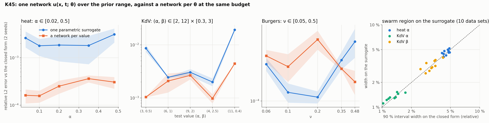

- **One surrogate covers the range to 0.2–0.3 % on heat and Burgers and 0.2–2 % on KdV**, at a quarter to a half of the cost of five dedicated networks (9–19 minutes against 23–56), and a forward evaluation of 10,000 points costs 15–40 ms. On heat it is 5–10 times less accurate than a network per value; on Burgers as accurate; on KdV it matches in the middle of the box and is 4–8 times worse at the corners.
- **The swarm on the surrogate is the swarm on the closed form.** Best fits agree to 0.04–0.3 % of the truth, 90 % widths to 1–3 %, and coverage data set by data set (8/10 heat, 7/10 KdV, the swarm's own under-coverage from K46). The surrogate's forward error is well below the scatter the data impose, and the region of a PINN inverse problem can be sampled on the PINN's own misfit at 0.1–0.2 s per data set.
- **Where the surrogate's error exceeds the data scatter (the KdV corner at (11, 0.4), 2 %), the region is biased by about that error**; the check is one dedicated network at the best fit.

## The evaporator reference and its PINN (experiments J01, J02)

`pinnrl.process.FallingFilmEvaporator`: liquid flow and solids fraction transported along a heated tube with boiling-point elevation, fouling and measured feed and steam signals; a steady-state ODE solver, a first-order method-of-lines dynamic solver, and the same model as a `CustomPDE`. Details in `experiments/J01_evaporator_reference/README.md`.

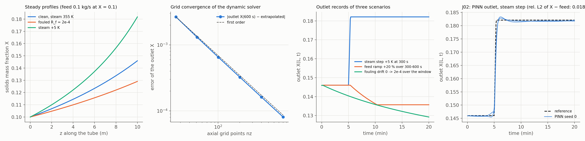

- One pass evaporates 31 % of the feed's water; a fouling of $10^{-4}$ m²K/W moves the outlet solids as much as 1.7 K of steam or 18 % of feed, so the outlet alone cannot tell them apart. The solver converges at first order (0.2 s per 10-minute simulation on the working grid).
- The normalised PINN reproduces the steam-step scenario to 0.4–0.6 % on both fields in under six minutes, in physical units; one of three seeds diverged in the L-BFGS finish (the safeguard is the next engineering item).

## Change-point identification (experiment F11)

```bash
python experiments/F11_change_point/run.py --seeds 5 --steps 10000 --workers 5 --clean --lbfgs --out experiments/F11_change_point/results/clean
```

Heat with $\alpha(t) = a + b\,\sigma((t - t_0)/0.02)$, the three numbers trainable from either side of the truth, 200 observations at noise 0, 0.01 and 0.05, 5 seeds, against the Cramér–Rao bound and F09's network unknown. Details in `experiments/F11_change_point/README.md`.

- **A change point is identifiable to the bound** with the clean configuration: the median error of $t_0$ is 0.0075 against a bound of 0.0062 at noise 0.01 and 0.032 against 0.031 at noise 0.05, from either start; $b$ is at the truth within its bound. The parametrised step beats the network's ramp at every noise level.
- Under the default weight decay and gradient clipping the same runs put $t_0$ 0.16 early, 25 times the bound, with half the jump: the regularization, not the estimator.

## Fouling from outlet sensors: identifiability (experiment J04)

```bash
python experiments/J04_plant_sensors/run.py --datasets 5 --modes 6
```

The Fisher information of J03's outlet records (solids and flow every 5 s over 20 minutes) for six Legendre modes of the fouling resistance $R_f(t)$ and four nuisances (the clean coefficient $U$, a steam bias, feed-flow and feed-solids biases), from finite differences on the reference solver; and F07's profile likelihood of the drift's end value on the reference. Details in `experiments/J04_plant_sensors/README.md`.

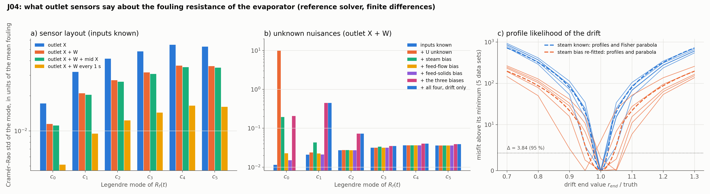

- **With the inputs known, the outlet determines the whole time course**: six modes to 1–4 % of the mean fouling, $\kappa(F) = 25$, the end value to 5 %. The flow meter halves the bound of the solids sensor alone, 1 s sampling halves it again, a mid-tube probe adds nothing.
- **$U$ and the constant fouling are one unknown** ($1/U + R_f$): a monitor estimates the change of resistance since a reference state, never its absolute value.
- **The steam temperature is the nuisance that matters**: 0.5 K of steam bias reproduces the records of a 30 % fouling error (correlation 0.85 with the drift), and with the three input biases free together the leftover direction masquerades as a drift (the drift's bound goes from 2 % to 45 %). The twin needs the steam temperature to 0.1 K, or a heat-duty signal.
- The profile likelihood on the reference is the Fisher parabola at $\pm 10$ %, with a 95 % interval of $\pm 2$ % on the drift's end value (steam known) and $\pm 4$ % (steam bias re-fitted).

## Fouling estimation (experiment J03)

```bash
python experiments/J03_fouling_estimation/run.py --seeds 3 --steps 4000 --workers 3
```

The evaporator twin with the steam and feed records as inputs and two outlet sensors ($X$ and $W$ every 5 s, 20 minutes), the fouling $R_f(t)$ an `UnknownFunction` of time bounded to $[0, 5 \times 10^{-4}]$, against a scalar $R_f$; the J02 recipe, 3 seeds. Details in `experiments/J03_fouling_estimation/README.md`.

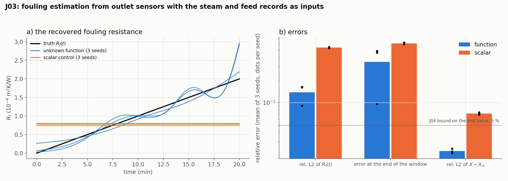

- **The twin recovers the drift to 9–16 % in L2** (the field to 2 %) where the best constant is wrong by 53–55 % (field 7 %): a drifting coefficient is a function to identify.
- **It lands at the surrogate's limit, not the data's**: J04's bound on the end value is 5 %, the PINN delivers 10–49 % at the end of the window and its excursions follow the steam signal (the surrogate's imperfect response to the recorded input is absorbed by the unknown). The value a few residence times before the end of the record is good to 5–10 %.
- The first pass ignored the records because the flow sensor's units (kg/s, scale 0.02) made its misfit 2,500 times too weak in the normalized loss; sensor misfits are now taken in units of the field's scale.

## Linearized stability (experiment K09)

```bash
python experiments/K09_linearized_stability/run.py --seeds 2 --steps 2000 --workers 3
```

The Jacobian spectrum along the reference trajectory of eight catalogue ODE systems (fastest rate, stiffness ratio, fast units in the window, oscillations, perturbation growth) next to the PINN's error on each; and the method-of-lines spectrum of the evaporator (`FallingFilmEvaporator.mol_rhs`) against its grid, with the source terms alone. Details in `experiments/K09_linearized_stability/README.md`.

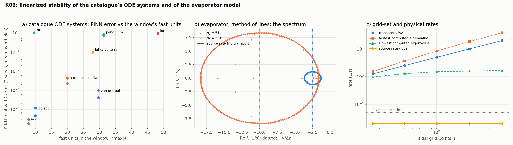

- **The evaporator's discretised operator is non-normal**: the upwind transport has one defective eigenvalue $-v/\Delta z$ and the computed spectrum is a circle of rounding around it, so its "stiffness ratio" means nothing. The physics is convectively stabilised and not stiff: the source terms grow locally at 0.02 s⁻¹, the transport removes them at 0.05 s⁻¹, the physical rates span a factor 6, and the grid-set rate (10 s⁻¹ at $n_z = 201$) that forces BDF is one a PINN never sees.
- **On ODEs the PINN fails by the trivial solution, not by stiffness**: pendulum, Lorenz and SIR collapse to an exact trivial solution close to the initial condition (errors 0.7–1.0), while Van der Pol with the same fast-unit count and a stiffness of 2,500 trains to $10^{-3}$. Every success has at most 30 fast units in the window; time-marching (H04) and causal weighting are the remedies.

## A Kalman-filter baseline (experiment J05)

```bash
python experiments/J05_ekf_baseline/run.py --seeds 3
```

`pinnrl.process.ExtendedKalmanFilter` (with a Rauch–Tung–Striebel smoother) on a lumped method-of-lines model of the evaporator with 6–51 cells, the fouling as a random-walk state, on J03's records and seeds; against the PINN twin, and with the steam and feed biases of J04. Details in `experiments/J05_ekf_baseline/README.md`.

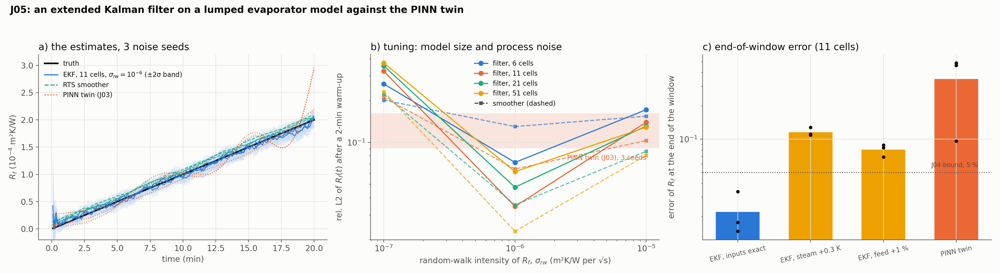

- **With the model known, the filter beats the PINN twin by a wide margin at a thousandth of the cost**: 11 cells track the drift to 3.5 % in L2 and 2 % at the end in 0.2 s against the PINN's 9–16 % and 10–49 % in five minutes; the smoother on 51 cells reaches 2.3 % and 0.7 %, close to J04's 5 % data limit.
- **The tuning is one number**, the random-walk intensity: a decade too small and the filter lags the ramp by four minutes, a decade too large and it follows the noise. Six cells still give 7 %.
- **The inputs bound both estimators alike**: a 0.3 K steam bias costs the filter 12 % at the end, a 1 % feed bias 8 %, the J04 numbers. The PINN's case is the partly unknown model (a closure, a field), not this one; the EKF stays as the control on every later comparison.

## Moving-horizon estimation (experiment J05b)

```bash
python experiments/J05_ekf_baseline/run_mhe.py --seeds 3 --workers 3
```

`pinnrl.process.MovingHorizonEstimator` against the extended Kalman filter on J05's records: the same 11-cell model, $Q$, $R$ and prior, horizons of 6 to 24 records, with and without the constraint that the fouling only grows, a random walk ten times too loose, and a confident wrong prior. Details in `experiments/J05_ekf_baseline/README.md`.

- **On this model the moving horizon is the Kalman filter at 10–35 times the cost**: 3.4 % against 3.5 % in L2 and 2.1 % against 2.2 % at the end for every horizon, because the response to the fouling is nearly linear over a window (for a linear model the two coincide exactly, which the tests check).
- **The growth constraint smooths, it does not correct**: with the random walk ten times too loose it removes two thirds of the noise-following and a tenth of the L2 error, and leaves the end error where it was; a one-sided constraint on noisy increments ratchets upward.
- **A confident wrong prior costs both about half a minute**, twice the residence time. The moving horizon's place is a model that is nonlinear within a window or constraints that bind in normal operation.

## Calibrated fouling intervals (experiment J06)

```bash
python experiments/J06_fouling_intervals/run.py --datasets 100 --workers 6
python experiments/J06_fouling_intervals/run.py --part pinn --pinn-datasets 12 --members 3 --workers 4
```

F06's question on the evaporator: over 100 noise draws of J03's records, does the 90 % interval of each estimator contain the fouling at the end of the record, and the time to the next cleaning, 90 % of the time? A batch Gauss–Newton fit through the reference solver (2 or 6 Legendre modes), the Kalman filters of J05 with the fouling as a random walk or as a level and a rate, on 11 and 51 cells, and the PINN twin of J03; with the inputs exact, with a steam record uncertain by 0.3 K, and with a fouling curve that saturates. Details in `experiments/J06_fouling_intervals/README.md`.

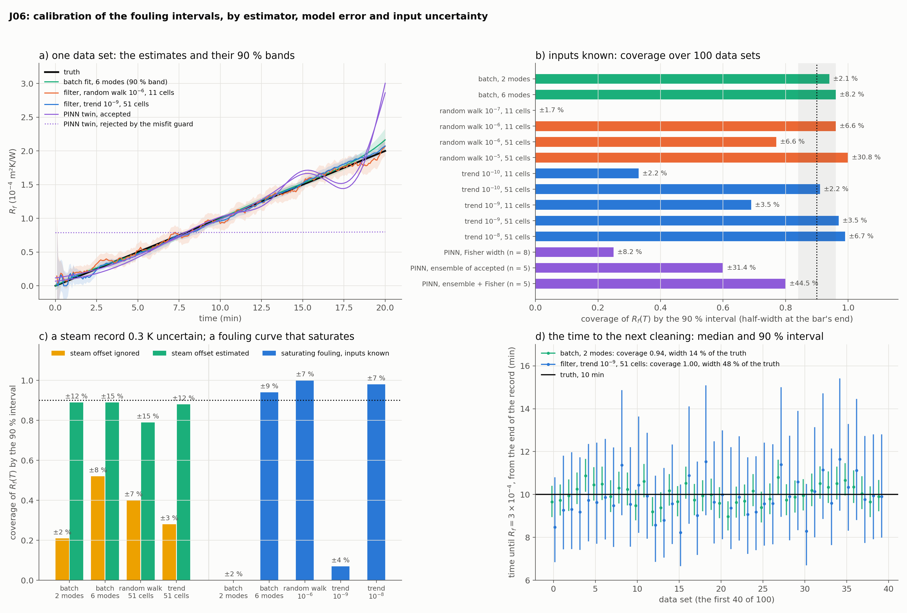

- **With the model right and the fouling's form containing the truth, the Fisher interval is calibrated**: 0.92–0.96 for the batch fits and 0.91–0.99 for the trend filter on 51 cells, at ±2 % (a ramp assumed) to ±8 % (six modes). The form is an assumption the interval inherits: the ramp fit on a saturating curve is 25 % off with a ±2.5 % interval, and its misfit (776 against 474) is what says so.
- **A model good enough for the estimate is not good enough for the interval**: the 11-cell filter of J05 is biased by 2.7 % of the fouling, which the tight intervals of the trend filter do not cover (33–69 %; 91–97 % on 51 cells). The tuned random walk covers on 11 cells because its lag and the grid's bias cancel by half.
- **The trend filter's rate noise is the same assumption in filter form**: frozen it is the ramp fit (0 % on the saturating curve), free to change over five minutes it covers both curves at ±7 %, and the time to clean then has an open upper end in half the data sets.
- **A steam record uncertain by 0.3 K, taken at face value, drops every interval to 21–52 %.** With the offset estimated under its prior the batch fits cover 0.89 at ±12–15 %: the honest width for this plant is set by the steam measurement, not by the estimator. Clipping the fouling at zero inside the filter costs five points of coverage once the offset is a state.
- **The time to clean is calibrated where the level and rate are**: 0.94 at ±7 % for the ramp fit, 0.92–0.93 at ±28–37 % once the steam offset is admitted.
- **The PINN twin fails to train on 22 of 36 runs** (a constant fouling, or the unknown's bound), which its own sensor misfit detects; the accepted runs are 26 % off at the end of the record against the 5 % the data allow, and no internal width covers that (0.25 with the Fisher width, 0.60–0.80 with ensembles at ±31–45 %). J03's three good seeds were a lucky draw.

## Measurement design for the fouling estimate (experiment J09)

J06 ends with an interval of ±12–15 % once the steam record's offset is admitted. J09 admits every instrument error (the steam offset, the feed solids, both flow meters' gains, the outlet density meter's offset), each with the accuracy it is trusted to as a prior, and prices the remedies before any is bought: the posterior covariance $(P_0^{-1} + J^\top R^{-1} J)^{-1}$, with the sensitivities from the reference solver, does not depend on the records ([`pinnrl.analysis.posterior_covariance`](api/analysis.md#analysis.design.posterior_covariance), [`greedy_design`](api/analysis.md#analysis.design.greedy_design)).

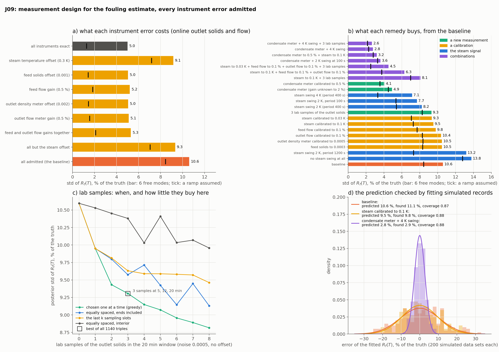

| Design (std of $R_f(T)$, % of the truth; six free modes) | |
|---|---|
| exact instruments | 5.0 |
| the steam offset admitted alone / the four mass-balance instruments alone | 9.1 / 9.3 |
| everything admitted (the baseline) | 10.6 |
| the steam probe calibrated to 0.03 K | 9.3 |
| three lab samples of the outlet solids, at the best times | 9.3 |
| a 4 K steam swing instead of 1 K | 7.1 |
| a condensate meter, gain unknown to 2 % | 4.9 |
| the condensate meter and the 4 K swing | 2.8 |

- **Two sources limit the estimate, and one is invisible one instrument at a time.** The evaporation rate carries the fouling and the records give it twice, by the flow balance and by the solids balance; any single loose instrument leaves the other balance closed (5.0–5.2 %), all four together cost as much as the steam offset. For the same reason no single calibration pays.
- **A condensate meter is the measurement to buy**: it reports the evaporation directly, not as the difference of two flows eight times larger, and with its gain unknown to 2 % it beats exact instruments without it.
- **The steam swing is the free remedy.** A change of the steam temperature changes the flux by $\Delta T_s/(1/U + R_f)$ whatever the offset. No swing gives 13.8 %, 4 K gives 7.1 %; a swing as slow as the window is worth almost nothing, since that is what a change of fouling looks like.
- **Lab samples buy 1.3 points**, best taken at the end, a quarter and past the middle of the window (the greedy triple is the best of all 1140).
- **The prediction holds**: over 200 nonlinear simulated fits per design the errors' standard deviations are within 5 % of the predicted ones (10.6 → 11.1, 9.5 → 9.8, 2.8 → 2.9 %), with coverages of 0.87–0.88.

See `experiments/J09_measurement_design/`.

## A drying droplet and its closure (experiment J07)

```bash
python experiments/J07_droplet_drying/run.py --seeds 3 --steps 12000 --lbfgs-steps 500 --data-weight 300 --workers 3
```

`pinnrl.process.DryingDroplet` (a 1.5 mm droplet drying in 90 °C air with a characteristic drying curve as its rate closure): the PINN forward solve, and the closure $f(X)$ identified as an unknown function from a mass-and-temperature record, against least squares with the right and with a wrong parametric form. Details in `experiments/J07_droplet_drying/README.md`.

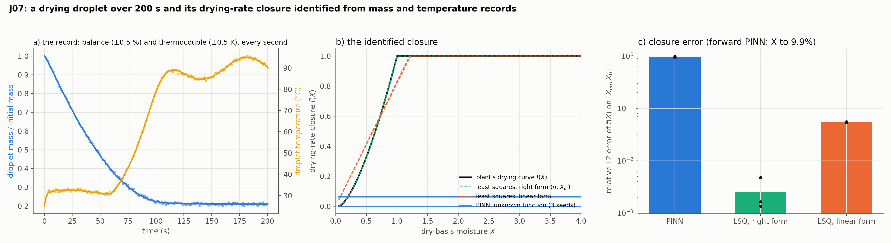

- **The forward solve reaches 8–14 % on the moisture** at 12,000 + 500 steps: the 50 K temperature rise over 40 s at the critical moisture is the feature a smooth network spreads (time-marching is the next lever).
- **The unknown closure collapses to a constant on every seed**, either ignoring the physics ($f \equiv 0$, records fitted) or the data ($f \equiv 0.06$): K09's trivial attractor in the inverse setting, sticky because softplus-constrained weights that go small cannot grow back. One recovery to 15 % did not reproduce.
- **Least squares with the right form is at the noise floor** ($n$, $X_{cr}$ to 1 % in 0.2 s) and the wrong form is 5.5 % off with a misfit 16 times larger.
- **Second pass (J07b).** The record itself gives the closure to 2–3 % pointwise ($f_i = -\dot X_i m_s / (h_m A \Delta\rho)$ from the smoothed readings); started there, the PINN refines it to 1.7–2.1 % on two seeds and destroys it on the third (a misfit check against the start catches that). Freezing the function first makes the collapse certain; a Legendre basis removes the sticky collapse (7 %, 20 %, 66 %) but not the multimodality. Figure: `assets/benchmarks/j07b_closure.png`.
- **The guard (J07c).** `DryingDroplet.record_misfit` solves the droplet with a closure by the reference solver and returns the reduced $\chi^2$ of the record: 0.9 for the plant's curve, 1.5–1.7 for the two good refinements, 60–90 for the pointwise start they came from, 390–765 for the two failed runs and infinite for the collapsed constants. It catches every failure of J07b, including one the network's own fields hide (fields within 0.8 %, closure 20 % off, record missed 43-fold). The start's misfit is all at the equilibrium moisture, where its closure is 0.01 instead of 0; what the PINN refinement buys is that consistency, a fifty-fold drop in misfit at an unchanged L2 error.
- **Shooting (J07d), the classical control.** A monotone piecewise-linear closure on 24 knots, fitted through the reference solver by bounded least squares from a cold start, reaches 1.5–1.6 % on every seed with the record at the noise level, in 8–10 s against the PINN's six to eight minutes and one lost seed in three. With an ODE model and a reference solver that takes a closure, an unknown function is a few dozen bounded parameters; the PINN's case starts where the forward solve is missing or too expensive to iterate.
- **The anchored closure (J07e).** `UnknownFunction(anchor={"at": X_eq, "value": 0.0})` with `monotone` holds $f(X_{eq}) = 0$ by construction. The same pointwise estimate then misses the record by 1.6–2.3 times its noise instead of 60–92 times, in one second; refining it with the PINN improves one seed and worsens two (the misfit guard rejects both). Shooting stays ahead (1.5–1.6 % against 2–3 %).

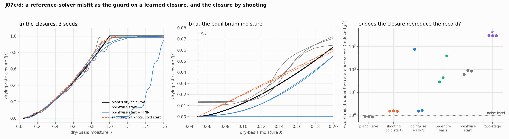

## The closure at dryer scale (experiment J11)

[`SprayDryer`](api/process.md#process.dryer.SprayDryer) couples J07's droplet to the air it dries in: a co-current plug-flow tower at steady state, four ODEs along the residence time, with the instruments a plant has (six air thermocouples, the outlet humidity, the powder's moisture). One solve takes 5 ms, so the estimator is a least-squares fit through it; no network was trained.

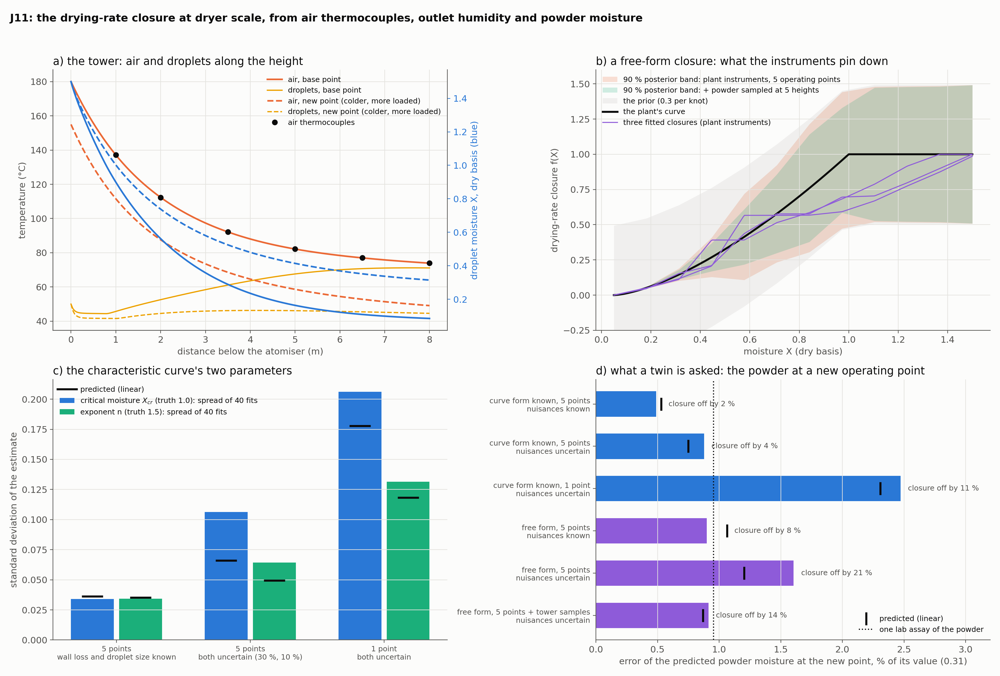

- **The curve's form known:** five operating points give the critical moisture and the exponent to ±0.03 each (2 % in L2), in under a second; ±0.11 and ±0.06 once the wall loss (30 %) and the droplet size (10 %) are uncertain, more than the linear analysis predicts.
- **A free-form closure is not identifiable from the tower:** 4 to 6 of its 11 directions are determined, the band closes only below a moisture of 0.5, and the fits are 8–21 % off. The droplets cross the high-moisture range above the first thermocouple.
- **The prediction does not need it:** the powder moisture at an operating point outside the campaign (four times wetter) is predicted to 0.9–1.6 % by the free-form fits and 0.5–0.9 % with the form known; one lab assay resolves 1 %. From a single operating point it is 2.5 %.
- **For the twin:** identify the closure on a droplet rig, carry it to the tower, and estimate at dryer scale the few numbers its records determine, with the droplet size as the nuisance to design for.

See `experiments/J11_dryer_closure/`.

## A soft sensor for the stickiness margin (experiment J08)

Powder sticks when its particles are warmer than their glass transition by more than a material limit; [`SprayDryer.stickiness_margin`](api/process.md#process.dryer.SprayDryer) is $T_p - T_g(X)$ along the tower, with $T_g$ from Gordon–Taylor. It cannot be measured online: $T_g$ falls by 9 K per 0.01 of moisture.

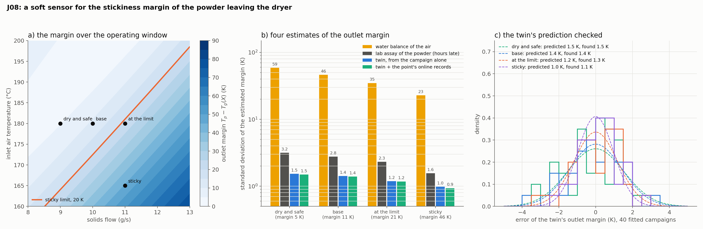

| Estimate of the outlet margin (std, four operating points) | |
|---|---|
| moisture from the water balance of the air | 23–59 K |
| lab assay of the powder, hours late | 1.6–3.2 K |
| the twin, identified on J11's five-point campaign and run forward | 1.0–1.5 K |
| the twin updated with the point's online records | 0.9–1.5 K |

- **The water balance cannot see the powder:** the air carries 36 times the solids' mass, so a humidity error of 0.001 is half the outlet moisture.
- **The twin beats the assay it replaces and is not late**; the errors of 40 fitted campaigns match the prediction (1.1–1.5 K). The guard band below the sticky limit halves, from 4.6 to 2.3 K. It also gives the margin inside the tower to about 1 K.
- **The caveat:** these are estimation errors of a model whose structure is the plant's; against a real dryer the first comparison is the twin's moisture against the lab's over a campaign.

See `experiments/J08_stickiness/`.

## Measurement and campaign design for the dryer (experiment J12)

J09's calculation on the tower, with eight inputs admitted at their accuracies. The droplet's diameter and velocity are one unknown (the drying time against the residence time), so measuring the droplet size alone buys nothing; behind them the six balance inputs limit jointly, none alone. What pays is thermocouples good to 0.2 K (critical moisture ±0.085 → ±0.052), nine operating points (±0.065) and, for the stickiness margin, replicate lab assays (1.2 → 0.6 K). The best five points depend on the target: next to the operating limit for the margin, the corners of the window at high load for the curve. 60 fitted campaigns per design confirm the parameters' predicted spreads; the margin's is 20 % optimistic. See `experiments/J12_dryer_design/`.

## Time-marching windows (experiment H04)

```bash
python experiments/H04_time_marching/run.py --seeds 2 --steps 12000 --workers 4
```

`PDETrainer.train_windows` (the same Adam budget split over 1, 2, 4 or 8 time windows, the network carried over, an L-BFGS finish on the whole span) on the K09 failures, Van der Pol and the drying droplet. Details in `experiments/H04_time_marching/README.md`.

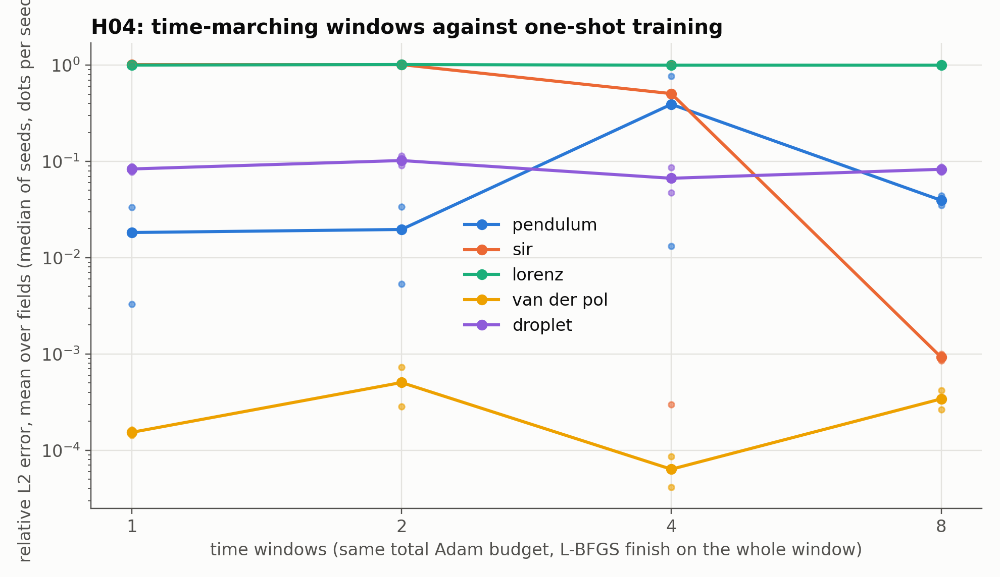

- **Time marching rescues SIR**: one-shot training returns the disease-free state (error 1.0), eight windows find the epidemic wave to 0.1 %. A window short against the feature keeps the network off the trivial branch.
- **The pendulum was a budget problem**: 12,000 + 500 steps give 0.3–3 % in one shot where K09's 2,000 + 100 gave 74 %; windows do not help it. **Lorenz is rescued by nothing** (a chaotic trajectory with a growth of $e^{23}$ is not one network's job), and **the droplet's sharp transition is a resolution problem**, unchanged by the schedule (2–5 % on the moisture).

