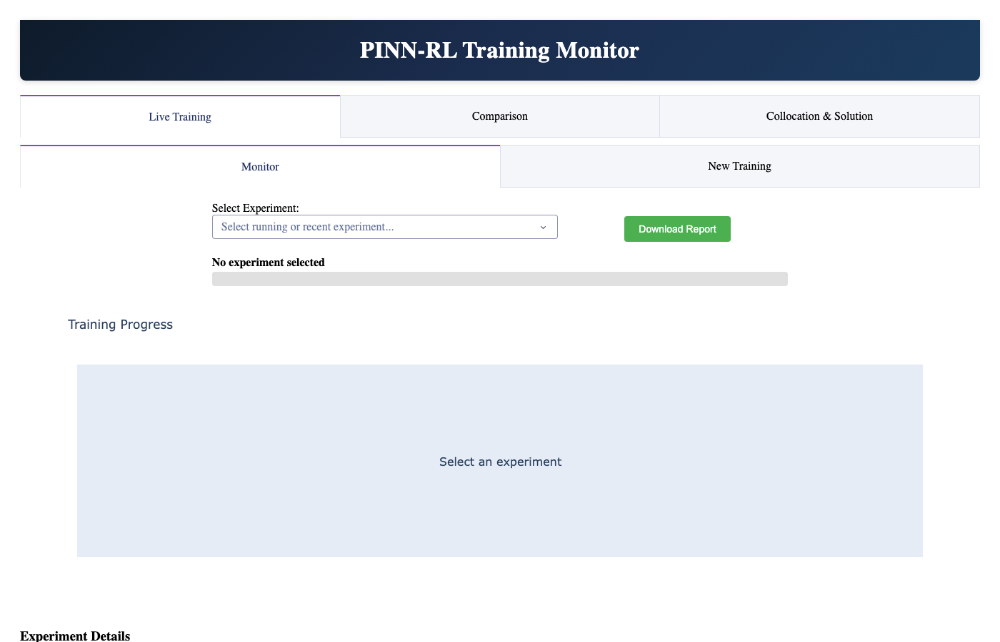
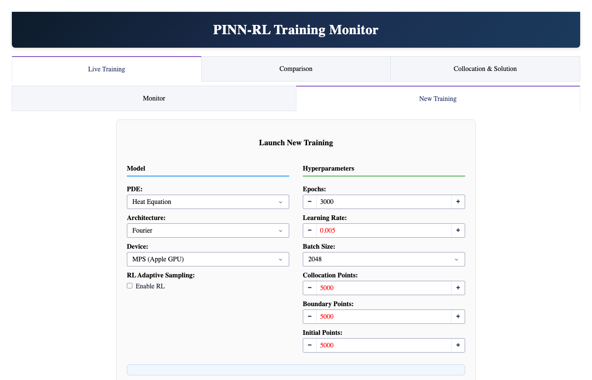
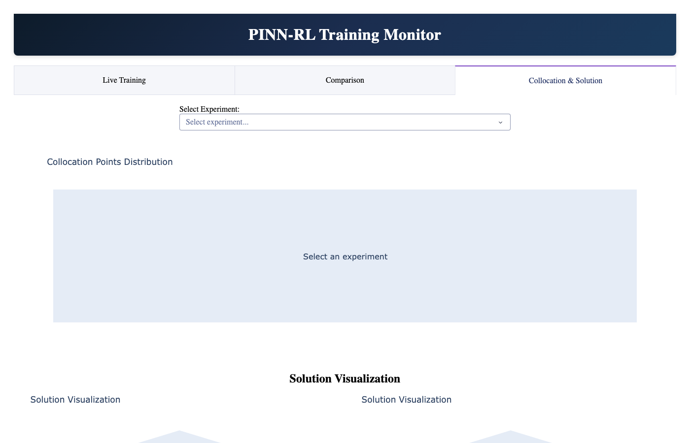
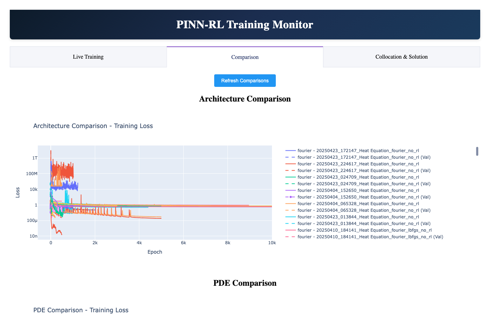

# Dashboard

A browser app for launching runs, watching them train, and comparing results, with no plotting code to write.

```bash
pinnrl-dashboard                       # http://127.0.0.1:8050/, opens a browser tab
pinnrl-dashboard --port 8051 --no-browser
```

The dashboard lists and writes runs in `./runs/` relative to the directory you start it from, the same folder `pinnrl-train` uses. Runs launched from the dashboard are ordinary `pinnrl-train` processes, so they keep going if you close the browser.



## Live Training

**New Training** is a form over every `pinnrl-train` option: PDE, architecture, budget, sampling strategy (including the experimental RL bandit), optimizer, LR schedule, adaptive weights, loss function, and mode. Defaults come from `config.yaml` for the selected PDE.

- In **inverse** mode the form asks for the parameters to identify, their initial guesses, and the observation source: synthetic noisy samples of the exact solution, or an `.npz` file.
- Choosing a **Well dataset** fills in its recommended mode and architecture.



**Monitor** follows a run as it trains:

- the loss components and the learning rate;
- the parameter trajectory in inverse mode, against the true value when known;
- interactive 3-D surfaces of the predicted `u(x, t)` and the PDE residual.

The surfaces are read from the run's `live_snapshot.npz`, which is written every `validation_frequency` epochs plus at the start and the end. 2-D PDEs are shown as a time slice.

## Collocation & Solution

For a finished run, this tab shows predicted against exact solution surfaces with a time slider, the point-wise error, and where the collocation points were placed over training. That last view is how you check what an adaptive sampler actually did. The exact-solution panel is empty for PDEs without a closed form.



## Comparison

Select several finished runs to overlay their loss curves and compare final metrics side by side.



Runs can be deleted from the selector (with a confirmation step); only folders inside the runs directory can be removed. To load a run in Python, use `pinnrl.training.train.load_run` (see [Training](training.md#python)).
