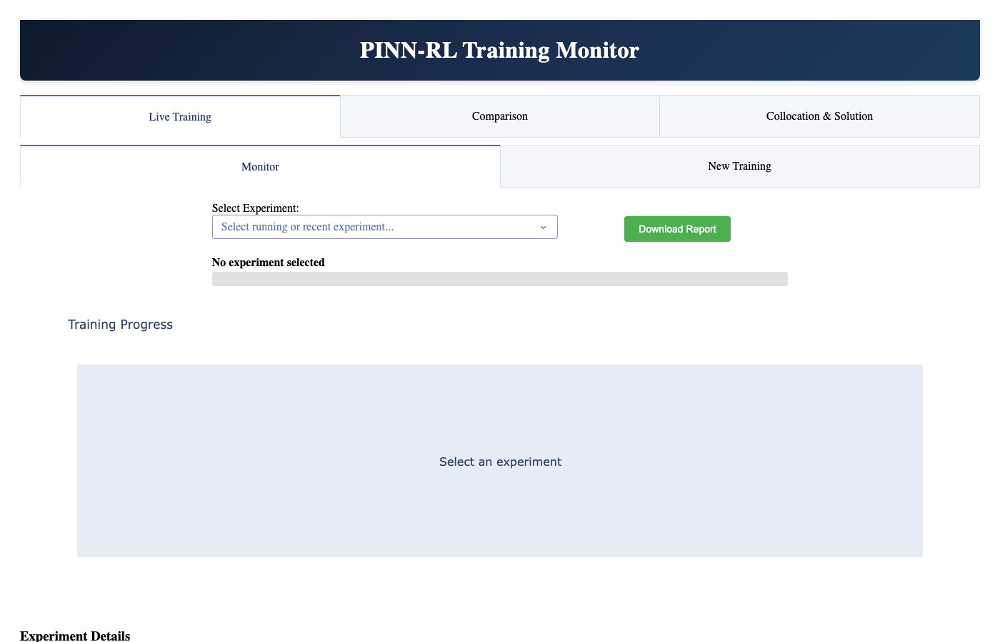
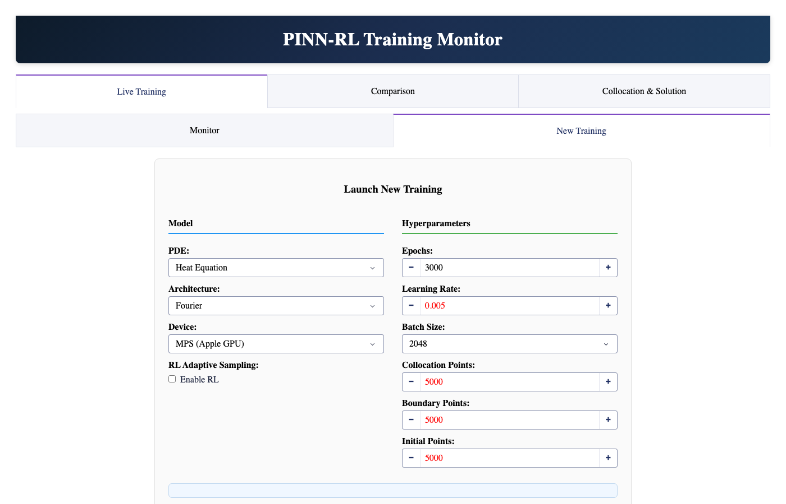
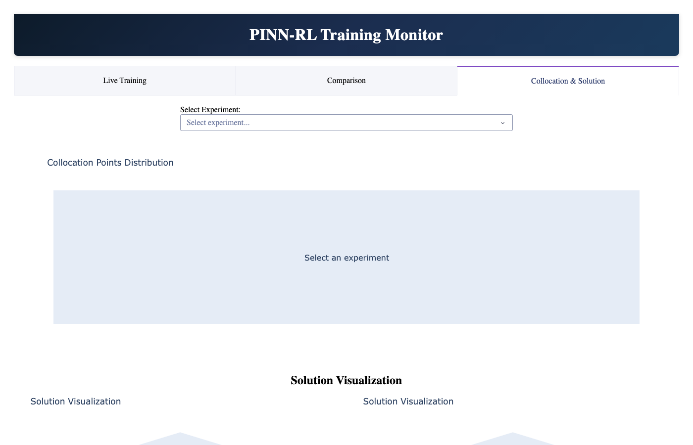
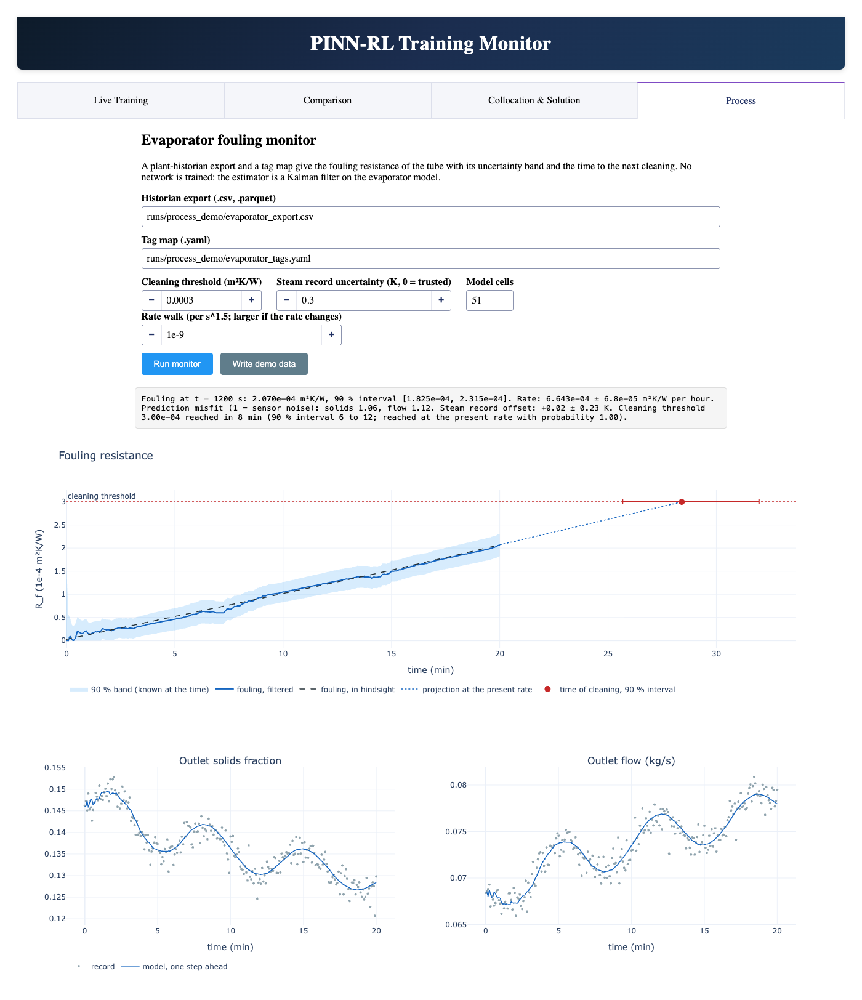
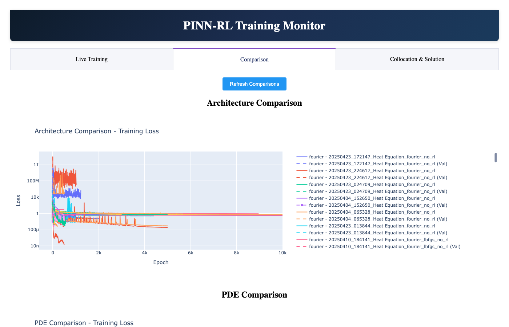

# Dashboard

A browser app for launching runs, watching them train, and comparing results, with no plotting code to write.

```bash
pinnrl-dashboard                       # http://127.0.0.1:8050/, opens a browser tab
pinnrl-dashboard --port 8051 --no-browser
```

The dashboard lists and writes runs in `./runs/` relative to the directory you start it from, the same folder `pinnrl-train` uses. Runs launched from the dashboard are ordinary `pinnrl-train` processes, so they keep going if you close the browser.



## Live Training

**New Training** is a form over every `pinnrl-train` option: PDE, architecture, budget, sampling strategy (including the experimental RL bandit), optimizer, LR schedule, adaptive weights, loss function, and mode. Defaults come from `config.yaml` for the selected PDE.

- In **inverse** mode the form asks for the parameters to identify, their initial guesses, and the observation source: synthetic noisy samples of the exact solution, or an `.npz` file.
- Choosing a **Well dataset** fills in its recommended mode and architecture.



**Monitor** follows a run as it trains:

- the loss components and the learning rate;
- the parameter trajectory in inverse mode, against the true value when known;
- interactive 3-D surfaces of the predicted `u(x, t)` and the PDE residual.

The surfaces are read from the run's `live_snapshot.npz`, which is written every `validation_frequency` epochs plus at the start and the end. 2-D PDEs are shown as a time slice.

## Collocation & Solution

For a finished run, this tab shows predicted against exact solution surfaces with a time slider, the point-wise error, and where the collocation points were placed over training. That last view is how you check what an adaptive sampler actually did. The exact-solution panel is empty for PDEs without a closed form.



## Process

The soft sensor of the evaporator twin on plant data. Give a plant-historian export (CSV or Parquet) and a YAML [tag map](process_twins.md#plant-data-a-historian-export-and-a-tag-map), and the view runs the [fouling monitor](process_twins.md#estimating-a-drifting-parameter): a Kalman filter on the evaporator model with the fouling resistance as a level and a rate. No network is trained, so the result is there in a few seconds.

- **Fouling resistance:** the estimate at each record with its 90 % band (what was known at the time), the hindsight estimate from the whole record, the cleaning threshold, and the projected time of reaching it with its interval. An interval whose upper end is open means the fouling rate is not yet clearly positive.
- **Outlet records** against the filter's one-step predictions, and the prediction misfit in units of the sensor noise in the summary: near 1 when the model explains the records; a larger value says the band should not be trusted.
- **Steam record uncertainty:** a steam-temperature offset mimics fouling (0.5 K for 30 %, experiment J04). Enter how well the steam record is trusted and the offset is estimated alongside, which widens the band to what the data support ([J06](benchmarks.md#calibrated-fouling-intervals-experiment-j06)).

- **Rate walk:** how fast the fouling rate itself may change, $r/\sqrt{\tau}$ for a rate $r$ that may change by its own size over a time $\tau$. The default suits a steady drift; on a curve that bends it gives a narrow band around a biased estimate, and a larger value is the safe choice at the price of a wider time to clean.

**Write demo data** puts a synthetic 20-minute export and its tag map in `runs/process_demo/` and fills the form; the two files are a template for a real export. A `model:` block in the tag map overrides the tube's parameters (`length`, `U`, `velocity`, ...).



## Comparison

Select several finished runs to overlay their loss curves and compare final metrics side by side.



Runs can be deleted from the selector (with a confirmation step); only folders inside the runs directory can be removed. To load a run in Python, use `pinnrl.training.train.load_run` (see [Training](training.md#python)).
