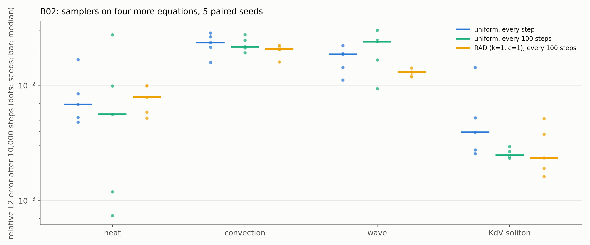

# B02: the sampler ranking on other equations

## Question

Does B01's ranking hold on heat, wave, convection and KdV?

## Setup

- **Equations** (catalogue entries with a closed form, now accepted by `pinnrl.benchmarks.sampling_study`): heat, convection, wave and the KdV soliton. Cahn–Hilliard has no closed form in the catalogue and is left out.
- **Samplers:** uniform every step, uniform every 100 steps (the same-cadence control) and RAD ($k = 1$, $c = 1$, pool 20×) every 100 steps.
- **Training:** the B01 protocol, 4 × 64 tanh MLP, 1,000 points, Adam at $10^{-3}$, 10,000 steps, 20 checkpoints; 5 seeds, paired across samplers.
- **Metric:** relative L2 error against the closed form on a 256 × 101 grid.
- **Code:** `run.py`.

Rerun with:

```bash
python experiments/B02_more_pdes/run.py --seeds 5 --steps 10000 --workers 4
```

## Result



Relative L2 error after 10,000 steps, median [IQR] over 5 seeds; "beats uniform" counts paired seeds, with p from a two-sided Wilcoxon signed-rank test (5 pairs, so the smallest attainable p is 0.06).

| Equation | Sampler | Rel. L2 | Beats uniform | p |
|---|---|---|---|---|
| heat | uniform, every step | 0.0069 [0.0053, 0.0085] | – | – |
| | uniform, every 100 | 0.0056 [0.0012, 0.0099] | 3/5 | 0.81 |
| | RAD | 0.0080 [0.0059, 0.0098] | 1/5 | 0.63 |
| convection | uniform, every step | 0.0237 [0.0216, 0.0267] | – | – |
| | uniform, every 100 | 0.0218 [0.0213, 0.0249] | 3/5 | 1.00 |
| | RAD | 0.0209 [0.0207, 0.0219] | 4/5 | 0.31 |
| wave | uniform, every step | 0.0187 [0.0144, 0.0191] | – | – |
| | uniform, every 100 | 0.0242 [0.0167, 0.0248] | 2/5 | 0.63 |
| | RAD | 0.0131 [0.0122, 0.0132] | 4/5 | 0.19 |
| KdV soliton | uniform, every step | 0.0039 [0.0028, 0.0052] | – | – |
| | uniform, every 100 | 0.0025 [0.0024, 0.0027] | 4/5 | 0.19 |
| | RAD | 0.0024 [0.0019, 0.0038] | 4/5 | 0.31 |

## Conclusion

1. **On smooth problems the sampler does not matter.** All four equations are solved to 0.2–2.5 % by every sampler, and no arm differs from fresh uniform points at a level the 5 seeds can resolve. RAD has the best median on convection, wave and KdV and wins 4 of 5 paired seeds there, and is slightly worse on heat; the differences are tenths of a percent on errors that are already small.
2. **B01's ranking holds in its negative form.** No sampler beats uniform significantly on a problem without a sharp feature; the only consistent adaptive advantage remains Allen–Cahn (B01, B04). The recommendation stands: uniform by default, RAD when the solution has a feature the uniform sample under-resolves, and measured against uniform at equal budget.
3. **RAD narrows the spread.** Where RAD leads (convection, wave) its interquartile range is 2–4× narrower than uniform's: adaptive points reduce the seed-to-seed variation more than the median, which is worth having in a study even when the median does not move.

**Consequences for the backlog:**
- B02 closes with four equations; Cahn–Hilliard waits for a reference solver (it has no closed form).
- A critical-difference diagram across the six equations needs more seeds than the ones B01 and B02 have in common; P02 reports the two tables instead.
