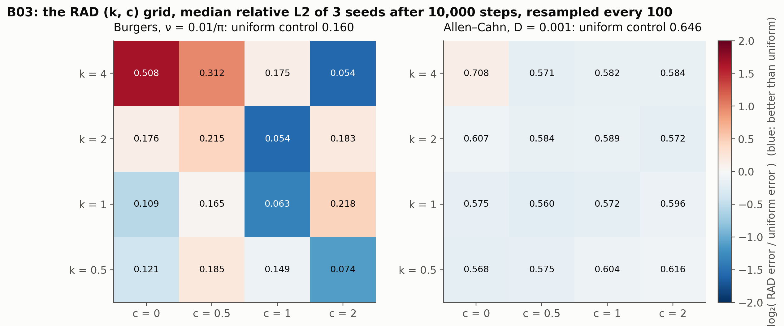

# B03: the RAD hyperparameter grid

## Question

Which RAD hyperparameters work, and are they PDE-dependent?

## Setup

- **Grid:** $k \in \{0.5, 1, 2, 4\} \times c \in \{0, 0.5, 1, 2\}$, the grid of Wu et al. (2023), plus the uniform-every-100-steps control ($k = 0$).
- **Problems:** Burgers ($\nu = 0.01/\pi$) and Allen–Cahn, scored against the B01 references.
- **Training:** the B01 protocol at 10,000 steps, 1,000 points resampled every 100 steps; 3 seeds.
- **Code:** `run.py`.

Rerun with:

```bash
python experiments/B03_rad_grid/run.py --seeds 3 --steps 10000 --workers 4
```

## Result



Median relative L2 error over 3 seeds after 10,000 steps, resampled every 100 steps. The uniform control at the same cadence: Burgers 0.160, Allen–Cahn 0.646.

| | Burgers: c = 0 | c = 0.5 | c = 1 | c = 2 | | Allen–Cahn: c = 0 | c = 0.5 | c = 1 | c = 2 |
|---|---|---|---|---|---|---|---|---|---|
| k = 0.5 | 0.121 | 0.185 | 0.149 | 0.074 | | 0.568 | 0.575 | 0.604 | 0.616 |
| k = 1 | 0.109 | 0.165 | **0.063** | 0.218 | | 0.575 | **0.560** | 0.572 | 0.596 |
| k = 2 | 0.176 | 0.215 | **0.054** | 0.183 | | 0.607 | 0.584 | 0.589 | 0.573 |
| k = 4 | 0.508 | 0.312 | 0.175 | **0.054** | | 0.708 | 0.571 | 0.582 | 0.584 |

## Conclusion

1. **On Burgers the grid matters, and the floor matters most.** The best cells ($k = 2, c = 1$; $k = 4, c = 2$; $k = 1, c = 1$) are three times better than the uniform control; pure residual weighting with no uniform floor ($k = 4, c = 0$) is three times *worse* than uniform, because the points pile onto the shock and the rest of the domain is abandoned. A sharp exponent needs a proportionally larger floor: the good cells lie on a diagonal $c \approx k/2$. The 3-seed medians are noisy (the $c = 0.5$ column is uniformly poor for no visible reason), so the diagonal is the finding, not the individual cells.
2. **On Allen–Cahn nothing in the grid matters.** Every cell except $k = 4, c = 0$ sits at 0.56–0.62, within the seed-to-seed range, and all are better than uniform (0.646); the adaptive advantage found in B01 and B04 is robust to the hyperparameters, and the problem's failure regime is not a sampling problem.
3. **The default $(k, c) = (1, 1)$ is a reasonable compromise**, within 20 % of the best Burgers cell and near the best Allen–Cahn one, and it is kept. Wu et al.'s recommendation of $k = 1, c = 1$ for their benchmarks is reproduced in spirit: good settings are PDE-dependent on sharp-feature problems and irrelevant on others.

**Consequences for the backlog:**
- RAD with $c = 0$ and $k \ge 2$ is documented as a failure mode (points abandon the smooth region).
- The grid was run at cadence 100 (B04 found 10 better for RAD); the best cells may shift at the better cadence, which a 2 × 2 follow-up can check.
