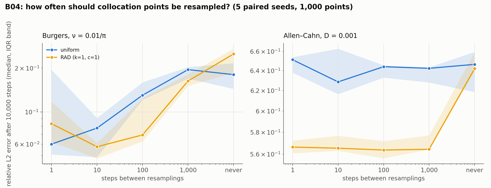

# B04: resampling frequency

## Question

How often should collocation points be resampled?

## Setup

- **Intervals:** every step, every 10, 100 and 1,000 steps, and never (one fixed set for the whole run), for uniform and for RAD sampling.
- **Problems:** Burgers and Allen–Cahn against the B01 references.
- **Training:** the B01 protocol at 10,000 steps, 1,000 points; 5 seeds.
- **Code:** `run.py`.

Rerun with:

```bash
python experiments/B04_resampling_frequency/run.py --seeds 5 --steps 10000 --workers 4
```

## Result



Relative L2 error after 10,000 steps, median [IQR] over 5 seeds.

| Equation | Sampler | every step | every 10 | every 100 | every 1,000 | never |
|---|---|---|---|---|---|---|
| Burgers | uniform | 0.060 [0.051, 0.195] | 0.077 [0.049, 0.091] | 0.131 [0.121, 0.160] | 0.196 [0.170, 0.204] | 0.181 [0.144, 0.217] |
| | RAD | 0.083 [0.062, 0.118] | 0.058 [0.048, 0.061] | 0.070 [0.063, 0.124] | 0.164 [0.152, 0.182] | 0.251 [0.186, 0.273] |
| Allen–Cahn | uniform | 0.651 [0.638, 0.654] | 0.629 [0.617, 0.663] | 0.644 [0.633, 0.646] | 0.643 [0.628, 0.644] | 0.647 [0.619, 0.660] |
| | RAD | 0.566 [0.561, 0.572] | 0.565 [0.563, 0.577] | 0.564 [0.556, 0.572] | 0.565 [0.564, 0.577] | 0.642 [0.640, 0.659] |

## Conclusion

1. **On Burgers the cadence is the main effect.** Uniform points refreshed every step or every 10 steps give 0.06–0.08; every 100 steps 0.13; every 1,000 or never about 0.19: a factor of three from cadence alone, larger than any difference between samplers at a fixed cadence. B01's suspicion is confirmed: part of what the literature attributes to adaptive sampling is the resampling frequency its implementations use.
2. **RAD wants frequent refreshes too, and then matches the best uniform.** RAD every 10 steps (0.058) equals uniform every step (0.060); RAD every 100 (0.070) beats uniform every 100 (0.131) because its residual-weighted points track the shock between refreshes; RAD with a fixed set is the worst arm (0.25), since a set chosen once from an early residual stays wrong. RAD's own best cadence is 10, not the 100 of B01, which understated it.
3. **On Allen–Cahn the cadence does not matter but the fixed set loses RAD's gain.** Uniform stays at 0.63–0.65 at every cadence; RAD stays at 0.565 at every cadence from 1 to 1,000 steps and falls back to 0.64 when never resampled. The adaptive advantage is robust to how often the points are refreshed, as long as they are; and every arm remains in the failure regime, as in B01.
4. **Recommendation.** Resample at least every 10 steps whatever the sampler; `pinnrl`'s default of fresh points every step for uniform is right, and the RAD default `resample_every` moves from 100 to 10 in the next release.

**Consequences for the backlog:**
- The RAD cadence in B01, B02 and B03 (100) is the cadence those studies used; their RAD arms are lower bounds on what RAD does at its better cadence.
- B03's grid is read with this in mind: a good $(k, c)$ at cadence 100 may be a different one at cadence 10.
