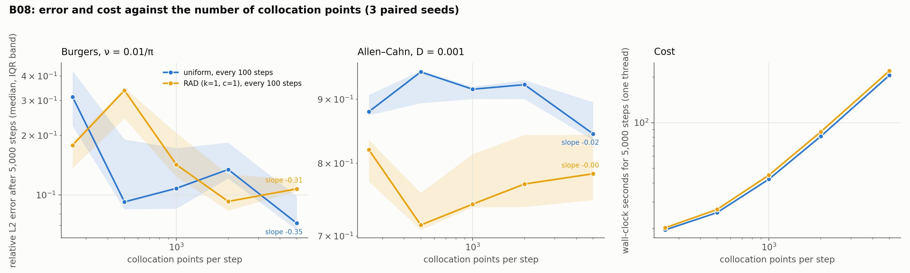

# B08: collocation-count scaling

## Question

Error vs number of points for each strategy.

## Setup

- **Counts:** 250, 500, 1,000, 2,000 and 5,000 points per step, for uniform (every 100 steps) and RAD.
- **Problems:** Burgers and Allen–Cahn against the B01 references.
- **Training:** the B01 protocol at 5,000 steps; 3 seeds.
- **Code:** `run.py`.

Rerun with:

```bash
python experiments/B08_point_count/run.py --seeds 3 --steps 5000 --workers 4
```

## Result



Median relative L2 error over 3 seeds after 5,000 steps, and the slope of $\log(\text{error})$ against $\log(N)$.

| Equation | Sampler | N = 250 | 500 | 1,000 | 2,000 | 5,000 | Slope | Seconds per 5,000 steps |
|---|---|---|---|---|---|---|---|---|
| Burgers | uniform | 0.313 | 0.092 | 0.108 | 0.135 | 0.072 | −0.35 | 20 → 206 |
| | RAD | 0.179 | 0.338 | 0.142 | 0.093 | 0.107 | −0.31 | 21 → 223 |
| Allen–Cahn | uniform | 0.880 | 0.946 | 0.917 | 0.924 | 0.845 | −0.02 | 19 → 205 |
| | RAD | 0.820 | 0.714 | 0.742 | 0.770 | 0.785 | 0.00 | 20 → 216 |

## Conclusion

1. **On Burgers the error falls as about $N^{-1/3}$, for both samplers.** Twenty times the points buy a factor of 2.5–3 in error at a fixed number of steps, with the same slope for uniform and RAD: adaptive sampling shifts the curve (RAD is better below 1,000 points, uniform above) but does not change how accuracy scales with points. The curves are noisy at 3 seeds and 5,000 steps (the Burgers optimizer has not settled, as B01 found), which is why individual counts cross.
2. **On Allen–Cahn the point count does not matter.** From 250 to 5,000 points the error stays at 0.85–0.95 (uniform) and 0.71–0.82 (RAD): the error is set by the wrong metastable solution the optimizer reaches (B01, H03), and no number of collocation points moves it. At 5,000 steps every arm is worse than at B01's 15,000.
3. **Cost is linear in the points.** Wall-clock grows tenfold from 250 to 5,000 points, so the Burgers scaling means an error reduction of $2^{-1/3}$ per doubling of cost: more points are a poor way to buy accuracy compared with more steps or a better optimizer, and the quadrature term of the error estimate is not the binding one on these problems at this budget.

**Consequences for the backlog:**
- K38 (quadrature error) can use these runs: the residual on fresh points vs the training points at each $N$ is one more column in this driver.
- D01/D02 (optimizer settling) are the lever on Burgers; H03/H04 (time-marching, causal weighting) on Allen–Cahn. Neither is a sampling question.
