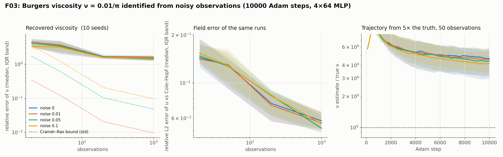

# F03: Burgers viscosity near the shock

## Question

Recovery of $\nu$ at $\nu = 0.01/\pi$, on the same noise grid as F01.

## Setup

- **Problem:** $u_t + u u_x = \nu u_{xx}$ on $[-1, 1] \times [0, 1]$ with $u_0 = -\sin \pi x$, Dirichlet 0, $\nu = 0.01/\pi \approx 0.00318$. The shock forms at $x = 0$ around $t = 0.3$ with a width of order $\nu$.
- **Parametrization:** the viscosity is identified as $\log\nu$, written into the residual as `exp(log_nu)` and started at $\log(5\nu)$. Adam's step is then relative (about 0.1 % of $\nu$ per step instead of 30 %) and $\nu$ stays positive.
- **Data:** $N_{\text{obs}} \in \{20, 50, 200, 1000\}$ nodes drawn at random from a Cole–Hopf reference on a 1601 × 161 grid (`pinnrl.benchmarks.reference.burgers_reference`), $t > 0$, with noise $\sigma \in \{0, 0.01, 0.05, 0.1\}$. No interpolation error enters.
- **Bound:** $\partial u / \partial\nu$ by central differences of the reference at $\nu(1 \pm 1\,\%)$, giving the Cramér–Rao bound on $\nu$ for each data set. The sensitivity reaches ±146 inside the shock and is near zero elsewhere, so the bound depends strongly on whether the draw hits the shock.
- **Model and training:** 4 × 64 tanh MLP, Adam at $10^{-3}$, **10,000 steps**, 1,000 collocation points refreshed every 100 steps, weights 1 / 10 / 10 / 10.
- **Seeds:** 10.
- **Metrics:** the relative error of $\hat\nu$ at the last step, the trajectory, the spread against the bound, and the relative L2 error of $u$ on a 201 × 81 subgrid of the reference.
- **Code:** `run.py`, `plot.py`. The reference and its sensitivity are cached in `results/reference.npz` (90 s to build).

Rerun with:

```bash
python experiments/F03_burgers_nu/run.py --seeds 10 --steps 10000 --workers 4
python experiments/F03_burgers_nu/plot.py
```

## Result



Relative error of $\hat\nu$ at step 10,000 (median [IQR] over 10 seeds), the spread across seeds, the Cramér–Rao bound (median over the draws), the mean bias and the field error against the Cole–Hopf reference.

| Noise σ | $N$ | $\hat\nu / \nu$ (median) | Rel. error of ν | Spread | CR bound | Bias | Rel. L2 of u |
|---|---|---|---|---|---|---|---|
| 0 | 20 | 5.50 | 4.50 [3.26, 5.57] | 1.79 | 0 | +4.63 | 0.144 |
| | 50 | 4.64 | 3.64 [1.96, 4.61] | 1.66 | 0 | +3.60 | 0.129 |
| | 200 | 2.68 | 1.68 [1.44, 1.95] | 0.39 | 0 | +1.74 | 0.074 |
| | 1000 | 2.60 | 1.60 [1.29, 1.75] | 0.28 | 0 | +1.53 | 0.058 |
| 0.01 | 20 | 5.49 | 4.49 [3.16, 5.54] | 1.86 | 0.34 | +4.68 | 0.141 |
| | 50 | 4.57 | 3.57 [2.11, 4.94] | 1.60 | 0.12 | +3.61 | 0.130 |
| | 200 | 2.65 | 1.65 [1.42, 1.77] | 0.38 | 0.02 | +1.69 | 0.072 |
| | 1000 | 2.57 | 1.57 [1.28, 1.79] | 0.30 | 0.01 | +1.55 | 0.056 |
| 0.05 | 20 | 5.12 | 4.12 [3.11, 4.99] | 1.95 | 1.71 | +4.48 | 0.148 |
| | 50 | 4.38 | 3.38 [2.23, 4.77] | 1.48 | 0.61 | +3.56 | 0.127 |
| | 200 | 2.62 | 1.62 [1.48, 1.75] | 0.34 | 0.10 | +1.68 | 0.083 |
| | 1000 | 2.42 | 1.42 [1.24, 1.77] | 0.28 | 0.05 | +1.49 | 0.052 |
| 0.1 | 20 | 4.36 | 3.36 [2.71, 4.16] | 2.06 | 3.41 | +3.97 | 0.154 |
| | 50 | 4.16 | 3.16 [2.42, 4.27] | 1.42 | 1.21 | +3.41 | 0.128 |
| | 200 | 2.59 | 1.59 [1.49, 1.72] | 0.27 | 0.21 | +1.62 | 0.083 |
| | 1000 | 2.49 | 1.49 [1.28, 1.84] | 0.29 | 0.10 | +1.55 | 0.056 |

The estimate is still moving at the end: with 1,000 clean points the median $\hat\nu/\nu$ is 5.5, 3.6, 3.0, 2.8 and 2.6 at steps 2,000 to 10,000. The runs take about 3 minutes each.

## Conclusion

1. **The viscosity is overestimated 2.5–5×, whatever the noise.** The error is a bias, and it is the same mechanism as the F01 floor and the F02 offset, in its extreme form: a 4 × 64 tanh network resolves a shock several times wider than the true one (width $O(\nu)$, i.e. about 0.003 on a domain of length 2), and a wider shock *is* the solution of Burgers at a larger viscosity. The physics term is satisfied best by the $\nu$ that matches the width the network can represent. K01 saw the same thing from the other side: the surrogate's sensitivity to $\nu$ is that of a smooth shock, not of the real one.
2. **Data help slowly, through the shock only.** The bias falls from 4.5× at 20 points to 1.6× at 1,000, and the estimate is still decreasing at 10,000 steps, because only observations inside the shock carry information about $\nu$ (the bound's sensitivity is near zero elsewhere) and only a few of 1,000 random points fall there. Dense sampling across the shock, which F05 would call a probe placed where the information is, is the data layout this problem needs.
3. **The bound is irrelevant until the bias is gone.** The Cramér–Rao bound is 1–10 % in most cells; the bias is 150–450 %. Nothing in the Fisher analysis predicts this, and nothing in it should: it is the surrogate's error, and it is detected by the field error (6–15 %, concentrated at the shock) and by the K01 comparison, not by the bound.
4. **Identifying $\log\nu$ did its job.** Every run stayed positive and stable from a 5× start, with Adam's relative step; the same runs with $\nu$ identified directly would have moved it by 30 % per step. The parametrization is now documented in the custom-equations guide.

**Consequences for the backlog:**
- Burgers viscosity identification needs a resolved shock before anything else: RAD sampling at the shock (the B01 work), a sharper or larger network, or the time-marching of H03/H04. F03 is rerun after that with the same driver.
- K32-type reference comparisons should report where the field error sits, not only its norm; a 6 % error at the shock is a 150 % error in $\nu$.
- The three identification problems now order the surrogate floor by operator and feature sharpness: heat 2 %, KdV soliton 20 %, Burgers shock 150 %. Paper P07 reports the three together.
