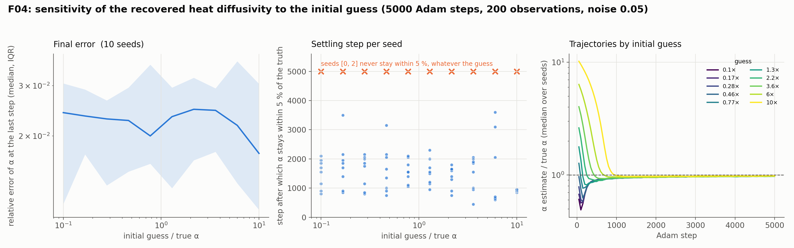

# F04: initial-guess sensitivity

## Question

Does the estimate depend on the starting guess?

## Setup

- **Problem and data:** the F01 heat problem ($\alpha = 0.1$) with one data set per seed: 200 observations at uniform random points, noise 0.05 (the F01 cell whose Cramér–Rao bound, 1.7 %, is close to the surrogate floor of 2 %).
- **Initial guesses:** ten values from 0.1× to 10× the truth, spaced logarithmically: 0.01, 0.017, 0.028, 0.046, 0.077, 0.13, 0.22, 0.36, 0.60, 1.0.
- **Model and training:** as in F01 (4 × 64 tanh MLP, Adam at $10^{-3}$, 5,000 steps, 1,000 collocation points refreshed every 50 steps, weights 1 / 10 / 10 / 10). Adam's step is at most about the learning rate, so a guess of 0.01 needs at least 90 steps to reach 0.1 and a guess of 1.0 at least 900.
- **Seeds:** 10, fixing the data and the initial weights; the ten guesses share them, so the comparison is paired.
- **Metrics:** the relative error at the last step; the settling step, the first step after which $\hat\alpha$ stays within 5 % of the truth (none if it never does); the trajectory every 50 steps.
- **Code:** `run.py`, `plot.py`.

Rerun with:

```bash
python experiments/F04_initial_guess/run.py --seeds 10 --steps 5000 --workers 4
python experiments/F04_initial_guess/plot.py
```

## Result



Relative error of $\hat\alpha$ at step 5,000 (median [IQR] over 10 seeds), the spread across seeds, the median settling step, and the number of seeds that never stay within 5 %.

| Guess | Guess / α | Rel. error of α | Spread across seeds | Settling step (median) | Never settle |
|---|---|---|---|---|---|
| 0.010 | 0.10 | 0.024 [0.012, 0.031] | 0.020 | 1,625 | 2 |
| 0.017 | 0.17 | 0.023 [0.017, 0.029] | 0.018 | 1,775 | 2 |
| 0.028 | 0.28 | 0.023 [0.013, 0.027] | 0.018 | 1,800 | 2 |
| 0.046 | 0.46 | 0.023 [0.015, 0.030] | 0.018 | 1,500 | 2 |
| 0.077 | 0.77 | 0.020 [0.016, 0.036] | 0.018 | 1,550 | 2 |
| 0.129 | 1.29 | 0.023 [0.013, 0.030] | 0.019 | 1,525 | 2 |
| 0.215 | 2.15 | 0.025 [0.016, 0.032] | 0.018 | 1,500 | 2 |
| 0.359 | 3.59 | 0.025 [0.018, 0.029] | 0.017 | 1,700 | 2 |
| 0.600 | 6.0 | 0.022 [0.014, 0.037] | 0.018 | 675 | 2 |
| 1.000 | 10 | 0.017 [0.011, 0.030] | 0.019 | 900 | 2 |

Two decompositions of the same 100 estimates:

| | Spread of $\hat\alpha$ (relative) |
|---|---|
| across the 10 seeds, at a fixed guess (median over guesses) | 0.018 |
| across the 10 guesses, at a fixed seed (median over seeds) | 0.003 |

The two seeds that never stay within 5 % are seeds 0 and 2 for every guess; their final errors are 6.3–6.7 % and 5.4–5.9 % across all ten starts.

## Conclusion

1. **The estimate does not depend on where it starts.** For a given data set, the ten starting values from 0.1× to 10× the truth land within 0.3 % of each other (median range 1.1 %), six times less than the spread the data and the network initialization produce across seeds (1.8 %). The basin of attraction for the heat diffusivity covers at least two decades around the truth, so a poor prior is harmless here. K30 (basin of attraction) can start from a harder problem.
2. **The seeds that fail, fail for every guess.** Seeds 0 and 2 end 5–7 % low whatever the start, which identifies the noise realization of their 200 observations, not the optimizer, as the cause. The F01 finding stands: at this noise level the error is dominated by the data and the surrogate's bias, and an initial-guess sweep is not a way to detect or fix it.
3. **Far starts are not slower.** Starting at 6× or 10× the truth settles in 675–900 steps, sooner than starts near the truth (about 1,500). The early transient of the network, not the distance of the guess, decides when $\hat\alpha$ stops moving: a start far above the truth arrives from one side after the field has formed, while a start near the truth is dragged around while the field is still wrong. Adam's per-step cap of about the learning rate sets the lower bound (90 steps from 0.01, 900 from 1.0), which is visible in the trajectories.

**Consequences for the backlog:**
- F04 closes for scalar heat identification. The remaining question about starting points belongs to problems with several parameters or non-convex profiles (F02, F07, K30).
- A sweep over initial guesses is not a substitute for a noise-aware data weight (K39) or for repeating the fit on resampled data (F06).
