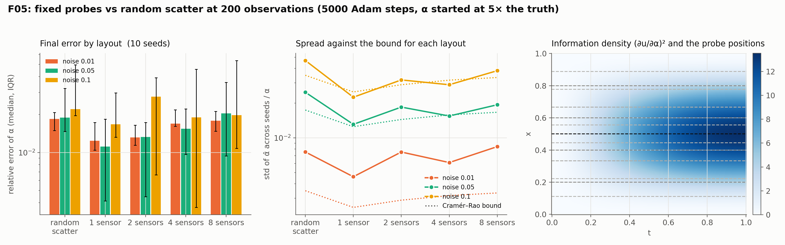

# F05: fixed sensors

## Question

Plant-like data: a few fixed probe locations, densely sampled in time. How do 2–8 fixed positions compare with random scatter at an equal data count?

## Setup

- **Problem:** the F01 heat problem ($\alpha = 0.1$, started at 0.5).
- **Layouts, all with 200 observations:** random scatter over the domain, or $n_s \in \{1, 2, 4, 8\}$ probes at the equispaced interior positions $x_i = i / (n_s + 1)$, each read at $200 / n_s$ regular times $t_j = (j + 1/2)\,n_s / 200$. One probe sits at $x = 0.5$; two sit at $1/3$ and $2/3$; and so on.
- **Noise:** 0.01, 0.05 and 0.1 (the solution has amplitude 1 at $t = 0$ and 0.37 at $t = 1$).
- **Model and training:** as in F01 (4 × 64 tanh MLP, Adam at $10^{-3}$, 5,000 steps, weights 1 / 10 / 10 / 10).
- **Seeds:** 10, fixing the random layout, the noise draw and the initial weights.
- **Metrics:** the relative error of $\hat\alpha$ at the last step; the spread of $\hat\alpha$ across seeds against the Cramér–Rao bound of each layout, $\sigma / \sqrt{\sum_i (\pi^2 t_i u_i)^2}$, which depends on where the probes sit; the relative L2 error of $u$.
- **Code:** `run.py` (`pinnrl.CustomPDE` with `observation_data` given as tensors), `plot.py`.

Rerun with:

```bash
python experiments/F05_fixed_sensors/run.py --seeds 10 --steps 5000 --workers 4
python experiments/F05_fixed_sensors/plot.py
```

## Result



Relative error of $\hat\alpha$ at step 5,000 (median [IQR] over 10 seeds), the spread across seeds, the Cramér–Rao bound of the layout (median over seeds; it varies only for the random layout), the mean bias and the field error. All layouts have 200 observations.

| Noise σ | Layout | Rel. error of α | Spread | CR bound | Bias | Rel. L2 of u |
|---|---|---|---|---|---|---|
| 0.01 | random scatter | 0.019 [0.015, 0.021] | 0.008 | 0.003 | −0.019 | 0.024 |
| | 1 probe | 0.012 [0.010, 0.017] | 0.005 | 0.002 | −0.014 | 0.020 |
| | 2 probes | 0.013 [0.011, 0.017] | 0.008 | 0.003 | −0.016 | 0.024 |
| | 4 probes | 0.017 [0.016, 0.022] | 0.006 | 0.003 | −0.019 | 0.028 |
| | 8 probes | 0.018 [0.015, 0.021] | 0.008 | 0.003 | −0.019 | 0.022 |
| 0.05 | random scatter | 0.019 [0.015, 0.032] | 0.025 | 0.017 | −0.022 | 0.027 |
| | 1 probe | 0.011 [0.004, 0.018] | 0.013 | 0.012 | −0.012 | 0.022 |
| | 2 probes | 0.013 [0.004, 0.017] | 0.018 | 0.014 | −0.010 | 0.028 |
| | 4 probes | 0.015 [0.010, 0.022] | 0.015 | 0.016 | −0.014 | 0.025 |
| | 8 probes | 0.020 [0.009, 0.036] | 0.019 | 0.017 | −0.020 | 0.024 |
| 0.1 | random scatter | 0.022 [0.020, 0.050] | 0.047 | 0.035 | −0.024 | 0.024 |
| | 1 probe | 0.017 [0.013, 0.030] | 0.022 | 0.025 | −0.009 | 0.023 |
| | 2 probes | 0.028 [0.007, 0.039] | 0.032 | 0.029 | −0.007 | 0.030 |
| | 4 probes | 0.019 [0.004, 0.046] | 0.029 | 0.032 | −0.013 | 0.020 |
| | 8 probes | 0.020 [0.011, 0.054] | 0.038 | 0.033 | −0.020 | 0.027 |

## Conclusion

1. **One well-placed probe beats 200 scattered points.** A single probe at $x = 0.5$ read at 200 times has a Cramér–Rao bound of 1.2 % at $\sigma = 0.05$ against 1.7 % for random scatter, and the PINN delivers it: median error 1.1 % vs 1.9 %, spread 1.3 % vs 2.5 %. The information about $\alpha$, $(\partial u/\partial\alpha)^2 = (\pi^2 t\, u)^2$, is concentrated at mid-domain and late times (right panel), where the probe sits and the scatter mostly is not.
2. **More probes at a fixed data count are slightly worse, and the bound says so.** Spreading 200 readings over 8 positions puts the outer probes at $x = 1/9$ and $8/9$, where $u$ is small and the readings carry little information; the bound rises from 1.2 % (1 probe) to 1.7 % (8 probes) and the measured spread follows (1.3 % to 1.9 %). Sensor placement is a question the Fisher information answers before any training, which is the basis of K02 and of the measurement-design work (P24).
3. **The estimator remains near-efficient with plant-like data.** At $\sigma \ge 0.05$ the spread across seeds is within 30 % of the bound in 8 of the 10 cells and within 50 % in all of them; the five low-noise cells sit 2–3× above a bound of 0.2–0.3 %, where the surrogate's 2 % floor dominates. Regular time sampling at fixed positions changes nothing in that respect.
4. **Dense time series reduce the bias.** The low-noise bias is −1.4 % with one probe against −1.9 % with scatter, and at $\sigma = 0.1$ it is −0.9 % against −2.4 %. Many readings along one decay curve pin the rate; scattered points pin the field. The surrogate floor found in F01 is therefore partly a property of the data layout, not only of the network.

**Consequences for the backlog:**
- K02 (sensor placement from the Fisher information) can use the bound as its design criterion; this experiment is its first validation point.
- F05 settles the data mode for the process twins (J-track): fixed probes with dense time series are the right abstraction for `pinnrl`'s sensor operators (roadmap v0.6).
- The bias reduction with dense time series should be checked on F03 (Burgers) where the information sits in the shock rather than at late times.
