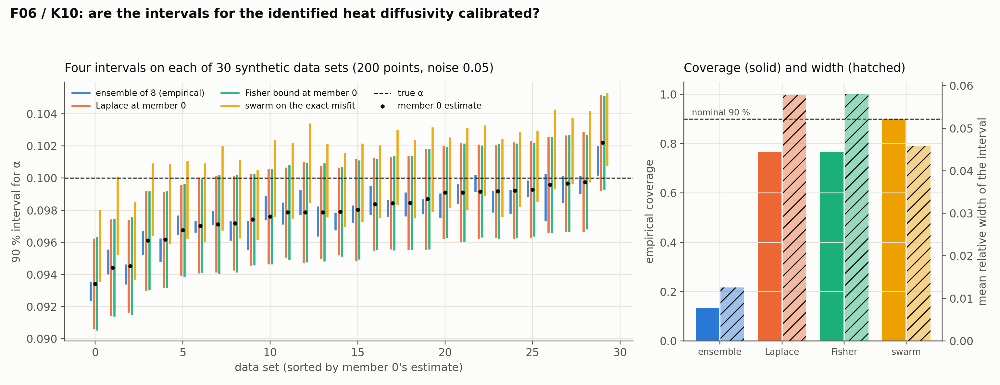

# F06 / K10: uncertainty and coverage

## Question

Are the confidence intervals for $\alpha$ calibrated? Ensembles (F06), and ensembles vs Laplace vs the sampled region of equivalence (K10): coverage, width and CRPS.

## Setup

- **Data sets:** 30 synthetic data sets of the F01 cell (heat, 200 observations at uniform random points, noise 0.05), one per seed.
- **Ensembles:** 8 members per data set, trained from different initial weights (4 × 64 tanh MLP, 5,000 Adam steps, weights 1 / 10 / 10 / 10, $\alpha$ started at 5× the truth).
- **Four 90 % intervals per data set:** the empirical central interval of the 8 member estimates (`ensemble`), and its Gaussian version from the ensemble mean and standard deviation (`ensemble_gauss`); a Gaussian at member 0's estimate with the standard deviation of the Laplace posterior, i.e. the surrogate's Fisher information at the trained network (`laplace`, `pinnrl.uq.laplace_posterior`); the same with the closed-form Cramér–Rao bound (`fisher`, what an efficient unbiased estimator would report); and the likelihood-ratio region of the *exact* misfit sampled by the swarm (`swarm`, `pinnrl.uq.sample_equivalence_region`), the nonlinear interval the physics alone implies for that data set.
- **Metrics** (`pinnrl.uq.metrics`): the empirical coverage of the truth over the 30 data sets (90 % is calibrated), the mean width, and the mean CRPS (ensemble as samples, the Gaussians in closed form).
- **Code:** `run.py`.

Rerun with:

```bash
python experiments/F06_coverage/run.py --datasets 30 --members 8 --steps 5000 --workers 4
```

## Result



Over 30 data sets. The estimate of member 0 has a mean bias of −0.0021 (−2.1 %) and a standard deviation across data sets of 0.00175 (1.75 %).

| Interval | Coverage of the truth (nominal 90 %) | Mean width / α | Mean CRPS | Typical std |
|---|---|---|---|---|
| ensemble of 8, empirical | 0.13 | 0.013 | 0.0021 | 0.0005 (spread of the members) |
| ensemble of 8, Gaussian | 0.13 | 0.016 | – | |
| Laplace at member 0 | 0.77 | 0.058 | 0.0016 | 0.00175 |
| Fisher bound at member 0 | 0.77 | 0.058 | 0.0016 | 0.00175 |
| swarm on the exact misfit | 0.90 | 0.046 | – | half-width 0.0023 |

## Conclusion

1. **An ensemble over initializations is not an uncertainty estimate for the parameter.** Its members agree to 0.5 % while the estimate varies by 1.75 % from one noise draw to the next: the ensemble measures the surrogate's initialization noise, which is a quarter of the data noise, and covers the truth in 13 % of the data sets. Averaging members over the same data cannot see the noise of the data. Ensembles over *resampled data* (bootstrap) would; ensembles over seeds do not.
2. **The Laplace interval has exactly the right width and the wrong centre.** Its standard deviation, 0.00175, equals the spread of the estimate across data sets to three digits: the surrogate's Fisher information (K01) predicts the random error of the PINN estimate without error. Coverage is 77 % instead of 90 % because every interval is centred on an estimate that is 2.1 % low, the surrogate floor of F01; a Gaussian with the right width shifted by 1.2 standard deviations covers 69–77 % of the time, which is what is observed. The Laplace CRPS (0.0016) is the lowest of the methods.
3. **The swarm on the physics is calibrated, because it has no surrogate.** The likelihood-ratio region of the exact misfit covers the truth in 90 % of the data sets with a narrower interval than Laplace, since it is centred on the exact best fit rather than on the biased PINN estimate. It is the interval the data and the physics warrant; the PINN's shortfall from it is entirely the bias.
4. **Honest intervals for a PINN estimate therefore need two parts:** the Fisher width for the random error, which `pinnrl.uq.laplace_posterior` already provides, and a correction for the surrogate's systematic error, which no method internal to the model provides. The bias can be estimated where a closed form or a reference exists (as here), reduced by a better forward solve (D01/D02, the F02 data-weight lever), or bounded by the field error (K01's condition); the interval should state which.

**Consequences for the backlog:**
- K40 (ensemble size) is moot for parameter intervals over seeds; the ensemble question becomes a bootstrap over data (a new cell of F06).
- K41 (Laplace variants) can start from the fact that the θ-only Gauss–Newton Laplace is already exact for the random part; the question is whether the full-loss Hessian sees the bias.
- The documented interval for an identified parameter is "Laplace width, bias-corrected where a reference exists, otherwise widened by the field error", to be written into `pinnrl.uq` and the [Bayesian view](../../docs/theory/bayesian.md).
