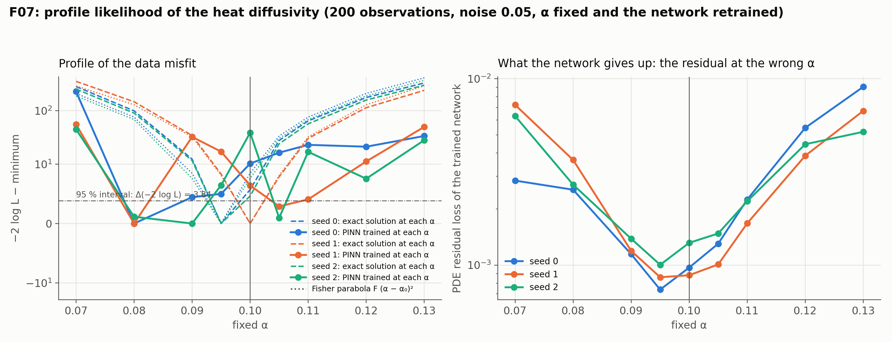

# F07: profile likelihood

## Question

Practical identifiability via profile likelihood: fix $\alpha$ on a grid, retrain, plot the profile. A flat profile means not identifiable.

## Setup

- **Definition.** $\mathrm{PL}(\alpha) = \min_w \sum_i (y_i - u_w(x_i, t_i; \alpha))^2 / \sigma^2$, the data misfit of the network trained with $\alpha$ held fixed (physics + data, nothing trainable in the equation). With Gaussian noise an identifiable parameter gives a parabola $\mathrm{PL}(\alpha) - \mathrm{PL}(\hat\alpha) \approx F (\alpha - \hat\alpha)^2$ with $F$ the Fisher information, and $\Delta = 3.84$ marks a 95 % interval.
- **Data:** the F01 cell with 200 observations and noise 0.05, one data set per seed (3 seeds). $F$ is computed per data set from the closed form.
- **Grid:** $\alpha$ at 0.7, 0.8, 0.9, 0.95, 1.0, 1.05, 1.1, 1.2 and 1.3 times the truth.
- **Two profiles:** the misfit of the PINN trained at each fixed $\alpha$ (5,000 steps, 4 × 64 tanh MLP, weights 1 / 10 / 10 / 10, mode `data_augmented`), and the misfit of the *exact solution* at that $\alpha$, which is the profile the physics alone would produce. The PDE residual of each trained network is recorded.
- **Code:** `run.py`, `plot.py`.

Rerun with:

```bash
python experiments/F07_profile_likelihood/run.py --seeds 3 --steps 5000 --workers 4
python experiments/F07_profile_likelihood/plot.py
```

## Result



A quadratic fit to each profile gives its curvature, compared with the Fisher information of the data set.

| Seed | $F$ | Curvature of the exact-solution profile | Ratio to $F$ | Curvature of the PINN profile | Ratio to $F$ | Argmin exact / PINN |
|---|---|---|---|---|---|---|
| 0 | 338,500 | 336,814 | 1.00 | 131,992 | 0.39 | 0.095 / 0.080 |
| 1 | 324,471 | 332,108 | 1.02 | 44,111 | 0.14 | 0.100 / 0.080 |
| 2 | 304,457 | 304,312 | 1.00 | 23,750 | 0.08 | 0.095 / 0.090 |

The PDE residual of the trained network rises from about $10^{-3}$ at $\alpha = 0.095$–$0.105$ to $5$–$9 \times 10^{-3}$ at $\alpha = 0.13$ and $3$–$7 \times 10^{-3}$ at $\alpha = 0.07$. Each run takes 40 s.

## Conclusion

1. **The exact-solution profile is the Fisher parabola.** Its curvature equals $F$ to within 2 % on every seed and its minimum is at the truth to within half a grid step. This is an independent check of the Fisher formula used throughout F01–F05 and of `pinnrl.analysis.closed_form_bound`, from a misfit on a grid rather than from a derivative.
2. **The PINN profile is 2.5–12× flatter.** Trained with $\alpha$ clamped at a wrong value, the network does not reproduce the wrong solution; it deviates from the PDE, keeps fitting the data, and pays in residual (up to 9×). With a soft physics term the data misfit barely rises as $\alpha$ moves, so a profile read from it reports an interval several times too wide and a minimum biased low (0.08–0.09). The information the PINN-constrained model exposes is the curvature of the *total* weighted loss, not of the data term alone.
3. **Consistent with F01, not in conflict with it.** In the joint fit the parameter is free and moves to where the physics is cheapest, so the estimate's spread follows $F$; in the profile the parameter is clamped and the network absorbs the mismatch, so the data term cannot see $F$. F01 measures the estimator; F07 measures the identifiability the loss exposes, which for a PINN is governed by the physics weight.
4. **Profile likelihood with a PINN needs hard physics or the full loss.** Either enforce the equation hard enough that a wrong $\alpha$ costs misfit (a large residual weight, or hard constraints), or profile the total weighted loss and read it in the Bayesian frame where the weights are inverse variances. The same applies to every UQ method that reads curvature off the loss, including the Laplace approximation of roadmap item 5.

**Consequences for the backlog:**
- The Laplace approximation (K41) must use the full loss Hessian with its weights; its interval width depends on the physics weight, which K39 sets from the noise model.
- F07 is rerun with a larger residual weight and with hard initial and boundary constraints, to see how close the PINN profile can come to the Fisher parabola.
- The exact-solution profile is the reference for a two-dimensional profile of the KdV pair, where F02 found the surrogate's optimum displaced from the truth.
