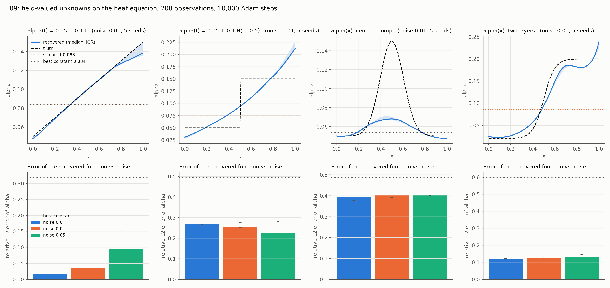

# F09: field-valued unknowns, a drifting α(t) and a coefficient field α(x)

## Question

Can a drifting α(t), fouling-like, be recovered? And a coefficient field α(x)?

## Setup

- **Problem:** the 1-D heat equation on $[0, 1] \times [0, 1]$ with $u_0 = \sin \pi x$ and Dirichlet 0, with four truths for the diffusivity:
  - `linear`: $\alpha(t) = 0.05 + 0.1\,t$, exact solution $e^{-\pi^2 (0.05 t + 0.05 t^2)} \sin \pi x$;
  - `step`: $\alpha(t) = 0.05 + 0.1\,H(t - 0.5)$, a fouling-like jump, exact solution $e^{-\pi^2 (0.05 t + 0.1 \max(t - 0.5, 0))} \sin \pi x$;
  - `bump`: $\alpha(x) = 0.05 + 0.1\, e^{-((x - 0.5)/0.15)^2}$, a centred bump; the equation in conservative form, $u_t = \alpha_x u_x + \alpha u_{xx}$, with the reference from `pinnrl.benchmarks.heat_variable_reference` (method of lines, verified to $5 \times 10^{-7}$ against the closed forms);
  - `layers`: $\alpha(x) = 0.02 + 0.18\,\sigma((x - 0.5)/0.05)$, a two-layer medium with a smooth interface and a tenfold contrast; same reference.
- **Unknown:** `pinnrl.pdes.UnknownFunction`, a 2 × 32 tanh network of $t$ (or $x$) through a softplus, started at the constant 0.1, declared as `unknown_functions={"alpha": {"inputs": ["t"], "positive": True, "initial": 0.1, "truth": ...}}` of a `CustomPDE`; `alpha_x` in the equation is its derivative by autograd. The control is a scalar `alpha` identified on the same data (`model = constant`, at noise 0.01).
- **Data:** 200 observations of the reference solution at uniform random points, Gaussian noise $\sigma \in \{0, 0.01, 0.05\}$.
- **Training:** the F01 protocol: tanh MLP 4 × 64, Adam at $10^{-3}$ for the weights and the unknown alike, **10,000 steps**, 1,000 collocation points refreshed every 50 steps, 512 boundary and initial points, weights 1 / 10 / 10 / 10. The unknown's weights are in an Adam group without weight decay (see the conclusion).
- **Seeds:** 5, paired across cells (the seed fixes the observation points, the noise and the network initialisation).
- **Metrics:** the relative L2 error of $\hat\alpha$ against the truth on a grid of 101 points of its input, its maximum error relative to $\max \alpha$, the relative L2 error of $u$ on 4,000 points, and the error trajectory every 500 steps. For each truth, the **best constant**: the constant $\alpha$ whose solution is closest (relative L2 over the grid) to the truth's, and that distance, computed with the reference solver. It says how far the data can tell the field from a constant at all.
- **Code:** `run.py`, `plot.py`.

Rerun with:

```bash
python experiments/F09_field_unknowns/run.py --seeds 5 --steps 10000 --workers 5
python experiments/F09_field_unknowns/plot.py
```

## Result



Median [IQR] over 5 seeds at step 10,000. The last column gives, for the truth, the best constant's own relative L2 error as a function and the distance between its solution and the truth's.

| Truth | Model | Noise σ | Rel. L2 of α̂ | Max error of α̂ | Rel. L2 of u | Best constant: error as α / distance in u |
|---|---|---|---|---|---|---|
| linear α(t) | function | 0 | 0.017 [0.007, 0.017] | 0.033 | 0.015 | 0.32 / 0.048 |
| | function | 0.01 | 0.037 [0.016, 0.042] | 0.078 | 0.018 | |
| | function | 0.05 | 0.094 [0.070, 0.173] | 0.209 | 0.019 | |
| | scalar (α̂ = 0.083) | 0.01 | 0.322 | 0.444 | 0.040 | |
| step α(t) | function | 0 | 0.268 [0.265, 0.268] | 0.475 | 0.026 | 0.50 / 0.080 |
| | function | 0.01 | 0.254 [0.253, 0.276] | 0.413 | 0.025 | |
| | function | 0.05 | 0.226 [0.224, 0.281] | 0.350 | 0.023 | |
| | scalar (α̂ = 0.076) | 0.01 | 0.496 | 0.493 | 0.062 | |
| bump α(x) | function | 0 | 0.392 [0.378, 0.409] | 0.533 | 0.020 | 0.49 / 0.038 |
| | function | 0.01 | 0.405 [0.392, 0.409] | 0.547 | 0.019 | |
| | function | 0.05 | 0.404 [0.400, 0.423] | 0.548 | 0.027 | |
| | scalar (α̂ = 0.052) | 0.01 | 0.501 | 0.652 | 0.035 | |
| layers α(x) | function | 0 | 0.120 [0.114, 0.122] | 0.189 | 0.022 | 0.60 / 0.198 |
| | function | 0.01 | 0.125 [0.114, 0.133] | 0.190 | 0.022 | |
| | function | 0.05 | 0.132 [0.120, 0.147] | 0.247 | 0.024 | |
| | scalar (α̂ = 0.085) | 0.01 | 0.618 | 0.573 | 0.123 | |

Shapes at noise 0.01 (median over seeds):

- `linear`: the recovered line is $0.048 \to 0.138$ against $0.05 \to 0.15$; it is within 2 % of the truth on $t \in [0.1, 0.8]$ and bends 8 % low at $t = 1$, where the solution has decayed to 0.4 of its amplitude. The error settles by step 1,500 and fluctuates between 2 and 4 % afterwards.
- `step`: a smooth ramp from 0.03 at $t = 0$ to 0.21 at $t = 1$ that crosses 0.075 at $t = 0.38$ and 0.125 at $t = 0.67$; it overshoots the plateaus on both sides so that its integral matches. The error does not improve with training after step 500 (0.22–0.27 throughout) and improves slightly with noise.
- `bump`: a bump of height 0.068 at $x = 0.5$ over a base of 0.05, against a true peak of 0.15: the shape is right, the amplitude is 18 % of the truth. The scalar control finds 0.052, which is the best constant (0.054), and reproduces the field to 3.5 %, as well as the function does.
- `layers`: the two plateaus and the interface are recovered (0.025 and 0.185 against 0.02 and 0.20, the crossing at the right place); the error is 34 % on the low-diffusivity side, 17 % at the interface and 8 % on the high side, and the right end curls up to 0.24. The scalar control (0.085) reproduces the field only to 12 %, three times the function's error.

Each run takes 110 s with five in parallel on a laptop CPU (2 threads each).

## Conclusion

1. **A drifting coefficient is recovered, and the scalar model is the wrong model.** With clean or lightly noisy data the linear $\alpha(t)$ is recovered to 2–4 % in L2 (8 % at its worst point), against the 32 % a constant would absorb; the scalar fit lands at 0.083, the best constant, with a field error of 4 % instead of 1.5 %. This is the fouling case of the twin (J03): a drift in a coefficient is a function to identify, not a number to re-fit.
2. **The surrogate turns a jump into a ramp.** A step in $\alpha(t)$ comes back as a smooth S with the right mean and the right crossing, 25 % off in L2 whatever the noise and the training length. The data see $\int_0^t \alpha$ through the amplitude $e^{-\pi^2 \int \alpha}$ of the solution, a kink of which the smooth network and the smooth $u$-surrogate both round off. Resolving a jump needs either a parametrisation with a jump (a time of change as a parameter) or a change-point test on the residual (K25/K26 territory), not a bigger network.
3. **A coefficient field is identified only where the solution feels it.** The response of $u$ to a local change of $\alpha(x)$ goes through the flux $\delta\alpha\, u_x$, and a localised change is diffused before it reaches the observations. For the centred bump, the best constant reproduces the solution to 3.8 %, close to the surrogate's own field error (2–3 %): at the accuracy of the forward model, the bump is not distinguishable from a constant, and the function collapses to the constant (with 18 % of the bump as a hint). The data themselves carry more: with an exact forward model the Fisher information of the same 200 observations determines eight cosine modes of the bump to within 0.006 at this noise (K48). The limit is the surrogate, not the sensors. For the two-layer medium no constant comes within 20 % of the solution, and the field is recovered in shape, to 12 %, with the error concentrated where $\alpha$ is small and the flux is small. The honest check before trusting a recovered field is the one the setup column gives: compare the solution of the truth (or of the candidate) with the solution of the best constant, with the reference solver; if they differ by about the surrogate's field error or less, the PINN cannot resolve the field, whatever the data say (and the Fisher information of the modes, K48, says what the data would allow with a better forward model). The theory page on identifiability now states this.
4. **Weight decay on the unknown's weights silently destroys the recovery.** The trainer's default Adam weight decay ($5 \times 10^{-4}$), meant for the network, also acted on the unknown function's weights; with Adam's normalisation a weight with a weak data gradient is driven to zero at the learning rate, and every field collapsed to a constant in the first runs. PDE unknowns (scalars and function weights) now form an Adam group without decay. The scalar experiments F01–F07 ran with the decay on $\alpha$; a full rerun of F01 without it reproduces every cell (median error 0.022 in both, bias $-2.0\,\%$ vs $-2.1\,\%$): for a scalar with a strong data gradient the decay is negligible under Adam's normalisation, and the 2 % floor is the forward error. The decay only matters for the many weak weights of a function.

**Consequences for the backlog:**
- The roadmap item "field-valued unknowns" is done: $\alpha(t)$ and the two-layer $\alpha(x)$ are recovered on heat; the bump is the counter-example that makes identifiability (K48: which modes of $\alpha(x)$ the data leave free, in a reduced basis) the next step for fields.
- J03 (fouling resistance $R_f(t)$) can use `UnknownFunction` directly; a step-like fouling event needs a change-point parametrisation (new entry).
- F01 rerun without weight decay on $\alpha$: no change (see its README); the scalar results stand.
