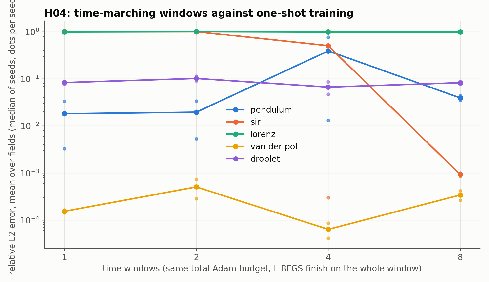

# H04: time-marching windows

## Question

Does training on sequential time windows, with the network carried over, fix the cases where one-shot training fails: the trivial solutions of K09 (pendulum, SIR, Lorenz) and the smeared transition of the drying droplet (J07)?

## Setup

- **Systems:** pendulum, SIR, Lorenz (the K09 failures), Van der Pol (the control), and the J07 drying droplet (forward, air at 90 °C with a $\pm 5$ K wander, 200 s).
- **Training:** the clean recipe (normalized to the reference's scales, tanh 4 × 64, 2,048 collocation points, no regularization), the same total budget of 12,000 Adam steps split equally over 1, 2, 4 or 8 windows of equal length (`PDETrainer.train_windows`: collocation points beyond the current cutoff are left out, the network carries over), then an L-BFGS finish of 500 steps on the whole span. 2 seeds.
- **Metric:** the relative L2 error against the reference (LSODA, $10^{-10}$) over the whole span, mean over the fields.
- **Code:** `run.py` (reuses the state-space forms of K09 and the droplet of J07), `plot.py`.

Rerun with:

```bash
python experiments/H04_time_marching/run.py --seeds 2 --steps 12000 --workers 4
python experiments/H04_time_marching/plot.py
```

## Result



Relative L2 error (seeds 0 / 1); time per cell.

| System | 1 window | 2 windows | 4 windows | 8 windows |
|---|---|---|---|---|
| pendulum | 0.003 / 0.033 | 0.034 / 0.005 | **0.77** / 0.013 | 0.035 / 0.044 |
| SIR | 1.01 / 1.01 | 1.01 / 1.01 | 1.01 / **0.0003** | **0.0009 / 0.0010** |
| Lorenz | 1.02 / 0.98 | 1.02 / 1.00 | 1.00 / 1.00 | 1.00 / 1.00 |
| Van der Pol | 0.0002 / 0.0001 | 0.0007 / 0.0003 | 0.0000 / 0.0001 | 0.0004 / 0.0003 |
| droplet ($X$, $T - T_0$) | 0.040, 0.12 / 0.053, 0.13 | 0.055, 0.17 / 0.036, 0.15 | 0.039, 0.13 / 0.017, 0.078 | 0.035, 0.14 / 0.033, 0.12 |

Cells take 4–12 minutes; no L-BFGS step was rolled back.

## Conclusion

1. **Time marching rescues SIR, and only time marching does.** One-shot and two-window training return the disease-free state on both seeds (error 1.0); with four windows one seed finds the epidemic wave to 0.03 % and with eight both do, to 0.1 %. The trivial solution is reachable from the initial state only while the window is long enough for the physics term to prefer it; a window short against the epidemic's rise keeps the network on the true branch, and each next window starts from it.
2. **The pendulum was a budget problem, not a window problem.** With 12,000 Adam steps and 500 L-BFGS steps the one-shot error is 0.3–3 %, where K09's 2,000 + 100 gave 74 %. Windows change nothing systematic here and one four-window run collapsed (77 %): the trivial solution $\theta \equiv 0$ stays within reach in every window, since each starts from a decayed state.
3. **Lorenz is not rescued by any schedule**: with a perturbation growth of $e^{23}$ over the window, no continuous-in-time surrogate of 4 × 64 tracks the trajectory, whatever the windows, and the error is 1.0 everywhere. This is the chaotic case where the right tool is a sequence of short solves (a shooting method), not one network.
4. **The droplet's transition is not a time-marching problem either.** The error stays at 2–5 % on the moisture and 8–17 % on the temperature rise whatever the number of windows: the 50 K rise over 40 s at the critical moisture is a resolution problem of the network over the whole span, and shorter windows with fewer steps each do not help. The levers are the network's capacity at that feature (an adaptive sampler on the residual, RAD, which the package has) or a larger budget, not the schedule.
5. **Van der Pol is unaffected**, as a control should be.

**Consequences for the backlog:** `train_windows` stays in the package as the remedy for the trivial-solution failure (SIR-like: a competing equilibrium close to the initial state); the droplet forward solve goes to the RAD sampler and a larger budget (H02-style sweep on this model); Lorenz is marked as out of scope for a single PINN; K09's pendulum entry is corrected to "a budget problem".
