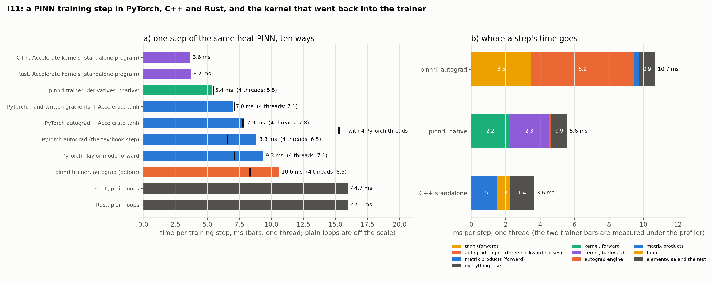

# I11: a PINN training step in PyTorch, C++ and Rust, and what went back into the trainer

**Question.** Where does a PINN training step spend its time in this package, how fast is the same step written without a framework in C++ and in Rust, and can the difference be brought back into `pinnrl`'s trainer? (I01, the time breakdown of a step, is answered here too.)

**Short answer.** The step is all arithmetic: sampling, the optimizer and Python bookkeeping are under a tenth of it. In PyTorch the largest single cost is `tanh` (a third of the step: per element it costs four times Apple's vectorised version and twenty times the matrix product next to it), followed by the three backward passes of the double-backward graph. A hand-written step (derivatives carried forward through the layers, one hand-written reverse pass, Accelerate for the matrix products and `tanh`) takes 3.6 ms in C++ and 3.7 ms in Rust against 8.8 ms for the textbook PyTorch step and 10.6 ms for the package's trainer. The two languages are indistinguishable; with plain loops instead of the BLAS both are five times *slower* than PyTorch. The kernel is now in the package: `build_trainer(derivatives="native")` brings the trainer from 10.6 to 5.4 ms a step on the same problem, with the same loss and gradients to rounding.

## Setup

One problem for every implementation: the heat equation $u_t = 0.1\,u_{xx}$ on the unit square with $u(x, 0) = \sin \pi x$ and zero boundary values; a `tanh` network 2-64-64-64-64-1 in float32; loss = mean residual² + 10 × initial + 10 × boundary on 4,096 + 512 + 512 points drawn afresh at every step; Adam at $10^{-3}$. Apple M4, macOS, PyTorch 2.10 (CPU; its BLAS is Accelerate).

| Implementation | What it is |
|---|---|
| `pinnrl`, autograd | the package's trainer on the catalogue's heat problem |
| PyTorch autograd | a minimal loop; $u_t$, $u_{xx}$ by two `autograd.grad` calls with `create_graph` |
| PyTorch Taylor | $u, u_x, u_{xx}, u_t$ carried forward layer by layer in tensor operations, one backward pass |
| PyTorch manual | the native programs' algorithm in tensor operations, no autograd graph |
| + Accelerate / sigmoid `tanh` | the activation by `vvtanhf` through `ctypes`, or as $2\sigma(2x) - 1$ |
| `cpp/pinn.cpp`, `rust/pinn.rs` | the same step with no framework; `blas` kernels (Accelerate `sgemm`, `vvtanhf`) or `naive` (plain loops the compiler vectorises). Rust uses the standard library only, with Accelerate through FFI |
| `pinnrl`, native | the trainer with `derivatives="native"` (`pinnrl.native`) |

The native programs are checked against PyTorch before they are timed: `check_gradients.py` gives both the same weights and batch, and their loss and weight gradient agree with float64 autograd to $4 \times 10^{-7}$ (relative) in both kernels. All timings are on an idle machine, three seeds each (the spread over seeds is under 1 %).

```bash
python experiments/I11_native_pinn/bench_python.py     # ~15 min
python experiments/I11_native_pinn/run.py              # builds and runs C++ and Rust, ~6 min (needs clang++; rustc for the Rust half)
python experiments/I11_native_pinn/bench_trainer.py    # the package's trainer, ~2 min
python experiments/I11_native_pinn/plot.py
```

## Results



| Implementation | ms per step, 1 thread | 4 threads |
|---|---|---|
| C++, Accelerate kernels | **3.64** | 3.64 |
| Rust, Accelerate kernels | **3.69** | 3.69 |
| **`pinnrl` trainer, `derivatives="native"`** | **5.4** | 5.5 |
| PyTorch manual + Accelerate `tanh` | 7.0 | 7.1 |
| PyTorch autograd + Accelerate `tanh` | 7.9 | 7.8 |
| PyTorch autograd + sigmoid `tanh` | 8.3 | 8.0 |
| PyTorch autograd | 8.8 | 6.6 |
| PyTorch Taylor / manual | 9.3 / 9.3 | 7.1 / 7.7 |
| `pinnrl` trainer, autograd | 10.6 | 8.3 |
| PyTorch Taylor, streams stacked | 12.4 | 9.6 |
| C++ / Rust, plain loops | 44.7 / 47.1 | |

**Where a step goes** (1 thread, ms):

| | `tanh` | matrix products | autograd engine / elementwise | sampling + optimizer | rest |
|---|---|---|---|---|---|
| `pinnrl`, autograd | 3.5 | 0.3 | 6.0 | 0.1 | 0.8 |
| PyTorch autograd | forward and loss 4.9 | | backward 3.6 | 0.2 | |
| C++ standalone | 0.75 | 1.5 | 1.4 | 0.02 | |
| `pinnrl`, native | kernel forward 2.3 | | kernel backward 2.4 | 0.1 | 0.9 |

Per element of a 4096 × 64 array: `torch.tanh` 2.6 ns (1.1 ns on 4 threads), `torch.sigmoid` 0.8 ns, Accelerate `vvtanhf` 0.6 ns, a 64 × 64 matrix product 0.12 ns.

**Accuracy.** After the same number of steps all implementations are in the same band (relative L2 of 2e-3 to 2e-2 at 2,000–3,000 steps; with a constant learning rate the error of a single step moves by an order of magnitude within a run, so no finer comparison is meaningful). The trainer with the kernel reaches 1.9e-3 to 2.5e-3 on the three seeds; with autograd 1.9e-3, 2.5e-3 and one seed at 1.3e-1 after 2,000 steps.

## Conclusion

1. **The pipeline has no pipeline bottleneck.** Sampling 5,120 points and the Adam update together are 0.1 ms of a 10 ms step, and the trainer's own bookkeeping 0.8 ms. Everything else is the arithmetic of the network and its derivatives; that is where to look, and nowhere else.
2. **In PyTorch the activation is the most expensive single operation.** On this build `tanh` costs 2.6 ns an element, twenty times the matrix product it follows, and a third of the trainer's step. Replacing it alone (Accelerate, or the sigmoid form) gains 6–10 % at one thread and loses at four, where PyTorch parallelises its own `tanh` and the custom backward costs more.
3. **Taylor mode is not faster in PyTorch.** Carrying the derivatives forward in tensor operations (9.3 ms), stacking them into one product a layer (12.4 ms) or writing the reverse pass by hand (9.3 ms) all lose to plain double backward (8.8 ms): each operation allocates megabytes of temporaries, and the graph is not what costs. The algorithm pays only where the loops are fused, which needs compiled code.
4. **Compiled code halves the step, and the language does not matter.** C++ and Rust, the same program line for line, take 3.64 and 3.69 ms: 2.4 times faster than the PyTorch step at one thread and 1.8 times at four. The gain comes from the algorithm with fused loops and reused buffers, on the same BLAS PyTorch calls. With their own loops for the matrix products both are five times slower than PyTorch (45 ms): a framework-free PINN is only worth writing on top of a tuned BLAS.
5. **The kernel is in the package, and the trainer is twice as fast with it.** `pinnrl.native` generalises the kernel (any layer widths, any number of inputs and outputs, first and pure second derivatives of chosen inputs) and wraps it as an autograd function, so the residual expression, the loss and the optimizer stay as they were. `build_trainer(derivatives="native")` takes the trainer from 10.6 to 5.4 ms a step (8.3 to 5.5 at four threads). The remaining distance to the standalone 3.6 ms is the kernel's generality (0.6 ms), three separate value passes for the boundary and initial points where the standalone has one (0.5 ms), and the trainer's bookkeeping (0.8 ms).

## What changed in the package

- `pinnrl/native/`: `jets.cpp`, compiled on first use with `clang++` into `~/.cache/pinnrl/native` (or `$PINNRL_NATIVE_CACHE`), and `mlp_jets`, `available`, `supported_layers`.
- `PINNModel.jets(x, first, second)` and `PINNModel.native_values`; `Fields(..., jets=...)`; `CustomPDE.build_trainer(derivatives="native")`, `CustomPDE.native_active(model)`; `pinnrl-train --pde-file ... --derivatives native`.
- Opt-in, so default results are unchanged. Where the kernel does not apply the residual is computed by autograd as before.

**Limits of the kernel, as shipped:** macOS (Accelerate) with a C++ compiler; a feed-forward network of `Linear` and `tanh`, with or without `LayerNorm` before each `tanh`; float32 on the CPU; equations given as text with first and pure second derivatives (not $u_{xt}$, $u_{xxx}$) and no unknown functions; weight gradients once (no Hessian-vector products, so the Hessian and sensitivity analyses of `pinnrl.analysis` need `derivatives="autograd"`). Next steps are on the roadmap: mixed and third derivatives in the kernel, a Linux build on OpenBLAS, one value pass instead of three.

## Layer normalization, and a defect in PyTorch's (I12)

The packaged `feedforward` network has `LayerNorm` between each `Linear` and its `tanh`, and layer normalization is expensive to differentiate twice: the trainer's step on the same problem is 32 ms with it against 10.6 ms without (and it reaches 7e-4 where the plain network reaches 2e-3 in the same 2,000 steps). The kernel now carries the derivative streams through the normalization by the quotient rule to second order, with its own reverse pass:

| Trainer, heat benchmark, 1 thread (4 threads) | autograd | `derivatives="native"` |
|---|---|---|
| plain `tanh` network | 10.6 (8.3) ms | 5.4 (5.5) ms |
| packaged default, layer normalization | 32.0 (28.6) ms | **10.4** (10.3) ms |

**Checking that reverse pass against autograd failed, and autograd was the one in error.** The kernel's values, first and second derivatives agreed with PyTorch to 3e-7 and so did the weight gradient of any loss built on values and first derivatives; with a second derivative in the loss the two disagreed by percent. Finite differences in float64 settle it: the gradient of `torch.nn.LayerNorm` (PyTorch 2.10) is wrong at third order, that is, for the weight gradient of a loss containing second derivatives of the network with respect to its inputs.

| Heat residual loss, 4 × 64 `tanh` network with layer normalization, float64 | `nn.LayerNorm` | written out in elementary operations |
|---|---|---|
| directional derivative against central differences, five random directions | 0.8–9 % off | 1e-10 to 1e-8 |
| weight gradient against the written-out version, three seeds | 1.8–3.3 % off in norm, cosine 0.9995–0.9998 | |
| the same for a first-order residual ($u_t + u_x$) | exact | |

One symptom needs no reference: the gradient with respect to the biases of a normalized layer must sum to zero (the output does not change when a constant is added to the pre-activations), and with `nn.LayerNorm` it does not.

The package's networks now use `pinnrl.neural_networks.ExactLayerNorm`, a subclass of `nn.LayerNorm` whose forward pass is `weight * c * rsqrt(mean(c²) + eps) + bias` with `c = x - mean(x)`: the same values, parameters and checkpoint keys, a gradient that matches finite differences, and the same 32 ms a step under autograd. Earlier runs with the default network on second-order equations followed a descent direction 2–3 % off the true one; nothing suggests their conclusions change, but they are not bit-reproducible after the fix. The defect is PyTorch's and worth reporting upstream; `tests/unit_tests/test_exact_layer_norm.py` reproduces it in twenty lines and will say when it is fixed.
