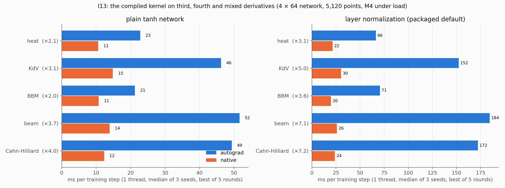

# I13: the compiled kernel on mixed, third and fourth derivatives

**Question.** `u_xt`, `u_xxx` (KdV) and `u_xxxx` (Cahn–Hilliard, the beam) fell back to autograd: the kernel of I11/I12 carried first and pure second derivatives only. Can it carry general Taylor coefficients, and what does the step cost then?

**Short answer.** Yes. `pinnrl.native` now carries, next to the value, the Taylor coefficient of every multi-index the residual needs (the downward closure of the requested derivatives, over the differentiated input columns), through `tanh` by the recurrence of $s' = (1 - s^2)\,a'$ and through layer normalization by Taylor arithmetic for the mean, the product and the inverse square root, with hand-written reverse passes for both. Residual, loss and weight gradient agree with autograd to $10^{-7}$–$10^{-5}$ (relative) on all five equations tested. The gain grows with the order of the equation: 2.1× on heat (as I11), 3.1× on KdV, 2.0× on a mixed third derivative, 3.7–4.0× on the two fourth-order equations; with the packaged network's layer normalization 3.1×, 5.0×, 3.6× and 7.1–7.2×. On the heat streams the general kernel is within 3–5 % of the special-cased one it replaces.

## Setup

The trainer's step as in I11: a `tanh` network 2-64-64-64-64-1 (plain, and with `ExactLayerNorm` before each `tanh`), 4,096 collocation + 512 initial + 512 boundary points drawn afresh every step, Adam, float32, one thread, Apple M4, PyTorch 2.10. Five equations from the catalogue or written as text:

| Key | Residual | Derivatives the kernel carries (streams) |
|---|---|---|
| `heat` | $u_t - 0.1\,u_{xx}$ | $u_t, u_x, u_{xx}$ (3) |
| `kdv_soliton` | $u_t + 6 u u_x + u_{xxx}$ | $u_t, u_x, u_{xx}, u_{xxx}$ (4) |
| BBM (text) | $u_t + u_x + u u_x - u_{xxt}$ | $u_t, u_x, u_{xx}, u_{xt}, u_{xxt}$ (5) |
| `beam` | $w_{tt} + EI\,w_{xxxx}$ | $w_t, w_{tt}, w_x, \ldots, w_{xxxx}$ (6) |
| `cahn_hilliard` | $u_t - M(6 u u_x^2 + (3u^2 - 1) u_{xx} - \kappa u_{xxxx})$ | $u_t, u_x, \ldots, u_{xxxx}$ (5) |

For each equation and network, one batch gives the relative difference of the residual, the loss and the full weight gradient between autograd and the kernel. Then, for three seeds, the two trainers alternate in five rounds of 200 steps and keep their best round (the machine was not idle: a virtual machine held one core throughout, which inflates every time here by about 2× against I11's 10.6 / 5.4 ms on heat; the best-of-rounds keeps the *ratios* where I11 measured them, 2.1× and 3.1× on heat).

```bash
python experiments/I13_native_higher_order/run.py     # ~20 min; --problems heat kdv_soliton reruns some
python experiments/I13_native_higher_order/plot.py
```

## Results



| Equation | plain: autograd → kernel (ms/step) | layer norm: autograd → kernel |
|---|---|---|
| heat | 22.8 → 10.6 (**2.1×**) | 66 → 21.5 (**3.1×**) |
| KdV, $u_{xxx}$ | 46 → 14.8 (**3.1×**) | 152 → 30 (**5.0×**) |
| BBM, $u_{xxt}$ | 21.2 → 10.7 (**2.0×**) | 71 → 19.8 (**3.6×**) |
| beam, $w_{xxxx}$ | 52 → 13.9 (**3.7×**) | 184 → 26 (**7.1×**) |
| Cahn–Hilliard, $u_{xxxx}$ | 49 → 12.3 (**4.0×**) | 172 → 24 (**7.2×**) |

Medians of three seeds; the spread between seeds is under 2 % except where a burst of load hit one round (BBM plain, one seed). Agreement with autograd on one batch: residual $3 \times 10^{-7}$ to $1.5 \times 10^{-6}$, loss exact to float32, weight gradient $9 \times 10^{-8}$ to $1.5 \times 10^{-5}$ relative (the larger values with layer normalization).

**The general kernel against the special-cased one** (the heat streams $u_t, u_x, u_{xx}$ through `mlp_jets` forward and backward, interleaved, best of eight rounds, same load): plain 7.7 → 8.1 ms (+5 %), layer normalization 16.4 → 17.0 ms (+3 %). The first version of the general loops was 45 % slower; the difference was the number of passes over the chunk arrays (zero-initialisation, products nobody reads, symmetric pairs counted twice, a copy of the adjoints at the end, and the normalization recomputed row by row in the reverse pass), not the arithmetic.

## Conclusion

1. **Taylor-mode generalises cleanly.** The streams are the multi-indices themselves, downward closed and sorted by degree; the `tanh` recurrence and the layer-norm Taylor arithmetic (mean, product, inverse square root) are table-driven, and their reverse passes are the tables read backwards. No order is special-cased; the tests go to fourth order and to $u_{xxt}$.
2. **The higher the order, the more the kernel pays.** Autograd's cost grows with each nested `autograd.grad` (a third derivative is a graph of a graph of a graph); the kernel adds one stream per multi-index and its cost grows about linearly with the number of streams. Hence 2× on heat and 4× on the fourth-order equations, and 7× when layer normalization multiplies autograd's graph again.
3. **Mixed derivatives cost what their closure costs.** $u_{xxt}$ needs five streams (its closure includes $u_{xt}$ and $u_{xx}$), so BBM's step costs as much as KdV's in the kernel while autograd finds it cheaper than KdV (one derivative per nested pass). The gain there is 2.0× plain, 3.6× with layer normalization.
4. **What is still outside the kernel:** unknown functions and callable residuals (the derivatives must be named in advance, which text gives), networks other than `Linear`/`LayerNorm`/`tanh`, a second differentiation of the weight gradient, and any platform but macOS (I14).

## What changed in the package

- `pinnrl/native/jets.cpp`: general multi-index streams; `Tables` builds the recurrence tables from the multi-indices; the normalization state is saved by the forward pass for the reverse pass.
- `native.mlp_jets(linears, x, derivatives, norms)` takes tuples of input columns of any order and returns `(u, {columns: derivative})`; `native.taylor_streams` gives the closure; `PINNModel.jets(x, derivatives)` and `Fields(..., jets=[...])` follow; `CustomPDE._native_request` asks for every derivative of a text residual, whatever its order.
- The catalogue's KdV, beam and Cahn–Hilliard problems and any mixed derivative now run through `build_trainer(derivatives="native")`; `tests/unit_tests/test_native.py` checks them against autograd.
