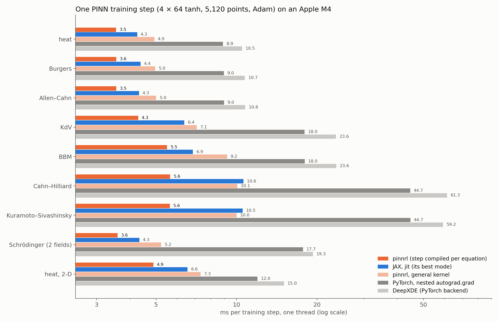

# I17: the training step against the alternatives

**Question.** Is `pinnrl` the fastest way to take a PINN step on a CPU, against everything else a user could install? And if not, what does the leader do that it does not?

**Short answer.** It is now, on all nine equations measured: 1.2–1.9× JAX's best mode, 2.5–8× eager PyTorch and 3–11× DeepXDE. It was not when the experiment started. The first run had JAX's forward mode 1.3× ahead on heat and 1.2× on KdV, and two mechanisms explained it: XLA fuses each layer's derivative arithmetic into one loop written for the equation, and its `tanh` is a rational approximation three times as fast as a vector library's. Both are now in the package (`pinnrl.native.specialize`, a step compiled per equation, and a rational `tanh` in the kernels), which is what moved the default from the "general kernel" row to the first.

## Setup

One step, the same in every arm: a `tanh` network d-64-64-64-64-k in float32, the loss `mean(r^2) + 10 mean(ic^2) + 10 mean(bc^2)` on 4,096 collocation, 512 initial and 512 Dirichlet boundary points drawn afresh every step, Adam at 1e-3.

| Problem | Residual |
|---|---|
| heat | $u_t - 0.1 u_{xx}$ |
| Burgers | $u_t + u u_x - 0.01 u_{xx}$ |
| Allen–Cahn | $u_t - 10^{-4} u_{xx} + 5u^3 - 5u$ |
| KdV | $u_t + 6 u u_x + u_{xxx}$ |
| BBM | $u_t + u_x + u u_x - u_{xxt}$ (a mixed third derivative) |
| Cahn–Hilliard | $u_t - (6 u u_x^2 + (3u^2 - 1) u_{xx} - 0.01 u_{xxxx})$ |
| Kuramoto–Sivashinsky (K–S) | $u_t + u u_x + u_{xx} + u_{xxxx}$ |
| Schrödinger | $u_t + \tfrac12 v_{xx} + (u^2 + v^2) v$, $v_t - \tfrac12 u_{xx} - (u^2 + v^2) u$ (two fields) |
| heat 2-D | $u_t - 0.1 (u_{xx} + u_{yy})$ |

| Arm | How the derivatives are taken |
|---|---|
| `pinnrl` | the package's trainer with its defaults: C++ generated for the equation (fused Taylor-mode loops, the residual and its adjoint inlined), compiled once and cached |
| `pinnrl-general` | the same trainer with `PINNRL_NATIVE_SPECIALIZE=off`: the table-driven kernel for any equation, the residual and loss in PyTorch |
| `pinnrl-autograd` | the same trainer with `derivatives="autograd"` |
| `torch-eager` | a minimal PyTorch loop, nested `torch.autograd.grad` with `create_graph=True`, the textbook step |
| `torch-compile` | that loop under `torch.compile(fullgraph=True)` |
| `torch-func` | `torch.func.jvp` nested for the input derivatives, one reverse pass for the weights |
| `jax-reverse` | JAX under `jit`: `vmap` of nested `grad` |
| `jax-forward` | JAX under `jit`: nested `jvp`, one reverse pass |
| `jax-jet` | JAX under `jit`: `jax.experimental.jet` (Taylor mode) along each coordinate, `jvp` for a mixed term, one reverse pass |
| `deepxde` | DeepXDE with its PyTorch backend, nested `dde.grad.jacobian`, fixed points |

Each arm runs in its own process, checks its residual against the reverse-mode one of its framework before it is timed, warms up through any compilation, and keeps the best of three rounds of 100 steps over two passes (the two passes agree within 5 % for most arms). Apple M4 on mains power, PyTorch 2.10, one thread.

```bash
uv run --with jax --with deepxde python experiments/I17_step_head_to_head/run.py   # ~45 min
python experiments/I17_step_head_to_head/plot.py
```

## Results



Milliseconds per step, one thread; the best of each column in bold:

| Implementation | heat | Burgers | Allen–Cahn | KdV | BBM | Cahn–Hilliard | K–S | Schrödinger | heat 2-D |
|---|---|---|---|---|---|---|---|---|---|
| **`pinnrl`, the default (step compiled per equation)** | **3.5** | **3.6** | **3.5** | **4.3** | **5.5** | **5.6** | **5.6** | **3.6** | **4.9** |
| JAX, `jit`, forward mode (nested `jvp`) | 4.3 | 4.4 | 4.3 | 6.4 | 6.9 | 10.9 | 11.0 | 4.3 | 6.6 |
| `pinnrl`, general kernel (`PINNRL_NATIVE_SPECIALIZE=off`) | 4.9 | 5.0 | 5.0 | 7.1 | 9.2 | 10.1 | 10.0 | 5.2 | 7.3 |
| JAX, `jit`, Taylor mode (`jax.experimental.jet`) | 5.2 | 5.4 | 5.4 | 7.5 | 8.7 | 10.6 | 10.5 | 5.4 | 7.6 |
| JAX, `jit`, reverse over reverse | 6.1 | 7.9 | 6.7 | 16.1 | 16.1 | 60.7 | 60.5 | 11.7 | 9.5 |
| PyTorch, nested `autograd.grad` | 8.9 | 9.0 | 9.0 | 18.0 | 18.0 | 44.7 | 44.7 | 17.7 | 12.0 |
| `pinnrl`, `derivatives="autograd"` | 10.1 | 10.4 | 10.3 | 19.5 | 19.6 | 46.2 | 46.2 | 15.7 | 14.5 |
| DeepXDE (PyTorch backend) | 10.5 | 10.7 | 10.8 | 23.6 | 23.6 | 61.3 | 59.2 | 19.3 | 15.0 |
| `torch.func`, nested `jvp` | 17.4 | 17.4 | 17.2 | 36.5 | 31.5 | 94.2 | 93.9 | 17.4 | 27.4 |
| `torch.compile` | fails | fails | fails | fails | fails | fails | fails | fails | fails |

## Findings

1. **`pinnrl` is first on every equation**, by 1.2× over JAX's best mode on the second-order problems, 1.25–1.5× at third order and in two dimensions, and 1.9× at fourth order. Against the PyTorch ecosystem the margin is 2.5–8× (the textbook loop) and 3–11× (DeepXDE).
2. **The step compiled per equation is worth 1.4–1.8× over the general kernel**, more as the order rises. The general kernel walks index tables, one loop per term of each recurrence, over arrays of megabytes; the generated code is one loop per layer each way, with a straight-line body for exactly the streams the equation uses. On heat the residual pass alone goes from 4.2 to 3.0 ms, the time of a step written by hand for that equation (I11).
3. **A third of the first gap was `tanh`.** Accelerate's `vvtanhf` costs 1.1 ns an element and the step evaluates 1.3 million of them; the rational form Eigen uses (which is what XLA runs) costs 0.4 ns at the same float32 accuracy (2.4e-7). It is now the kernels' `tanh` on every platform.
4. **Blocking the batch for the cache does not pay on this machine.** The compiled step can run the batch in blocks of points; blocks of 1,024 are as fast as the whole batch and smaller ones are slower, because the matrix product's cost per call outweighs what the cache saves.
5. **The technique decides before the framework does.** Reverse over reverse is 1.4–6× behind forward or Taylor mode inside JAX itself, and JAX's reverse mode is no better than PyTorch's at fourth order. `torch.func`'s forward mode runs but loses to eager reverse mode: without a compiler to fuse it, forward mode in tensor operations does not pay.
6. **`torch.compile` cannot run the step.** With `fullgraph=True` it stops at `torch.autograd.grad` inside the function ("attempted to call function marked as skipped"); without it, it falls back to eager silently, and an earlier form of the loop failed with "does not currently support double backward".

## What this does not show

- **The packaged default network is slower to gain.** With layer normalization (the `feedforward` default) the compiled step takes heat's residual pass from 9.0 to 7.4 ms only: the normalization's passes are still table-driven. The other arms were not run with layer normalization.
- **Where the compiled step does not apply**, the general kernel row is the package's number: a network with input or output scaling (`normalize=True`), trainable parameters or unknown functions (the inverse problems), a loss other than the squared one.
- **PhysicsNeMo was not run.** `nvidia-physicsnemo-sym` resolves on this machine, but its solver is driven by a Hydra configuration that does not reduce to one timed step. It differentiates with PyTorch autograd, so the eager row is the floor for it; that is an inference, not a measurement.
- **One machine, one network size.** An M4 with Accelerate. On Linux (OpenBLAS) neither the kernel's nor JAX's position is measured here.
- **A CPU result.** On a GPU with large batches the frameworks' own kernels win and `pinnrl` falls back to autograd.
- **A step, not a solution.** Every arm takes the same Adam step; error at equal time was not compared, and the arms' initial weights differ.
