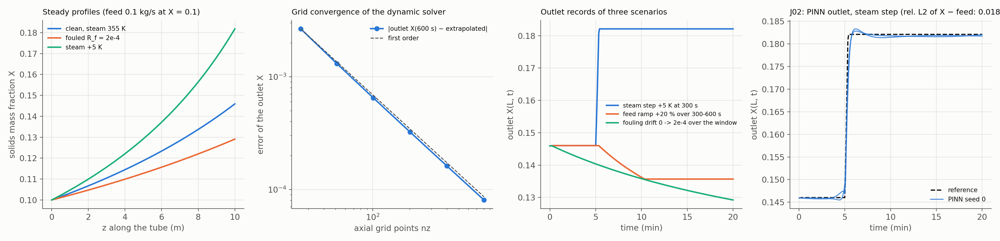

# J01 / J02: the falling-film evaporator reference simulator, and its PINN forward solve

## Question

J01: a trusted forward model to grade everything else against. J02: can the PINN match the reference simulator?

## Setup

**The model** (`pinnrl.process.FallingFilmEvaporator`). A liquid film runs down a heated tube of length $L = 10$ m at $v = 0.5$ m/s (residence time 20 s). Steam at $T_s$ heats it through the wall; the film boils at $T_b(X) = T_{\text{sat}} + k_{\text{bpe}} X$ (boiling-point elevation, $k_{\text{bpe}} = 4$ K), and the heat flux $q = (T_s - T_b(X)) / (1/U + R_f)$ ($U = 2{,}000$ W/m²K clean, $R_f$ the fouling resistance) evaporates water at $P q / \lambda$ per unit length ($P = \pi \cdot 0.05$ m, $\lambda = 2.3$ MJ/kg). The liquid mass flow $W$ and the solids fraction $X$ obey

$$W_t + v W_z = -\frac{P q(X)}{\lambda}, \qquad X_t + v X_z = \frac{X P q(X)}{\lambda W},$$

with the feed $W(0, t) = W_{\text{in}}(t)$, $X(0, t) = X_{\text{in}}(t)$ (0.1 kg/s at 10 % solids), $T_s(t) = 355.15$ K (12 K above $T_{\text{sat}} = 343.15$ K) and $R_f(t)$ as inputs. Solids are conserved along the tube ($WX$ constant in steady state).

- **Steady state:** an ODE in $z$ (`steady_state`, LSODA, $10^{-10}$ tolerances), and its sensitivity to steam, feed and fouling.
- **Dynamics:** method of lines, first-order upwind in $z$, BDF in $t$ (`reference`); grid convergence on a 5 K steam step at $t = 300$ s, $n_z = 26 \ldots 801$, against a first-order Richardson extrapolation of the outlet at 600 s.
- **Scenarios** on a 20-minute window: a 5 K steam step at 300 s; a 20 % feed ramp over 300–600 s; a fouling drift $R_f: 0 \to 2 \times 10^{-4}$ m²K/W over the window (an 8-hour drift compressed, so the transport and the drift both show).
- **J02:** the `custom_pde()` form of the model (two fields of $(z, t)$, the four signals as `TimeSeries` inputs, one-sided Dirichlet inlet conditions, the steady profile as the initial condition, scales $W \approx 0.1 \pm 0.02$, $X \approx 0.1 \pm 0.05$) trained forward on the steam-step scenario with `normalize=True`: tanh MLP 4 × 64, 4,096 points refreshed every 50 steps, Adam 4,000 steps then L-BFGS 100 steps, no regularisation, 3 seeds; scored on the $(z, t)$ grid against the reference ($n_z = 201$) and on the outlet $X(L, t)$.
- **Code:** `run.py`, `plot.py`.

Rerun with `python experiments/J01_evaporator_reference/run.py --seeds 3 --workers 3` (`--skip-pinn` for J01 alone).

## Result

**Steady state.** One pass evaporates 31.5 % of the feed's water: $W$ falls from 0.100 to 0.0685 kg/s and $X$ rises from 0.100 to 0.1459; the flux falls from 23,200 to 22,830 W/m² along the tube as the boiling point rises with $X$. Sensitivity of the outlet $X$:

| Change | Outlet $X$ | $\Delta X$ |
|---|---|---|
| none | 0.1459 | |
| steam +1 K | 0.1519 | +0.0060 |
| feed +10 % | 0.1401 | −0.0058 |
| feed solids +0.01 | 0.1602 | +0.0143 |
| fouling $R_f = 10^{-4}$ | 0.1356 | −0.0103 |
| fouling $R_f = 2 \times 10^{-4}$ | 0.1291 | −0.0168 |

A fouling of $10^{-4}$ m²K/W (a 17 % loss of $U$) moves the outlet as much as 1.7 K of steam or 18 % of feed: the twin's observability question (J04) is whether the outlet record can tell these apart, which it can only with the steam and feed records as inputs.

**Grid convergence** of the outlet $X$ at 600 s after the steam step:

| $n_z$ | 26 | 51 | 101 | 201 | 401 | 801 |
|---|---|---|---|---|---|---|
| outlet $X$ | 0.18444 | 0.18309 | 0.18243 | 0.18210 | 0.18194 | 0.18186 |
| error vs extrapolated 0.18178 | 2.7e-3 | 1.3e-3 | 6.5e-4 | 3.2e-4 | 1.6e-4 | 8.1e-5 |
| time | 0.04 s | 0.05 s | 0.07 s | 0.22 s | 1.4 s | 9.6 s |

First order, as the upwind scheme is; $n_z = 201$ (0.2 % of the step's response, 0.2 s per 10-minute simulation) is the working grid.

**Scenarios.** The steam step reaches the outlet after the 20 s residence time and settles at $X = 0.1821$ (+0.036); the feed ramp lowers the outlet to 0.1357 with $W$ up to 0.0885 kg/s; the fouling drift lowers it from 0.1459 to 0.1292 over the window, a drift of the same size as the steam step and of the opposite sign.

**J02.** The PINN forward solve of the steam-step scenario, 3 seeds:

| Seed | Rel. L2 of $W$ | Rel. L2 of $X$ | Rel. L2 of $X - X_{\text{in}}$ | Outlet $X$, max error | Time |
|---|---|---|---|---|---|
| 0 | 0.0035 | 0.0044 | 0.016 | 0.0085 | 337 s |
| 1 | diverged (NaN in the L-BFGS phase) | | | | 343 s |
| 2 | 0.0038 | 0.0058 | 0.021 | 0.0116 | 338 s |

The outlet record follows the reference before and after the step (within 0.001 of $X$ on the plateaus) and rounds the front: the maximum error, a quarter of the step's height, sits in the 20 s of the front's arrival, which the smooth network spreads over about a minute (figure, right).

## Conclusion

1. **J01 is a usable reference.** The model has the structure the twin needs (measured inputs, a transport delay, a slowly drifting unknown, outlet sensors), conserves solids to $10^{-12}$, converges at first order with a 0.2 s solve on the working grid, and its sensitivities are physically sensible: fouling, steam and feed all move the outlet by comparable amounts, so none can be inferred from the outlet alone.
2. **The PINN matches the reference to a fraction of a percent, in physical units, once normalised.** With `scales` for $W$ and $X$ and the inputs mapped to $[-1, 1]$, two of three seeds reach 0.4–0.6 % on both fields (1.6–2.1 % of the part of $X$ that the tube adds) in under six minutes of CPU, with no hand scaling of the equations; the first-order front of the steam step is the only place the error concentrates. The third seed diverged to NaN in the L-BFGS finish, the failure D01 saw on Burgers: the L-BFGS safeguard is now the blocking engineering item for J03.

**Consequences for the backlog:** J03 (fouling estimation) uses `custom_pde(unknown_fouling=...)` with the steam and feed records as inputs and outlet sensors; J04 asks the identifiability question with `sensor_jacobian`-style sensitivities from this solver (finite differences, as K48 did); K09 (linearised stability) can start from the method-of-lines Jacobian.
