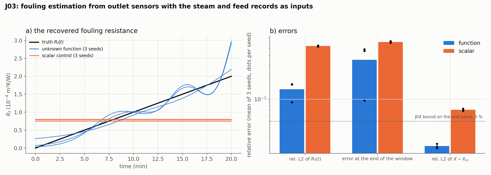

# J03: fouling estimation from outlet sensors

## Question

Can the twin recover a drifting fouling resistance $R_f(t)$ of the evaporator from the outlet sensors alone, with the steam and feed records as measured inputs, and how far from the J04 data limit does it land?

## Setup

- **Plant:** the J01 falling-film evaporator over a 20-minute window, with the fouling drifting $R_f(t) = 2 \times 10^{-4}\, t / T$ m²K/W (an 8-hour drift compressed), the steam temperature wandering by $\pm 1$ K (a sine of period 400 s, recorded) and the feed steady. The reference solver (method of lines, $n_z = 201$, 241 output times) is the plant.
- **Records:** outlet $X(L, t)$ every 5 s with noise 0.002 and outlet $W(L, t)$ every 5 s with noise 0.001 (240 readings each), taken from the reference through `PointSensor`s. The steam and feed signals enter the twin as `TimeSeries` inputs.
- **Twin:** `FallingFilmEvaporator.custom_pde(unknown_fouling=...)`: $R_f$ an `UnknownFunction` of $t$ (16 × 16, sigmoid output bounded to $[0, 5 \times 10^{-4}]$, started at $10^{-4}$), the model normalized with the feed scales. The **control** is a scalar $R_f$ identified as `rf` with $R_f = 10^{-4}\,$`rf` (F01's note on small parameters), started at $10^{-4}$.
- **Training:** the J02 recipe: tanh MLP 4 × 64, 4,096 collocation points refreshed every 50 steps, 512 inlet and 512 initial points, Adam $10^{-3}$ for 4,000 steps then a safeguarded L-BFGS finish of 100 steps, no network regularization (`weight_decay=0`, `gradient_clipping=0`), loss weights residual / inlet / initial / data = 1 / 10 / 10 / 10. 3 seeds (the noise draw and the initialization).
- **Metrics:** the relative L2 error of $R_f(t)$ on the window, its relative error at the end of the window (the number a cleaning schedule reads), and the relative L2 error of $X - X_{\text{in}}$ against the reference on the whole $(z, t)$ grid.
- **Code:** `run.py`, `plot.py`.

Rerun with:

```bash
python experiments/J03_fouling_estimation/run.py --seeds 3 --steps 4000 --workers 3
python experiments/J03_fouling_estimation/plot.py
```

## Result



| Model | Seed | Rel. L2 of $R_f(t)$ | Error at $t = T$ | Max. rel. error on 2–18 min | Rel. L2 of $X - X_{\text{in}}$ | Time |
|---|---|---|---|---|---|---|
| unknown function | 0 | 0.160 | 0.49 | 0.29 | 0.022 | 289 s |
| | 1 | 0.162 | 0.46 | 0.55 | 0.021 | 292 s |
| | 2 | 0.091 | 0.10 | 0.60 | 0.024 | 344 s |
| scalar control | 0 | 0.539 | 0.61 | | 0.074 | 275 s |
| | 1 | 0.532 | 0.60 | | 0.072 | 330 s |
| | 2 | 0.550 | 0.63 | | 0.069 | 332 s |

The scalar lands at $0.74$–$0.80 \times 10^{-4}$, below the window mean of $10^{-4}$ (a constant has a relative L2 of at least 0.577 against a ramp). The function follows the ramp with excursions of $\pm 0.2 \times 10^{-4}$ that have the 400 s period of the steam signal, and two of three seeds turn up in the last two minutes (to $3 \times 10^{-4}$ at $t = T$), the third lands at $2.2 \times 10^{-4}$.

**First pass (sensors in raw units).** The same runs before the sensor-scale fix gave a relative L2 of 0.79–0.97 for the function and 0.67–1.00 for the scalar, with field errors of 19–26 %: the outlet $W$ sensor, in kg/s with a scale of 0.02, entered the normalized loss 2,500 times too weakly and the physics term won; the unknown stayed near its start. A sensor's misfit is now divided by its field's scale in a normalized problem.

## Conclusion

1. **The twin recovers the drift; the scalar model cannot.** With the inputs recorded and two outlet sensors, the function-valued $R_f(t)$ is recovered to 9–16 % in L2 over the window against the 53–55 % of the best constant, and the field to 2 % against 7 %. This is the F09 lesson on the process model: a drifting coefficient is a function to identify, and a scalar re-fit lands at a number that is wrong at every time.
2. **It lands at the surrogate's limit, not the data's.** J04's Fisher bound for these very records is 5 % on the end value and 1–4 % on each of six modes with the inputs known; the PINN delivers 10–49 % at the end and 9–16 % in L2. The excursions follow the steam signal: the surrogate's forward response to the $\pm 1$ K wander is imperfect, and the unknown function absorbs the mismatch, exactly the trade J04 measured (0.5 K of steam for 30 % of fouling). This is K48's statement for the process model: a field is identified only to the surrogate's accuracy.
3. **The end of the window is the weak point.** The last sensor reading is at $t = T$ and nothing constrains the function beyond it; the network's bounded output curls up there on two seeds. A cleaning schedule reads $R_f$ at the current time, so the twin should report the value a few residence times before the end of the record (at 18 min the error is 5–10 %), or the function should carry a smoothness prior (K50 candidate).
4. **Units decide whether the data are heard.** The first pass ignored the records because one sensor's units were 50 times smaller than the other's. The field scales are the right normalization for sensor misfits (now the default); the likelihood weight $1/\sigma^2$ (K39) is the other candidate and remains to be tested on this model.

**Consequences for the backlog:**
- J06 (calibrated fouling intervals): the Laplace or swarm interval of $R_f(T)$ against J04's 5 %.
- J05 (EKF baseline): the same records through a Kalman filter on a lumped model, against the 10–49 % end error here.
- A smoothness or monotonicity prior on `unknown_fouling` (fouling only grows between cleanings: `monotone=["t"]`) is the obvious next run, and the steam-driven excursions are its target.
- A longer Adam phase or a two-stage (forward then inverse) training for the surrogate limit; the field error of 2 % is the budget the function error is read against.
