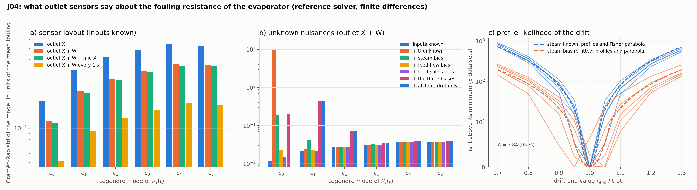

# J04: is the fouling resistance identifiable from outlet measurements only?

## Question

A plant measures the evaporator at its outlet (solids by a refractometer or density meter, flow by a flow meter), not along the tube. What do those records determine about the fouling resistance $R_f(t)$: which part of its time course, with what precision, and how does that change when the clean coefficient $U$, the steam temperature or the feed are themselves uncertain?

## Setup

- **Plant:** the J01 falling-film evaporator over J03's 20-minute window: the steam wandering by $\pm 1$ K (a sine of period 400 s, recorded), the feed steady, the fouling drifting $R_f(t) = 2 \times 10^{-4}\, t / T$ m²K/W. The reference solver (method of lines, $n_z = 201$, 241 output times) is the forward model; no PINN is trained here.
- **Unknown:** $R_f(t) = \sum_{k=0}^{5} c_k P_k(2t/T - 1)$, six Legendre modes of time, the coefficients in units of $10^{-4}$ (the mean fouling of the window). Truth $c_0 = c_1 = 1$, the rest 0.
- **Nuisances:** the clean coefficient $U$ (relative), a steam-temperature bias (K), a feed-flow bias (relative) and a feed-solids bias (absolute), all constant over the window.
- **Sensors:** outlet $X$ every 5 s with noise 0.002 (J03's), outlet $W$ every 5 s with noise 0.001, and for the layout question a mid-tube $X$ probe and 1 s sampling.
- **Method:** central finite differences of the records with respect to each mode (step 0.1) and nuisance (steps 1 %, 0.1 K, 1 %, 0.001), `pinnrl.analysis.fisher_information` for the Cramér–Rao standard deviations, correlations and condition number, and the bound on the end value $R_f(T) = \sum_k c_k$ from the covariance. Part C is F07's profile likelihood on the reference: the misfit of 5 noisy data sets (outlet $X$ and $W$) as a function of the drift's end value $r_{\text{end}}$ (with $R_f = r_{\text{end}}\, t/T$), with the steam bias fixed at zero and re-optimised at every grid point, against the Fisher parabola of $(r_{\text{end}}, b)$.
- **Code:** `run.py` (76 s in total), `plot.py`.

Rerun with:

```bash
python experiments/J04_plant_sensors/run.py --datasets 5 --modes 6
python experiments/J04_plant_sensors/plot.py
```

## Result



**A. Layouts, inputs known.** Cramér–Rao standard deviation of each mode in units of the mean fouling; the end value relative to its truth; the condition number.

| Layout | $c_0$ | $c_1$ | $c_2$ | $c_3$ | $c_4$ | $c_5$ | $R_f(T)$ | $\kappa(F)$ |
|---|---|---|---|---|---|---|---|---|
| outlet X | 0.017 | 0.032 | 0.042 | 0.048 | 0.055 | 0.053 | 7.8 % | 30 |
| outlet X + W | 0.011 | 0.021 | 0.027 | 0.032 | 0.036 | 0.036 | 5.0 % | 25 |
| outlet X + W + mid-tube X | 0.011 | 0.020 | 0.026 | 0.031 | 0.035 | 0.035 | 4.8 % | 25 |
| outlet X + W every 1 s | 0.005 | 0.009 | 0.012 | 0.014 | 0.016 | 0.016 | 2.3 % | 26 |

**B. Nuisances, outlet X + W.** The same, with each nuisance added to the unknowns (its own standard deviation in the last column).

| Unknowns | $c_0$ | $c_1$ | $c_2$ | $c_3$–$c_5$ | $R_f(T)$ | $\kappa(F)$ | Nuisance std, correlation with $c_0$ / $c_1$ |
|---|---|---|---|---|---|---|---|
| modes only | 0.011 | 0.021 | 0.027 | 0.032–0.036 | 5.0 % | 25 | |
| + $U$ | 63 | 0.024 | 0.027 | 0.032–0.036 | 3,100 % | $10^9$ | 1,250 % (1.00 / 0.48) |
| + steam bias | 0.20 | 0.043 | 0.027 | 0.034–0.036 | 13 % | 2,500 | 0.38 K (1.00 / 0.88) |
| + feed-flow bias | 0.023 | 0.022 | 0.027 | 0.032–0.036 | 5.2 % | 5,600 | 0.1 % (−0.86 / −0.35) |
| + feed-solids bias | 0.015 | 0.021 | 0.027 | 0.032–0.036 | 5.0 % | $2 \times 10^5$ | 0.0003 (0.65 / 0.13) |
| + the three biases | 0.21 | 0.45 | 0.073 | 0.035–0.040 | 34 % | $3 \times 10^9$ | steam 4.9 K, flow 11 %, solids 0.011 (… / −0.99, −1.00, 1.00) |
| + all four, drift only ($c_1$–$c_5$) | | 0.45 | 0.073 | 0.035–0.041 | 28 % | $3 \times 10^9$ | as above |

**C. Profile likelihood** of the drift's end value, outlet X + W, 5 data sets.

| | Fisher std of $r_{\text{end}}$ | 95 % half-width (parabola) | Profile rise at $\pm 10$ % (5 data sets) | Parabola at $\pm 10$ % |
|---|---|---|---|---|
| steam bias known | 1.1 % | 2.2 % | 53–113 | 80 |
| steam bias re-fitted | 2.1 % | 4.2 % | 5–52 | 22 |

The joint Fisher correlation of $r_{\text{end}}$ and the steam bias is 0.85. Along the free profile the re-fitted bias moves from −0.5 K at $r_{\text{end}} = 0.7 \times$ truth to +0.45 K at $1.3 \times$: a 0.5 K steam error reproduces the records of a 30 % fouling error. The profiles are asymmetric (860 at 0.7 against 610 at 1.3 with the bias fixed): the response to $R_f$ through $1/(1/U + R_f)$ is convex.

## Conclusion

1. **With the inputs known, the outlet determines the whole time course of the fouling.** Six Legendre modes of $R_f(t)$ are determined from outlet $X$ alone to 1.7–5.5 % of the mean fouling, with $\kappa(F) = 30$: the information falls only threefold from the constant to the fifth mode, because the 20 s residence time is short against the 1,200 s window and every mode is slow for the tube. The end value is bounded at 7.8 %; the outlet flow halves that (5 %) because it reads the evaporation rate directly, and 1 s sampling halves it again ($\sqrt 5$). A mid-tube probe adds nothing (4.8 %): the outlet already integrates the tube. For the twin, a flow meter and a faster sampling rate are worth more than an extra probe.
2. **The clean coefficient and the constant fouling are the same unknown.** $U$ and $c_0$ enter only through $1/U + R_f$: with $U$ free the constant mode is undetermined ($\kappa = 10^9$, the finite differences' rounding), while the drift modes keep their bounds (0.024 against 0.021). A fouling monitor therefore estimates the *change* of resistance since a reference state (the clean tube, or the last cleaning), never its absolute value, unless $U$ is known from elsewhere.
3. **The steam temperature is the nuisance that matters.** A constant steam bias correlates 0.88 with the constant fouling and 0.85 with the drift's end value; it raises the bound on $c_0$ from 1 % to 20 %, on $R_f(T)$ from 5 % to 13 %, and the profile shows the trade: 0.5 K of steam for 30 % of fouling. The feed biases are determined by the outlet flow (0.1 % and 0.0003) and cost nothing on their own. With the three biases free together the records no longer separate them (two outlet signals cannot pin three constant offsets: $\kappa = 3 \times 10^9$, steam 4.9 K, flow 11 %), and the leftover direction masquerades as a slow drift: $c_1$ goes from 2 % to 45 %. The twin needs either the steam temperature to about 0.1 K and the feed flow to about 1 %, or one more signal that breaks the degeneracy (the condensate or steam flow, which measures the heat duty directly).
4. **The profile likelihood on the reference is the Fisher parabola, as F07 found for the heat equation**, within the noise of five data sets at $\pm 10$ % (53–113 against 80, 5–52 against 22) and with a visible convexity at $\pm 30$ %. The 95 % interval of the drift's end value is $\pm 2$ % with the steam known and $\pm 4$ % with its bias re-fitted. These are the targets J03's PINN estimator is to be read against.

**Consequences for the backlog:**
- J03 reports its function-valued $R_f(t)$ against these bounds: the data allow 5 % on the end value with the inputs known; what the PINN delivers above that is the surrogate's.
- J09 (measurement design): the candidate set is outlet $X$, outlet $W$, the sampling rate, and a heat-duty signal (steam or condensate flow); the Fisher machinery here is the objective.
- K15 (functionals only) has its process instance: the outlet is a boundary sensor, and the heat duty an integral one.
- The twin's state is the drift since the last cleaning; `unknown_fouling` in J03 starts at the clean value for that reason.
