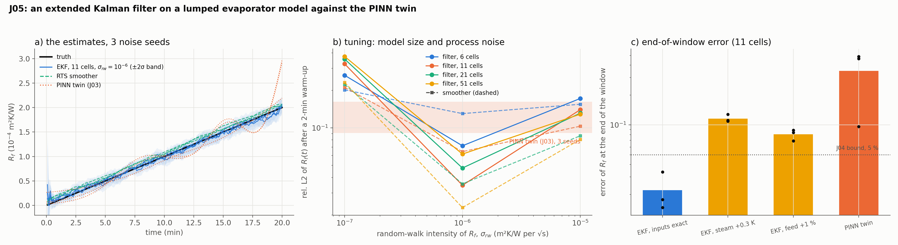

# J05: a Kalman-filter baseline against the PINN twin

## Question

How does the classical estimator, an extended Kalman filter on a lumped model of the evaporator, compare with the PINN twin of J03 on the same records: estimation error, latency, tuning effort, and sensitivity to the model mismatches J04 identified?

## Setup

- **Plant and records:** exactly J03's: the J01 evaporator over 20 minutes, the steam wandering by $\pm 1$ K (recorded), the fouling drifting $R_f(t) = 2 \times 10^{-4}\, t/T$, outlet $X$ and $W$ every 5 s with noise 0.002 and 0.001, the same three noise seeds.
- **Estimator:** `pinnrl.process.ExtendedKalmanFilter` on the method-of-lines model with $n_z \in \{6, 11, 21, 51\}$ cells (`FallingFilmEvaporator.fouling_state_space`), $R_f$ appended to the state as a random walk of intensity $\sigma_{rw}^2$ per second, $\sigma_{rw} \in \{10^{-7}, 10^{-6}, 10^{-5}\}$ m²K/W per $\sqrt{\text{s}}$ (the truth's slope is $1.7 \times 10^{-7}$ per second), started at $R_f = 10^{-4}$ with a prior standard deviation of $10^{-4}$, like the PINN. The Jacobians by central finite differences, the covariance propagated with the matrix exponential, the state with LSODA; the Rauch–Tung–Striebel smoother gives the batch estimate, which is what the PINN (a whole-window fit) is comparable to. $R_f$ is clipped at zero.
- **Model mismatch:** the filter's steam record biased by $+0.3$ K, or its feed flow by $+1$ %, with 11 cells and $\sigma_{rw} = 10^{-6}$.
- **Metrics:** relative L2 of $R_f(t)$ after a 2-minute warm-up; the error at the end of the window; the lag of the filter behind the ramp (the mean of (truth − estimate) over the slope after 5 minutes); the fraction of the window inside the $\pm 2\sigma$ band; the run time on one CPU core.
- **Code:** `run.py` (14 s for all 42 runs), `plot.py`.

Rerun with:

```bash
python experiments/J05_ekf_baseline/run.py --seeds 3
python experiments/J05_ekf_baseline/plot.py
```

## Result



Mean over 3 seeds.

| Cells | $\sigma_{rw}$ | Filter rel. L2 | Filter end error | Lag | $\pm 2\sigma$ coverage | Smoother rel. L2 | Smoother end error | Time |
|---|---|---|---|---|---|---|---|---|
| 6 | $10^{-7}$ | 0.264 | 0.270 | +196 s | 0.08 | 0.202 | 0.270 | 0.1 s |
| 6 | $10^{-6}$ | 0.072 | 0.052 | −40 s | 0.90 | 0.130 | 0.052 | 0.1 s |
| 6 | $10^{-5}$ | 0.172 | 0.180 | −75 s | 1.00 | 0.155 | 0.180 | 0.1 s |
| 11 | $10^{-7}$ | 0.326 | 0.310 | +249 s | 0.04 | 0.211 | 0.310 | 0.2 s |
| 11 | $10^{-6}$ | **0.035** | **0.022** | +6 s | 1.00 | 0.064 | 0.022 | 0.2 s |
| 11 | $10^{-5}$ | 0.140 | 0.151 | −33 s | 1.00 | 0.103 | 0.151 | 0.2 s |
| 21 | $10^{-7}$ | 0.356 | 0.329 | +273 s | 0.01 | 0.223 | 0.329 | 0.3 s |
| 21 | $10^{-6}$ | 0.048 | 0.008 | +28 s | 1.00 | 0.036 | 0.008 | 0.3 s |
| 21 | $10^{-5}$ | 0.131 | 0.137 | −13 s | 1.00 | 0.086 | 0.137 | 0.4 s |
| 51 | $10^{-7}$ | 0.374 | 0.339 | +287 s | 0.00 | 0.232 | 0.339 | 0.8 s |
| 51 | $10^{-6}$ | 0.062 | 0.007 | +40 s | 0.98 | **0.023** | **0.007** | 0.8 s |
| 51 | $10^{-5}$ | 0.129 | 0.128 | −1 s | 1.00 | 0.081 | 0.128 | 0.8 s |

With model mismatch (11 cells, $\sigma_{rw} = 10^{-6}$): steam $+0.3$ K gives a filter rel. L2 of 0.129 and an end error of 0.116 (smoother 0.196); feed $+1$ % gives 0.134 and 0.081 (smoother 0.073).

For reference, the PINN twin of J03 on the same records: rel. L2 0.09–0.16, end error 0.10–0.49, field error 2 %, 290–340 s per run.

## Conclusion

1. **With the model known, the Kalman filter beats the PINN twin by a wide margin at a thousandth of the cost.** Eleven cells and a tuned random walk track the drift to 3.5 % in L2 and 2 % at the end of the window in 0.2 s, against the PINN's 9–16 % and 10–49 % in five minutes; the smoother on 51 cells reaches 2.3 % and 0.7 %, close to J04's 5 % data limit for the end value (the smoother uses the whole window, as the Fisher bound assumes, and its model is nearly the plant's). The PINN's deficit is the surrogate limit of J03: the filter has no surrogate, it has the equations.
2. **The lumped model is good enough, and the tuning is one number.** Six cells (the coarsest, a 4 % error on the step response in J01) still give 7 %, and 11 cells are within a factor of two of 51. The only knob is $\sigma_{rw}$: a decade too small and the filter lags the ramp by 4 minutes (30 % error, the band misses the truth); a decade too large and it follows the noise (13–17 %). The right value is the drift's expected rate over the sampling interval, which a plant engineer knows roughly; the PINN's recipe has more knobs (steps, weights, architecture, the unknown's bounds) and no such rule.
3. **Both estimators are only as good as their inputs.** A 0.3 K steam bias costs the filter 12 % at the end (J04 predicted 18 % for the batch estimate; the random walk lets the filter absorb part of it as a slow drift) and a 1 % feed bias 8 %. These are the same numbers that bound the PINN, because they are the data's, not the estimator's: the sensors, not the method, set the floor once the model is right.
4. **Where the PINN earns its place is not here.** This benchmark has a known model structure with one unknown signal, which is the Kalman filter's home ground. The twin's case is the model that is partly unknown: a drying-kinetics closure (J07/P20), a heat-transfer correlation off its range, a sensor model with an unknown delay, or a field in space that a lumped model cannot carry. The next comparisons should be made there, with the EKF kept as the control on every one.

**Consequences for the backlog:**
- J06 (calibrated intervals): the filter's $\pm 2\sigma$ band is a candidate interval (coverage 1.00 at the tuned setting, over-wide) to put next to the PINN's Laplace or swarm interval.
- J07 (spray dryer): include an unknown closure, so the comparison tests what the PINN is for.
- K15/J09 (measurement design): the Fisher machinery of J04 applies to both estimators.
- The EKF is a `pinnrl.process` module; moving-horizon estimation (the roadmap's other classical estimator) can reuse its state-space form.
