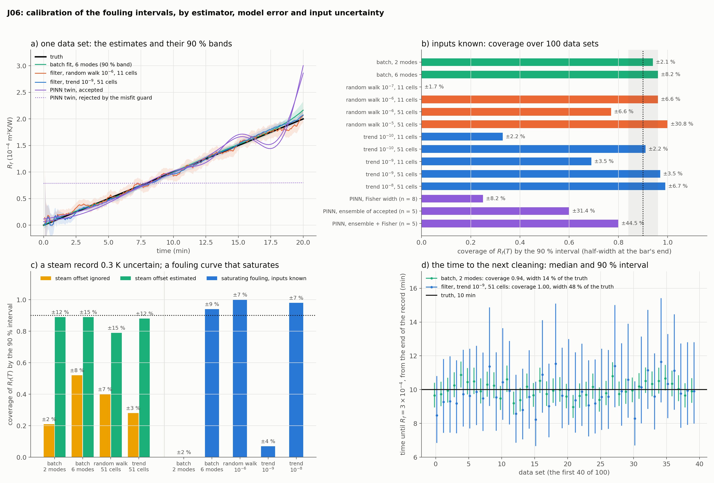

# J06: are the fouling intervals calibrated?

## Question

An estimate of the fouling resistance is used to decide when to clean, so it needs an interval that means what it says. For each estimator of the evaporator's fouling (a batch fit through the reference solver, the Kalman filters of J05, the PINN twin of J03): does its 90 % interval contain the truth 90 % of the time, how wide is it, and what breaks the calibration? F06 asked this for a scalar on the heat equation; here the unknown is a function of time on a process model with a lumped estimator, uncertain inputs and a prognosis (the time to the next cleaning) on top.

## Setup

- **Plant and records:** J03's: the J01 evaporator over 20 minutes on the reference solver ($n_z = 201$), the steam wandering by $\pm 1$ K (recorded), outlet $X$ and $W$ every 5 s with noise 0.002 and 0.001. **100 data sets** (noise draws; seeds 0–2 are J03's and J05's records).
- **Three scenarios:** *known* (the fouling a ramp, $R_f = 2 \times 10^{-4}\, t/T$, inputs exact); *steam offset* (the same, with the estimator's steam record offset by $b \sim N(0, 0.3\ \text{K})$, one draw per data set); *saturating* (a Kern–Seaton curve $\propto 1 - e^{-t/400\,\text{s}}$ to the same end value, inputs exact).
- **Three targets, each with a 90 % interval:** the fouling at the end of the record, $R_f(T)$; the fouling two minutes earlier, $R_f(0.9T)$, from the whole record; the time until $R_f$ reaches a cleaning threshold of $3 \times 10^{-4}$ (10 minutes after $T$ on the ramp).
- **Batch fit** (`batch-2`, `batch-6`): Gauss–Newton (`scipy.optimize.least_squares`) on the reference solver at the plant's own grid, $R_f$ as 2 or 6 Legendre modes of time, started at a constant $10^{-4}$; the interval is the Gaussian of the Fisher covariance at the estimate. This is the interval the data and the physics warrant, with no model error.
- **Filters:** J05's extended Kalman filter on 11 or 51 cells with $R_f$ a *random walk* ($\sigma_{rw} \in \{10^{-7}, 10^{-6}, 10^{-5}\}$) or a *local linear trend*, a level and a rate with the rate a random walk ($\sigma_{rate} \in \{10^{-10}, 10^{-9}, 10^{-8}\}$ per s$^{1.5}$; the ramp's rate is $1.7 \times 10^{-7}$ per s). $R_f(T)$ from the filter, $R_f(0.9T)$ from the RTS smoother, the time to clean from the trend's level and rate (`pinnrl.process.time_to_threshold`, by sampling the ratio).
- **The steam offset as an unknown** (`+ bias`): one more parameter of the batch fit with its prior $N(0, 0.3\ \text{K})$ as a residual; one more constant state of the filter with that prior variance. J05 clips the fouling at zero after each update; in this scenario the 51-cell filters are also run unclipped.
- **PINN twin:** J03's configuration ($R_f$ an `UnknownFunction` of $t$, Adam 4,000 + L-BFGS 100), 12 data sets × 3 initializations. A **misfit guard** accepts a run when the $\chi^2$ of its own sensor predictions against the 480 records is below the 99.9 % quantile (581). Candidate intervals: the Fisher width of `batch-6` centred on one accepted run; the $t$-interval of the accepted runs of a data set; both widths in quadrature.
- **Metrics:** coverage of the truth over the data sets (with 100 data sets a calibrated 90 % interval lands in 0.84–0.96), the median half-width and the median bias, all relative to the truth.
- **Code:** `run.py` (about half an hour for the 44 classical arms on 6 cores; the PINN part is 36 runs of 5–8 minutes), `plot.py`.

Rerun with:

```bash
python experiments/J06_fouling_intervals/run.py --datasets 100 --workers 6
python experiments/J06_fouling_intervals/run.py --part pinn --pinn-datasets 12 --members 3 --workers 4
python experiments/J06_fouling_intervals/run.py --part summary
python experiments/J06_fouling_intervals/plot.py
```

## Result



**A. Inputs known, the ramp.** Coverage / half-width / bias for $R_f(T)$; coverage for $R_f(0.9T)$; coverage and half-width for the time to clean.

| Estimator | $R_f(T)$: coverage | half-width | bias | $R_f(0.9T)$: coverage | Time to clean: coverage, half-width | Time per record set |
|---|---|---|---|---|---|---|
| batch, 2 modes | 0.94 | ±2.1 % | 0.0 % | 0.94 | 0.94, ±7 % | about 4 s |
| batch, 6 modes | 0.96 | ±8.2 % | −0.3 % | 0.92 | | about 14 s |
| random walk $10^{-7}$, 11 / 51 cells | 0.00 / 0.00 | ±1.7 % | −32 / −35 % | 0.00 / 0.00 | | 0.3 / 1.4 s |
| random walk $10^{-6}$, 11 cells | 0.96 | ±6.6 % | −2.6 % | 0.86 | | |
| random walk $10^{-6}$, 51 cells | 0.77 | ±6.6 % | −4.8 % | 1.00 | | |
| random walk $10^{-5}$, 11 / 51 cells | 1.00 / 1.00 | ±31 % | +0.5 / −1.6 % | 0.99 / 1.00 | | |
| trend $10^{-10}$, 11 cells | 0.33 | ±2.2 % | +2.7 % | 0.22 | 0.84, ±8 % | |
| trend $10^{-10}$, 51 cells | 0.91 | ±2.2 % | −0.3 % | 0.90 | 0.88, ±8 % | |
| trend $10^{-9}$, 11 cells | 0.69 | ±3.5 % | +2.9 % | 0.30 | 1.00, ±24 % | |
| trend $10^{-9}$, 51 cells | 0.97 | ±3.5 % | +0.4 % | 0.94 | 1.00, ±24 % | |
| trend $10^{-8}$, 11 cells | 0.90 | ±6.8 % | +2.5 % | 0.62 | 1.00, upper end open in 66 % | |
| trend $10^{-8}$, 51 cells | 0.99 | ±6.7 % | +0.6 % | 0.94 | 1.00, upper end open in 57 % | |

**B. A saturating fouling curve, inputs known.** $R_f(T)$.

| Estimator | Coverage | Half-width | Bias |
|---|---|---|---|
| batch, 2 modes (a ramp) | 0.00 | ±2.5 % | +25 % |
| batch, 6 modes | 0.94 | ±8.5 % | −0.2 % |
| random walk $10^{-6}$, 51 cells | 1.00 | ±6.7 % | −0.6 % |
| trend $10^{-10}$, 51 cells | 0.00 | ±2.7 % | +23 % |
| trend $10^{-9}$, 51 cells | 0.07 | ±3.7 % | +6.4 % |
| trend $10^{-8}$, 51 cells | 0.98 | ±6.8 % | +0.8 % |

The misfit of the ramp fit on this curve is 776 (660–872 over the data sets) against 474 (at most 541) for the fits whose form is right, with 480 records.

**C. A steam record uncertain by 0.3 K.** $R_f(T)$, the offset ignored and estimated.

| Estimator | Ignored: coverage, half-width | Estimated: coverage, half-width, bias |
|---|---|---|
| batch, 2 modes | 0.21, ±2.1 % | 0.89, ±12 %, −0.9 % |
| batch, 6 modes | 0.52, ±8.2 % | 0.89, ±15 %, +0.7 % |
| random walk $10^{-6}$, 51 cells | 0.40, ±6.6 % | 0.77, ±15 %, −10 % |
| the same, unclipped | 0.40, ±6.6 % | 0.79, ±15 %, −9 % |
| trend $10^{-9}$, 51 cells | 0.29, ±3.5 % | 0.83, ±12 %, +1.8 % |
| the same, unclipped | 0.28, ±3.5 % | 0.88, ±12 %, +1.8 % |

The batch fit recovers the offset itself to 0.24 K (its 90 % interval covers 0.89–0.90), barely below the prior's 0.3 K. The time to clean with the offset estimated: batch-2 covers 0.92 at ±28 %, the unclipped trend filter 0.93 at ±37 %; ignoring the offset, 0.25 and 0.66.

**D. The PINN twin**, inputs known, 36 runs (8 minutes each).

| Outcome | Runs | Rel. L2 of $R_f(t)$ | $\chi^2$ of its sensor predictions (480 records) |
|---|---|---|---|
| follows the ramp | 14 | 0.04–0.27 | 436–558, one at 744 |
| collapses to a constant near $0.4\, R_f(T)$ | 17 | 0.47–0.55 | 704–953 |
| sticks at the upper bound $5 \times 10^{-4}$ | 5 | 3.5 | 5,900–6,600 |

The guard accepts 13 runs (it rejects one that follows the ramp) on 8 of the 12 data sets; four data sets have no accepted run among three. For the accepted runs the error of $R_f(T)$ has a mean of +7 % and an RMS of 26 % (the data allow 5 %), and of $R_f(0.9T)$ −8 % and 11 % (the data allow 2 %); two accepted runs of one data set differ by 13 % RMS.

| Interval for $R_f(T)$ from accepted runs | Data sets | Coverage | Half-width |
|---|---|---|---|
| Fisher width at one run | 8 | 0.25 | ±8 % |
| ensemble of a data set's runs ($t$-interval) | 5 | 0.60 | ±31 % |
| ensemble and Fisher in quadrature | 5 | 0.80 | ±45 % |
| ensemble of all three runs, no guard | 12 | 0.83 | ±130 % |

## Conclusion

1. **Where the model is the plant's and the unknown's form contains the truth, the Fisher interval is calibrated**, for all three targets: 0.92–0.96 for the batch fits, 0.90–0.99 for the trend filter on 51 cells. J04's profile likelihood said the problem is nearly linear; this is the same statement over 100 data sets. F06's result for a scalar on the heat equation (the exact misfit gives calibrated intervals; the PINN's shortfall is its own) carries over to a function on a process model.
2. **The width is set by the form assumed for the fouling as much as by the data**: ±2.1 % if it is a ramp, ±8.2 % if it is any curve of six modes, on the same records. The narrow interval is bought with an assumption, and when the assumption fails the interval fails completely: on the saturating curve the ramp fit is 25 % off with a ±2.5 % interval and covers nothing. The fit knows, though: its misfit is 776 against 474, above every correctly specified fit. A narrow interval has to come with its misfit.
3. **A filter's interval has three ways to be wrong, and the coarse grid is the one J05 did not see.** The random walk too tight lags the ramp by a third and never covers; too loose it always covers, at ±31 %. In between, the 11-cell model's discretization bias is +2.7 % of the fouling, more than the standard deviation of the trend filter's intervals (1.3–2.1 %): the trend filter on 11 cells covers 33–69 %, on 51 cells 91–97 %. J05's tuned random walk on 11 cells covers 96 % partly by accident: its lag (−4.8 % on the fine grid, where it covers 77 %) and the grid's bias cancel by half. A model good enough for the estimate (J05) is not good enough for the interval; the monitor uses 51 cells, 1.4 s per record set.
4. **The trend model is the filter's version of the form assumption.** With the rate nearly frozen ($10^{-10}$) it is the ramp fit, as sharp (±2.2 %) and as fragile (0 % on the saturating curve); with the rate free to change by its own size in five minutes ($10^{-8}$) it covers both curves (0.98–0.99) at ±6.7 %, sharper than six batch modes. The price moves to the prognosis: at $10^{-8}$ the time to clean has an open upper end in more than half the data sets, because a rate that may change is a rate that may stop. The setting follows from the physics, $\sigma_{rate} \approx r / \sqrt{\tau}$ for a rate $r$ that may change by its own size over $\tau$.
5. **An uncertain input costs more than any choice of estimator.** A steam record trusted to 0.3 K and taken at face value drops every interval to 21–52 % coverage; J04's trade (0.5 K of steam for 30 % of fouling) is the reason. With the offset among the unknowns under its prior the batch fits are back at 0.89, at ±12–15 % instead of ±2–8 %. The honest interval for this plant is that wide, and the data hardly narrow the offset (0.24 K from a prior of 0.3 K): the width is the prior's. A better steam measurement, or the heat-duty signal J04 proposed, is worth more than anything done to the estimator.
6. **The filters with the offset state cover 77–88 %, and two defects explain the gap.** Clipping the fouling at zero after each update, as J05 does, moves one state without the states it is correlated with; unclipped, the trend filter covers 0.88, the batch fit's level. The random walk's lag, which the offset state lets it keep, grows to −9 % and no clipping explains it (0.79 unclipped). The monitor reports a clipped band from an unclipped filter.
7. **The time to clean is calibrated wherever the level and rate are**: 0.94 at ±7 % (42 s in 10 minutes) for the ramp fit, 0.88 for the frozen-rate filter, conservative (1.00 at ±24 %) for the trend at $10^{-9}$, and 0.92–0.93 at ±28–37 % once the steam offset is admitted. A cleaning schedule read off this record is good to a few minutes in ten, not to seconds, and most of that is the steam record again.
8. **The PINN twin's first uncertainty is whether training worked, and it mostly did not.** 22 of 36 runs end in one of two wrong states, a constant fouling (the scalar solution of J03's control, the collapse of F09 and J07) or the unknown's upper bound; J03's three good seeds out of three were a lucky draw from a recipe that succeeds four times in ten. The guard on the run's own sensor misfit rejects every failed run (and one good one), so the collapse is detectable without the truth. What is left is still not an estimate with an interval: accepted runs are 26 % off at the end of the record and 11 % two minutes earlier, five to six times what the data allow, and no internal width covers that (0.25 for the Fisher width, 0.60–0.80 for ensembles of two or three accepted runs at ±31–45 %). The value two minutes before the end is the better number, as J03 found, and it is biased low by 8 %.

**Consequences for the backlog:**
- The fouling monitor of the package (`pinnrl.process.monitor_fouling`, the dashboard's Process view) is the estimator this experiment arrives at: the trend filter on 51 cells, unclipped, the steam offset as an optional state, the prediction misfit reported next to the band.
- `time_to_threshold` and `augment_local_linear_trend` moved into `pinnrl.process`.
- J03 is to be read with a success rate of 14 in 36: the twin needs a restart rule on the sensor misfit before any accuracy is quoted, and the collapse to a constant is now seen on three models (F09, J07, J03).
- J09 (measurement design) has its first quantified target: the steam temperature to better than 0.3 K, or a heat-duty signal, against ±12 % on the fouling.
- A calibrated PINN interval would have to be calibrated on simulated plants (the error distribution of accepted runs over synthetic records), which this experiment's 13 runs are too few to do; K44 (conformal) is the place.
- P19's claim can be stated: calibrated time to clean from a trend filter or a batch fit, with the conditions (form, grid, inputs) each measured here.
