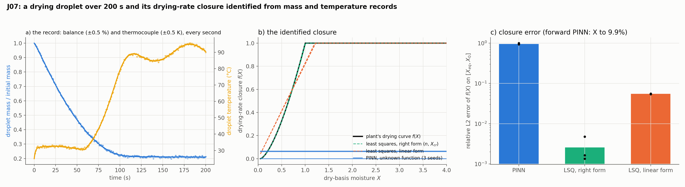
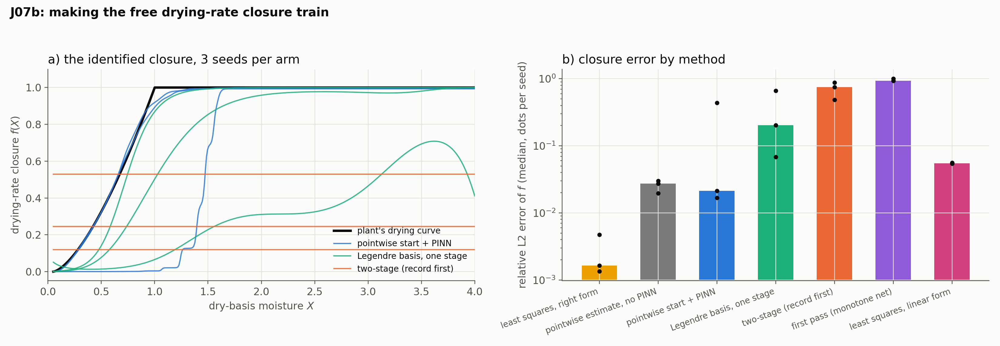
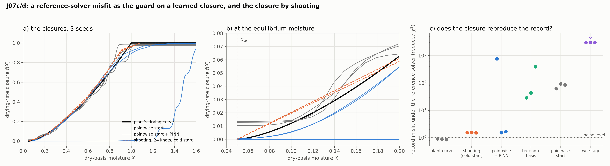

# J07: a drying droplet and its drying-rate closure

## Question

Can the twin solve the single-droplet drying model forward, and identify the drying-rate closure $f(X)$, the part of the model a plant cannot measure, from a mass-and-temperature record? Against what a classical fit achieves with the right and with a wrong parametric form.

## Setup

- **Model:** `pinnrl.process.DryingDroplet`: a 1.5 mm droplet of a 20 % solids solution (skim-milk-like) at 25 °C in air at 90 °C wandering by $\pm 5$ K (recorded), humidity ratio 0.01, relative velocity 1 m/s. Ranz–Marshall heat and mass transfer, shrinkage by ideal mixing, and the drying rate $-\dot X = h_m A (\rho_{v,s}(T) - \rho_{v,a}) f(X) / m_s$ with the characteristic drying curve $f(X) = \min(1, ((X - X_{eq})/(X_{cr} - X_{eq}))^n)$, $n = 1.5$, $X_{cr} = 1$, $X_{eq} = 0.05$ (dry basis; $X_0 = 4$). The ODE reference (LSODA) dries the droplet in about 100 s: a wet-bulb plateau at 32 °C, the falling-rate period from $t \approx 50$ s with the temperature rising 50 K in 40 s, equilibrium by 150 s.
- **Part A, forward PINN:** `custom_pde(t_max=200)` (an ODE in $t$, normalized with the trajectory's scales), the clean recipe: tanh 4 × 64, 2,048 collocation points, Adam $10^{-3}$ for 12,000 steps then L-BFGS 500 (4,000 + 100 left a 20 % error), 3 seeds.
- **Part B, the closure:** the record is the droplet mass every second (a balance, noise 0.5 % of the initial mass) and its temperature every second (noise 0.5 K), 200 readings each, through `PointSensor`s (the mass as the expression `m_s*(1 + X)` with `scale = m_0`). `custom_pde(unknown_rate=...)` makes $f$ an `UnknownFunction` of $X$ (16 × 16, sigmoid output in $[0, 1]$, monotone increasing in $X$, started at 0.5). Sensor weight 300 (a sweep over 100–10,000 on one seed, below), same training, 3 seeds. **Controls** on the same records, by least squares on the ODE reference (`scipy.optimize.least_squares`): the parametric curve with the right form ($n$, $X_{cr}$ free), and the misspecified linear form $f = \min(1, X / X_{lin})$.
- **Metrics:** the relative L2 error of $f$ over $[X_{eq}, X_0]$; the relative L2 errors of $X(t)$ and of $T(t) - T_0$ against the reference; the run time.
- **Code:** `run.py`, `plot.py`.

Rerun with:

```bash
python experiments/J07_droplet_drying/run.py --seeds 3 --steps 12000 --lbfgs-steps 500 --data-weight 300 --workers 3
python experiments/J07_droplet_drying/plot.py
```

## Result



| Arm | Seed | Rel. L2 of $f$ | Rel. L2 of $X$ | Rel. L2 of $T - T_0$ | Max $\lvert \Delta T \rvert$ | Time |
|---|---|---|---|---|---|---|
| forward PINN | 0 | – | 0.076 | 0.21 | 24 K | 111 s |
| | 1 | – | 0.084 | 0.22 | 25 K | 114 s |
| | 2 | – | 0.138 | 0.25 | 27 K | 110 s |
| PINN, unknown $f$ | 0 | 1.00 ($f \equiv 0$) | 0.026 | 0.006 | 1.0 K | 214 s |
| | 1 | 0.94 ($f \equiv 0.06$) | 0.36 | 0.53 | 35 K | 180 s |
| | 2 | 0.93 ($f \equiv 0.07$) | 0.41 | 0.54 | 34 K | 194 s |
| least squares, right form | 0–2 | 0.005, 0.002, 0.001 ($n$ = 1.50–1.52, $X_{cr}$ = 1.00–1.01) | | | | 0.2 s |
| least squares, linear form | 0–2 | 0.056, 0.054, 0.055 ($X_{lin}$ = 1.20–1.22) | | | | 0.3 s |

The weighted misfit of the least-squares fits: 341–361 with the right form (400 records, $\chi^2 \approx N$) and 5,700–6,000 with the linear one.

**Sensor-weight sweep** (one seed, 12,000 + 500 steps): weight 100, $f \equiv 0.04$ (fields 33 % off); 300, $f$ recovered to 15 % in one run (the shape right, shifted to higher $X$) and collapsed to a constant in a repeat of the same seed with a different thread count; 1,000, one run at 33 % (the shape right, a plateau at 0.66) and two collapsed; 3,000 and 10,000, $f \equiv 0$ with the fields fitted to 1–2 %.

## Conclusion (first pass)

1. **The forward solve is harder than the evaporator's.** The sharp transition at the critical moisture (the temperature rises 50 K in 40 s after a 50 s plateau) is the feature a smooth network spreads: 8–14 % on $X$ and 20–25 % on the temperature rise at 12,000 + 500 steps, where 4,000 + 100 gave 20 % and 44 %. The error sits in the transition; the plateaus are right. Time-marching windows (H04) or a causal weighting are the known remedies and this model is their test case.
2. **The unknown closure collapses to a constant.** On every seed the monotone, bounded network for $f$ ends flat: either $f \equiv 0$ with the records fitted and the physics ignored (high sensor weight: the network reproduces the data by itself and the residual is cheap to leave unpaid), or $f \equiv 0.06$ with the fields 40 % off (low weight: a self-consistent wrong solution). The one recovery to 15 % did not reproduce under a different thread count: the basin is narrow. The collapse is K09's trivial attractor in the inverse setting, and it is sticky by construction: softplus-constrained weights that have gone small leave almost no gradient to grow back.
3. **The classical fit with the right form is at the noise floor, and the wrong form is detectable.** Least squares on the ODE recovers $n$ and $X_{cr}$ to 1 % in 0.2 s; the linear form lands 5.5 % off with a misfit 16 times the right one, so misspecification shows in the residual. Between a parametric fit that is right, a parametric fit that is visibly wrong, and a free function that collapses, the twin's claim to identify closures is not yet made on this model.
4. **What to change (J07b).** Two-stage training (fit the record with $f$ frozen at the wet-surface value, then release $f$ with the physics weight raised); a basis parametrization of $f$ (K48's cosine or Legendre modes, whose constant mode is explicit and whose other modes cannot vanish silently); a pointwise start for $f$ from the smoothed record ($f = -\dot X m_s / (h_m A \Delta\rho)$, the equation-discovery estimate), with the PINN refining it; and the sensor weight set by the noise model (K39) rather than by a sweep.

**Consequences for the backlog (after the first pass):** J07b (below) with the four changes above; H04 (time-marching) gets the droplet as a test case next to the pendulum and SIR of K09; J08 (stickiness) waits for a working closure; the EKF control (J05) applies to the parametric form only, which is the comparison's point.

## Second pass (J07b): making the free closure train

`run_closure2.py`, same plant, records (3 seeds) and controls; sensor weight 300, 12,000 Adam steps then L-BFGS 500. Four arms:

- **pointwise start + PINN:** $f$ is first estimated point by point from the smoothed record, $f_i = -\dot X_i m_s / (h_m A (\rho_{v,s}(T_i) - \rho_{v,a}))$ (Savitzky–Golay, window 21, order 3, the equation-discovery estimate), the `UnknownFunction` is pre-trained to those points (3,000 Adam steps on the function alone), and the PINN refines fields and function together;
- **two-stage:** the network fits the record with $f$ frozen at its start (6,000 steps), then $f$ is released (6,000 + 500);
- **Legendre basis:** $f$ as six Legendre modes of $X$ bounded to $[0, 1]$ (`basis={"type": "legendre", "modes": 6}`, no monotone constraint), one stage;
- **pointwise only:** the pre-trained function without the PINN, the control the twin must beat.



| Arm | Rel. L2 of $f$, seeds 0 / 1 / 2 | Rel. L2 of $X$ | Time |
|---|---|---|---|
| pointwise estimate, raw | 0.046 / 0.035 / 0.038 | | 2 s |
| pointwise only (pre-trained function) | 0.030 / 0.020 / 0.027 | | 2 s |
| pointwise start + PINN | **0.439** / **0.021** / **0.017** | 0.66 / 0.009 / 0.007 | 380–480 s |
| two-stage | 0.49 / 0.75 / 0.88 (all $f \equiv$ const) | 0.13 / 0.08 / 0.12 | 1,900–2,200 s |
| Legendre basis | 0.068 / 0.20 / 0.66 | 0.005 / 0.008 / 0.77 | 270–560 s |
| first pass (monotone net, no start) | 1.00 / 0.94 / 0.93 | | |
| least squares, right form | 0.005 / 0.002 / 0.001 | | 0.2 s |
| least squares, linear form | 0.056 / 0.054 / 0.055 | | 0.3 s |

### Conclusion (second pass)

1. **The record itself gives the closure to 2–3 %, before any PINN.** With mass and temperature every second, $\dot X$ from a smoothing filter and the known transfer coefficients turn each reading into a point of $f(X)$; the raw points are within 3.5–4.6 % and the function fitted to them within 2–3 %. That is the equation-discovery estimate, and it is the start the PINN needs.
2. **From that start the PINN refines, or destroys.** Two seeds improve the function to 1.7–2.1 % with the fields at 0.7–0.9 %, better than the start; the third leaves the basin (the function becomes a step at $X \approx 1.5$, the fields 66 % off). The refinement is a gain of a third at a 1-in-3 risk of losing everything, which a check against the start's misfit would catch (the failed seed's temperature error is 20 % against 1 %).
3. **Freezing the function first makes the collapse certain**, and **a basis parametrization removes the sticky collapse but not the multimodality**: the Legendre modes cannot vanish silently, so no run ends flat, but the three seeds land at 7 %, 20 % and 66 %. The flat basin is a property of the monotone network; the wide basin structure is the problem's.
4. **The classical fit with the right form is still ten times better than the best free function.** Where the functional form is known, fit it; the free function's place is where it is not, and there it should start from the pointwise estimate and be checked against it. For the twin the rule is: estimate the closure from the record pointwise, use the PINN to make it consistent with the physics, and reject the result when the misfit rises above the start's.

**Consequences for the backlog:** a `pointwise_start` helper for closures of a measured field (the smoothing-and-division estimate as a package function) and a misfit guard that rejects a refinement worse than its start; K39's noise-model weight on this problem; H04 (time-marching) on the forward droplet; J08 (stickiness) can proceed on the pointwise-plus-PINN recipe.


## The misfit guard (J07c) and the closure by shooting (J07d)

Two follow-ups that need no training. `run_guard.py` reads the twelve closures J07b produced and asks of each the question the twin has to answer before a closure is used: does the droplet model, solved by the reference solver with this closure, reproduce the record it was identified from? `DryingDroplet.record_misfit` returns the reduced $\chi^2$ of the mass and temperature records (1 at the noise level). `run_shooting.py` is the classical control J05 asked for on this problem: the closure as a free-form function fitted through the reference solver, with no knowledge of the plant's form.

- **Guard (J07c):** each closure of `results/closure2.json` interpolated on its grid, the seed's own record, the misfit averaged over the two sensors. The rule under test: accept a refinement when its misfit is not above its start's (the pointwise estimate of the same record).
- **Shooting (J07d):** $f$ piecewise linear on 24 knots uniform in $X$ over $[X_{eq}, X_0]$, parametrized by non-negative increments (so it increases) and capped at 1; bounded least squares on the weighted record residuals (`scipy.optimize.least_squares`, finite-difference Jacobian, each residual one ODE solve). Variants: *anchored* ($f(X_{eq}) = 0$, which the definition of the equilibrium moisture gives) and *free* (the value at $X_{eq}$ a parameter); starts: *cold* (a straight line from 0 at $X_{eq}$ to 1 at $X_0$, far from the plant's curve) and the pointwise estimate.

```bash
python experiments/J07_droplet_drying/run_guard.py
python experiments/J07_droplet_drying/run_shooting.py --seeds 3 --knots 24
python experiments/J07_droplet_drying/plot_guard.py
```



Record misfit under the reference solver (reduced $\chi^2$, mass / temperature), seeds 0 / 1 / 2, with the closure's relative L2 error for comparison:

| Closure | Rel. L2 of $f$ | Misfit, mass | Misfit, temperature | Guard (≤ start) |
|---|---|---|---|---|
| plant's curve | 0 | 0.92 / 0.86 / 0.93 | 0.90 / 0.89 / 0.79 | |
| pointwise start | 0.030 / 0.020 / 0.027 | 21 / 31 / 30 | 103 / 156 / 141 | (the start) |
| pointwise start + PINN | 0.439 / 0.021 / 0.017 | 723 / 1.0 / 1.0 | 807 / 2.1 / 2.3 | reject / accept / accept |
| Legendre basis | 0.068 / 0.20 / 0.66 | 6.8 / 20 / 308 | 51 / 66 / 473 | accept / accept / reject |
| two-stage | 0.49 / 0.75 / 0.88 | ∞ | ∞ | reject (all) |
| **shooting, anchored, cold start** | **0.015 / 0.016 / 0.015** | 0.97 / 0.89 / 0.97 | 2.1 / 2.3 / 2.1 | |
| shooting, free, cold start | 0.021 / 0.016 / 0.015 | 0.98 / 0.90 / 0.99 | 4.6 / 2.2 / 2.0 | |
| shooting, anchored, pointwise start | 0.014 / 0.016 / 0.025 | 0.97 / 0.89 / 0.98 | 2.1 / 2.3 / 2.1 | |

Shooting takes 8–10 s per fit from the cold start with the anchor (23–34 iterations, each a finite-difference Jacobian of 24 ODE solves) and 5–52 s from the pointwise start, against 380–480 s for the pointwise start + PINN.

### Conclusion (J07c, J07d)

1. **The guard catches every failure J07b had, and the network could not have.** The destroyed refinement (seed 0) has a misfit of 765 against its start's 62, the failed basis run 390 against 85, and the three collapsed two-stage closures are constants that dry the droplet past zero volume (the solve breaks: an infinite misfit). The PINN's own fields are not a substitute: the network of the basis run of seed 1 is within 0.8 % of the reference fields while its closure, solved honestly, misses it 43-fold and is 20 % off. A closure and the fields trained with it agree only as far as the residual is zero, so the check has to go through the reference solver.
2. **The misfit and the closure's L2 error measure different things, and the misfit is the one a twin has.** The pointwise start is within 2–3 % of the plant's curve and misses the record 60–90-fold; the plant's form with its critical moisture 20 % too high is 8 % off in L2 and misses it 3.5-fold. All of the start's misfit comes from one feature: its closure is 0.010–0.013 at the equilibrium moisture instead of 0 (panel b), so the simulated droplet keeps drying after the real one has stopped, 9 K too cold at the end of the record. With that value set to zero the same closure has a misfit of 0.9 / 2.7. The record weighs the closure by what it does to the trajectory; the L2 norm over $[X_{eq}, X_0]$ weighs a plateau the droplet crosses in seconds like the last tenth of moisture it spends half the record in.
3. **What the PINN refinement actually buys is consistency with the record, not accuracy of the curve.** On the two good seeds the closure's L2 error barely moves (2.0 → 2.1 %, 2.7 → 1.7 %) while the misfit falls from 85–93 to 1.5–1.7: the physics residual pulls $f(X_{eq})$ to zero. J07b read these runs as "a gain of a third"; in the terms that matter they are a gain of fifty.
4. **Shooting does the whole job, from a cold start, on every seed.** A monotone piecewise-linear closure on 24 knots, fitted through the reference solver, lands at 1.5–1.6 % with the record at the noise level in mass and twice it in temperature (the kink at the critical moisture between two knots), from a straight line that knows nothing of the plant's curve. No pointwise estimate, no collapse, no seed that fails; the anchor at $X_{eq}$ and the start make no difference beyond one seed each. The PINN's best two seeds are 1.7–2.1 % at forty to sixty times the cost, with a third seed lost.
5. **On this model the PINN has no case, and the reason is general.** The droplet is an ODE system with a reference solver that takes a closure as a function; under those two conditions an unknown function is a few dozen bounded parameters of a least-squares problem, and J05's finding for an unknown signal (the classical estimator wins when the model structure is known) extends to an unknown closure. What remains for the twin is the case where no trusted forward solve exists for the candidate physics, or where each solve is too expensive to put inside an optimizer; neither holds for the two units built so far.

**Consequences for the backlog:** the closure workflow in the package is pointwise estimate → refinement → `record_misfit` against the start; an `anchor` constraint for `UnknownFunction` (a value fixed at a point, here $f(X_{eq}) = 0$) is the missing structural prior; J08 (stickiness) should use the shooting closure as its baseline; the dryer-scale model (a PDE in the tower with the droplet's closure inside) is where the cost argument for the PINN can first be tested, and the experiment should time a shooting fit through its reference solver before any network is trained.

## The anchored closure (J07e)

J07c traced the pointwise start's misfit to one number, $f(X_{eq}) \approx 0.01$ instead of 0: a network squeezed into $[0, 1]$ by a sigmoid cannot reach zero. `UnknownFunction(anchor={"at": X_eq, "value": 0.0})` holds a value at a point exactly, by subtracting the network's own value there; with `monotone="increasing"` and no sigmoid the closure is zero at equilibrium and non-negative above it. `run_anchor.py` repeats J07b's pointwise arm with that closure: the function pre-trained to the pointwise estimate, then refined by the PINN (same schedule, 12,000 Adam + 500 L-BFGS steps), 3 seeds.

```bash
python experiments/J07_droplet_drying/run_anchor.py      # ~4 min on 3 workers
```

| Closure (seeds 0 / 1 / 2) | Closure rel. L2 | Record misfit (reference solver) | Network's own reduced $\chi^2$ (limit 1.23) |
|---|---|---|---|
| pointwise start, bounded (J07b) | 0.030 / 0.020 / 0.027 | 60 / 92 / 85 | |
| **pointwise start, anchored** | 0.030 / 0.020 / 0.028 | **1.6 / 1.8 / 2.3** | |
| anchored start + PINN | 0.029 / 0.039 / 0.055 | 1.3 / 2.7 / 13 | 1.08 / 1.15 / 1.98 |
| bounded start + PINN (J07b) | 0.021 / 0.017 / destroyed | 1.5 / 1.7 / 765 | |
| shooting, cold start (J07d) | 0.015 / 0.016 / 0.015 | 0.97 / 0.89 / 0.97 | |

1. **The anchor does in one second what the PINN refinement was buying in six minutes.** The same pointwise estimate, fitted by a closure that is zero at $X_{eq}$ by construction, misses the record by 1.6–2.3 times its noise instead of 60–92 times, with the same 2–3 % error in L2. Conclusion 3 of J07c ("what the refinement buys is consistency with the record") is now a constraint of the function class.
2. **From the anchored start the PINN has nothing left to add, and takes something away on two seeds of three.** One refinement lowers the misfit (1.6 → 1.3) with the closure unchanged; two raise both the misfit (1.8 → 2.7, 2.3 → 13) and the closure's error (2.0 → 3.9 %, 2.8 → 5.5 %). The guard of J07c (reject a refinement whose misfit is above its start's) rejects both; the network's own sensor misfit (`pde.sensor_misfit`, the check that needs no reference solver) rejects the worse one (1.98 against a limit of 1.23) and passes the milder one.
3. **The ranking of J07d stands.** Shooting through the reference solver is at 1.5–1.6 % with the record at its noise on every seed; the anchored pointwise estimate is the best the network class does (2–3 %, misfit about 2), and it is not a PINN result: no residual was trained.
