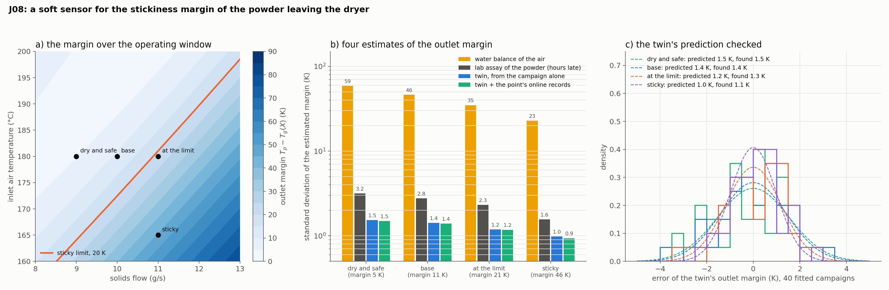

# J08: a soft sensor for the stickiness margin

**Question.** Powder sticks to the walls and cakes when its particles are warmer than their glass transition by more than a material limit. The margin $T_p - T_g(X)$ is not measurable online: $T_g$ falls by 9 K for each 0.01 of moisture, and the moisture comes from the lab hours later. From what a dryer does measure, how well can the margin of the powder leaving it be estimated?

**Short answer.** The obvious online route, the powder's moisture from the water balance of the air, is useless: it gives the margin to ±23–59 K. A lab assay gives ±1.6–3.2 K, late. The twin (the tower model with its drying curve, wall loss and droplet size identified on J11's five-point campaign, run forward at the operating point) gives ±1.0–1.5 K at once, twice as good as the assay it replaces, and the errors of 40 fitted campaigns match that prediction. The point's own online records add nothing to it. The twin also gives the margin inside the tower, to ±1 K, where no measurement exists.

## Setup

- **Model:** J11's `SprayDryer` and instruments, with `glass_transition(X)` (Gordon–Taylor, a maltodextrin-like carrier: $T_g$ of the dry solids 188 °C, $k = 7.7$) and `stickiness_margin()`. Sticky limit: 20 K. Over the operating window (inlet air 160–200 °C, solids 8–13 g/s) the outlet margin runs from 3 to 90 K and crosses the limit along a line (panel a).
- **Four operating points** at 180 °C / 9, 10, 11 g/s and 165 °C / 11 g/s: margins of 5, 11, 21 and 46 K.
- **Estimates of the outlet margin:**
  - *balance*: $X_{out} = X_0 - G\,(Y_{out} - Y_{in})/F_s$ from the two humidities (noise 0.001 each), the outlet air temperature (0.5 K) for $T_p$;
  - *lab*: the assay of the powder (0.003) with the outlet air temperature;
  - *twin*: the model with the posterior of J11's campaign (critical moisture, exponent, wall loss ±30 %, droplet size ±10 %), no record of the point;
  - *twin + online*: updated with the point's six air thermocouples and outlet humidity.
- **Method:** linear-Gaussian standard deviations (`pinnrl.analysis.posterior_covariance`, `target_std`); validation with the 40 campaigns fitted in J11 (nuisances drawn from their priors), each fit run forward at the four points.

```bash
python experiments/J11_dryer_closure/run.py    # the campaign fits this experiment reuses
python experiments/J08_stickiness/run.py       # ~10 s
python experiments/J08_stickiness/plot.py
```

## Results



| Operating point (outlet margin) | Balance | Lab | Twin | Twin + online | Twin, 40 fits (bias) | Margin at 5 m: twin, predicted / 40 fits |
|---|---|---|---|---|---|---|
| dry and safe (5 K) | 59 K | 3.2 K | 1.5 K | 1.5 K | 1.5 K (−0.2) | 1.1 / 1.2 K |
| base (11 K) | 46 K | 2.8 K | 1.4 K | 1.4 K | 1.4 K (−0.1) | 1.0 / 1.1 K |
| at the limit (21 K) | 35 K | 2.3 K | 1.2 K | 1.2 K | 1.3 K (0.0) | 1.0 / 1.0 K |
| sticky (46 K) | 23 K | 1.6 K | 1.0 K | 0.9 K | 1.1 K (+0.1) | 0.9 / 1.2 K |

Guard band below the limit for a 5 % chance of running a sticky point as safe, at the base point: 76 K (balance), 4.6 K (lab), 2.3 K (twin).

## Conclusion

1. **The water balance cannot see the powder.** The air carries 36 times the mass of the solids, so a humidity error of 0.001 is a moisture error of 0.04–0.06, half the outlet moisture itself, and 23–59 K of margin. The same balance that closes to rounding in the model is the worst estimator of the four; more accurate hygrometers would have to improve tenfold to match a lab assay.
2. **The twin beats the assay it would replace, and it is not late.** A campaign of five operating points determines the drying curve well enough (J11) that the model, run forward from the inlet conditions alone, gives the outlet margin to 1.0–1.5 K, against 1.6–3.2 K for one assay. The 40 fitted campaigns confirm it (1.1–1.5 K, biases within 0.2 K), with the wall loss and the droplet size uncertain in every one. In operating terms the guard band below the sticky limit halves, from 4.6 to 2.3 K.
3. **The current records add nothing.** Updating the campaign's posterior with the point's own thermocouples and humidity changes the third digit: eight numbers of the same kind as the forty the campaign already has. What adds something is a lab assay used to recalibrate the twin, not to replace it: J12 finds that replicate assays halve the margin's error, and that a measurement of the droplet size does not help.
4. **The margin inside the tower comes for free.** At 5 m, where deposits form and nothing is measured, the twin gives the margin to about 1 K.
5. **What this result rests on.** The numbers are the estimation error of a model whose structure is the plant's: the curve's form, the Gordon–Taylor constants and the plug flow are taken as known, and only parameters are uncertain. Against a real dryer the model error will dominate these 1.5 K, and the comparison to make first is the twin's predicted moisture against the lab's over a campaign, which is the misfit test of J07c at plant scale.
