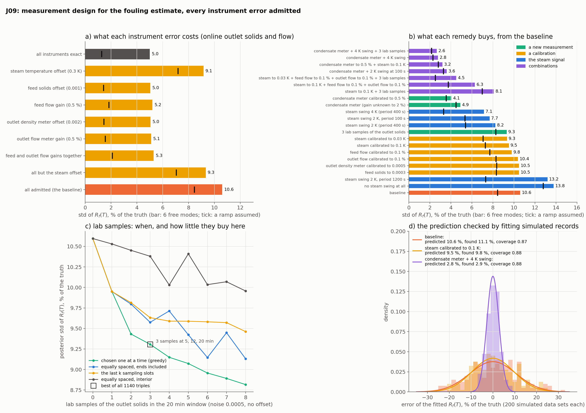

# J09: which measurement narrows the fouling estimate?

**Question.** J06 left the 90 % interval of the fouling at ±12–15 % once the steam record's 0.3 K offset is admitted. Which instrument error actually limits the estimate when all of them are admitted, and which remedy (a calibration, a new sensor, a deliberate swing of the steam, lab samples) buys the most, computed before any of them is bought?

**Short answer.** With every instrument error admitted the fouling at the end of a 20-minute window is known to 10.6 % (one standard deviation; 5.0 % with exact instruments). Two things each cost about as much: the steam offset, and the *joint* looseness of the four mass-balance instruments, none of which matters alone. No single calibration recovers much (the best, the steam to 0.03 K, gives 9.3 %). A condensate flow meter, even with its gain unknown to 2 %, halves the uncertainty (4.9 %), a 4 K steam swing gives 7.1 %, and the two together 2.8 %, better than exact instruments without them. Three lab samples buy 1.3 points. Fits of 200 simulated data sets per design confirm the predicted standard deviations to within 5 %.

## Setup

- **Plant and records:** J06's evaporator window (1200 s, fouling a ramp from 0 to 2×10⁻⁴ m²K/W, steam 355.15 K with a 1 K sine of period 400 s), outlet solids (noise 0.002) and outlet flow (0.001 kg/s) every 5 s. Reference on 101 cells.
- **Unknowns:** six Legendre modes of $R_f(t)$ (a wide prior, 3×10⁻⁴ each) and six nuisances, each with the accuracy its instrument is trusted to as a Gaussian prior:

| Nuisance | Enters as | Prior (1σ) |
|---|---|---|
| steam temperature offset $b$ | $T_s = \text{record} - b$ | 0.3 K |
| feed solids offset | $X_{in} = 0.1 + \delta$ | 0.001 |
| feed flow gain | $W_{in} = 0.1\,(1 + g)$ | 0.5 % |
| outlet density meter offset | record $= X(L) + o$ | 0.002 |
| outlet flow meter gain | record $= W(L)\,(1 + g)$ | 0.5 % |
| condensate meter gain | record $= C\,(1 + g)$ | 2 % |

- **Candidate measurements:** a condensate flow meter, $C(t) = \frac{P}{\lambda}\int_0^L q\,dz$ (the evaporation rate, 0.012 kg/s; noise 1 % per record); lab assays of the outlet solids (noise 0.0005, no offset) at any of 20 slots, one a minute; steam swings of 0, 1, 2 and 4 K and periods of 100, 400 and 1200 s; each instrument calibrated to a tighter prior.
- **Method:** the sensitivities of every record to the 12 parameters from the reference solver by central differences (20 solves per steam signal, 6 s in all); the posterior covariance $(P_0^{-1} + J^\top R^{-1} J)^{-1}$ and the standard deviation of the target $R_f(T)$ (`pinnrl.analysis.posterior_covariance`, `target_std`); lab times by `greedy_design`. Two columns: the six modes free, and a ramp assumed (modes 2–5 pinned), J06's two batch fits.
- **Validation:** 200 data sets per design, the nuisances drawn from their priors, fitted through the nonlinear reference by Gauss–Newton with the nominal Jacobian (on six data sets a full `least_squares` fit differs by at most 0.24 % of the truth).

```bash
python experiments/J09_measurement_design/run.py     # ~1.5 min on 6 workers
python experiments/J09_measurement_design/plot.py
```

## Results



**What each error costs** (standard deviation of $R_f(T)$, % of the truth; online outlet solids and flow):

| Admitted | 6 modes | Ramp assumed |
|---|---|---|
| nothing (exact instruments) | 5.0 | 1.3 |
| steam offset, 0.3 K | 9.1 | 7.2 |
| feed solids / feed flow / outlet density / outlet flow, each alone | 5.0–5.2 | 1.4–1.8 |
| both flow gains | 5.3 | 2.1 |
| all four mass-balance instruments, steam exact | 9.3 | 7.0 |
| everything (the baseline) | 10.6 | 8.5 |

**What each remedy buys**, from the baseline of 10.6 (8.5 with a ramp assumed):

| Remedy | 6 modes | Ramp | Steam offset known to (K) |
|---|---|---|---|
| condensate meter + 4 K swing | **2.8** | 2.3 | 0.03 |
| condensate meter calibrated to 0.5 % + steam to 0.1 K | 3.2 | 2.8 | 0.08 |
| condensate meter + 2 K swing at 100 s | 3.6 | 3.3 | 0.05 |
| condensate meter calibrated to 0.5 % | 4.1 | 3.6 | 0.11 |
| steam to 0.03 K + both flows to 0.1 % + 3 lab samples | 4.5 | 2.5 | 0.03 |
| **condensate meter, gain unknown to 2 %** | **4.9** | 4.5 | 0.11 |
| steam to 0.1 K + both flows to 0.1 % | 6.3 | 3.8 | 0.10 |
| steam swing 4 K / 2 K at 100 s / 2 K (period 400 s) | 7.1 / 7.7 / 8.2 | 3.3 / 5.4 / 5.4 | 0.21–0.23 |
| 3 lab samples of the outlet solids | 9.3 | 8.3 | 0.25 |
| steam calibrated to 0.03 K / 0.1 K | 9.3 / 9.5 | 7.1 / 7.3 | 0.03 / 0.10 |
| feed flow to 0.1 % | 9.8 | 7.7 | 0.25 |
| outlet flow, outlet density or feed solids calibrated | 10.4–10.5 | 8.3–8.4 | 0.25 |
| steam swing 2 K, period 1200 s | 13.2 | 7.3 | 0.30 |
| no steam swing at all | 13.8 | 12.8 | 0.30 |

**Lab samples** (6 modes): 10.6 with none, 9.9 with one (at the end of the window), 9.4 with two (5 and 20 min), 9.3 with three (5, 12 and 20 min), 8.8 with eight. The greedy triple is the best of all 1140. Equally spaced with the ends included gives 9.6 for three, the last three slots 9.6, equally spaced in the interior 10.4.

**Validation** (200 data sets each; a coverage of 0.90 has a standard error of 0.021):

| Design | Predicted std | Std of the fitted errors | Mean error | Coverage of the 90 % interval |
|---|---|---|---|---|
| baseline | 10.6 % | 11.1 % | +0.5 % | 0.87 |
| steam calibrated to 0.1 K | 9.5 % | 9.8 % | +0.8 % | 0.88 |
| condensate meter + 4 K swing | 2.8 % | 2.9 % | +0.1 % | 0.88 |

## Conclusion

1. **Two error sources limit the estimate, and one of them is invisible one instrument at a time.** The steam offset alone takes the estimate from 5.0 to 9.1 %, which J04 and J06 had found. The other is the mass balance: the evaporation rate is what carries the fouling, and the records give it twice, as the difference of the feed and outlet flows and as the ratio of the outlet and feed solids. Loosen any one of the four instruments and the other balance still closes (5.0–5.2 %); loosen all four to ordinary accuracies and the evaporation is uncertain enough to cost as much as the steam offset (9.3 %). A one-at-a-time sensitivity study would have cleared all four.
2. **For the same reason no single calibration pays.** The steam probe calibrated tenfold, to 0.03 K, takes 10.6 to 9.3 %, because the mass balance then limits; any one mass-balance instrument calibrated takes it to 9.8–10.5 %, because the steam then limits. It takes the steam and both flows together to reach 6.3 % (0.1 K) or 4.5 % (0.03 K, with lab samples).
3. **A condensate meter is the measurement worth buying, even uncalibrated.** It reports the evaporation directly instead of as the difference of two flows eight times larger, with 1 % noise where the outlet flow gives it to 8 %. With its gain unknown to 2 % it brings the estimate to 4.9 %, below what exact instruments achieve without it, and it also pins the steam offset to 0.11 K from the records, without touching the probe.
4. **The steam swing is the free remedy, and its frequency matters as much as its size.** A change of the steam temperature changes the flux by $\Delta T_s / (1/U + R_f)$ whatever the offset, so the response to a swing measures the resistance itself. Without any swing the estimate is 13.8 %; J06's 1 K gave 10.6; 4 K gives 7.1, and 2.8 with the condensate meter. A swing as slow as the window (1200 s) is worth almost nothing with six free modes (13.2 %), since a slow change of the flux is what a change of the fouling looks like; 100 s is slightly better than 400 s. If the fouling is known to be a ramp the slow swing is as good as any, which is the kind of conclusion that depends on an assumption J06 showed can fail.
5. **Lab samples buy little here, and their timing is not the intuitive one.** The outlet solids are not the limiting record, so three assays four times as precise as the online meter improve the estimate by 1.3 points. The best three are at the end, at a quarter and past the middle of the window; the end alone is worth half of the total, and spreading the samples evenly in the interior is worth a fifth of it.
6. **The linear prediction holds.** The fitted errors over 200 nonlinear simulations have standard deviations within 5 % of the predicted ones for the three designs tested, across a fourfold range of accuracy, and the 90 % intervals cover 0.87–0.88 (0.90 is within 1.5 standard errors each time, and the mean errors are within one standard error of zero; the shortfall being on the same side in all three is as much as these runs can say about the nonlinearity).

**For the twin:** J06's recommendation (estimate the steam offset under its prior) stands for a plant as instrumented; the interval it gives is the honest one, and this experiment says what would shrink it: a condensate meter first, a faster and larger steam swing second, calibration campaigns last. The design costs twenty reference solves per steam signal and needs no data.
