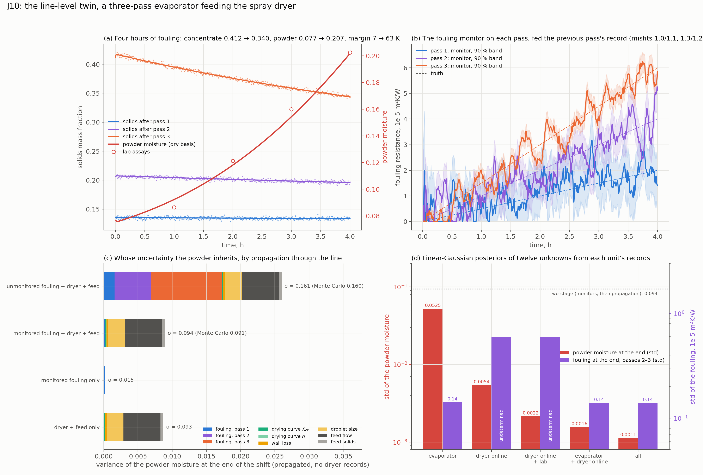

# J10: the line-level twin

**Question.** A plant's units are coupled by what flows between them: the evaporator's concentrate is the dryer's feed. When the passes foul, the concentrate thins and the powder leaves wetter. Which unit's uncertainty does the powder inherit, does a monitor on each unit followed by propagation give the same answer as one estimator on all the line's records, and does information flow upstream (do the dryer's instruments tell anything about the fouling behind them)?

**Short answer.** Downstream only, and the dryer's own records beat propagation by two orders of magnitude. Propagating the monitors' fouling bands with the dryer's campaign posterior and the feed's accuracy gives the end-of-shift powder moisture to ±0.09 (Monte Carlo agrees), and that band is owned by the feed flow (61 %) and the droplet size (27 %), not by the fouling, which the monitors have pinned to a few 1e-6 m²K/W. The dryer's own thermocouples and hygrometer determine its powder to ±0.005 with no evaporator records and no lab assay, and to ±0.001 with everything, because they see the drying itself; the two-stage estimate throws that away. The same dryer records say nothing about the fouling (its posterior stays at the prior). One structural finding: the first pass's fouling level is one unknown with the feed's solids calibration, so its monitor's band (which trusts the feed) is optimistic by a factor of six; the later passes are measured on both sides and determined to 1–2e-6.

## Setup

- **Line:** `pinnrl.process.ProcessLine.default()`: three standard tubes of J01 in series (10 m, steam 10 K above saturation), fed with 0.1 kg/s at 10 % solids, leaving the third pass at 41 % solids and 0.024 kg/s (the evaporation accelerates as the film thins), atomised into J11's co-current tower, which dries it to a powder moisture of 0.077 (dry basis) with a stickiness margin of 7 K. The dryer is quasi-steady: its residence time is seconds, the fouling moves over hours. One four-hour shift solves in 1.6 s (the passes through the compiled integrator of I16, the dryer every two minutes).
- **Shift:** the fouling grows linearly to 2, 4 and 6e-5 m²K/W in passes 1–3; the concentrate drops from 0.412 to 0.340, the powder rises from 0.077 to 0.207 and the margin from 7 to 63 K.
- **Records every 30 s** (480): each pass's outlet solids (noise 0.002) and flow (0.001); the dryer's six air thermocouples (0.5 K) and outlet humidity (0.001). **Lab:** the powder's moisture hourly (0.003).
- **Unknowns, twelve:** the fouling of each pass as a level and a growth over the shift (flat priors); the drying curve's critical moisture and exponent, the wall loss and the droplet size with J11's five-point campaign as priors (±0.106, ±0.064, ±30 %, ±10 %); the feed's flow and solids at their instrument accuracies (±2 %, ±0.005).
- **Arms:** (1) `monitors`: J06's `monitor_fouling` on each pass, the measured outlet of the previous pass (smoothed over five minutes) as its inlet; then `ProcessLine.propagate` from the end-of-shift bands and the priors to the concentrate, the powder and the margin, linear and by 300 Monte-Carlo samples. (2) `joint`: central-difference sensitivities of all 6,244 records to the twelve unknowns, linear-Gaussian posteriors (`pinnrl.analysis.posterior_covariance`, `target_std`) for the evaporator's records, the dryer's, the lab's and their combinations. (3) `validate`: ten simulated shifts fitted jointly through the line's reference from a cold start (bounded least squares, the priors as rows) against the two-stage estimate on the same records.

```bash
python experiments/J10_line_twin/run.py      # monitors and joint in 2 min; validate ~20 min on 3 workers
python experiments/J10_line_twin/plot.py
```

## Results



**The monitors** (end of the shift, 90 % half-widths):

| Pass | Truth | Monitor | Prediction misfit (solids / flow) |
|---|---|---|---|
| 1 | 2.0e-5 | 1.4e-5 ± 1.0e-5 | 1.0 / 1.1 |
| 2 | 4.0e-5 | 5.1e-5 ± 0.7e-5 | 1.3 / 1.2 |
| 3 | 6.0e-5 | 5.9e-5 ± 0.4e-5 | 1.8 / 0.9 |

**Propagation to the end-of-shift powder** (std of the moisture; the margin in K):

| Sources of uncertainty | Concentrate | Powder (Monte Carlo) | Margin | Who owns the powder's variance |
|---|---|---|---|---|
| fouling unmonitored (its full size), dryer, feed | 0.040 | 0.161 (0.160) | 50 | pass 3 40 %, pass 2 21 %, feed flow 21 % |
| fouling as monitored, dryer, feed | 0.021 | 0.094 (0.091) | 30 | feed flow 61 %, droplet size 27 % |
| fouling as monitored, nothing else | 0.004 | 0.015 | 4.5 | pass 1 61 %, pass 2 32 % |
| dryer and feed only | 0.021 | 0.093 | 30 | feed flow 62 %, droplet size 28 % |

**The joint linear-Gaussian posterior** (std at the end of the shift):

| Records used | Fouling, pass 1 | Fouling, passes 2 / 3 | Powder moisture | Margin |
|---|---|---|---|---|
| evaporator only | 3.8e-5 | 1.7e-6 / 1.0e-6 | 0.053 | 19 K |
| dryer online only | prior | prior | 0.0054 | 2.1 K |
| dryer online + lab | prior | prior | 0.0022 | 0.8 K |
| evaporator + dryer online | 3.8e-5 | 1.7e-6 / 1.0e-6 | 0.0016 | 0.6 K |
| all | 3.8e-5 | 1.7e-6 / 1.0e-6 | 0.0011 | 0.4 K |
| two-stage: monitors, then propagation | 6e-6 (trusting the feed) | 4.5e-6 / 2.2e-6 | 0.094 | 30 K |

**Validation on ten simulated shifts**, the plant's nuisances drawn from their priors, both estimators started at the nominal values (rms error over the ten; the intervals claimed in brackets):

| | Fouling, pass 1 | Fouling, pass 2 | Fouling, pass 3 | Powder moisture at the end | Time |
|---|---|---|---|---|---|
| joint fit, twelve unknowns, all records | 4.0e-5 (3.5e-5) | 1.4e-6 (1.7e-6) | 0.8e-6 (1.0e-6) | 0.0008 (0.0011); 10 of 10 covered | 68–460 s, 246 solves |
| two-stage: monitors, then propagation | 4.7e-5 (0.6e-5) | 6.2e-6 (4.5e-6) | 3.9e-6 (2.3e-6) | 0.075 (0.10); 10 of 10 covered | 10 s |

The joint fit's errors in the drying curve, the wall loss, the droplet size and the feed are within 10–40 % of the linear prediction (critical moisture 0.0098 against 0.0075, feed flow 0.0017 against 0.0018). The two-stage monitor of pass 1 is six times overconfident, and its prediction misfit says so on every data set (5.2 / 4.5 against 1.0–1.7 for the other passes): the feed it trusts is not the feed the plant has.

## Conclusion

1. **The powder inherits the dryer's inputs, not the evaporator's fouling, once the fouling is monitored.** Unmonitored, the three passes' fouling owns two thirds of the powder's variance (±0.16 of moisture); monitored to a few 1e-6, they own 1 %, and what remains (±0.09) is the feed flow and the droplet size, the same nuisances J12 named for the tower alone. The line's error propagation is linear enough for the budget to be read off the sensitivities: the Monte Carlo stds agree within 10 % on the moisture, and the margin's bends only in the unmonitored case (50 against 39 K).
2. **Propagation is the wrong estimator for the powder.** The dryer's thermocouples and hygrometer see the drying itself, and the linear-Gaussian posterior of the powder's moisture from them alone is ±0.005, against ±0.094 by propagating the upstream and nuisance bands: the two-stage estimate is 17 times too wide, because the dryer's own records constrain the combination of concentrate, droplet size and feed that sets the powder, whatever each of them is. The lab's four assays halve it (0.0022), and the evaporator's records halve it again (0.0016 → 0.0011 with everything): they pin the concentrate, which separates the droplet size from the feed.
3. **Information flows downstream only.** The dryer's records leave the fouling at its prior: the dryer sees the concentrate's solids through four uncertain nuisances of its own, so what it learns about its feed does not reach back into the tube. A line twin estimates each unit's unknowns on that unit's instruments and uses the downstream unit's instruments for the downstream product; it is not one inverse problem.
4. **The first pass's fouling is one unknown with the feed.** Pass 1's outlet solids respond to a constant fouling and to a feed-solids offset alike, so with the feed admitted at its ±0.005 accuracy the joint posterior of its fouling is 3.8e-5, larger than the fouling itself, while the monitor that trusts the feed reports ±6e-6. Passes 2 and 3 are measured on both sides and determined to 1–2e-6 (the monitors' bands are two to three times wider than the batch posterior, as J06 found for the filter against the batch fit). This is J04's lesson at line scale: every unit's first inlet needs an instrument the twin can trust, or its fouling is traded against the feed.
5. **The validation confirms the linear picture.** On ten shifts whose nuisances are drawn from their priors, the joint fit predicts the end-of-shift powder to 0.0008 (claimed 0.0011, all ten covered) in four minutes, the two-stage estimate to 0.075 (claimed 0.10, all covered) in ten seconds; the fouling of passes 2 and 3 to 1.4 and 0.8e-6 jointly against 6 and 4e-6 by the monitors, whose bands are 1.4–1.7 times too narrow; and the fouling of pass 1 to 4e-5 by both, as the confounding predicts, with the monitor claiming 0.6e-5 and its misfit of 5 flagging the feed it trusts. The two-stage estimate is honest about the powder and dishonest about the first pass; the joint fit is right about both and costs 25 times more.
6. **The monitors cope with measured inlets.** Fed with the previous pass's record smoothed over five minutes instead of an exact signal, the monitors' prediction misfits stay at 1.0–1.8 and the estimates within one to two bands of the truth; the raw record as the inlet gave misfits of 2.5–6 (the input noise enters the filter as if it were exact).

**Not done here:** the counter-current tower in the line (`ProcessLine` accepts it; its transient was left for J13), a feed-solids instrument with its calibration as an unknown, and the operating decision the line twin serves (when a cleaning of the evaporator pays for the powder's quality), which is the predictive-advisory question of P25.
