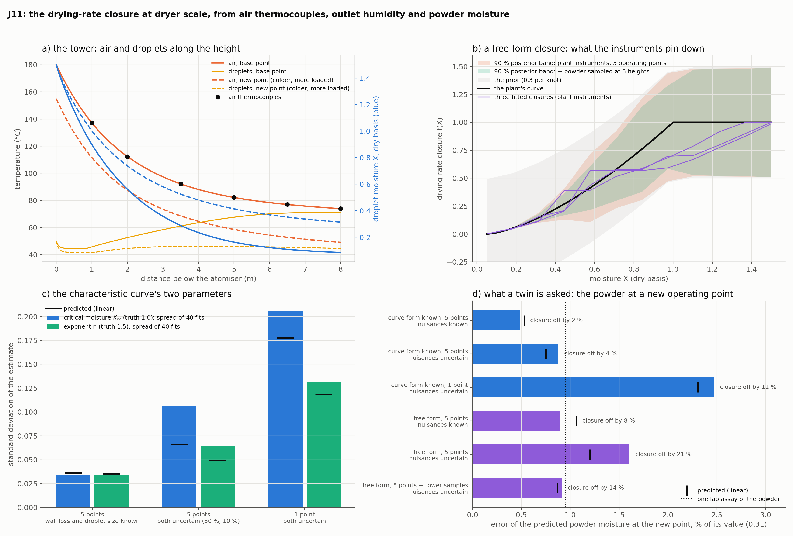

# J11: the drying-rate closure at dryer scale

**Question.** J07 identified the closure $f(X)$ from a single droplet's own mass and temperature record. A spray dryer offers air thermocouples at a few heights, the outlet air's humidity and the powder's moisture from the lab, at a handful of operating points. What do those determine of the closure, what does a fit through the reference solver cost (the question the roadmap set before training any network at this scale), and does what stays undetermined matter for the prediction a twin is asked for?

**Short answer.** The forward solve takes 5 ms, so the estimator is again a least-squares fit through it: 0.3–1.3 s for the two parameters of the characteristic drying curve, 10–14 s for a free-form closure. With the curve's form known, five operating points give its critical moisture and exponent to ±0.03 (±0.07–0.11 once the wall loss and the droplet size are uncertain). A free-form closure is determined in 4 to 6 of its 11 directions, mostly below a moisture of 0.5, and comes out 8–21 % off; the powder moisture at an operating point outside the campaign is nevertheless predicted to 0.5–1.6 %, about what one lab assay resolves. The closure is not identifiable at dryer scale, and the prediction does not need it to be.

## Setup

- **Model:** `pinnrl.process.SprayDryer`, a co-current tower at steady state: equal droplets (J07's physics, 250 µm, 40 % solids) in plug flow with the air, whose humidity and temperature follow from the water and heat the droplets exchange, plus a wall loss. Four ODEs along the residence time; the water balance closes to rounding and the energy balance to the quadrature of the output grid. Default tower: 8 m, air at 180 °C, powder leaving at $X = 0.085$, air at 74 °C.
- **Records at one operating point:** six air thermocouples (1 to 8 m; noise 0.5 K), the outlet humidity ratio (0.001) and the powder moisture (0.003): eight numbers. Variant: powder also sampled at five heights inside the tower (0.01), which a pilot campaign can do and a plant cannot.
- **Campaigns:** 1, 5 or 9 operating points (inlet air 165/180/195 °C, solids flow ±20 %). **New point**, outside all of them: 155 °C and +30 % solids, where the powder leaves wet ($X = 0.31$).
- **Closures:** the plant's form with two unknowns (critical moisture 1.0, exponent 1.5); and a free form, piecewise linear on 12 knots, zero at the equilibrium moisture, increasing, with a prior of 0.3 on each knot centred on a straight line (in the fits) that knows nothing of the plant's curve.
- **Nuisances:** the wall-loss coefficient (prior 30 %) and the droplet diameter (10 %), known or uncertain.
- **Method:** linear-Gaussian posteriors from central-difference sensitivities (`pinnrl.analysis.posterior_covariance`, `target_std`), checked by 40 simulated campaigns per configuration fitted by bounded least squares from a cold start.

```bash
python experiments/J11_dryer_closure/run.py     # ~6 min on 6 workers
python experiments/J11_dryer_closure/plot.py
```

## Results



**The curve's form known** (standard deviation of the estimate: 40 fits, linear prediction in brackets):

| Campaign, nuisances | $X_{cr}$ | $n$ | Closure rel. L2, median (max) | $X_{out}$ at the new point | Fit |
|---|---|---|---|---|---|
| 5 points, known | 0.034 (0.036) | 0.034 (0.035) | 2.0 % (6) | 0.0015 (0.0017), 0.5 % | 0.7 s |
| 5 points, uncertain | 0.106 (0.066) | 0.064 (0.049) | 3.7 % (24) | 0.0028 (0.0024), 0.9 % | 1.3 s |
| 1 point, uncertain | 0.206 (0.178) | 0.131 (0.118) | 11 % (28) | 0.0078 (0.0073), 2.5 % | 0.3 s |

**A free-form closure** (11 knot values; a direction counts as determined when the data's information exceeds the prior's):

| Campaign, instruments, nuisances | Directions determined | Closure rel. L2, median (max) | $X_{out}$ at the new point | Fit |
|---|---|---|---|---|
| 1 point, plant, uncertain | 4 | | (0.0083) | |
| 5 points, plant, known | 5 | 7.6 % (15) | 0.0028 (0.0033), 0.9 % | 14 s |
| 5 points, plant, uncertain | 4 | 21 % (31) | 0.0050 (0.0038), 1.6 % | 10 s |
| 5 points, plant + tower samples, uncertain | 6 | 14 % (25) | 0.0029 (0.0027), 0.9 % | 11 s |
| 9 points, plant + tower samples, uncertain | 7 | | (0.0020) | |

## Conclusion

1. **The dryer-scale model does not change who the estimator is.** One solve of the tower is 5 ms and a fit from a cold start takes a second (two parameters) or ten (a free form). The condition under which a PINN twin has a case, no cheap trusted forward solve, is not met by a steady plug-flow tower any more than by the droplet or the evaporator tube; no network was trained here, on the rule the roadmap set after J07d.
2. **With the form of the curve known, a small campaign determines it.** Five operating points give the critical moisture and the exponent to 2–3 % each when the wall loss and the droplet size are known, and the linear prediction matches the fits. One operating point is two to three times worse than five under the same nuisances, since inlet temperature and loading move the droplets through the falling-rate period differently and that is what separates the two parameters.
3. **The nuisances cost more than the linear analysis says.** With the wall loss uncertain by 30 % and the droplet size by 10 %, the critical moisture's spread is 0.106 against a predicted 0.066, and the worst fit is 24 % off in L2: a 10 % change of diameter is a 20 % change of the drying rate, not a small perturbation. The droplet size is to the dryer what the steam offset is to the evaporator, the input the unknown is traded against, and the design calculation of J09 should be redone with it before a campaign is planned.
4. **A free-form closure is not identifiable from a tower's instruments.** Of 11 directions the data move 4 to 6, and the posterior band (panel b) closes only below a moisture of about 0.5: the air records see the integral of the drying rate along the height, the droplets cross the high-moisture range in the first metre, above the first thermocouple, and the plateau of the constant-rate period stays at its prior. The fitted closures follow the plant's curve at low moisture and the straight line of the prior above it (8 % off with the nuisances known, 21 % with them uncertain). Sampling powder inside the tower adds one or two directions; nine operating points add one more.
5. **The prediction does not need the closure.** The powder moisture at a colder, more loaded operating point, where it is four times the campaign's, is predicted to 0.9 % by a free-form fit of five points with known nuisances and to 1.6 % with uncertain ones (0.9 % again with tower samples), against 0.5–0.9 % when the form is known; one lab assay resolves 1 %. The directions of the closure the instruments cannot see are, for the same reason, directions the outlet does not depend on. The exception is the one-point campaign (2.5 %): a twin extrapolates from a designed campaign, not from an operating point.
6. **What this fixes for the twin.** Identify the closure where it is identifiable, on a droplet rig (J07: 1.5 % by shooting), carry it to the tower, and at dryer scale estimate the few numbers the tower's records do determine (two curve parameters, or a scale factor) together with the nuisances. Report the dryer-scale result as a prediction with its interval, not as a closure.

**Not done here:** a transient or counter-current tower, a droplet size distribution and wall deposition, which are the cases where a forward solve stops being a 5 ms initial-value problem; the stickiness margin (J08) on this model.
