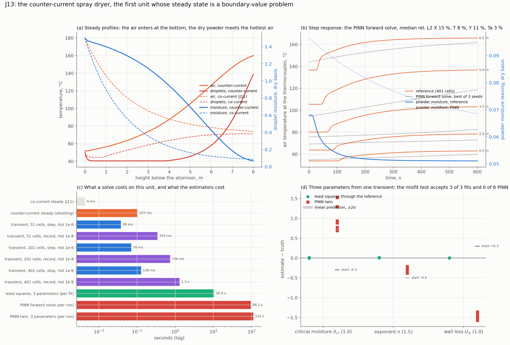

# J13: the counter-current tower, the first unit whose steady state is not an initial-value problem

**Question.** Three units so far (the evaporator tube, the drying droplet, the co-current tower) had a forward solve of milliseconds, and on each the classical estimator through the reference solver beat the PINN twin. The roadmap set the condition for the PINN's case: a unit without a cheap trusted forward solve. The counter-current spray dryer is the first candidate: the air enters at the bottom against the falling droplets, so the droplets' state is known at the top and the air's at the bottom; the steady state is a two-point boundary-value problem and the transient a hyperbolic system whose characteristics run both ways. What do its solves cost, how well does the PINN solve it forward, and does the PINN twin identify the drying curve's parameters from a transient record where the classical estimator can?

**Short answer.** The steady state is twenty times the co-current solve (100 ms by shooting against 4 ms), but the transient is not expensive: with the Jacobian's sparsity declared, a ten-minute step response integrates in 0.04–0.6 s by grid and tolerance, and a bounded least-squares fit of the critical moisture, the exponent and the wall loss from one noisy transient takes 10 s, lands within the linear prediction (±0.011, ±0.015, ±0.003) on every data set and passes the misfit test. The PINN twin on the same records does not: all six runs (two seeds on three data sets) are rejected by the misfit test (reduced chi-square 5–9), with the critical moisture 0.7–1.5 too high and the wall loss driven negative, in about 110 s each. The forward PINN solve of the four coupled fields, with each equation scaled and the residual weight tuned over two decades, reaches 12–15 % on the moisture, 7–8 % on the droplet temperature and 3 % on the air's on two seeds of three and fails on the third. The condition the roadmap set is met by the steady state and not by the transient, and on the transient the classical estimator wins again.

## Setup

- **Model:** `pinnrl.process.CounterCurrentDryer`, J11's pilot tower turned counter-current: 8 m, 250 µm droplets of a 40 % concentrate falling at 1.5 m/s (5.3 s), 0.36 kg/s of dry air entering at the bottom at 160 °C and rising at 0.076 m/s (106 s). The powder leaves at a moisture of 0.067 and 139 °C into the inlet air (stickiness margin 61 K at the bottom); the air leaves the top at 52 °C with a humidity ratio of 0.050. The water balance closes to rounding, the energy balance to 4e-5.
- **Solvers:** `steady()` shoots on the air's humidity and temperature at the top (LSODA down the tower, a two-dimensional root search); `steady_cells(nz)` the steady state of the upwind grid by a sparse Newton solve; `transient()` the method of lines (first-order upwind along each family of characteristics, BDF with the sparse Jacobian). The upwind grid is first order: the outlet moisture is 10 % wet at 51 cells, 2.6 % at 201, 1.3 % at 401.
- **Transient:** the inlet air steps by 15 K at t = 10 s (5 s time constant) over 600 s; the response settles with a time constant of about 125 s. **Records:** five air thermocouples (0.5, 2, 3.5, 5, 6.5 m; 0.5 K) and the outlet humidity (0.001) every 10 s, the powder's moisture (0.003) every minute: 420 numbers. The plant and the fitted model share the 201-cell grid.
- **Unknowns:** critical moisture (1.0), exponent (1.5), wall-loss coefficient (1.0 W/m²K), started at 0.7, 1.0 and 1.3. **Estimators:** bounded least squares through the transient (`scipy.optimize.least_squares`, finite-difference Jacobian, rtol 1e-7), and the PINN twin: `custom_pde(identify=[...])` with the three parameters trainable, J06's recipe (4 × 64 tanh, normalized, the compiled kernel of I13 for the derivatives), 2,000 Adam steps and 200 of L-BFGS, the residual weight at 1e-3 (see below), two seeds on each of three data sets, graded by `pde.sensor_misfit`.
- **Forward solve:** the same network on the step response with the parameters known, three seeds, against a 401-cell reference (the gap between the 201- and 401-cell solutions is 0.2 % in the same norm).

```bash
python experiments/J13_counter_current_dryer/run.py --arms cost          # 1 min
python experiments/J13_counter_current_dryer/run.py --arms forward,identify   # ~15 min on 3 workers
python experiments/J13_counter_current_dryer/plot.py
```

## Results



**The cost of a solve** (Apple M4, one thread; the transient over 600 s with 121 outputs):

| Solve | Time |
|---|---|
| co-current steady state (J11, an initial-value problem) | 4 ms |
| counter-current steady state (shooting) | 103 ms |
| steady state of the upwind grid, 51–401 cells (Newton) | 106–115 ms |
| transient, smooth step, 51 / 201 / 401 cells, rtol 1e-6 | 0.04 / 0.07 / 0.13 s |
| transient, smooth step, rtol 1e-8 | 0.09 / 0.30 / 0.60 s |
| transient, a 10 s-knot record of the inlet air, rtol 1e-6 | 0.13 / 0.26 / 0.41 s |
| transient, the record, rtol 1e-8 | 0.34 / 0.74 / 1.3 s |
| least squares, three parameters (31–36 solves) | 9–10 s |
| PINN forward solve, 2,000 + 200 steps | 96–97 s |
| PINN twin, three parameters trainable, 2,000 + 200 steps | 108–138 s |

**The PINN forward solve of the step response** (relative L2 on the (z, t) grid):

| Seed | X (moisture) | T (droplets) | Y (humidity) | Ta (air) |
|---|---|---|---|---|
| 0 | 15.2 % | 6.9 % | 11.2 % | 2.9 % |
| 1 | 11.7 % | 8.2 % | 8.6 % | 3.4 % |
| 2 | 143 % (failed) | 11.8 % | 50 % | 11.0 % |

**Identification from one transient record** (estimate − truth; the linear prediction of the standard deviation is ±0.011, ±0.015 and ±0.003, with the three parameters correlated at 0.82–0.87):

| Data set | Estimator | $X_{cr}$ − 1.0 | $n$ − 1.5 | $U_w$ − 1.0 | Reduced χ² | Accepted | Time |
|---|---|---|---|---|---|---|---|
| 0 | least squares | +0.014 | −0.001 | −0.001 | 0.94 | yes | 10 s |
| 1 | least squares | −0.002 | +0.006 | +0.003 | 1.03 | yes | 10 s |
| 2 | least squares | −0.008 | +0.015 | +0.005 | 1.08 | yes | 9 s |
| 0 | PINN twin, seeds 0 / 1 | +1.53 / +0.77 | −0.34 / −0.21 | −1.46 / −1.53 | 9.1 / 7.7 | no | 113 / 110 s |
| 1 | PINN twin, seeds 0 / 1 | +0.89 / +0.69 | −0.22 / −0.27 | −1.36 / −1.57 | 5.5 / 5.1 | no | 108 / 108 s |
| 2 | PINN twin, seeds 0 / 1 | +0.94 / +1.30 | −0.28 / −0.38 | −1.40 / −1.52 | 6.5 / 7.1 | no | 138 / 137 s |

The twin's fields are 4–7 % off the reference in every run (the data term pulls them to the records), and its parameters absorb what the physics loss does not resolve: a critical moisture of 1.7–2.5 says the droplets never leave the constant-rate period, and a negative wall loss adds the heat the network's drying lacks.

## Conclusion

1. **The boundary-value problem is the expensive part, and it is not expensive enough.** Shooting on the air's two unknowns at the top costs 25 integrations down the tower, 100 ms against 4 ms for the co-current profile. The transient, which is where a twin estimates anything, is a stiff hyperbolic system of 4 × 201 states, and with its sparsity declared BDF integrates ten minutes of it in 0.07–0.3 s. A fit of three parameters is ten seconds. The PINN's case, no cheap trusted forward solve, is not made by counter-current flow; it would need a model with no method-of-lines form at all (a distribution of droplet sizes with coalescence, deposition on the wall, a recirculating flow), which this experiment did not build.
2. **The PINN needs the problem scaled, and then it is still 10 % off.** Written as it stands, the four equations' residuals differ by five orders of magnitude (the droplet-temperature equation is a stiff balance of terms of thousands of kelvin per second, the humidity equation is of order 1e-4), and the package's own normalization, which multiplies a residual by the time span over the field's scale, assumes the fields change over the whole 600 s where this unit's time scales are 5 and 100 s. With the residual at weight 1 the initial and boundary terms are never fitted and the moisture field is 90 % off; dividing each equation by the size of its own terms (`residual_scales`, now what `custom_pde` does) and lowering the residual weight to 1e-3 brings the forward solve to 12–15 % on the moisture and 3 % on the air temperature, where Adam makes no progress and L-BFGS does all the learning (longer L-BFGS phases get worse again). The kink of the characteristic drying curve at the critical moisture, which the droplets cross in the first metre, is the feature the network does not resolve, as in J07.
3. **With a forward solve that poor, the twin cannot identify the curve.** The twin reaches fields 4–7 % off the reference with the parameters free, nearer than the forward solve, because the data term pulls the fields to the records while the parameters absorb the unresolved physics: a critical moisture above the feed's moisture, which turns the drying curve off, and a negative wall loss, which supplies heat the network's drying does not. Every run fails the misfit test (reduced chi-square 5–9 against a limit near 1.1), so the failure is detectable without the truth, as in J06 and J07b. The classical fit lands within the linear prediction on every data set in ten seconds; the misfit test separates the two without the truth, as it did in J06 and J07.
4. **What the counter-current tower adds to the twin regardless.** The dry powder meets the hottest air: at the default point the outlet margin is 61 K against 7 K for the co-current tower, and the outlet moisture is the most sensitive quantity of the unit (a 20 K change of the inlet air moves it from 0.20 to 0.067). The unit's steady state, transient and records are in the package for the line twin (J10 accepts it as the dryer), and a plant's counter-current tower is the case where the residual scaling of `custom_pde` matters most.

**Not done here:** a free-form closure on the transient (J07d's shooting would be the comparison), a size distribution, wall deposition, and a time-marching or domain-decomposed PINN (H04) for the forward solve.
