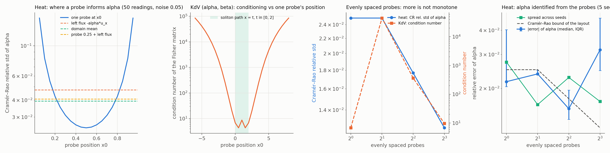

# K02: sensor layout vs conditioning

## Question

How do sensor count and placement change $\kappa(F)$?

## Setup

The sensors are the observation operators of `pinnrl.pdes.sensors` (`PointSensor`, `BoundarySensor`, `IntegralSensor`), and the Fisher information of a layout comes from `sensor_jacobian`, which differentiates each sensor's closed-form record with respect to the parameters, through the operator (a flux sensor's record is $-\alpha u_x$, so its sensitivity has the explicit $-u_x$ term as well as $-\alpha\, \partial u_x / \partial \alpha$). Every record has noise $\sigma = 0.05$ and every sensor takes 50 readings, so layouts with the same number of sensors have the same number of records.

**Part A, closed forms (seconds).**

- *Heat*, $u_t = \alpha u_{xx}$ on $[0, 1]$, $u_0 = \sin \pi x$, $\alpha = 0.1$, readings on $t \in [0, 1]$: $n \in \{1, 2, 4, 8\}$ probes at the centres of $n$ equal cells; one probe swept over $x_0 \in [0.05, 0.95]$; and five layouts of 50 records each (a probe at $0.5$, a probe at $0.25$, the left wall flux $-\alpha u_x$, the domain mean $\int_0^1 u\,dx$, and a probe at $0.25$ alternating with the flux). Metric: the Cramér–Rao bound on the relative standard deviation of $\hat\alpha$.
- *KdV with two coefficients*, $u_t + \alpha u u_x + \beta u_{xxx} = 0$ on $[-15, 15]$, the soliton $u = (3/\alpha)\,\mathrm{sech}^2(\tfrac{1}{2}\sqrt{1/\beta}\,(x - t))$ with $\alpha = 6$, $\beta = 1$, readings on $t \in [0, 2]$: $n \in \{1, 2, 4, 8\}$ evenly spaced probes; one probe swept over $x_0 \in [-6, 8]$ (the soliton runs from $x = 0$ to $x = 2$); five probes on the path ($x_0 \in \{0, 0.5, 1, 1.5, 2\}$) vs five far from it ($\{-12, -9, 6, 9, 12\}$). Metrics: $\kappa(F)$, the correlation of $(\hat\alpha, \hat\beta)$ and the per-parameter bound.

**Part B, training.** Heat $\alpha$ identified from the $n \in \{1, 2, 4, 8\}$ probe layouts with the records as the data term (one misfit term per sensor, weight 10), $\sigma = 0.05$, the F01 protocol otherwise (tanh MLP 4 × 64, Adam $10^{-3}$, 5,000 steps, 1,000 collocation points refreshed every 50 steps, $\alpha$ started at 0.5), 5 seeds. Metrics: the relative error of $\hat\alpha$, its spread across seeds, and the layout's bound.

Rerun with:

```bash
python experiments/K02_sensor_layout/run.py --seeds 5 --steps 5000 --workers 5   # --fisher-only for part A
python experiments/K02_sensor_layout/plot.py
```

## Result



**Heat: where a probe informs $\alpha$.** One probe, 50 readings, $\sigma = 0.05$:

| Probe at $x_0$ | 0.05 | 0.2 | 0.35 | 0.5 | 0.65 | 0.8 | 0.95 |
|---|---|---|---|---|---|---|---|
| CR relative std of $\hat\alpha$ | 0.160 | 0.043 | 0.028 | 0.025 | 0.028 | 0.043 | 0.160 |

The information of a probe is $\sum_k (\partial u / \partial \alpha)^2 / \sigma^2$ with $\partial u / \partial \alpha = -\pi^2 t\, u$, so it scales with $\sin^2 \pi x_0$: the centre is best and a probe at 5 % of the length is 6.4 times worse. Layouts with 50 records each:

| Layout (50 records) | CR relative std |
|---|---|
| probe at 0.5 | 0.025 |
| probe at 0.25 | 0.035 |
| domain mean $\int u\,dx$ | 0.039 |
| probe at 0.25 + left flux, alternating | 0.041 |
| left wall flux $-\alpha u_x$ | 0.048 |

The mean is a good sensor ($2/\pi$ of the centre value at every time), the wall flux the worst of the five: $\partial(-\alpha u_x)/\partial\alpha = -u_x(1 - \alpha\pi^2 t)$ changes sign at $t = 1/(\alpha\pi^2) \approx 1.01$, so over $t \in [0, 1]$ the flux's sensitivity decays to zero where the probes' is largest. Evenly spaced probes:

| Probes | 1 (at 0.5) | 2 (0.25, 0.75) | 4 | 8 |
|---|---|---|---|---|
| CR relative std | 0.0250 | 0.0250 | 0.0177 | 0.0125 |

Two probes at the quarter points carry exactly the information of one at the centre ($2 \sin^2 \pi/4 = 1$); from there the bound falls as $1/\sqrt{n}$. Placement is worth as much as count: moving one probe from $x_0 = 0.05$ to $0.5$ gains what 41 probes at $0.05$ would.

**KdV: two coefficients and one probe.** $\kappa(F)$ and the bounds for a single probe at $x_0$:

| $x_0$ | −6 | −4 | −2 | 0 | 2 | 4 | 6 | 8 |
|---|---|---|---|---|---|---|---|---|
| $\kappa(F)$ | 85,000 | 16,000 | 760 | 6.8 | 6.8 | 760 | 16,000 | 85,000 |
| CR rel. std $\hat\alpha$ | 43 | 3.8 | 0.26 | 0.025 | 0.025 | 0.26 | 3.8 | 43 |
| CR rel. std $\hat\beta$ | 13 | 1.7 | 0.24 | 0.093 | 0.093 | 0.24 | 1.7 | 13 |

A probe on the soliton's path ($x_0 \in [0, 2]$) sees the pulse pass: its height fixes $\alpha$ (amplitude $3/\alpha$) and its width fixes $\beta$, and the two are nearly decoupled ($\kappa \approx 7$). Four lengths away the probe only sees the exponential tail $\propto e^{-|x - t|/\sqrt{\beta}}/\alpha$, where $\alpha$ and $\beta$ both scale the same small number: the Fisher matrix is nearly singular ($\kappa = 10^4$–$10^5$, correlation 0.996) and the bounds exceed the parameters themselves. Five probes on the path give $\kappa = 4.4$ and bounds of 0.9 % ($\alpha$) and 5 % ($\beta$); five probes far from it, with the same 250 records, give $\kappa = 14{,}500$ and bounds of 360 % and 160 %. Evenly spaced probes are not monotone in count:

| Evenly spaced probes | 1 (at 0) | 2 (±7.5) | 4 | 8 |
|---|---|---|---|---|
| $\kappa(F)$ | 6.8 | 44,500 | 365 | 9.7 |
| correlation $(\hat\alpha, \hat\beta)$ | 0.675 | 0.996 | 0.947 | 0.586 |

Two probes at $\pm 7.5$ are both off the path and the layout is 6,500 times worse conditioned than a single probe at the origin; eight probes work because two of them ($x_0 = -1.875$ and $1.875$) sit near the path.

**Part B: the identified $\alpha$ against the bound of its layout.**

Heat $\alpha$ identified from the probe layouts, $\sigma = 0.05$, 5 seeds, step 5,000. Spread is the standard deviation of $\hat\alpha$ across seeds relative to $\alpha$; the bound is the layout's Cramér–Rao relative standard deviation.

| Probes | Rel. error of $\hat\alpha$ (median [IQR]) | Spread across seeds | CR bound of the layout | Mean bias | Rel. L2 of $u$ |
|---|---|---|---|---|---|
| 1 (at 0.5) | 0.022 [0.020, 0.040] | 0.027 | 0.025 | −0.027 | 0.024 |
| 2 | 0.024 [0.023, 0.025] | 0.016 | 0.025 | −0.028 | 0.031 |
| 4 | 0.016 [0.014, 0.020] | 0.023 | 0.018 | −0.013 | 0.029 |
| 8 | 0.032 [0.025, 0.046] | 0.017 | 0.013 | −0.030 | 0.030 |

Each run takes 50 s with five in parallel on a laptop CPU.

## Conclusion

1. **The Fisher information of a layout is computable before any training, through the operators.** `sensor_jacobian` reproduces the closed-form sensitivities for probes, fluxes and integrals (tests), so sensor placement is a design computation: per layout, one Jacobian and one $p \times p$ matrix, in milliseconds.
2. **Placement beats count.** On heat a probe's information scales with $\sin^2 \pi x_0$; on KdV a probe off the soliton's path leaves the two coefficients unidentifiable in practice ($\kappa > 10^4$) whatever the number of readings, and two such probes are worse than one well-placed one. The rule for the plant twin (J04, J09): put the sensors where the unknown physics changes the signal, not where the installation is convenient, and check $\kappa(F)$ of the candidate layouts first.
3. **Different sensor kinds differ by less than placement does.** On heat the mean, a quarter-point probe and the wall flux lie within a factor of two of each other, and all within a factor of two of the best probe; the flux sensor loses because its sensitivity to $\alpha$ passes through zero inside the window.
4. **The trained estimator follows the layout's bound down to the surrogate floor, and no further.** The spread of $\hat\alpha$ across seeds (1.6–2.7 %) matches the Cramér–Rao bound of the layout (1.3–2.5 %) within what 5 seeds resolve, as in F01 and F05, so the bound predicts what a layout buys. The median error does not fall below 2 % with 4 or 8 probes because every estimate is 1–3 % low: the surrogate's bias (F01's floor), which no sensor can remove. For the twin, layout design with the Fisher information is worth doing until the bound reaches the floor of the forward model, and after that the forward accuracy is the thing to improve.

**Consequences for the backlog:** J09 (measurement design) can start from `sensor_jacobian` and a greedy or D-optimal search over candidate layouts; F05 predates the sensor module and its fixed probes are now one `PointSensor` each (its conclusions stand, see the heat table above, which reproduces its "one mid-domain probe beats the scatter").
