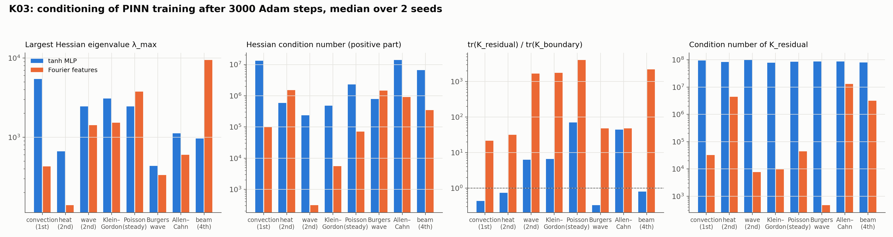

# K03: training conditioning

## Question

Is PINN training ill-conditioned by the differential operator? Loss-Hessian and tangent-kernel spectra across PDEs and architectures; condition number vs final error.

## Setup

- **Hypothesis.** The residual of a $k$-th order operator contains $k$-th derivatives of the network, whose weight-gradients grow with the frequencies the network represents, so the residual kernel $K_{\text{res}} = \nabla_w r\, \nabla_w r^\top$ and the Hessian's $\lambda_{\max}$ should worsen with the order and force a smaller learning rate.
- **Problems** (catalogue entries): convection (first order), heat, wave, Klein–Gordon, Poisson (second order, linear), the Burgers travelling wave and Allen–Cahn (second order, nonlinear), the Euler–Bernoulli beam (fourth order).
- **Architectures:** a 4 × 64 tanh MLP and the same with Fourier features. Two seeds, 3,000 Adam steps at $10^{-3}$, 1,000 collocation points, weights 1 / 10 / 10.
- **Diagnostics** (`pinnrl.analysis`): the extreme Ritz values of the physics-loss Hessian by 60 Lanczos steps with Hessian-vector products (`loss_hessian_spectrum`); the tangent kernels of the residual, boundary and initial terms on 96 points each (`tangent_kernel_spectrum`): traces (the total rate at which each term is fitted) and condition numbers; the relative L2 error where a closed form exists.
- **Code:** `run.py`, `plot.py`.

Rerun with:

```bash
python experiments/K03_training_conditioning/run.py --seeds 2 --steps 3000
python experiments/K03_training_conditioning/plot.py
```

## Result



Medians over 2 seeds after 3,000 Adam steps. $\lambda_{\max}$ and $\lambda_{\min}$ are the extreme Ritz values of the physics-loss Hessian; $\kappa(H^+)$ its condition number over the positive part; the trace ratio compares the residual and boundary tangent kernels; $\kappa(K_{\text{res}})$ and $\kappa(K_{\text{bc}})$ are the kernels' own condition numbers on 96 points.

| Problem (order) | Architecture | Rel. L2 | $\lambda_{\max}$ | $\lambda_{\min}$ | $\kappa(H^+)$ | tr $K_{\text{res}}$ / tr $K_{\text{bc}}$ | $\kappa(K_{\text{res}})$ | $\kappa(K_{\text{bc}})$ |
|---|---|---|---|---|---|---|---|---|
| convection (1st) | MLP | 0.083 | 5,459 | −17 | 1.3e7 | 0.44 | 9.4e7 | 4.8e7 |
| | Fourier | 0.015 | 429 | −68 | 1.0e5 | 22 | 3.2e4 | 8.4e7 |
| heat (2nd) | MLP | 0.030 | 662 | −1.6 | 5.9e5 | 0.74 | 8.4e7 | 2.9e7 |
| | Fourier | 0.001 | 139 | −0.0 | 1.5e6 | 32 | 4.4e6 | 4.3e7 |
| wave (2nd) | MLP | 0.035 | 2,449 | −6.9 | 2.4e5 | 6.3 | 9.8e7 | 3.2e7 |
| | Fourier | 0.037 | 1,418 | −41 | 3.1e2 | 1,690 | 7.7e3 | 6.2e7 |
| Klein–Gordon (2nd) | MLP | 0.048 | 3,092 | −8.3 | 4.9e5 | 6.6 | 7.9e7 | 7.3e7 |
| | Fourier | 0.023 | 1,524 | −42 | 5.6e3 | 1,750 | 9.7e3 | 7.7e7 |
| Poisson (2nd, steady) | MLP | 0.035 | 2,446 | −5.3 | 2.3e6 | 70 | 8.5e7 | 5.9e7 |
| | Fourier | 0.029 | 3,768 | −258 | 7.1e4 | 4,060 | 4.4e4 | 6.5e7 |
| Burgers wave (2nd, nonlinear) | MLP | 0.003 | 434 | −0.2 | 7.9e5 | 0.33 | 8.7e7 | 4.6e7 |
| | Fourier | 0.004 | 333 | −0.7 | 1.5e6 | 48 | 4.7e2 | 8.8e7 |
| Allen–Cahn (2nd, nonlinear) | MLP | – | 1,118 | −0.9 | 1.4e7 | 44 | 8.6e7 | 7.2e7 |
| | Fourier | – | 602 | −0.3 | 9.1e5 | 48 | 1.3e7 | 8.7e7 |
| beam (4th) | MLP | 0.061 | 963 | −2.9 | 6.7e6 | 0.80 | 8.0e7 | 6.8e7 |
| | Fourier | 0.097 | 9,454 | −198 | 3.4e5 | 2,210 | 3.2e6 | 7.8e7 |

## Conclusion

1. **The architecture, not the operator order, sets the conditioning at this budget.** For the MLP, $\lambda_{\max}$ is largest for first-order convection (5,459) and smaller for the fourth-order beam (963), and $\kappa(K_{\text{res}})$ is $8$–$10 \times 10^7$ for every problem. The residual kernel of a tanh MLP is ill-conditioned by the network's spectral bias, whatever operator is applied to it. The hypothesis is not supported.
2. **Fourier features fix the residual kernel and break the balance between terms.** $\kappa(K_{\text{res}})$ drops by three to five orders of magnitude (to $5 \times 10^2$ for the Burgers wave, $10^4$ for wave and Klein–Gordon), which is why they solve heat and convection 5–30× more accurately. The price is the trace ratio: the residual kernel's trace becomes $10^3$–$4 \times 10^3$ times the boundary kernel's on wave, Klein–Gordon, Poisson and the beam, the gradient pathology of Wang, Teng & Perdikaris (2021) in its pure form; on the beam it costs accuracy (0.097 vs 0.061). The random features inject high frequencies that a high-order derivative amplifies.
3. **No run is at a minimum.** Every Hessian has a negative Ritz value, from −0.0 (heat with Fourier features, essentially converged) to −258 (Poisson with Fourier features), and $|\lambda_{\min}|$ tracks the final loss across runs. It is a usable convergence diagnostic, and the reason the sensitivity solve of K01 needs an indefinite-capable solver.
4. **The learning-rate bound binds for Fourier features on high-order problems.** $2/\lambda_{\max}$ is $2 \times 10^{-4}$ for the Fourier beam and $5 \times 10^{-4}$ for Fourier Poisson, below the $10^{-3}$ used; Adam's normalization lets training proceed, but these are the two runs with the largest negative curvature and the worst accuracy relative to the MLP.

**Consequences for the backlog:**
- K04 (preconditioning, second-order optimizers) should target the MLP's $\kappa(K_{\text{res}}) \sim 10^8$, which is architecture-wide, and the Fourier trace imbalance, which the adaptive loss weights in `pinnrl` address and K03 can now measure.
- The diagnostics cost 0.3–5 s per run and are worth recording at every study checkpoint next to the loss.
- The operator-order question is re-asked after D01/D02 (a settled optimizer); at 3,000 steps the answer is dominated by where the optimizer is.
