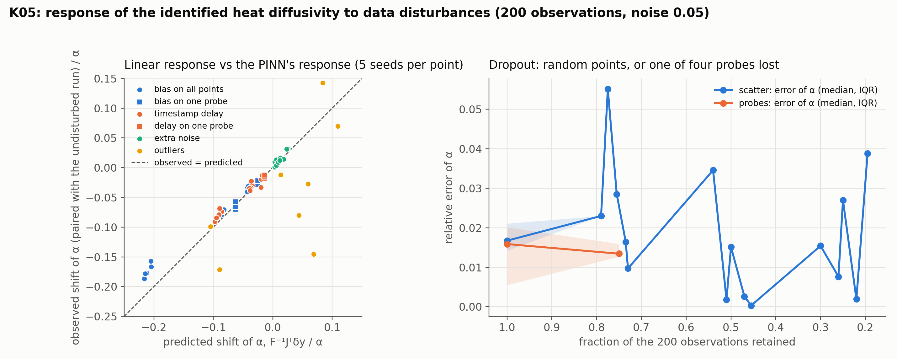

# K05: data-disturbance response

## Question

How far does the estimate move under sensor noise, bias, dropout and delay? Perturbation sweeps; empirical $\delta\theta$ vs the linear prediction $F^{-1} J^\top \Sigma^{-1} \delta y$ from K01.

## Setup

- **Base case:** the F01 heat problem ($\alpha = 0.1$, started at 0.5) with 200 observations at noise 0.05, as random scatter; and, for single-probe faults, the F05 layout with four probes at $x = 0.2, 0.4, 0.6, 0.8$ read at 50 regular times each.
- **Disturbances** (`pinnrl.analysis.perturb_observations`), applied to the same data set as the base run of the same seed, so every shift is paired: extra Gaussian noise (0.05, 0.1 on top of the base 0.05); a constant bias on all values (0.01, 0.02, 0.05) or on the $x = 0.4$ probe alone (0.02, 0.05); a timestamp delay, the values attributed to $t + \tau$ (0.01, 0.02, 0.05; on one probe 0.02); dropout of 25, 50 or 75 % of the points at random, or of one whole probe; outliers replacing 5 or 10 % of the values by draws of ten times the data's standard deviation.
- **Prediction:** $\delta\alpha = (J^\top J)^{-1} J^\top \delta y$ with $J$ the exact sensitivity at the attributed points and $\delta y$ the disturbance of the values (for a delay, the truth at the attributed time minus the truth at the real time). Dropout has no $\delta y$; its effect is on the information, not the values.
- **Training:** as in F01 (4 × 64 tanh MLP, 5,000 Adam steps, weights 1 / 10 / 10 / 10). 5 seeds.
- **Code:** `run.py`, `plot.py`.

Rerun with:

```bash
python experiments/K05_data_disturbance/run.py --seeds 5 --steps 5000 --workers 4
python experiments/K05_data_disturbance/plot.py
```

## Result



Paired shift of $\hat\alpha$ (disturbed minus undisturbed run of the same seed), median [IQR] over 5 seeds, against the linear prediction; the ratio observed / predicted; the residual loss of the trained network; the field error.

| Layout | Disturbance | Size | $\hat\alpha$ (median) | Observed shift | Predicted shift | Ratio | Residual loss | Rel. L2 of u |
|---|---|---|---|---|---|---|---|---|
| scatter | none | – | 0.0983 | – | – | – | 8.8e-4 | 0.027 |
| scatter | extra noise | 0.05 | 0.0992 | +0.0010 [+0.0009, +0.0012] | +0.0009 | 1.05 | 1.0e-3 | 0.023 |
| | | 0.10 | 0.0998 | +0.0014 [+0.0013, +0.0031] | +0.0018 | 1.24 | 1.3e-3 | 0.031 |
| scatter | bias | 0.01 | 0.0947 | −0.0033 [−0.0041, −0.0032] | −0.0042 | 0.78 | 9.1e-4 | 0.022 |
| | | 0.02 | 0.0909 | −0.0074 [−0.0075, −0.0071] | −0.0085 | 0.87 | 1.0e-3 | 0.037 |
| | | 0.05 | 0.0812 | −0.0177 [−0.0178, −0.0167] | −0.0212 | 0.83 | 1.5e-3 | 0.016 |
| scatter | delay | 0.01 | 0.0964 | −0.0016 [−0.0019, −0.0013] | −0.0019 | 0.94 | 9.2e-4 | 0.026 |
| | | 0.02 | 0.0949 | −0.0033 [−0.0034, −0.0030] | −0.0037 | 0.87 | 9.9e-4 | 0.022 |
| | | 0.05 | 0.0905 | −0.0079 [−0.0084, −0.0074] | −0.0090 | 0.88 | 1.3e-3 | 0.024 |
| scatter | dropout | 25 % | 0.0984 | +0.0011 [−0.0006, +0.0014] | – | – | 8.6e-4 | 0.027 |
| | | 50 % | 0.0998 | +0.0015 [+0.0001, +0.0021] | – | – | 1.0e-3 | 0.029 |
| | | 75 % | 0.1008 | +0.0048 [−0.0000, +0.0054] | – | – | 1.1e-3 | 0.024 |
| scatter | outliers | 5 % | 0.1073 | +0.0070 [−0.0012, +0.0128] | +0.0084 | 0.64 | 1.1e-2 | 0.050 |
| | | 10 % | 0.0903 | −0.0099 [−0.0145, −0.0027] | +0.0059 | – | 2.3e-2 | 0.107 |
| 4 probes | none | – | 0.0995 | – | – | – | 9.9e-4 | 0.024 |
| 4 probes | bias on one | 0.02 | 0.0965 | −0.0026 [−0.0029, −0.0024] | −0.0025 | 1.06 | 1.1e-3 | 0.027 |
| | | 0.05 | 0.0928 | −0.0064 [−0.0066, −0.0062] | −0.0062 | 1.03 | 1.5e-3 | 0.027 |
| 4 probes | delay on one | 0.02 | 0.0980 | −0.0013 [−0.0015, −0.0013] | −0.0013 | 0.99 | 1.2e-3 | 0.026 |
| 4 probes | one probe lost | – | 0.0987 | +0.0003 [−0.0003, +0.0005] | – | – | 9.2e-4 | 0.024 |

## Conclusion

1. **The PINN's response to bias and delay is the linear response, to within 20 %.** Observed shifts are 0.78–1.06 of $F^{-1} J^\top \delta y$ with interquartile ranges of a few $10^{-4}$: for a given disturbance the shift is deterministic, and the Fisher machinery of K01 predicts it before any training. On the probe layout, where the disturbed points are known, the prediction is exact (1.03–1.06); on random scatter the PINN is 10–20 % less sensitive than the linear theory, which is the surrogate's smoothing of a disturbance it cannot fit exactly.
2. **A bias is the worst disturbance per unit size and a delay the most insidious.** A bias of 0.05 (the noise level) moves $\alpha$ by 18 %, far more than noise of the same size (1 %), because a bias is coherent and the noise averages out; a delay of 0.05 on a unit time scale moves it by 8 %, and the residual does not flag either (it rises by 10–70 %, within the seed-to-seed range). Both are detected only by a model of the sensor, not by the physics.
3. **Dropout costs information, not accuracy.** Losing 75 % of the points or a whole probe shifts the estimate by under 5 % and leaves the residual unchanged; the bound grows as $1/\sqrt{N}$ and the spread across seeds with it, but there is no systematic shift. For the plant this means a lost probe degrades the interval, not the estimate.
4. **Outliers break the squared-error data term, and the residual sees it.** With 5–10 % outliers the shift becomes seed-dependent (IQR ten times wider), the linear prediction is not followed (an outlier is not a small disturbance), and the residual loss rises 10–25× while the field error doubles or quadruples. A robust data loss (`loss_function: huber` or `mae`, experiment K28) is the fix; the residual jump is the detector.

**Consequences for the backlog:**
- K25–K27 (bias, missing data, timing) have their baselines; the linear response is accurate enough that their sweeps can be predicted from $J$ and verified on a few cells.
- K28 (robust losses) is the pending item: the squared-error data term has no breakdown resistance.
- The residual loss is a usable sensor-health signal for outliers but not for bias or delay; the twin needs sensor models for those.
