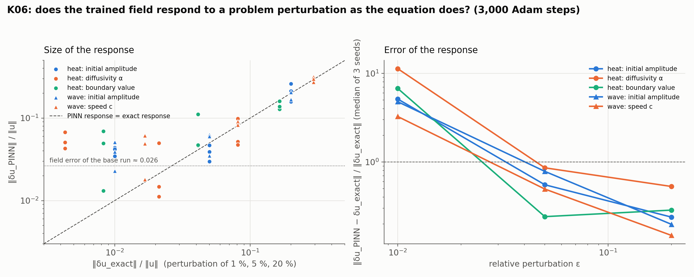

# K06: problem-disturbance stability

## Question

Does the learned solution respect the PDE's own stability? Perturb the initial condition, boundary condition and parameters; compare the PINN's response with the reference solver's (amplification ratios).

## Setup

- **Problems and perturbations**, each with the exact perturbed solution:
  - heat ($u_t = \alpha u_{xx}$, $u_0 = \sin\pi x$, Dirichlet 0): initial amplitude $(1+\varepsilon)$, exact response $\varepsilon u$; diffusivity $\alpha(1+\varepsilon)$, closed form; left boundary value $\varepsilon$, exact solution $\varepsilon(1-x)$ plus a 60-term transient series;
  - wave ($u_{tt} = c^2 u_{xx}$, $u_0 = \sin\pi x$, $u_t(x, 0) = 0$): initial amplitude $(1+\varepsilon)$; speed $c(1+\varepsilon)$.
- **Sizes:** $\varepsilon \in \{0.01, 0.05, 0.2\}$, plus the unperturbed problem.
- **Training:** forward, 4 × 64 tanh MLP, 3,000 Adam steps, weights 1 / 10 / 10; 3 seeds, the same initial weights for all $\varepsilon$ of a seed (paired).
- **Metrics:** on 4,000 fixed random points, the exact response $\|\delta u_{\text{exact}}\| / \|u\|$, the PINN's $\|\delta u_{\text{PINN}}\| / \|u\|$ (perturbed minus unperturbed trained field), their ratio (the amplification) and the relative error of the response $\|\delta u_{\text{PINN}} - \delta u_{\text{exact}}\| / \|\delta u_{\text{exact}}\|$.
- **Code:** `run.py`, `plot.py`.

Rerun with:

```bash
python experiments/K06_problem_disturbance/run.py --seeds 3 --steps 3000 --workers 4
python experiments/K06_problem_disturbance/plot.py
```

## Result



Medians over 3 seeds. The unperturbed fields have a relative L2 error of 0.026 (heat) and 0.034 (wave).

| Problem | Perturbation | ε | Exact response | PINN response | Amplification [min, max] | Error of the response |
|---|---|---|---|---|---|---|
| heat | initial amplitude | 0.01 | 0.010 | 0.042 | 4.3 [3.4, 4.5] | 5.1 |
| | | 0.05 | 0.050 | 0.039 | 0.80 [0.61, 0.92] | 0.55 |
| | | 0.20 | 0.200 | 0.213 | 1.10 [0.80, 1.27] | 0.24 |
| heat | α | 0.01 | 0.004 | 0.051 | 12.1 [10.2, 15.4] | 11.3 |
| | | 0.05 | 0.021 | 0.015 | 0.68 [0.54, 2.40] | 0.86 |
| | | 0.20 | 0.081 | 0.052 | 0.66 [0.57, 1.24] | 0.53 |
| heat | boundary value | 0.01 | 0.008 | 0.049 | 6.1 [1.7, 8.2] | 6.8 |
| | | 0.05 | 0.041 | 0.047 | 1.18 [1.15, 2.63] | 0.24 |
| | | 0.20 | 0.165 | 0.138 | 0.86 [0.80, 0.95] | 0.29 |
| wave | initial amplitude | 0.01 | 0.010 | 0.039 | 3.9 [2.3, 5.2] | 4.8 |
| | | 0.05 | 0.050 | 0.060 | 1.22 [0.70, 1.28] | 0.78 |
| | | 0.20 | 0.200 | 0.171 | 0.86 [0.85, 1.04] | 0.20 |
| wave | c | 0.01 | 0.017 | 0.049 | 3.0 [1.1, 3.7] | 3.3 |
| | | 0.05 | 0.081 | 0.089 | 1.10 [1.03, 1.13] | 0.49 |
| | | 0.20 | 0.293 | 0.298 | 1.02 [0.94, 1.09] | 0.15 |

## Conclusion

1. **Above its own error, the PINN responds as the equation does.** For perturbations whose exact response exceeds the field error of the trained network (about 3 %), the amplification is 0.7–1.2 and the response error falls from about 0.5 at ε = 0.05 to 0.15–0.3 at ε = 0.2: the trained field moves the right amount in roughly the right direction, for a change of the initial data, of the boundary data, of a diffusivity and of a wave speed. The learned solution respects the stability of the heat and wave equations to within its own accuracy.
2. **Below its own error, the response is noise.** At ε = 0.01 the exact response (0.4–1.7 %) is smaller than the training-to-training variation of the field, and the measured amplification is 3–12 with a response error of 3–11: two trainings of the same seed on problems that differ by 1 % differ by about 4 % for reasons unrelated to the perturbation. The surrogate has a **resolution**, the field error, below which it cannot be used to compute a response, and a sensitivity study on a trained PINN must check the perturbation against it.
3. **The resolution limit is the same floor as in F01–F03.** It is the surrogate's forward error again, now seen as the smallest change of the problem the surrogate can register. The implicit-function-theorem sensitivities of K01 do not suffer from it because they differentiate the trained network analytically instead of retraining; for responses to finite perturbations of the problem, retraining with a shared initialization (paired, as here) is the method, and only above the floor.

**Consequences for the backlog:**
- Response studies on trained surrogates (K31, the process twins' what-if scenarios) report the field error as the resolution and perturb above it, or use the K01 derivatives for small perturbations.
- Warm-started retraining (initializing the perturbed problem from the base network) should lower the resolution by removing the initialization noise; a follow-up cell for K06.
