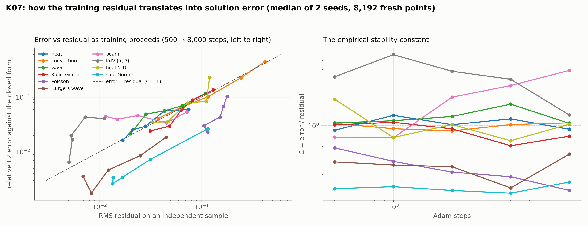

# K07: empirical stability constants

## Question

How does the training residual translate into solution error? Ratio of error to residual across PDEs and runs; compare with conditional-stability bounds (error ≤ C · (residual + quadrature error)).

## Setup

- **Problems** (catalogue entries with a closed form): heat, convection, wave, Klein–Gordon, Poisson, the Burgers travelling wave, the Euler–Bernoulli beam, the two-parameter KdV soliton (data-augmented, since it collapses without data), heat in 2-D, the sine-Gordon kink.
- **Budgets:** the same run evaluated at 500, 1,000, 2,000, 4,000 and 8,000 Adam steps (4 × 64 tanh MLP, 1,000 collocation points, weights 1 / 10 / 10). 2 seeds.
- **Diagnostic** (`pinnrl.analysis.stability_ratio`): on 8,192 fresh uniform points of the domain, not the training points, the RMS residual of the equation, the RMS boundary and initial mismatches, the relative L2 error against the closed form, and $C = \text{error} / \text{residual}$.
- **Code:** `run.py`, `plot.py`.

Rerun with:

```bash
python experiments/K07_stability_constants/run.py --seeds 2 --workers 4
python experiments/K07_stability_constants/plot.py
```

## Result



Medians over 2 seeds at three of the five budgets, and the slope of $\log(\text{error})$ against $\log(\text{residual})$ across all budgets and seeds.

| Problem | 500 steps: error / residual / C | 2,000 steps | 8,000 steps | Slope |
|---|---|---|---|---|
| heat | 0.060 / 7.5e-2 / 0.9 | 0.030 / 2.8e-2 / 1.0 | 0.016 / 1.7e-2 / 0.9 | 0.87 |
| convection | 0.445 / 4.2e-1 / 1.1 | 0.102 / 1.2e-1 / 0.9 | 0.041 / 3.8e-2 / 1.1 | 0.98 |
| wave | 0.117 / 1.1e-1 / 1.1 | 0.056 / 4.4e-2 / 1.3 | 0.021 / 2.0e-2 / 1.1 | 0.88 |
| Klein–Gordon | 0.137 / 1.3e-1 / 1.0 | 0.059 / 6.4e-2 / 0.9 | 0.024 / 3.1e-2 / 0.8 | 1.30 |
| Poisson | 0.104 / 1.8e-1 / 0.6 | 0.044 / 1.5e-1 / 0.3 | 0.023 / 1.2e-1 / 0.2 | 1.45 |
| Burgers wave | 0.019 / 4.5e-2 / 0.4 | 0.005 / 1.2e-2 / 0.4 | 0.004 / 6.9e-3 / 0.5 | 1.18 |
| beam | 0.054 / 7.2e-2 / 0.8 | 0.046 / 2.4e-2 / 2.0 | 0.045 / 1.1e-2 / 3.9 | 0.04 |
| KdV (α, β) | 0.041 / 1.1e-2 / 3.4 | 0.020 / 5.3e-3 / 3.8 | 0.006 / 5.0e-3 / 1.3 | 1.62 |
| heat 2-D | 0.230 / 1.2e-1 / 1.9 | 0.078 / 7.3e-2 / 1.0 | 0.035 / 3.3e-2 / 1.0 | 1.35 |
| sine-Gordon | 0.027 / 1.2e-1 / 0.2 | 0.003 / 1.7e-2 / 0.2 | 0.003 / 1.4e-2 / 0.2 | 1.05 |

For the beam the boundary and initial mismatches at 8,000 steps (1.2e-2 each) are as large as the residual (1.1e-2) and the error (4.5e-2) stalls from 2,000 steps on.

## Conclusion

1. **For the linear evolution equations the constant is 1.** Heat, convection, wave, Klein–Gordon and heat in 2-D have $C$ between 0.8 and 1.3 at every budget and a slope near 1: the error falls in proportion to the residual, with a stability constant of order one, as the energy estimates for these well-posed problems say it should. For these equations the training residual on an independent sample *is* a usable error estimate.
2. **Scale and nonlinearity change the constant, not the law.** Poisson ($C \approx 0.2$–$0.6$) and sine-Gordon (0.2) have large residuals relative to the error because the residual carries the source term's scale ($2\pi^2$) or a large nonlinear term; the Burgers wave (0.4–0.5) and the KdV soliton (1.3–3.8) have constants away from 1 but slopes of 1.2–1.6, so the error still tracks the residual. The constant is a property of the equation, which is what the conditional-stability theory claims, and a per-equation calibration of $C$ from a closed-form case makes the residual an error estimate for cases without one.
3. **The beam violates the residual law because the residual is not the whole right-hand side.** Its error stalls at 4.5 % while the residual falls fourfold, and its boundary and initial mismatches stop falling at the level of the residual. The estimate $\text{error} \le C(\text{residual} + \text{boundary} + \text{initial} + \text{quadrature})$ holds; the estimate with the residual alone does not. The fourth-order operator makes the boundary conditions (two per end) the binding terms, which the loss weights of 10 do not enforce strongly enough.
4. **An independent sample is necessary.** The residual on the training points is the quantity the optimizer minimizes; the residual on fresh points includes the quadrature gap of the error estimate, and it is the one that correlates with the error. `stability_ratio` reports the four terms separately for this reason.

**Consequences for the backlog:**
- K33 (consistency vs convergence) has its first counterexample, the beam: the residual converges, the error does not, and the boundary terms explain it. Allen–Cahn and convection with large speeds are the cases to add.
- K38 (quadrature error): compare the training-point residual with the independent one as the point count grows, which this driver can do with one more column.
- The error estimate the package reports for a problem without a closed form should be $C \cdot (\text{residual} + \text{boundary} + \text{initial})$ with $C$ taken from the nearest calibrated equation and stated as such.
