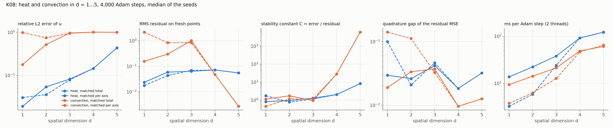

# K08: dimension scaling of stability constants and quadrature error

## Question

How do stability constants and quadrature error grow with dimension?

## Setup

- **Problems**, built with `CustomPDE` so that the solution has the same shape and time scale in every $d$:
  - heat, $u_t = (\alpha/d) \sum_i u_{x_i x_i}$ on $[0, 1]^d \times [0, 1]$, $u = e^{-\alpha \pi^2 t} \prod_i \sin \pi x_i$, Dirichlet 0, $\alpha = 0.1$;
  - convection, $u_t + (1/d) \sum_i u_{x_i} = 0$, $u = \prod_i \sin 2\pi (x_i - t/d)$, periodic.
  Note that $\|u\|_{L^2}$ shrinks as $2^{-d/2}$ with the product form, which matters for relative errors below.
- **Sampling arms:** a pool of 4,096 collocation points whatever $d$ (*matched total*), or $6^{d+1}$ points, 36 to 46,656 (*matched per axis*); the batch is capped at 4,096, so for $d \ge 4$ only the first 4,096 pool points enter each step and the two arms coincide.
- **Training:** tanh MLP 4 × 64, Adam $10^{-3}$, **4,000 steps**, pool refreshed every 50 steps, 512 boundary and initial points, weights 1 / 10 / 10. 2 seeds. Two threads per run.
- **Metrics** on 8,192 fresh uniform points after training (`pinnrl.analysis.stability_ratio`): the relative L2 error of $u$, the RMS residual, their ratio $C$ (the empirical stability constant of $\text{error} \le C\,(\text{residual} + \text{quadrature})$), the initial and boundary errors; the **quadrature gap**, the relative difference between the mean-squared residual over pools of the batch size and over the dense sample, and the **spread** of that estimate over 8 pools; and the time per step.
- **Code:** `run.py`, `plot.py`.

Rerun with:

```bash
python experiments/K08_dimension_scaling/run.py --seeds 2 --steps 4000 --workers 3
python experiments/K08_dimension_scaling/plot.py
```

## Result



Median of the two seeds, matched-total arm (4,096 points):

| Problem | $d$ | Rel. L2 error | RMS residual | $C$ | Initial error | Boundary error | Quadrature gap | Spread | ms / step |
|---|---|---|---|---|---|---|---|---|---|
| heat | 1 | 0.019 | 0.023 | 0.8 | 0.009 | 0.010 | 0.030 | 0.060 | 14 |
| heat | 2 | 0.054 | 0.059 | 1.0 | 0.016 | 0.018 | 0.026 | 0.036 | 22 |
| heat | 3 | 0.082 | 0.064 | 1.3 | 0.023 | 0.021 | 0.042 | 0.030 | 38 |
| heat | 4 | 0.145 | 0.071 | 2.0 | 0.029 | 0.022 | 0.018 | 0.051 | 92 |
| heat | 5 | 0.437 | 0.055 | 8.4 | 0.076 | 0.049 | 0.032 | 0.018 | 122 |
| convection | 1 | 0.179 | 0.155 | 1.2 | 0.036 | 0.126 | 0.019 | 0.021 | 9 |
| convection | 2 | 0.521 | 0.301 | 1.7 | 0.071 | 0.316 | 0.034 | 0.017 | 14 |
| convection | 3 | 0.960 | 1.01 | 1.0 | 0.074 | 0.393 | 0.037 | 0.115 | 21 |
| convection | 4 | 1.008 | 0.048 | 28 | 0.245 | 0.252 | 0.010 | 0.038 | 49 |
| convection | 5 | 1.000 | 0.0027 | 5,947 | 0.175 | 0.152 | 0.013 | 0.015 | 61 |

Matched per axis (36, 216, 1,296 points for $d = 1, 2, 3$): heat 0.031 / 0.036 / 0.079 error with quadrature gaps 0.100 / 0.021 / 0.046 and spreads 0.235 / 0.132 / 0.082; convection 0.985 / 0.749 / 0.947 with gaps 0.140 / 0.112 / 0.033 and spreads 0.70 / 0.34 / 0.14.

## Conclusion

1. **For heat the error grows with dimension while the residual does not, so the empirical stability constant grows: $C = 0.8, 1.0, 1.3, 2.0, 8.4$ for $d = 1 \ldots 5$.** Part of that is normalisation: the solution's norm shrinks as $2^{-d/2}$, so the same absolute error is a $2^{(d-1)/2}$ times larger relative one (a factor 4 at $d = 5$); the rest, a factor 2–3 by $d = 5$, is the initial and boundary errors, which grow faster than the residual (0.009 → 0.076 and 0.010 → 0.049) because 512 fixed points cover a 5-dimensional initial slab and ten 4-dimensional faces more thinly. The residual at the interior stays at 2–7 % whatever $d$: at a fixed budget the network's interior accuracy barely depends on dimension; its conditions do.
2. **Convection fails from $d = 2$ with this budget**, and the failure is of the kind the stability estimate does not see: at $d = 4, 5$ the network converges to $u \approx 0$, which satisfies the equation (residual $3 \times 10^{-3}$) but not the initial condition (error 0.18–0.25 of a unit-amplitude field, under the weight 10 it carries), so $C$ is meaningless there ($5{,}947$). An error bound of the form $C(\text{residual} + \text{quadrature})$ holds only with the condition terms included, as the theory page states; a surrogate with a small residual and a large initial error is not close to the solution. The hyperbolic problem with periodic conditions and a product initial condition of shrinking norm is the hard case (cf. H01): time marching or a larger initial weight is the known fix, not more points.
3. **The quadrature error does not grow with dimension.** At 4,096 points the gap between the training pool's residual and the dense sample's is 1–4 % for every $d$, and the spread of the estimate over pools goes down (0.06 → 0.02 for heat) as the residual field smooths; at 36 and 216 points the gap is 10–14 %, the $1/\sqrt{N}$ Monte Carlo law. This is the expected dimension independence of Monte Carlo quadrature; the cost of a dimension is not in the quadrature but in the cost per point: 14 → 122 ms per step from $d = 1$ to $5$ for heat, one second-derivative pass per axis.
4. **Matched per-axis sampling is not a sensible budget beyond $d = 3$.** $6^{d+1}$ points exceed the batch cap at $d = 4$ and the arms coincide; below it, 36 points in 1-D is a worse budget than 4,096 (error 0.031 vs 0.019, gap 0.10), so the per-axis rule mostly tests small pools in low $d$.

**Consequences for the backlog:** the stability constant reported in K07 should be read with the condition errors next to it (as `stability_ratio` already returns them); I10 (the cost of a dimension) is a per-point cost, so the quadrature point count need not grow with $d$; H01-style fixes (time marching, causal weighting) are the lever for high-dimensional convection, to be tested there.
