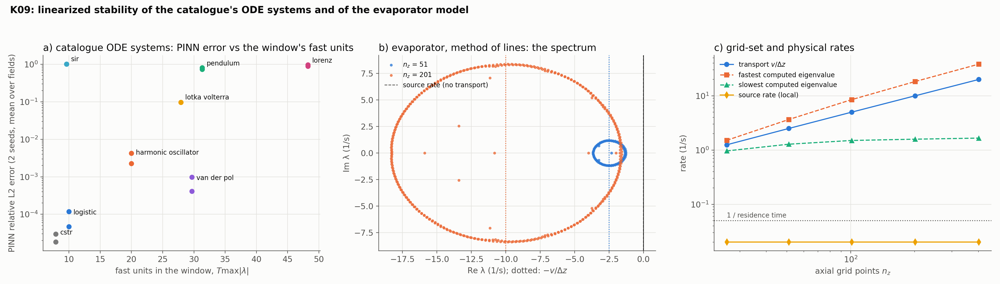

# K09: linearized stability of the catalogue's systems and of the evaporator

## Question

What are the linearized dynamics (eigenvalues of $\partial f / \partial s$) of the ODE systems in the catalogue and of the evaporator's method-of-lines system: are they stable, how stiff, and what does that say about the PINN's training on them?

## Setup

- **Part A, the catalogue's ODE systems:** logistic, harmonic oscillator, pendulum, Lotka–Volterra, Van der Pol, Lorenz, SIR, CSTR. The state-space form $\dot s = f(s)$ is read from the equations with SymPy (second-order equations as $(u, \dot u)$), the reference trajectory is integrated over the catalogue's window with `solve_ivp` (LSODA, $10^{-10}$), and the Jacobian along it gives, over 400 samples: the fastest rate $\max |\mathrm{Re}\,\lambda|$, the stiffness ratio $\max |\mathrm{Re}| / \min |\mathrm{Re}|$ (eigenvalues with $|\mathrm{Re}| < 10^{-8}$ counted as zero modes), the **fast units** in the window $T \max |\lambda|$, the oscillation count $T \max |\mathrm{Im}\,\lambda| / 2\pi$, and the perturbation growth $T \max \mathrm{Re}\,\lambda$.
- **Part B, the PINN on the same systems:** the clean recipe (normalized to the trajectory's mean and standard deviation per field, tanh 4 × 64, 2,048 collocation points, 256 initial points, Adam $10^{-3}$ for 2,000 steps then L-BFGS 100, weights residual / initial = 1 / 10, no regularization), 2 seeds; the relative L2 error against the reference on 401 times.
- **Part C, the evaporator** (`FallingFilmEvaporator.mol_rhs`, now exposed): the Jacobian of the method-of-lines system by central finite differences at the clean steady state for $n_z \in \{26, 51, 101, 201, 401\}$ and at the fouled state ($R_f = 2 \times 10^{-4}$) for 201, the inlet entries removed; the same for the source terms alone (velocity 0), whose $2 \times 2$ blocks per node give the local physical rates. Physical time scales: residence $L/v = 20$ s, evaporation $W_{\text{in}} / (P q_{\text{in}} / \lambda) / v = 126$ s, window 1,200 s.
- **Code:** `run.py` (2 s for A and C; the PINN part 7 minutes), `plot.py`.

Rerun with:

```bash
python experiments/K09_linearized_stability/run.py --seeds 2 --steps 2000 --workers 3
python experiments/K09_linearized_stability/plot.py
```

## Result



**A and B.** The spectrum along the reference trajectory and the PINN error (2 seeds).

| System | $T$ | Fastest rate | Stiffness | Fast units $T\max\lvert\lambda\rvert$ | Oscillations | Growth $T \max \mathrm{Re}\,\lambda$ | PINN rel. L2 |
|---|---|---|---|---|---|---|---|
| logistic | 10 | 1.0 | 241* | 10 | 0 | +8.0 | 0.0000, 0.0001 |
| harmonic oscillator | 10 | 0.2 | 1 | 20 | 3.2 | −2.0 | 0.002, 0.004 |
| pendulum | 10 | 0.05 | 1 | 31 | 5.0 | −0.5 | **0.74, 0.82** |
| Lotka–Volterra | 10 | 2.8 | 843 | 28 | 1.5 | +9.7 | 0.097, 0.097 |
| Van der Pol | 10 | 3.0 | 2,470 | 30 | 4.3 | +13.0 | 0.0004, 0.001 |
| Lorenz | 2 | 22.6 | 3,040 | 48 | 7.7 | +22.9 | **0.89, 0.97** |
| SIR | 50 | 0.19 | 1,750 | 9.6 | 0.7 | +9.6 | **1.01, 1.01** |
| CSTR | 5 | 1.5 | 1.2 | 7.9 | 0.4 | −6.3 | 0.0000, 0.0000 |

\* The ratio along a trajectory includes rates that pass through zero (the logistic's $r(1 - 2N/K)$ changes sign at $N = K/2$); for one-state systems it is not a stiffness. Lotka–Volterra's error is all in the prey ($x$: 0.19, $y$: 0.003), whose peak of 30 the network rounds.

The three failures are the same picture: the network returns the **trivial solution**. The pendulum collapses to $\theta \equiv 0$ (an exact solution of the equation; after Adam the initial-condition term is 3.1 and the residual 0.5, the initial condition is simply not paid), SIR to the disease-free state ($S \equiv 0.99$, $I \equiv 0$; the initial $I_0 = 0.01$ makes the trivial solution's initial error negligible), Lorenz to a flat field. The successes include a relaxation oscillator with 30 fast units and a growth of 13 (Van der Pol, whose trivial solution $x \equiv 0$ sits 2 away from the initial condition), so neither the fast-unit count nor the growth alone predicts the failure.

**C.** The evaporator's method-of-lines spectrum.

| $n_z$ | $v / \Delta z$ (1/s) | Computed eigenvalues: $\max \mathrm{Re}$ | fastest $\lvert\mathrm{Re}\rvert$ | radius of the cloud around $-v/\Delta z$ | Source rate alone, max / median (1/s) |
|---|---|---|---|---|---|
| 26 | 1.25 | −0.96 | 1.5 | 0.29 | +0.0203 / 0.0081 |
| 51 | 2.5 | −1.28 | 3.7 | 1.22 | +0.0203 / 0.0080 |
| 101 | 5 | −1.50 | 8.5 | 3.5 | +0.0203 / 0.0080 |
| 201 | 10 | −1.59 | 18.3 | 8.4 | +0.0203 / 0.0080 |
| 401 | 20 | −1.66 | 38.3 | 18.4 | +0.0203 / 0.0080 |
| 201, fouled | 10 | −1.63 | 18.4 | 8.4 | +0.0131 / 0.0056 |

The Jacobian takes 0.1 s at $n_z = 201$ (802 states).

## Conclusion

1. **The evaporator's method-of-lines operator is non-normal, and its computed spectrum is a pseudospectrum.** The upwind transport matrix has the single defective eigenvalue $-v/\Delta z$ (a Jordan block of size $n_z - 1$ per field); the computed eigenvalues scatter over a circle of radius $0.85\, v/\Delta z$ around it (figure, b), the signature of rounding on a defective matrix, not of the physics. The "stiffness ratio" of such a system (11 at $n_z = 201$, 23 at 401) is therefore not a meaningful number and the eigenvalue analysis of the theory page must be read on the source terms and the transport rate separately. The system is stable in every grid: $\max \mathrm{Re}\,\lambda < -0.96$ s⁻¹.
2. **The physics is convectively stabilised, and not stiff.** The source terms alone are locally *unstable*: their fastest rate is $+0.020$ s⁻¹ (a 50 s doubling: more solids raise the boiling point, lower the flux, but the evaporation of a thinner film concentrates faster), $+0.013$ s⁻¹ when fouled. The transport removes a perturbation in one residence time (20 s, a rate of 0.05 s⁻¹), 2.5 times faster than it grows, so a disturbance grows by at most $e^{0.4} = 1.5$ before it leaves the tube. The physical rates span 0.008 to 0.05 s⁻¹ (a factor 6); the grid-set rate $v / \Delta z = 10$ s⁻¹ at $n_z = 201$ is 500 times the source rate, which is why the reference solver needs BDF, and why a PINN, which has no grid, does not see this stiffness at all. The window holds 60 residence times and 10 evaporation times: that, and the sharpness of the inputs' changes (the step front of J02), is what the PINN has to resolve.
3. **On ODEs the PINN fails by the trivial solution, not by stiffness.** The two stiffest systems by the ratio (Van der Pol, 2,470; Lorenz, 3,040) are one success and one failure; the failures (pendulum, Lorenz, SIR) are the three whose equations admit an exact trivial solution close enough to the initial condition for the physics term, weighted $T / \text{scale}$ by the normalization, to prefer it over paying the initial condition. Five oscillations of a pendulum fail where 4.3 of a Van der Pol succeed. The fast-unit count still matters as the budget: every success has $T \max |\lambda| \le 30$. The remedies are the known ones, time-marching windows (H04) and causal weighting, and the diagnostic before training is cheap: integrate the trivial candidate's loss. *H04 (same day):* SIR is rescued by eight windows; the pendulum turns out to be a budget problem (0.3–3 % in one shot with 12,000 + 500 steps); Lorenz is rescued by nothing.
4. **For process twins the numbers to report are the physical rates and the window ratio**, not the eigenvalues of the discretised operator: the residence time, the source time scale, their ratio (2.5 here, convectively stable), and the number of residence times in the window (60). `mol_rhs` exposes the operator for the next model (J07, J10).

**Consequences for the backlog:** H04 (time-marching) gets the pendulum and SIR as test cases, with the trivial-solution loss as the diagnostic; the theory page's stiffness paragraph is amended (pseudospectra of transport operators); J07's spray-dryer model reports the same table.
