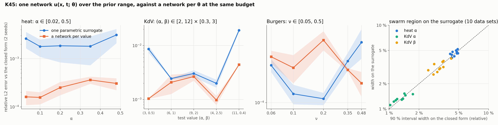

# K45: a parametric surrogate as the forward emulator

## Question

Can one network $u_w(x, t; \theta)$, trained once over the prior range of the parameters, replace a training run per $\theta$? With what accuracy across the range, at what cost per forward evaluation, and does the swarm of K46 recover the same equivalence region on it as on the closed-form misfit?

## Setup

- **Problems** (catalogue entries with a closed form, the parameters made inputs of the network with `CustomPDE(parametric=...)`):
  - heat, $\alpha \in [0.02, 0.5]$ (the K46 prior), physics only;
  - KdV soliton (`kdv_two_parameter`), $(\alpha, \beta) \in [2, 12] \times [0.3, 3]$, data-augmented with 2,000 noise-free observations over the box (the soliton collapses to zero without data);
  - Burgers travelling wave, $\log\nu \in [\log 0.05, \log 0.5]$, data-augmented likewise.
- **Part A, accuracy and cost.** Each surrogate is a tanh MLP 4 × 64 with the parameters appended to $(x, t)$, trained on 4,096 collocation points sampled jointly over the domain and the parameter box (refreshed every 50 steps), 512 boundary and 512 initial points, with Adam $10^{-3}$ for 4,000 steps then a safeguarded L-BFGS finish of 100 steps. It is scored at five parameter values across the range against the closed form (relative L2 on 4,000 random points), next to a **dedicated network** of the same architecture trained at each value with the same budget and settings. The box error is `pde.validate` on 4,000 random $(x, t, \theta)$. The cost of one forward evaluation of 10,000 points is timed. 2 seeds.
- **Part B, the swarm on the surrogate** (K46, second pass). For 10 noisy data sets of heat (200 points, noise 0.05, $\alpha = 0.1$) and KdV (200 points, noise 0.01, $(6, 1)$), the likelihood-ratio region sampled by `sample_equivalence_region` (30 particles, 100 iterations, seed 0 surrogate) with the surrogate's misfit (`pde.surrogate_misfit`, one batched network call per swarm step) is compared with the same swarm on the closed-form misfit: best fit, 90 % interval, coverage of the truth, time.
- **Code:** `run.py`, `plot.py`. Surrogates saved as `results/surrogate_{problem}_{seed}.pt`.

Rerun with:

```bash
python experiments/K45_parametric_surrogate/run.py --seeds 2 --datasets 10 --workers 4
python experiments/K45_parametric_surrogate/plot.py
```

## Result



**Part A.** Relative L2 error against the closed form (mean of 2 seeds), the surrogate at each test value next to a dedicated network at that value.

| Problem | θ | Surrogate | Dedicated | | Problem | θ | Surrogate | Dedicated |
|---|---|---|---|---|---|---|---|---|
| heat | 0.03 | 0.0026 | 0.0002 | | KdV | (3, 0.5) | 0.0086 | 0.0010 |
| | 0.1 | 0.0018 | 0.0002 | | | (6, 1) | 0.0024 | 0.0021 |
| | 0.2 | 0.0019 | 0.0003 | | | (9, 2) | 0.0030 | 0.0027 |
| | 0.35 | 0.0018 | 0.0004 | | | (4, 2.5) | 0.0020 | 0.0010 |
| | 0.48 | 0.0031 | 0.0003 | | | (11, 0.4) | 0.019 | 0.0044 |
| Burgers | ν = 0.06 | 0.0002 | 0.0002 | | | | | |
| | 0.1 | 0.0001 | 0.0002 | | | | | |
| | 0.2 | 0.0001 | 0.0003 | | | | | |
| | 0.35 | 0.0002 | 0.0002 | | | | | |
| | 0.48 | 0.0002 | 0.0001 | | | | | |

Box errors (seeds 0, 1): heat 0.0013, 0.0036; KdV 0.014, 0.008; Burgers 0.0002, 0.0002.

Cost, on a laptop CPU with two threads per job:

| Problem | Surrogate training | Five dedicated networks | Surrogate evaluation, 10,000 points |
|---|---|---|---|
| heat | 519 s | 2,080 s (≈ 415 s each) | 19–22 ms |
| KdV | 1,060–1,150 s | 3,360 s (≈ 670 s each) | 15–26 ms |
| Burgers | 570–600 s | 1,390 s (≈ 280 s each) | 26–37 ms |

**Part B.** The swarm on the surrogate against the swarm on the closed-form misfit, 10 data sets each.

| | heat α | KdV α | KdV β |
|---|---|---|---|
| Best fit, mean distance between the two (relative to the truth) | 0.2 % | 0.04 % | 0.3 % |
| … as a fraction of the closed-form interval width | 0.05 | 0.03 | 0.08 |
| 90 % width, closed form (relative) | 4.6 % | 1.3 % | 3.2 % |
| 90 % width, surrogate (relative) | 4.6 % | 1.3 % | 3.2 % |
| Coverage of the truth, closed form / surrogate | 8/10 | 7/10 | 7/10 |
| Scatter of the best fit across data sets, closed form / surrogate | 1.7 % / 1.7 % | 0.6 % / 0.6 % | 1.0 % / 1.0 % |
| Swarm time per data set, closed form / surrogate | 3 ms / 0.12 s | 4 ms / 0.15 s | |

Coverage is identical set by set: the three data sets the surrogate misses are the three the closed form misses.

## Conclusion

1. **One surrogate covers the range to 0.2–0.3 % on heat and Burgers, 0.2–2 % on KdV, at a quarter to a half of the cost of the dedicated networks.** On the heat equation the surrogate is 5–10 times less accurate than a network per value (0.2 % against 0.02–0.04 %), on Burgers it is as accurate (0.01–0.02 % both ways, the travelling wave is an easy function of $\nu$), and on KdV it matches the dedicated networks in the middle of the box (0.2–0.3 % at (6, 1), (9, 2)) and is 4–8 times worse at the corners, where the soliton is either very wide (3, 0.5) or very narrow and fast (11, 0.4). One training run of 9–19 minutes replaces five of 5–11 minutes each, and the gap would widen with every further value: a forward evaluation of 10,000 points costs 15–40 ms, so a swarm step of 30 particles on 200 points is one batched call of 6,000 points.
2. **The swarm on the surrogate is the swarm on the closed form.** Best fits agree to 0.04–0.3 % of the truth, a twentieth of the interval width; the 90 % widths agree to 1–3 %; coverage is the same data set by data set (8/10 on heat, 7/10 on KdV, the K46 under-coverage of the swarm's region, not the surrogate's). The surrogate's 0.2–0.3 % forward error is well below the 0.6–1.7 % scatter the data impose at these noise levels, so it is invisible in the region. This closes the gap K46 left: the equivalence region of a PINN inverse problem can be sampled on the PINN's own misfit without a closed form, at 0.1–0.2 s per data set.
3. **Where the surrogate is inaccurate, the region will be biased by about its error.** The KdV corner at (11, 0.4) has a 2 % forward error, ten times the scatter of $\alpha$ across data sets, so a region sampled near that corner would be displaced; the diagnostic is the dedicated-network check of Part A at the best fit (one extra training run), or the box error of `pde.validate` when a closed form exists. A larger network or a parameter-adaptive sampling of the box (more collocation points where the residual is large in $\theta$) is the lever.
4. **The data term is what makes a parametric surrogate trainable for wave problems.** Without observations the KdV soliton surrogate collapses to zero over the box (the trivial solution satisfies the equation and the far-field conditions); 2,000 clean points over the box fix it. For the plant twin (J-series) the records play that role.

**Consequences for the backlog:**
- K46 second pass done here: the swarm's forward model is the surrogate; the region's under-coverage remains K46's (the swarm's sampling of the edges, K47).
- The sampler for a density (K47's conclusion) can run on `pde.surrogate_misfit` at 10 ms per batch of 30 points.
- J-series: a parametric surrogate in the fouling resistance (or in the heat-transfer coefficient) of the evaporator would give the region of equivalence of the twin's state; J04 after J03.
