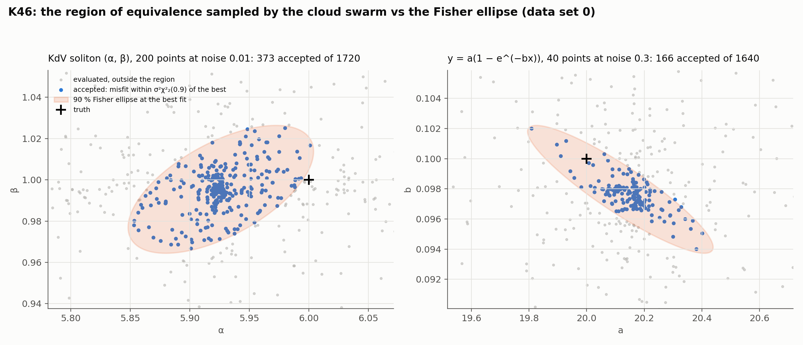

# K46: swarm sampling of the region of equivalence

## Question

Does an exploratory swarm recover the nonlinear region of equivalence that the Fisher ellipse misses?

## Setup

- **Forward maps with a closed form**, so the region sampled is the one the physics implies for a noisy data set, independent of any surrogate: heat $\alpha$ (200 points, noise 0.05); the two-parameter KdV soliton $(\alpha, \beta)$ (200 points, noise 0.01); and the saturation model $y = a(1 - e^{-bx})$ at 40 points with noise 0.3, the nonlinear example of Pallero et al. (2018) whose region is banana-shaped.
- **Sampler:** `pinnrl.uq.sample_equivalence_region`, a cloud generalized PSO (30–40 particles, 100–150 iterations, per-particle inertia, acceleration and time step drawn inside the second-order stability region, dispersion monitored). The accepted set is the likelihood-ratio region, positions within $\sigma^2 \chi^2_p(0.9)$ of the best misfit found.
- **Comparison:** the Fisher ellipse at the 90 % level centred on the best fit; the fraction of accepted samples inside it (1 for a linear problem, less where the region is curved); the width of the swarm's 90 % interval over the ellipse's; the correlation of the accepted samples against the ellipse's $\rho$; whether the truth lies in the swarm interval. 10 data sets per problem.
- **Code:** `run.py`.

Rerun with:

```bash
python experiments/K46_swarm_equivalence/run.py --datasets 10
```

## Result



Medians over 10 data sets per problem.

| Problem | Accepted / evaluated | Truth in the swarm's 90 % interval | Samples inside the 90 % Fisher ellipse | Swarm width / ellipse width | Sample correlation / ellipse ρ | Final dispersion |
|---|---|---|---|---|---|---|
| heat, α | 240 / 945 | 8 / 10 | 1.00 [0.99, 1.00] | 0.79 | – | 0.016 |
| KdV, (α, β) | 250 / 1,440 | 4 / 10 | 1.00 [0.98, 1.00] | 0.75 / 0.75 | +0.35 / +0.61 | 0.018 |
| saturation, (a, b) | 164 / 1,340 | 5 / 10 | 0.99 [0.94, 1.00] | 0.58 / 0.57 | −0.68 / −0.90 | 0.018 |

## Conclusion

1. **At these noise levels the regions are ellipses.** On all three problems 94–100 % of the accepted samples lie inside the 90 % Fisher ellipse centred on the best fit, including the saturation model that is banana-shaped at larger noise: the likelihood-ratio region of a mildly nonlinear problem with good data is the linearized one. The swarm confirms the ellipse rather than correcting it here; the cases where it would correct it are the F02 displaced optimum and noisier data, and those need the parametric surrogate (K45) to be affordable.
2. **The swarm under-samples the edges of the region.** The swarm's 90 % interval is 0.57–0.79 of the ellipse's width and its correlation is weaker than the ellipse's (+0.35 vs +0.61, −0.68 vs −0.90): the sample is dense near the best fit and thin near the acceptance boundary, because the particles converge and the run stops on collapse (dispersion 0.02 after 25–40 iterations). The retained samples are an approximation of the region, as the papers say, and not a uniform or a posterior sample of it; a percentile read from them is biased inward. This is why the truth falls in the swarm interval only 4–8 times in 10 instead of 9.
3. **Two fixes, both cheap, both to measure (K47).** Keep the swarm exploring once it has found the region (raise the time step or add repulsion, as the papers do, rather than stopping on collapse), and weight the retained samples by $\exp(-\text{misfit}/2\sigma^2)$ so that the dense centre does not dominate the percentiles. Until then the swarm interval is reported together with the ellipse, and the wider of the two is the honest one.

**Consequences for the backlog:**
- K47 (is the swarm sample a posterior sample?) is the next step, with the exploration-after-convergence and the likelihood weighting as its two arms, judged by coverage over data sets as in F06.
- K45 (parametric surrogate) is what makes the swarm applicable to the PINN's own misfit, where the region is known to be displaced (F02) and the ellipse is wrong.
