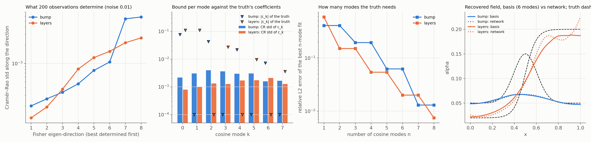

# K48: reduced bases for field unknowns

## Question

How many modes can be sampled, and which does the data leave free?

## Setup

The two coefficient fields of F09 on the heat equation, $u_t = (\alpha(x) u_x)_x$ with $u_0 = \sin \pi x$ and Dirichlet 0: the centred bump $\alpha = 0.05 + 0.1 e^{-((x-0.5)/0.15)^2}$ and the two-layer medium $\alpha = 0.02 + 0.18\,\sigma((x - 0.5)/0.05)$, written in a cosine basis $\alpha(x) = \sum_{k=0}^{n-1} c_k \cos k\pi x$. The data are F09's: 200 observations of $u$ at uniform random points, noise $\sigma = 0.01$.

- **Part A, Fisher (seconds).** $J_{ik} = \partial u(x_i, t_i) / \partial c_k$ by central differences of the method-of-lines reference (`heat_variable_reference`) around the truth, $\varepsilon = 0.002$, for $n = 8$ modes; $F = J^\top J / \sigma^2$, its eigenvalues and eigenvectors, the Cramér–Rao bound per mode, and the best $n$-mode projection error of each truth for $n = 1 \ldots 8$.
- **Part B, swarm (a minute each).** `pinnrl.uq.sample_equivalence_region` over the first 4 coefficients, with the reference solver as the forward model (one solve per particle and iteration, 24 particles × 60 iterations), sampling the likelihood-ratio region at 90 % around the best misfit found; the spread of the accepted samples along the Fisher eigenvectors against the ellipse's half-widths (K46 on a field).
- **Part C, training.** `UnknownFunction(basis={"type": "cosine", "modes": 6}, positive=True)` against F09's 2 × 32 network as the unknown, the F09 protocol (10,000 Adam steps, 200 observations, noise 0.01), 3 seeds. Metrics: the relative L2 error of $\hat\alpha$, and the cosine modes of the recovered field against the truth's.
- **Code:** `run.py`, `plot.py`.

Rerun with:

```bash
python experiments/K48_reduced_bases/run.py --seeds 3 --steps 10000 --workers 3
python experiments/K48_reduced_bases/plot.py
```

## Result



**Part A.** Cramér–Rao standard deviation of each mode coefficient at $\sigma = 0.01$ with an exact forward model, and the truth's coefficients (odd modes are zero by the symmetry of both truths about $x = 0.5$):

| Mode $k$ | 0 | 1 | 2 | 3 | 4 | 5 | 6 | 7 |
|---|---|---|---|---|---|---|---|---|
| bump: CR std | 0.0022 | 0.0030 | 0.0040 | 0.0036 | 0.0029 | 0.0030 | 0.0016 | 0.0016 |
| bump: $c_k$ | 0.077 | 0 | −0.043 | 0 | 0.022 | 0 | −0.007 | 0 |
| layers: CR std | 0.0008 | 0.0010 | 0.0013 | 0.0013 | 0.0017 | 0.0017 | 0.0021 | 0.0013 |
| layers: $c_k$ | 0.110 | −0.110 | 0 | 0.027 | 0 | −0.010 | 0 | 0.004 |

The Fisher eigenvalues span $2.5 \times 10^7$ to $3.0 \times 10^4$ (bump) and $6.2 \times 10^7$ to $1.4 \times 10^5$ (layers): condition numbers 840 and 430, no null space. The worst-determined direction has a standard deviation of 0.006 (bump) and 0.003 (layers), a tenth of the bump's height and a sixtieth of the layers' contrast. The best $n$-mode fit of the truth has relative error 0.41, 0.20, 0.06, 0.013 for $n = 1, 3, 5, 7$ (bump) and 0.59, 0.15, 0.05, 0.02, 0.007 for $n = 1, 2, 4, 6, 8$ (layers).

**Part B.** Swarm over 4 coefficients, 1,440 reference solves:

| Truth | Accepted | Best misfit | Misfit at the truth's projection | Best − projection along eigenvectors | Swarm / Fisher half-widths |
|---|---|---|---|---|---|
| bump | 29 | 317 | 2,601 | (−0.004, 0.001, −0.031, 0.004) | 0.50, 0.36, 0.33, 0.19 |
| layers | 47 | 272 | 1,178 | (0.003, −0.009, 0.001, −0.004) | 0.74, 0.38, 0.35, 0.33 |

**Part C.** Median [min, max] over 3 seeds at step 10,000:

| Truth | Unknown | Rel. L2 of $\hat\alpha$ | Rel. L2 of $u$ |
|---|---|---|---|
| bump | 6-mode basis | 0.409 [0.397, 0.413] | 0.019 |
| bump | network (F09) | 0.405 [0.395, 0.409] | 0.021 |
| layers | 6-mode basis | 0.146 [0.136, 0.161] | 0.031 |
| layers | network (F09) | 0.123 [0.114, 0.175] | 0.022 |

Cosine modes of the recovered basis field (seed 0; the other seeds agree to 3 digits) against the truth's:

| | $c_0$ | $c_1$ | $c_2$ | $c_3$ | $c_4$ | $c_5$ |
|---|---|---|---|---|---|---|
| bump: truth | 0.077 | 0 | −0.043 | 0 | 0.022 | 0 |
| bump: recovered | 0.058 | 0.001 | −0.011 | −0.001 | 0.001 | 0.000 |
| layers: truth | 0.110 | −0.110 | 0 | 0.027 | 0 | −0.010 |
| layers: recovered | 0.104 | −0.092 | 0.004 | 0.010 | −0.003 | −0.001 |

## Conclusion

1. **The data leave no mode free.** With an exact forward model, 200 noisy observations determine all eight cosine modes of either field to 0.001–0.006, with no null space ($\kappa(F) < 10^3$). The sensitivity of $u$ to a mode falls with its wavenumber, as diffusion smooths it, but at this noise even mode 7 is determined to 0.0016. So F09's collapse of the bump to a constant is **not a property of the data**: it is the surrogate's. This corrects the first reading of F09.
2. **A basis is no better than a network, and the error is systematic.** The 6-mode basis recovers the same field as the network (0.41 vs 0.41 for the bump, 0.15 vs 0.12 for the layers), with its coefficients reproducible across seeds to three digits: the PINN's estimate of $c_2$ for the bump is −0.011 for a truth of −0.043, and of $c_3$ for the layers 0.010 for 0.027, on every seed. The surrogate has a biased optimum in the field, 10–50 Fisher standard deviations from the truth, exactly as F02 found for the KdV pair. The limit of field identification in this package is the forward accuracy of the PINN (its 2–3 % field error here), not the number of modes nor the data; the lever is forward accuracy, and the diagnostic is the best-constant check of F09 read against the surrogate's field error. These runs used the packaged weight decay and gradient clipping, which D01 and the F01 `--clean` rerun identified as the cause of the scalar floor (0.1–0.2 % field error without them); the field cases are to be rerun clean before the 0.4 bump error is called final.
3. **The reference solver is a usable forward model for the swarm, and the truncated basis is the problem there.** 1,440 solves per field take a minute. The swarm under-samples the likelihood region, at 0.2–0.7 of the Fisher half-widths (K46 found 0.6–0.8 with closed forms; here with fewer evaluations per dimension), and its best 4-mode fit lies 10 Fisher half-widths from the $L^2$ projection of the truth along the third eigenvector for the bump: the 4-mode truncation (19 % projection error) is model-form error that the misfit minimiser absorbs into the modes the data weigh most. Sampling a field needs a basis fine enough that its truncation error is below the noise, which for these fields means 7–8 modes.

**Consequences for the backlog:** K45 (a parametric surrogate $u_w(x, t; c)$ over the coefficients) is the way to make the swarm's forward model a network rather than a solver, and the surrogate bias of conclusion 2 is what it must beat; F08 (model-form error) has its first quantitative case in the truncated basis; the forward-accuracy items D01/D02 are now the bottleneck for every field identification.
